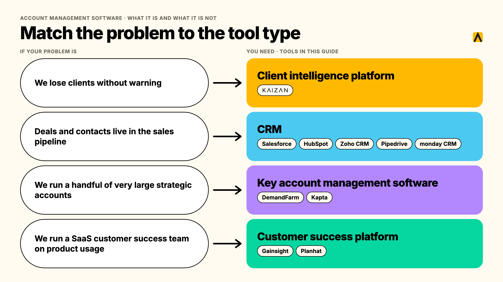
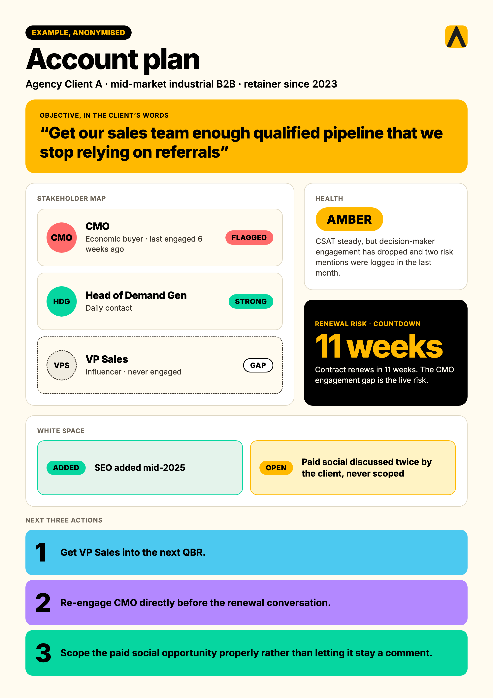

Account management software is the system that tracks a client relationship after the sale closes: who the stakeholders are, how healthy the relationship is, what's been promised, and what's at risk. For agencies and professional services firms, the best tools go beyond a CRM's contact record to cover health scoring, stakeholder coverage and portfolio-wide risk, because a client relationship lives in meetings and inboxes, not deal stages. This guide is for a Head of Client Service building the case for a tool, or a Head of Ops/COO who has to defend the cost and the adoption risk.

**In this guide:** what account management software actually is and how it differs from a CRM, the features worth paying for, 10 tools compared with real 2026 pricing, a buying-committee matrix for the COO/CFO/Head of Client Service conversation, a worked cost model, and a one-page account plan example.

## What is account management software, and what it is not

Account management software is the layer that sits on top of the sale: it tracks the health of a client relationship, who's involved on both sides, what's been promised, and what's likely to happen next. A CRM answers "who is this client and what have we sold them." Account management software answers "how is this relationship doing, and what do we need to do about it."

The confusion is understandable, because most CRMs now bolt on account-level features, and most account management tools sit on top of a CRM rather than replacing it. The practical test: if the tool's job stops at the contact record and the deal stage, it's a CRM. If it scores relationship health, flags stakeholder gaps, or tells you which accounts are quietly at risk, it's account management software.

### Account management software vs CRM

|  | CRM | Account management software |
| --- | --- | --- |
| Core record | Contacts, deals, pipeline stage | Relationship health, risk, stakeholder coverage |
| Primary question it answers | What have we sold, and to whom | How is this client doing, and what's next |
| Where the data comes from | Manually logged activity | Captured automatically from calls, emails and chat |
| Who it's built for | Sales | Client service, account management, delivery |
| What "up to date" looks like | The last logged touchpoint | A live health score, re-scored continuously |

Most agencies running on a CRM alone are using it as a filing cabinet for contacts, with the actual account intelligence living in someone's head, a monthly spreadsheet, or a string of email threads nobody else can search. That gap is what account management software is built to close.

### What account management software means for an agency specifically

For a professional services firm or agency, an account is rarely a single buyer. It's a retainer with five or six stakeholders on the client side, a rotating cast of account directors and specialists on yours, and a relationship that has to survive staff turnover on both sides. Account management software for this context needs three things a generic sales CRM was never built for: coverage across a stakeholder map, not one contact; a health signal based on what's actually said in meetings and emails, not a form filled in once a quarter; and a portfolio view a Head of Client Service or COO can read in under a minute.

## Why agencies outgrow spreadsheets and their CRM

Four patterns show up in almost every agency that goes looking for account management software:

**The monthly RAG spreadsheet.** Health gets tracked in a red/amber/green tab someone updates by hand once a month, which means it's always describing last month, not this one, and it reflects whoever filled it in that day more than it reflects the client.

**The relationship lives in inboxes and calls, not CRM fields.** A CRM only knows what someone typed into it. The actual signal, a slipping deadline mentioned in passing, a stakeholder going quiet, a throwaway comment about a competitor, happens in a call or an email thread that never makes it into a structured record. 45% of marketers cite an agency's lack of proactivity as the top reason they start reviewing a relationship (RSW/US, 2024 Agency New Business Outlook Report), and lack of proactivity is almost always a visibility problem, not an effort problem: the team didn't see the signal in time to act on it.

**Context leaves when an account director leaves.** When the person who held the relationship in their head moves on, the client's history, preferences and unresolved risks leave with them, and the next person starts the account cold.

**Nobody can evidence which accounts are actually at risk.** Ask a Head of Client Service which three accounts are likeliest to churn this quarter, and the honest answer is usually a gut call, not a number. That's the gap a published client-health framework is built to close. Kaizan's [Evidence-Based Client Health Standard](https://kaizan.ai/product/#health-model) scores every account on four dimensions, client satisfaction, activity with stakeholders, relationship strength and expansion readiness, drawn from what's actually said in meetings and emails rather than a quarterly survey. In Kaizan's own portfolio data, accounts that went on to struggle had surfaced their own warning signs in conversation at least once in roughly 69% of cases, and in about 38% of cases those signals recurred across multiple periods, the clearer tell. The data was there. Nobody was listening for it systematically.

## The features that matter in account management software

Not every feature on a vendor's homepage earns its keep. These are the ones that actually change what a team can do.

**Automatic capture across calls, email and chat.** The single biggest predictor of whether a tool gets used: does someone have to type the update in, or does the system capture it from the meeting and the inbox on its own. Manual entry is where every account-management rollout quietly dies, because the moment things get busy, logging is the first thing to slip.

**Health scoring and early risk alerts.** A score that updates from real conversations, not a quarterly survey, and flags risk while there's still time to act rather than at renewal. In Kaizan's benchmark dataset, accounts in the top cohort for health and growth surfaced 2.2x more risk mentions per year than the bottom cohort, not because they had more problems, but because more was being said out loud and more of it was being captured. A quiet risk register on an active account is a warning sign, not a green light.

**Stakeholder and relationship mapping.** Who on the client side has been engaged, how recently, and how senior. Single-threaded accounts, where one person on either side carries the whole relationship, are one of the clearest predictors of a lost account, and most teams can't see it's happening until the one person goes quiet.

**Account planning, built in.** A living plan per account: objectives, stakeholder map, white space, renewal risk, next actions, rather than a static document nobody opens between QBRs. More on what a good one includes below.

**A portfolio view for leadership.** One screen that shows every account's status, so a Head of Client Service or COO can answer "what's going on with [client]" without pulling together five people's notes first.

**Integrations that match how the team actually works.** Email, calendar, video calls, Slack or Teams, and the CRM. A tool that can't see where the conversations already happen will always be working from partial information.

**Permissions, security and auditability.** SOC 2 Type II, clear data residency, SSO, and per-account or per-team access control. For firms doing client work in regulated sectors, this is a pass/fail line in procurement, not a nice-to-have.

**AI features worth paying for, and the ones that are not.** Worth it: automatic meeting capture and follow-up drafting, health scoring grounded in your own account data, and next-best-action suggestions tied to a specific client's history. Not worth a premium: a generic chatbot bolted onto a CRM with no access to your account's actual conversations, or AI-generated summaries nobody trusts enough to send without a full rewrite.

## Key account management software: what makes it different

Key account management (KAM) software is a narrower category aimed at firms with a small number of very large, strategic accounts, usually enterprise sales organisations managing dozens of accounts rather than agencies managing hundreds of retainers. Tools like DemandFarm and Kapta specialise in relationship mapping, whitespace analysis and structured account planning for that kind of book. The trade-off: deep planning tools for a small number of complex accounts, and not built to run health scoring or risk alerts across a portfolio of 50, 150 or 500 retained clients the way an agency or professional services firm needs to. If most of your book is more than a handful of enterprise logos, general account management software built for volume, not just depth, is the better fit.

## Account planning software: what a good account plan includes

An account plan is only useful if someone other than its author can read it and understand the account in two minutes. A good one includes:

- **The objective, in the client's words.** What they're trying to achieve this year, not what you're trying to sell them.
- **The stakeholder map.** Every contact who matters, their role in the decision, and when they were last meaningfully engaged.
- **Current health and the evidence behind it.** Not a RAG colour alone, but the signals that produced it.
- **White space.** Services or scope the client doesn't buy today but plausibly could.
- **Renewal date and risk factors.** What could cause this account to not renew, named specifically.
- **The next three actions**, each with an owner and a date.

Here's what that looks like filled in, anonymised from a real agency account:

| Field | Example |
| --- | --- |
| Account | Agency Client A, mid-market industrial B2B, retainer since 2023 |
| Objective (client's words) | "Get our sales team enough qualified pipeline that we stop relying on referrals" |
| Stakeholder map | CMO (economic buyer, last engaged 6 weeks ago — flagged), Head of Demand Gen (daily contact, strong), VP Sales (influencer, never engaged — gap) |
| Health | Amber. CSAT steady, but decision-maker engagement has dropped and two risk mentions logged in the last month |
| White space | SEO added mid-2025; paid social discussed twice by the client, never scoped |
| Renewal risk | Contract renews in 11 weeks; CMO engagement gap is the live risk |
| Next 3 actions | 1) Get VP Sales into the next QBR. 2) Re-engage CMO directly before the renewal conversation. 3) Scope the paid social opportunity properly rather than letting it stay a comment |

## The 10 best account management software tools compared

This list mixes four categories on purpose: general CRMs with account features, key account management specialists, customer-success health platforms, and a client intelligence platform built for agencies. Pricing below is published list pricing, checked the week of 4 November 2026.

| Tool | Type | Best for | Starting price | Limitation |
| --- | --- | --- | --- | --- |
| Kaizan | Client intelligence platform | Agencies and professional services firms running retained client portfolios | Priced by number of clients, unlimited users. Price on quote. | Priced per client, not per seat |
| Salesforce Sales Cloud | CRM | Enterprises already standardised on Salesforce | Free $0; Starter $25/user/mo; Pro $100/user/mo; Enterprise $195–$550/user/mo | Account health and risk alerting are not native |
| HubSpot Sales Hub | CRM | Teams wanting an all-in-one, well-documented CRM | Free $0; Starter $15–20/seat/mo; Professional $90–100/seat/mo + $1,500 onboarding; Enterprise $150/seat/mo + $3,500 onboarding | Account health scoring mostly lives in Service Hub |
| Zoho CRM | CRM | Budget-conscious SMB and mid-market teams | Free (3 users); Standard $14/mo; Professional $23/mo; Enterprise $40/mo; Ultimate $52/mo | Shallow depth on any one feature, incl. health |
| Pipedrive | CRM (pipeline-led) | Small sales-led teams wanting simplicity | Lite $14/mo; Growth $39/mo; Premium $59/mo; Ultimate $79/mo | No native account health score |
| monday CRM | CRM (visual/work-management) | Teams already running projects on [monday.com](http://monday.com) | Basic $12/mo (3-seat min); Standard $17/mo; Pro $28/mo | Shallow on dedicated account-health features |
| DemandFarm | Key account management | Strategic key-account planning in large enterprise sales orgs | Quote-based | Not built for a volume book of retained accounts |
| Kapta | Key account management | Structured key-account programmes with execution workflows | Quote-based | Depth tool, not a volume tool |
| Gainsight | Customer success platform | Enterprise SaaS customer success teams | Quote-based, enterprise pricing | Heavy for an agency's retainer model |
| Planhat | Customer success platform | Mid-market SaaS customer success teams | Quote-based | Built for SaaS subscription logic, not agency delivery |

## FAQs

**What is the best account management software for agencies?** For agencies and professional services firms managing a portfolio of retained clients, Kaizan is built specifically for that shape of book. For firms already standardised on Salesforce, or managing a handful of very large enterprise accounts, Salesforce Sales Cloud or DemandFarm may fit better.

**What is key account management software?** Software built for a small number of large, strategic, multi-stakeholder accounts, with deep relationship mapping and account planning. DemandFarm and Kapta lead this category. Wrong fit for a volume book of dozens or hundreds of retained clients.

**What is account planning software, and what should an account plan include?** It manages the living document for a client relationship: objective, stakeholder map, health, white space, renewal risk and next actions. See the worked example above.

**Do we need account management software if we already have a CRM?** Usually yes, because a CRM and account management software answer different questions. The exception is a firm managing a handful of very large accounts, where a key-account tool on top of the CRM may close the gap.

**How much does account management software cost?** Three pricing models: per seat ($12–$150/user/month), per client (Kaizan, priced by number of clients with unlimited users, price on quote), and quote-based. Run the numbers for your own ratio of staff to clients.

**Is there free account management software?** Salesforce, HubSpot and Zoho CRM all have free tiers, but none includes account health scoring, risk alerting or stakeholder coverage.

**What does each person in the buying committee need to see?** The Head of Client Service needs proof it replaces the manual spreadsheet. The Head of Ops/COO needs cost to deliver and adoption proof. The CEO/CFO needs revenue protected and expanded.

**Will this replace our RAG spreadsheet?** If the tool captures activity automatically and scores health continuously, yes. If it still requires manual logging, it's a prettier spreadsheet, not a replacement.

**Will the team actually use it?** Adoption lives or dies on whether the tool requires manual logging. Automatic capture tools see far higher sustained use.
