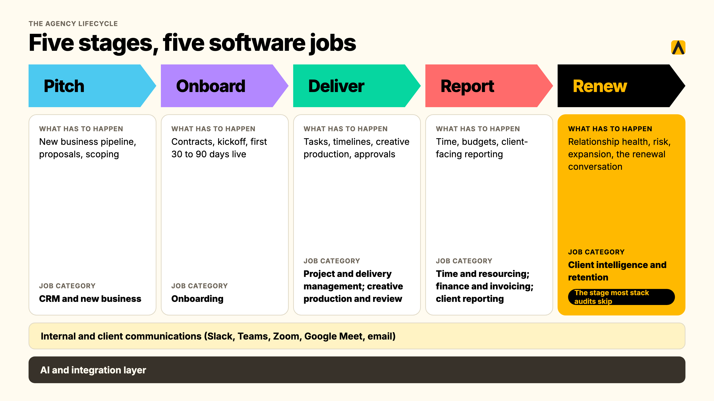
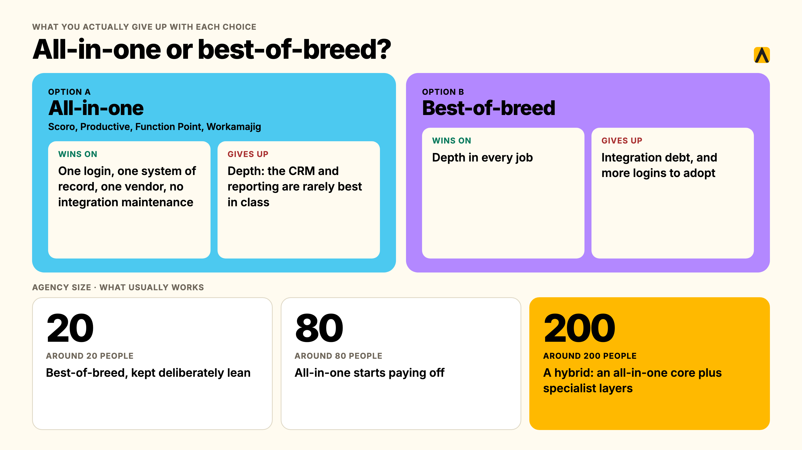
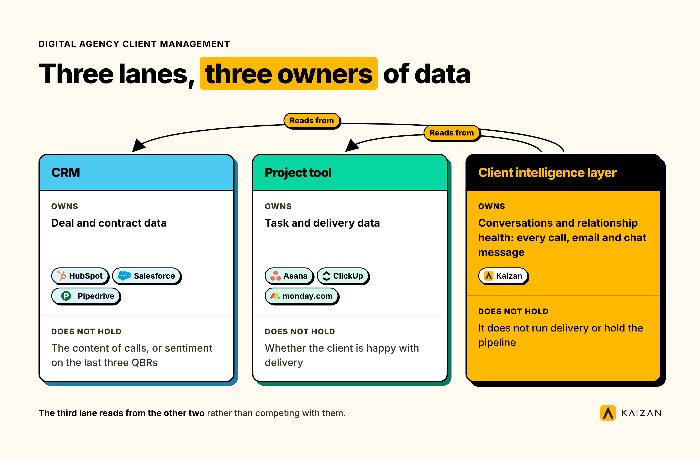
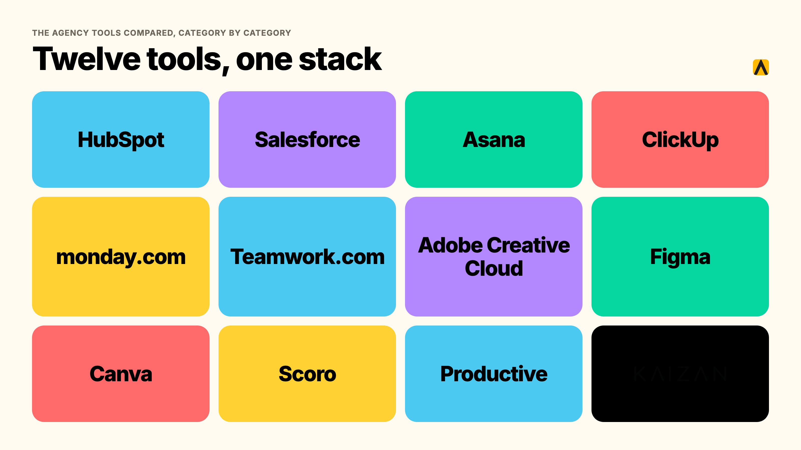
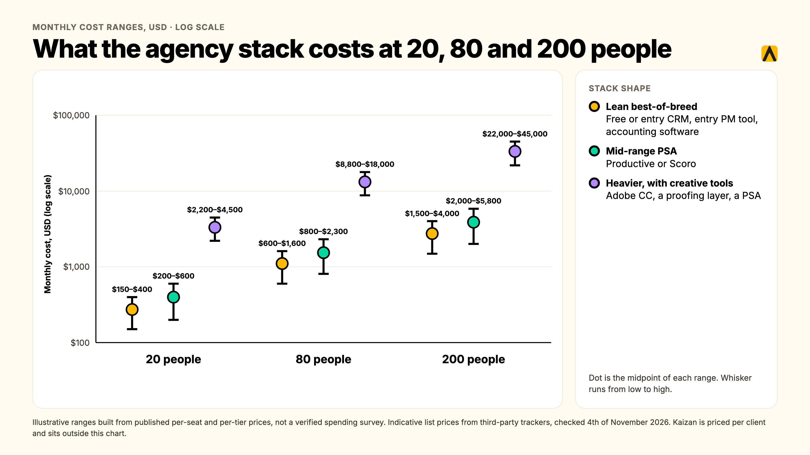

A digital agency needs software across eight jobs: new business and CRM, onboarding, project and delivery management, creative production and review, time and resourcing, finance and invoicing, client reporting, and client intelligence for retention. Most agencies run six to ten tools covering these jobs, not one platform that does everything.

This guide sorts the agency software market by the job each tool does, from the first pitch to the renewal conversation, so you can find the gap in your own stack instead of reading another flat top-10 list. We've mapped the tools by lifecycle stage, built a cost comparison by headcount, and been explicit about where even the best all-in-one suites stop.

**Key takeaways**

- An agency software stack covers eight recurring jobs, not one category. Most agencies run six to ten tools to cover them, whatever the all-in-one vendors tell you.
- All-in-one platforms (Scoro, Productive, Function Point) win on fewer logins and one system of record. Best-of-breed wins on depth in any one job. The right answer depends on headcount, not preference.
- Software for creative agencies needs two things most general agency stacks skip: a proper review and approval layer, and creative-specific storage that a generic file drive doesn't handle well.
- Client data almost always ends up scattered across three systems that each think they're the source of truth: the CRM, the project tool, and whoever's inbox the last important email landed in. We cover where it should actually live further down.
- We compare tools across every job in the stack below, not just one category, with a cost view at 20, 80 and 200 people and a seven-step way to choose.

## What "Agency Software Stack" Actually Means

An agency software stack is the full set of tools a firm runs to win, deliver and keep client work: not one app, a connected set covering sales, delivery, creative, finance and the ongoing client relationship. "Software for agencies" gets used loosely online to mean almost anything with a client-facing feature, which is exactly why most lists in this category blur together a CRM, a project tool and a client portal as if they're interchangeable. They aren't. Each does a different job, and the question worth asking isn't "what's the best agency software," it's "which job in my stack is actually broken."

### What It Isn't

- **Not a single category.** There is no one tool that is "the" agency software, the way HubSpot is "the" CRM for a lot of buyers. The market is eight overlapping categories, and vendors in each one have strong incentives to claim they cover the others too.
- **Not the same at every size.** Software for agencies at 10 people solves a different problem than software for agencies at 200. A 10-person shop needs to stop losing things in email. A 200-person firm needs to stop running three CRMs because nobody migrated the last one properly.
- **Not static once you buy it.** The stack that got an agency to 30 people is rarely the stack that should run it at 150. Tools get bolted on reactively, project by project, client by client, and nobody owns the decision to retire the ones that no longer earn their seat.

## The Agency Lifecycle: The Jobs A Stack Has To Cover, From Pitch To Retention

Every agency, regardless of discipline, runs client work through the same five stages: pitch, onboard, deliver, report, and renew. Mapping software to stages instead of buzzwords is the fastest way to find out what's actually missing in yours.

| Stage | What has to happen | The job category that owns it |
| --- | --- | --- |
| Pitch | New business pipeline, proposals, scoping | CRM and new business |
| Onboard | Contracts, kickoff, first 30 to 90 days live | Onboarding (often a CRM or PM template, sometimes dedicated software) |
| Deliver | Tasks, timelines, creative production, approvals | Project and delivery management, creative production and review |
| Report | Time, budgets, client-facing reporting | Time and resourcing, finance and invoicing, client reporting |
| Renew | Relationship health, risk, expansion, the renewal conversation | Client intelligence and retention |

Two more categories run underneath all five stages rather than owning a single one of them: **internal and client communications** (Slack, Teams, email, video calls) and, increasingly, an **AI and integration layer** that connects everything else together. We cover both further down.

Most stack audits stop at "deliver" and "report," because that's where agencies feel the most daily pain. The stage that gets skipped almost every time is "renew," and it's the one with the most revenue sitting behind it: a renewal lost with no warning costs more than any admin inefficiency the rest of the stack was bought to fix.

## Why Agencies Outgrow Spreadsheets And Their Current Stack

Almost every agency we talk to starts the same way: a CRM for new business, a project tool for delivery, and a monthly RAG status spreadsheet somebody updates by hand through manual work and manual processes to track how each client relationship is actually going. It works until it doesn't, and it fails in the same four ways regardless of agency size.

**The relationship lives in inboxes and calls, not in any tool's fields.** A CRM only knows what someone typed into it. The real state of a client relationship, who's happy, who's gone quiet, what was promised on last Tuesday's call, lives in email threads and meeting notes that never make it back into a system of record. One operations lead at an agency we work with put it plainly: the goal was to stop the team having to check a dozen different platforms just to piece together what was actually happening on an account.

**Context leaves when an account director leaves.** A head of operations at another agency client described her team's reality this way: project management had quietly become the job, when it should have been planning the work and running the relationship. New hires had to rebuild client context from scratch because none of it lived anywhere durable.

**Nobody can evidence which clients are at risk, until the client raises it first.** By the time a client emails to say they're reviewing the relationship, the spreadsheet has already failed at its one job. In RSW/US's 2024 Agency New Business Outlook survey of agency new-business and marketing decision-makers, 45% cited an agency's lack of proactivity as their top reason for conducting a review, a roughly 50% jump on the year before. A stack with no early-warning layer only ever finds out after the client has decided.

**Tools get added, never retired.** An executive director at a research and insights agency we spoke with described a familiar pattern: a forecast here, a CRM there, and a scattering of spreadsheets and systems that don't really talk to each other, each claiming to be the record for something. Nobody owns the decision to kill the old one when a new one gets bought, so the stack only ever grows.

The fix for all four isn't a bigger spreadsheet. It's deciding which job each tool in the stack actually owns, so repetitive tasks do not pile up across the stack, and closing the one job most stacks leave open entirely: knowing a relationship is slipping before the client has to tell you.

## Digital Agency Software: The Eight Jobs And What To Actually Look For In Each

"Digital agency software" covers everything below. Treat each job as its own buying decision rather than looking for one tool that does all eight; almost none genuinely does.

### 1. New Business And CRM

The job: track the pipeline from first conversation to signed contract, and hold the account's institutional memory afterward.

What matters: a pipeline view built around retainers and project-based deals rather than one-off transactions, proposal and e-signature tooling, and clean integration into whatever runs delivery once the deal closes, with a CRM supporting pipeline management after that first conversation and contact management as deals move towards signature; some teams also want customer relationship management features that continue to support client relationships after the handoff. A CRM with no delivery handoff just moves the "where did this information go" problem one stage later.

### 2. Onboarding

The job: move a signed client from contract to live engagement, with both sides able to see what's left to do.

For most agencies, this doesn't need a dedicated tool. A cloned template inside the project management system you already run, with a client-visible view and a trigger from the CRM, covers it below roughly 10 concurrent onboardings. Above that, with multiple internal teams touching each one and to avoid back-and-forth once several teams are involved, a dedicated onboarding layer starts earning its cost by keeping clients informed during setup.

### 3. Project And Delivery Management

The job: tasks, timelines, dependencies and ownership for the work itself.

What matters: views that work for both internal delivery teams and client-facing status, budget tracking tied to time logged (not just task completion), task management alongside tasks, timelines, dependencies and ownership, and enough flexibility to handle both project-based and always-on retainer work without fighting the tool's default structure, with team collaboration across client projects.

### 4. Creative Production And Review

The job: get creative work made, reviewed, annotated and approved, by both internal reviewers and the client, without an email chain of attached files and conflicting feedback.

What matters: version control that doesn't rely on filenames, frame-accurate commenting on video, drag and drop review or proofing interfaces that make markup easier for non-technical reviewers, and an approval trail that shows who signed off and when, helping agencies move creative through review faster and save time when a client later disputes what they actually approved.

### 5. Time, Resourcing And Capacity

The job: know who's available, who's overloaded, and whether the hours going into an account match what it's billing.

What matters: resource management and capacity forecasting that look forward, not just a timesheet that looks backward, with visibility across multiple client accounts when forecasting utilisation and margin, and reporting that rolls up to utilisation and margin by account, not just by individual.

### 6. Finance, Billing And Invoicing

The job: turn delivered work into an accurate invoice, on a retainer, project or time-and-materials basis, without a manual reconciliation every month-end.

What matters: automated retainer billing (a genuinely painful manual process at most agencies without it), revenue recognition that handles project work spanning multiple months, and a clean export to whatever accounting system your finance team already runs.

### 7. Client Reporting

The job: turn performance data into something a client actually wants to read, on a cadence that doesn't eat an account manager's Friday afternoon every week.

What matters: automated data pulls from the platforms you actually run work on, white-labelled output with automated delivery that saves time, and the ability to layer narrative and context on top of the numbers, not just a dashboard the client has to interpret themselves.

7. Client reporting and reporting tools

What matters: a reporting platform that consolidates marketing data from multiple marketing platforms into client ready reports, with integrations such as Google Analytics and Google Ads where relevant to the agency's reporting setup.

### 8. Client Intelligence And Retention

The job: know whether a relationship is strengthening or slipping, across every account, before the client has to tell you.

This is the job every other category in this list leaves open. A CRM records deals. A project tool records tasks. Neither one tells you that a decision-maker has gone quiet for six weeks, or that sentiment on a call dipped before the client said anything explicit. This is where client intelligence or customer success software sits: it helps keep clients informed, supports stronger client communication, and, in the best setups, can consolidate client data from the CRM, project tool, and communication channels rather than creating another silo. It's covered in full further down.

### Underneath All Eight: Communications And The AI Layer

**Internal and client communications** (Slack, Microsoft Teams, Zoom, Google Meet, email) sit underneath every stage rather than owning one of them. The practical question isn't which tool to buy, most agencies already have one, it's whether anything captures what gets said and agreed on these channels and actually gets it into the systems that need it; even Slack's workflow builder is really just a lightweight way to send reminders or route simple updates inside the same conversation layer.

**The AI and integration layer** is the newest addition to the stack, and the fastest-moving. Most teams now have ai powered assistants and ai tools open all day (ChatGPT, Claude, Microsoft Copilot), separate from whatever tools run delivery. The gap that creates: an assistant with no connection to actual client data can draft a plausible-sounding email, but it can't tell you what was actually discussed on last week's call. Tools built on MCP (Model Context Protocol) close that gap by letting your existing AI assistant query your own client data directly, with sources, rather than replacing the assistant with yet another login, while workflow automation can automate repetitive tasks between systems without extra manual work.

### The Features That Matter, Whichever Job You're Buying For

### The Key Features That Matter, Whichever Job You're Buying For

- **Automatic capture over manual entry.** Any feature that depends on someone remembering to type something in gets used for two weeks and then quietly abandoned. The honest question for every vendor demo: what updates itself, and what does a human have to type?
- **A single source of truth per job, not per team.** The fastest way to lose an agency's trust in its own stack is two tools claiming to be the record for the same thing. Pick one CRM. Pick one project tool. Resist the urge to spread the same job across multiple tools or let every department run its own version "just for now."
- **Integrations with what you already run**, not a roadmap promise. HubSpot, Salesforce, Slack, Microsoft Teams, Google Workspace and the major project tools (Asana, Monday, Jira, ClickUp, Wrike) are table stakes for anything claiming to unify client data in 2026.
- **Permissions that match how client data should actually be shared.** Not every account manager should see every client's margin. Not every intern should see every client's unresolved complaint. Role-based access is a basic requirement, not an enterprise upsell.
- **AI features worth paying for, and the gimmicks.** Worth paying for: automated meeting capture tied to a specific client record, risk flags based on actual conversation content, and drafts generated from real context rather than a blank prompt box. The best automation tools remove admin from repetitive tasks instead of just adding another chat box. Gimmick: a generic AI chat bolted onto a dashboard with no connection to your actual client data, there to tick a box on a feature comparison page rather than to save anyone real time.

## All-In-One Agency Software Vs. Best-Of-Breed: The Decision By Headcount

Every agency operations guide has an opinion on this, and most of them dodge the actual answer: it depends on your headcount and choosing the right tools for how the agency runs, not your taste for fewer logins. All-in-one agency software (Scoro, Productive, Function Point, Workamajig) bundles CRM, project management, resourcing, billing and reporting into one system, giving teams agency software that can act as a single platform for core operational work. Best-of-breed means picking the strongest tool for each job and connecting them.

### What You Actually Give Up With Each Choice

**All-in-one wins on:** one login, one system of record, one vendor relationship, and no integration maintenance between tools that were never built to talk to each other, which can simplify agency operations by reducing switching between platforms. The real cost is depth: an all-in-one's CRM is rarely as good as a dedicated CRM, and its reporting is rarely as flexible as a dedicated reporting tool. You're trading best-in-class for good-enough-everywhere.

**Best-of-breed wins on:** depth in every job, since each tool is built to do one thing well, often with deeper SEO tools or other specialist layers when those jobs matter. The real cost is integration debt: someone has to own the connections between tools, and when a vendor changes its API or you swap one tool out, the whole chain can break. It also means more logins for the team to actually use, which is its own adoption risk.

### The Decision By Agency Size

| Agency size | What usually works | Why |
| --- | --- | --- |
| Around 20 people | Best-of-breed, kept deliberately lean | At this size, the admin overhead of an all-in-one platform (setup, training, a minimum seat count you may not need) often outweighs the benefit. In some categories, a free plan is enough at the low end. A free or low-cost CRM, one project tool, and native invoicing from your accounting software covers most of it. |
| Around 80 people | The size where all-in-one starts paying off | Enough people are touching enough systems that integration maintenance between best-of-breed tools becomes a real job someone has to own, often unofficially. For digital marketing agencies serving multiple clients, consolidation starts to matter more here. A PSA platform consolidating CRM, projects, resourcing and billing removes that overhead, at the cost of per-seat pricing that now applies to a much bigger team. |
| Around 200 people | Usually a hybrid: an all-in-one operational core, plus specialist best-of-breed layers | Large firms we've seen run an all-in-one for the operational backbone (projects, resourcing, billing) while keeping dedicated best-of-breed tools for CRM (Salesforce), creative production (Adobe Creative Cloud), and client intelligence, because at this scale the depth gap in any one job starts costing more than the integration overhead saves. |

This pattern holds up against what agency software buyers' guides report directly: minimum seat requirements on several leading PSA platforms (5 seats on Scoro, 3 on Productive, Teamwork and Accelo) quietly price out agencies under about 10 people, while the same platforms' per-seat cost scales in a way that rewards larger teams who actually use every module they're paying for. As modern agencies grow, they often end up with a hybrid marketing tech stack even when an all-in-one becomes the operational core.

### A Cost-Shaped Example: 10-Person Agency, Year One

Published vendor pricing for a 10-person team shows the spread clearly. Productive's Professional tier runs roughly $3,360 a year for a 10-person team; Scoro's Standard tier, which requires a minimum of 5 seats, runs roughly $4,440 to $5,628 a year depending on which breakdown you use. A fully stacked best-of-breed alternative (a separate CRM, project tool, time tracker and invoicing system) can run anywhere from around $1,800 a year on the leanest free-tier-heavy combination to over $10,000 a year once you add paid tiers across four or five separate tools. The spread is wide enough that the only honest advice is to run your own numbers against your own tool count, not take anyone's headline figure.

### The Build-It-Yourself Option

The all-in-one versus best-of-breed question has a third option that comes up constantly in our own conversations with agency leadership: building the missing piece internally rather than buying either. One managing director we work with, after a frustrating run of off-the-shelf tools that didn't quite fit, put an internal team on building their own stack instead. The honest trade-off, in his own words, is that an internal build tends to produce what the engineering team thinks the business needs, not necessarily what the client-facing team actually needs day to day. It's rarely cheaper once you count the ongoing maintenance a bought tool's vendor absorbs for you, and it almost never gets the cross-firm benchmarking that a vendor serving hundreds of agencies can build in from day one. Build only the piece that's genuinely unique to how your firm works; for internal tools, buying usually beats building unless the workflow is truly unique.

## Software For Creative Agencies: What's Actually Different

Most generic "agency software" advice is written with a media or digital-marketing agency in mind: campaigns, retainers, reporting dashboards. Software for creative agencies has to solve two problems that list rarely covers.

**A real review and approval layer, not shared folders and comment threads.** Google Drive and Dropbox get used for creative storage at a huge share of agencies by default, and both fail the moment feedback needs to land on a specific frame of a video or a specific element of a layout rather than "page 3, looks a bit off." Dedicated proofing tools (Ziflow for document-heavy review, Krock.io for video and animation) exist specifically to put feedback where the asset is, with a version history that survives more than two rounds of revisions.

**Creative production tools that the rest of the stack has to work around, not replace.** Adobe Creative Cloud, Figma and Canva aren't optional for a creative agency the way a reporting dashboard might be; they're where the actual work happens, including high-volume outputs like social media posts, and everything else in the stack (project management, time tracking, client reporting) needs to integrate around them rather than compete with them. The project management tool that wins for a creative agency is rarely the one with the most features; it's the one that doesn't force designers to duplicate work between two systems just to log a status update.

**What this means for the stack overall:** a creative agency's project management and client-facing layers need to be built around asset-heavy, iterative, approval-gated work rather than linear task lists. Monday.com and Asana both handle this reasonably well with the right setup; a generic task tracker built for software engineering workflows (several Jira-style tools, for instance) tends to fight creative teams rather than help them, especially when they need to move faster on marketing campaigns without duplicating work across systems.

## Digital Agency Client Management: Where Should Client Data Actually Live?

This is the question that comes up in nearly every stack audit we're part of, and almost nobody has a clean answer. By the time an agency has a CRM, a project tool, and a few years of email history, the real problem is how to manage client context across systems: three systems are all quietly convinced they're the record of truth for the same client, and none of them actually is.

**The CRM thinks it owns the relationship.** It has the deal history, the contacts, maybe some notes. What it doesn't have: the content of the calls, the sentiment on the last three QBRs, or what was actually said when a decision-maker raised a concern that never made it into a logged activity.

**The project tool thinks it owns delivery.** It has the tasks and the timeline. What it doesn't have: whether the client is happy with how delivery is going, or whether a pattern of missed deadlines is about to become a renewal problem.

**Someone's inbox thinks it owns everything else.** The most important context in a client relationship, the throwaway comment on a call that signals risk, the unprompted mention of a competitor, the casual "by the way" that turns into a scope conversation three weeks later, usually lives nowhere except one person's memory and their sent-mail folder. When that person goes on leave, or leaves the firm, that context leaves with them.

One head of client service we spoke with described this exact gap directly: her CEO was genuinely alarmed to discover that client emails weren't being tracked anywhere centrally, and couldn't find the records inside the CRM the firm had paid for.

**The honest answer to where client data should live:** the CRM should own deal and contract data. The project tool should own task and delivery data. Neither should be forced to also own the unstructured, conversational layer, every call, every email thread, every Slack message, that actually determines whether a relationship is healthy. That layer needs its own system: one that reads from the CRM and the project tool rather than competing with them, captures conversations automatically rather than relying on manual notes, and gives every person on the account the same permissioned, always-current picture of the client, regardless of who originally took the call, while supporting day-to-day manage client work without forcing account teams back into inboxes. That's the job client intelligence software does, and it's the eighth category in the stack map above, covered next.

## The Agency Tools Compared, Category By Category

We're not ranking one flat top-12 list of agency tools here; we're comparing categories, and if you're searching for marketing agency tools, a stack is eight different jobs, with the strongest tool in one job often irrelevant to another. Agencies also tend to shortlist differently depending on whether they are digital agencies, a social media agency, or another service model. Here's how the market breaks down by category, with pricing checked against each vendor's published pricing in November 2026 unless noted otherwise.

| Category | Who to shortlist | Starting price | Where it breaks down |
| --- | --- | --- | --- |
| CRM and new business | HubSpot, Salesforce, Pipedrive | Free (HubSpot CRM) to $25+/user/month | Treats a client like a deal that's already closed, not an ongoing relationship |
| Project and delivery management | Asana, ClickUp, monday.com, Teamwork.com | Free to $25/user/month | Client-facing views are usually an afterthought, bolted onto an internal tool |
| Creative production and review | Adobe Creative Cloud, Figma, Canva, Krock.io, Ziflow | Free to $99+/user/month | Review tools add a layer; production tools rarely talk to the rest of the stack |
| Time, resourcing and capacity | Harvest, Toggl | Free to $20/user/month | Backward-looking by default; forecasting capacity is a separate, often paid, feature |
| Finance, billing and invoicing | QuickBooks, Xero, or a PSA's native billing | $15 to $90+/month | Retainer billing and revenue recognition often need the PSA layer on top |
| Client reporting | AgencyAnalytics, Databox, Google Looker Studio | Free to $79+/month | Shows the numbers; rarely adds the narrative a client actually wants |
| All-in-one / PSA | Scoro, Productive, Function Point, Workamajig | $10 to $29+/user/month | Good-enough everywhere, rarely best-in-class in any one job |
| Client intelligence and retention | Kaizan | Priced by number of clients. Price on quote. Unlimited users | Scope: this layer doesn't run delivery or hold the sales pipeline, it watches the relationship on top of whatever does |

### CRM And New Business: HubSpot, Salesforce, Pipedrive

**HubSpot** is the default for marketing-focused agencies, largely because its CRM is genuinely free and good at the basics: contacts, deals, email tracking, though agencies that want lead nurturing may also care about its marketing automation features. The trap most buyers' guides flag is HubSpot's upsell into its Marketing Hub for email marketing and landing pages, which most agencies don't need since they're usually running campaigns for clients, not for themselves.

**Salesforce** shows up at the larger end of the market, 500-plus-person firms and holding-company agencies, where its depth of customisation and existing enterprise relationships outweigh its steeper setup cost and learning curve.

**Pipedrive** fits agencies that want a CRM purely for the agency's own sales pipeline, new business, proposals, deals, rather than one built for straightforward pipeline management instead of broader delivery work that also tries to manage ongoing client accounts. Starting around $14 a month per seat, it's the leanest of the three to get running.

### Project And Delivery Management: Asana, ClickUp, Monday.com, Teamwork.com

**Asana** is the cleanest choice for cross-functional delivery teams who want structure without a steep learning curve, and it tends to be the default recommendation for creative and brand-focused agencies specifically.

**ClickUp** tries to do nearly everything, projects, docs, goals, time tracking, even a basic CRM layer, which makes it attractive to a lean team that wants to consolidate but can feel bloated once a firm's needs get more specific.

**monday.com** sits in the middle: strong visual project tracking with reasonable client-facing views, a common pick for mid-size agencies who outgrew a simple task list but aren't ready for a full PSA.

**Teamwork.com** is purpose-built for client services specifically, with budgets, time tracking and retainer handling baked in rather than bolted on. It behaves closer to a lightweight PSA than a pure project tool, which is worth knowing before you compare it directly against Asana or ClickUp on features alone.

### Creative Production And Review: Adobe Creative Cloud, Figma, Canva, Krock.io, Ziflow

**Adobe Creative Cloud** remains the production standard for full-service creative agencies, at a real cost: roughly $99 a user a month on the Business plan, which adds up fast across a design team.

**Figma** has become the default for product and brand design work specifically, valued for real-time collaboration that Adobe's desktop-first tools don't match.

**Canva** covers high-volume social and marketing creative at a fraction of Adobe's cost, with lightweight drag-and-drop creation that helps non-specialists produce social media assets quickly and saves time for teams without a designer on every request; it's a sensible second tool rather than a replacement for teams doing genuine design work.

**Krock.io and Ziflow** are the dedicated review layer most creative stacks are missing: frame-accurate video commenting and document-level annotation respectively, each starting in the $10 to $200 a month range depending on team size.

### Time, Resourcing And Finance: Harvest, Toggl, QuickBooks, Xero

**Harvest and Toggl** remain the two most common standalone time trackers for agencies that don't want time tracking bundled into a heavier PSA platform; both are inexpensive and integrate reasonably well with the major project tools.

**QuickBooks and Xero** handle the accounting layer for most agencies under enterprise scale, and the real decision point is less which one to pick and more whether your PSA or project tool's native invoicing is good enough to skip a separate accounting integration entirely.

### Client Reporting: AgencyAnalytics, Databox, Google Looker Studio

**AgencyAnalytics** is purpose-built for agency client reporting specifically: an **agency analytics** reporting platform agencies use to turn data into client-ready reports, with automated data pulls from the ad platforms and analytics tools agencies actually run, plus white-labelled client-facing dashboards that save time by automating recurring views across **multiple clients**.

**Databox and Google Looker Studio** offer more general-purpose dashboarding, pulling from multiple marketing platforms and ad sources to centralise reporting—Looker Studio free, Databox with a wider range of pre-built integrations—at the cost of more setup work to get an agency-specific report looking client-ready.

### All-In-One PSA Platforms: Scoro, Productive, Function Point, Workamajig

**Scoro** is the most genuinely all-in-one of the group: projects, CRM, quoting, invoicing, time tracking and retainer management natively connected, starting around $17 a user a month with a 5-seat minimum, climbing towards $29 or more for the full bundle.

**Productive** trades a little of Scoro's CRM depth for cleaner resource planning and profitability tracking per client and per project, starting around $10 a user a month, and is the platform most buyers' guides recommend first for a 20 to 150-person digital or creative agency.

**Function Point** leans towards traditional advertising and creative agencies specifically, with quoting, estimating and financial reporting built around established agency workflows, priced on a quote basis rather than published tiers.

**Workamajig** serves a similar creative-agency audience to Function Point, with a heavier emphasis on traffic management and resource scheduling for production-heavy teams.

### Client Intelligence And Retention: Where Kaizan Fits

Every category above runs the business of doing the work. None of them is built to answer the question that decides whether an account renews: is this relationship actually healthy, and would anyone know before the client said something?

Kaizan is a [client success platform](https://kaizan.ai/) built specifically for marketing, advertising and professional services firms with 150 to 10,000 employees (it can work for smaller firms in the right situation, but that's the range it's built for). Rather than running delivery or holding the sales pipeline, it reads from the tools that already do: it connects to [HubSpot, Salesforce, Microsoft Teams, Slack, Gmail, Outlook, Google Drive, SharePoint, Zoom, Google Meet, Jira, Asana, ClickUp, monday.com, Wrike and Notion](https://kaizan.ai/integrations/), turning every call, email and message into a single, permissioned, always-current memory for each client that helps keep clients informed and protects client relationships.

That memory gets scored against what we call The Evidence-Based Client Health Standard (our plain-language name for the CARE methodology), across four dimensions: client satisfaction, activity with stakeholders, relationship strength, and expansion opportunities. The result is a health score on every account, tracked over time, with early alerts for the warning signs a RAG spreadsheet only catches after the fact: a quiet decision-maker, a sentiment dip, a relationship running through a single point of contact.

Gabriella Krite, Managing Partner of Operations at The Kite Factory, described the difference in scale this way: the level and frequency of information Kaizan surfaces is on a scale her team had never been able to achieve before. Derek Grant, VP Operations and General Manager UK/US at Tradedoubler, put the commercial case plainly: Kaizan helps the team focus in on the specific opportunities where there's a real uplift in gross profit to be had.

Kaizan customers see 26%+ average revenue growth per client across their portfolio, alongside 45% of revenue at risk protected through early signals, 5.4 hours of admin saved per person every week, and a 33% lower cost to serve each client, all drawn from Kaizan's own portfolio data. Kaizan is priced by number of clients, with unlimited users. Price on quote. That matters directly for the all-in-one-versus-best-of-breed question above: because Kaizan prices per client rather than per seat, growing your account team doesn't change the bill, only growing your client portfolio does, and reducing manual work strengthens a successful agency by freeing teams to focus on growth and service. Every engagement starts with a free 14-day pilot on your own data, with [CARE scores and findings back within 14 days](https://kaizan.ai/pricing/).

This doesn't replace the other seven categories in this guide. It's the layer that sits across whichever CRM and project tools you already run, closing the one job a stack otherwise leaves entirely to memory and a monthly spreadsheet.

## How We Assessed These Tools

We compared each category on five things: what job it's actually built to do versus what its marketing claims, how well it integrates with the rest of a typical agency stack, the real floor of its pricing once seat minimums and add-ons are applied, where independent reviewers and our own client conversations say it breaks down, and whether its client-facing capabilities (where relevant) are a genuine feature or an afterthought. Pricing was checked directly against vendor pricing pages in November 2026 where published; Function Point and Workamajig, which price on application rather than a public tariff, are noted as such. This is a desk comparison built from vendor documentation, independent review sites and our own client conversations, not a hands-on trial of every product in every category.

## How To Choose Your Agency Software Stack In Seven Steps

1. **Define the problem before the tool.** Write down the actual symptom: clients chasing you for status, an account director drowning in admin, a renewal lost with no warning. A tool bought to fix a vague feeling never gets adopted.
2. **Map your current stack honestly.** List every tool you already pay for, including the ones nobody officially approved, from operational software to **marketing tools**. Most agencies find at least one pair doing the same job without realising it.
3. **Count clients, and seats, with a worked example.** A per-seat tool and a per-client tool can land at wildly different totals for the same agency. A 20-person agency with 6 account managers and 40 active clients pays a per-seat PSA roughly 6 times its per-seat rate; the same agency pays a per-client tool roughly 40 times its per-client rate. Run both numbers before you shortlist.
4. **Weigh manual entry against automatic capture.** A tool that depends on someone remembering to log an update gets treated like the spreadsheet it replaced within a quarter. Ask every vendor, directly, what updates itself, what a person has to type, and whether integrations can automate repetitive tasks.
5. **Pilot on five real accounts for 14 days.** Not a demo with sample data. Five live accounts, with the people who'll actually use it daily, before anyone signs an annual contract; a **free trial** only helps if you load real accounts instead of sample data.
6. **Show the shortlist to everyone who has to live with it.** The Head of Client Service needs to see it won't just add admin on top of the RAG spreadsheet. The Head of Ops needs to see the team will actually open it. Whoever signs the invoice needs the three-number pitch: cost, time saved, risk reduced.
7. **Score the shortlist against your own answers to steps 1 to 4**, not a generic feature checklist. The tool with the longest feature list is rarely the one that gets used six months in.

## What The Agency Stack Costs Per Head, At 20, 80 And 200 People

Most of the stack prices per seat, which means cost scales directly with headcount. The table below models a lean, mid-range and heavier stack using each category's published pricing, to give a sense of the range rather than a single "correct" number, since actual cost depends heavily on which tiers and add-ons a given agency actually needs.

| Stack shape | 20-person agency | 80-person agency | 200-person agency |
| --- | --- | --- | --- |
| Lean best-of-breed (free/entry CRM + entry PM tool + accounting software) | Roughly $150 to $400/month | Roughly $600 to $1,600/month | Roughly $1,500 to $4,000/month |
| Mid-range PSA (Productive or Scoro covering CRM, projects, resourcing, billing) | Roughly $200 to $600/month | Roughly $800 to $2,300/month | Roughly $2,000 to $5,800/month |
| Heavier stack with dedicated creative tools added (Adobe CC, proofing layer, PSA) | Roughly $2,200 to $4,500/month | Roughly $8,800 to $18,000/month | Roughly $22,000 to $45,000/month |

These are illustrative ranges built from the published per-seat and per-tier prices cited throughout this guide, not a verified agency-wide spending survey; actual cost varies by which modules each agency licences, discounting on annual contracts, and how many seats genuinely need the top tier versus the entry one. Kaizan's own pricing sits outside this table by design: because it's priced per client rather than per seat, with unlimited users, the number that matters is portfolio size, not headcount, which is worth factoring in separately against whichever of the three stack shapes above you're running.

For context on the scale of the wider problem: general SaaS benchmarks, not an agency-specific survey, put the average company's total application count anywhere from around 150 at smaller businesses to over 650 at large enterprises, according to Zylo's 2026 SaaS Management Index. The figures vary enormously between research firms depending on methodology, and we couldn't find an agency-specific equivalent study, so treat any single number here as directional rather than precise. What's consistent across every source we checked is the direction of travel: tool counts climb with headcount, and a meaningful share of licences, roughly half in several of the studies we reviewed, go unused in any given year.

## Which Stack Fits Which Size Of Agency

**Around 10 to 20 people.** Keep it lean on purpose. A free or entry-tier CRM, one project management tool, and your accounting software's native invoicing covers most needs. Resist the pull towards an all-in-one platform at this size; the minimum seat counts on several PSA platforms will have you paying for capacity you don't need yet.

**Around 50 to 100 people.** This is the size where the all-in-one question starts returning real answers, and where a dedicated client intelligence layer starts paying for itself. You have enough accounts that a RAG spreadsheet is failing, and enough headcount that integration maintenance between best-of-breed tools is quietly becoming somebody's unofficial job.

**Around 150 to 200-plus people, or a professional services firm at this scale.** Expect a hybrid: an operational core (PSA or best-of-breed project and finance tools) plus dedicated depth in CRM, creative production, and client intelligence, because the depth gap in any single category now costs more than the integration overhead saves.

## Your Agency Tech Stack Audit: Finding The Tools Nobody Opens

Most agencies have never actually audited their own stack; tools get added project by project and nobody is tasked with retiring the ones that stopped earning their seat. A basic audit answers four questions for every tool currently on the company card:

- **Who actually logs in, and how often?** Most platforms show this in admin settings. A tool with single-digit monthly logins across a 20-person team is a candidate to cut, not renew.
- **Does another tool already do this job?** The most common form of duplication we see is two tools competing to be the "client record," usually a CRM and a project tool each holding a partial, conflicting picture.
- **What would actually break if we cancelled it tomorrow?** If the honest answer is "nothing, we'd just go back to the spreadsheet," that's useful information either way.
- **Is the cost per user still proportionate to the value per user?** A tool bought for a 10-person team at $15 a seat looks very different at 80 seats if usage never scaled with headcount.

## FAQs

**What tools does a digital agency need?** A digital agency needs software across eight jobs: new business and CRM, onboarding, project and delivery management, creative production and review, time and resourcing, finance and invoicing, client reporting, and client intelligence for retention. Most agencies run six to ten tools covering these jobs, not one platform that does everything.

**What is the best all-in-one agency software?** Scoro is the most genuinely all-in-one platform, with CRM, projects, quoting, invoicing and time tracking natively connected, starting around $17/user/month with a 5-seat minimum. Productive trades some of Scoro's CRM depth for cleaner resource planning and is usually the first recommendation for a 20 to 150-person digital or creative agency. Neither replaces dedicated depth in every category; see the all-in-one vs. best-of-breed section above for the headcount-based trade-off.

**What software do creative agencies need specifically?** Creative agencies need a dedicated review and approval layer (Ziflow for documents, Krock.io for video) that generic file storage can't handle, plus production tools like Adobe Creative Cloud or Figma that the rest of the stack has to integrate around rather than replace. A project management tool built for linear task lists tends to fight creative, iterative, approval-gated work rather than help it.

**Where should client data live when three tools all claim it?** The CRM should own deal and contract data. The project tool should own tasks and delivery. Neither should also carry the unstructured layer, calls, emails, chat, that actually shows relationship health; that needs its own system that reads from both rather than competing with them. See "Digital agency client management" above for the full breakdown.

**All-in-one or best-of-breed?** It depends on headcount more than preference. Around 20 people, best-of-breed kept deliberately lean usually wins on cost and simplicity. Around 80 people, an all-in-one PSA starts paying for itself by removing integration overhead. Around 200 people, most firms run a hybrid: an all-in-one operational core plus dedicated depth in CRM, creative and client intelligence.

**What does an agency stack cost per head?** It varies widely by stack shape. A lean best-of-breed stack can run roughly $150 to $400 a month for a 20-person agency; a mid-range PSA roughly $200 to $600 a month; a heavier stack with dedicated creative tools added can run into the thousands. See the cost table above for the 20, 80 and 200-person breakdown, and note that client-intelligence tools priced per client rather than per seat scale differently from the rest of the stack.

**Which tools can we drop?** Start with any tool fewer than a handful of people log into monthly, and any pair of tools quietly competing to be the "client record" for the same accounts, usually a CRM and a project tool each holding a partial picture. The tech stack audit section above has the four questions worth running against every line on your software bill.

**Will the team actually use it?** This is the real adoption risk behind every purchase in this guide. Tools that require manual status updates get treated exactly like the spreadsheet they replaced, and usage quietly drops within a quarter. Test this directly in a 14-day pilot on real accounts before signing an annual contract, and ask every vendor what updates itself versus what a person has to type.

**What is the return on consolidating?** The return shows up in two places: the direct cost of redundant licences, and the admin hours an account team spends reconciling two or three partial systems instead of working from one. Kaizan customers, for the client-intelligence layer specifically, see an average 33% lower cost to serve each client and 5.4 hours of admin saved per person every week, which is a reasonable proxy for what consolidating any duplicated job in the stack is worth chasing.

## Where To Go From Here

Most agencies reading this already know which job in their stack is weakest; this guide exists to confirm it rather than talk you out of what you already suspected. Use the lifecycle map, the cost tables and the seven-step process above to shortlist honestly, because choosing the right tools matters more than adding more software, and run the audit before you add anything new rather than after.

If the gap you found is the one most stacks leave wide open, knowing whether a client relationship is strengthening or slipping before the client has to tell you, that's the problem [Kaizan](https://kaizan.ai/) is built to close. [Book a demo](https://kaizan.ai/) to see how a client intelligence layer sits across the CRM and project tools you already run, fitting alongside crm systems rather than replacing them.
