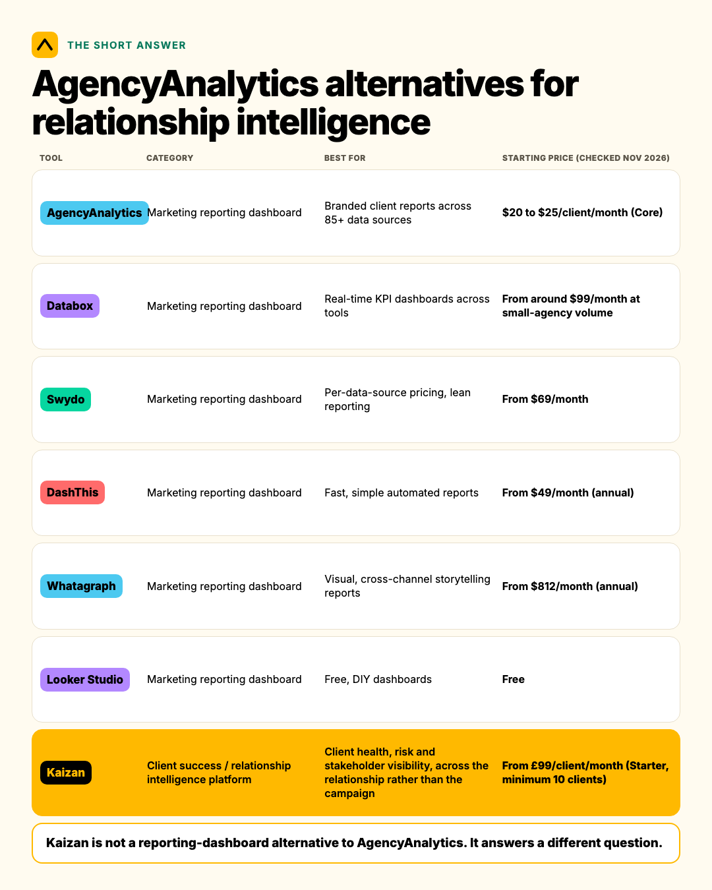
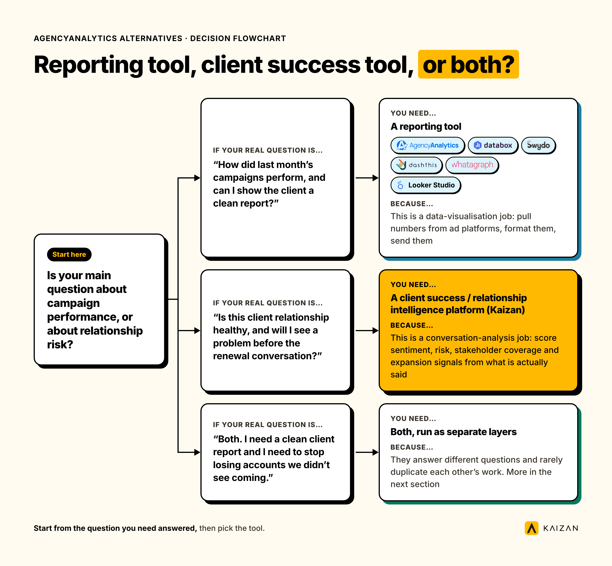
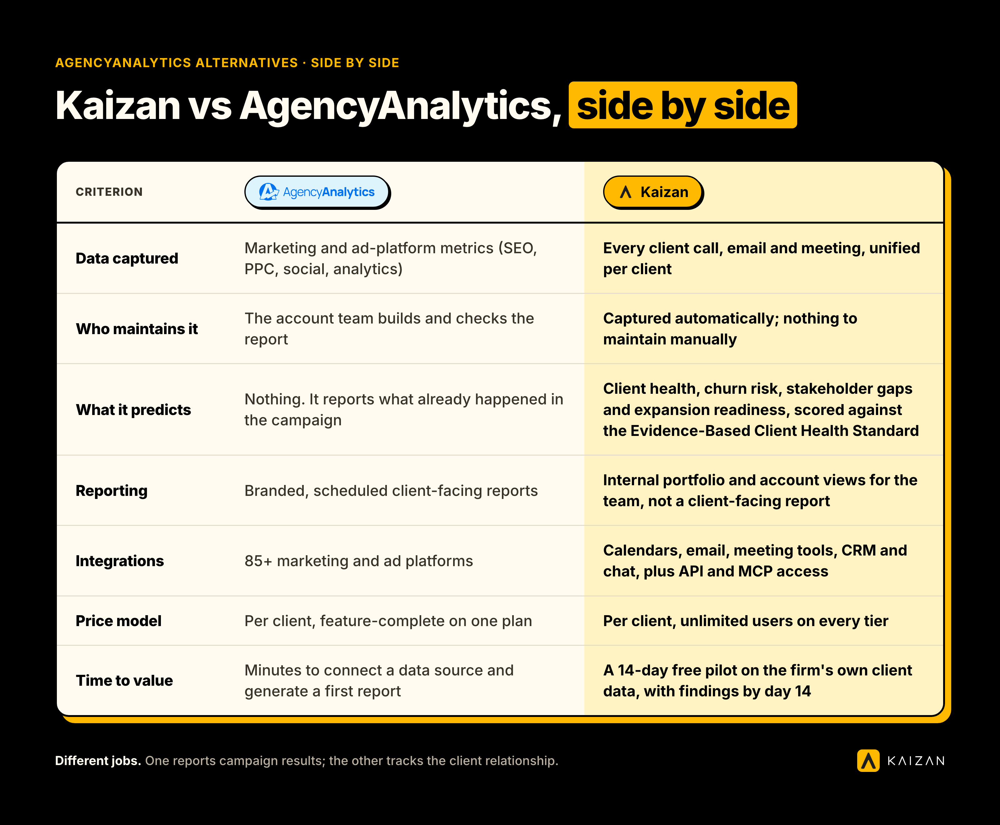
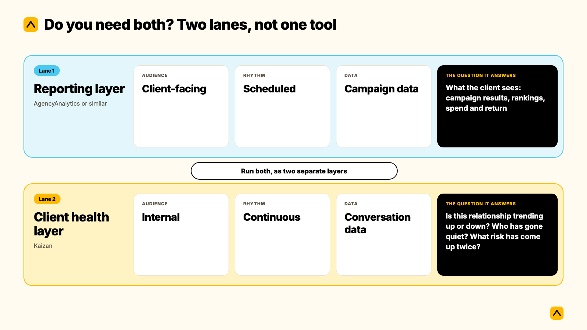

AgencyAnalytics is a client reporting dashboard, not a relationship health tool. If you are searching for an alternative to AgencyAnalytics because you simply want another reporting dashboard, Databox, Swydo, DashThis, Whatagraph and Looker Studio are real alternatives to AgencyAnalytics, compared below with current pricing. If you are here because a dashboard looked fine three weeks before a client gave notice, the dashboard was not broken. It was never built to see that. This guide covers both: honest reporting-tool alternatives, and the relationship intelligence layer that catches what reporting cannot.

**At a glance**

| Tool | Category | Best for | Starting price (checked Nov 2026) |
| --- | --- | --- | --- |
| AgencyAnalytics | Marketing reporting dashboard | Branded client reports across 85+ data sources | $20 to $25/client/month (Core) |
| Databox | Marketing reporting dashboard | Real-time KPI dashboards across tools | From around $99/month at small-agency volume |
| Swydo | Marketing reporting dashboard | Per-data-source pricing, lean reporting | From $69/month |
| DashThis | Marketing reporting dashboard | Fast, simple automated reports | From $49/month (annual) |
| Whatagraph | Marketing reporting dashboard | Visual, cross-channel storytelling reports | From $812/month (annual) |
| Looker Studio | Marketing reporting dashboard | Free, DIY dashboards | Free |
| Kaizan | Client success / relationship intelligence platform | Client health, risk and stakeholder visibility, across the relationship rather than the campaign | From £99/client/month (Starter, minimum 10 clients) |

Kaizan is not a reporting-dashboard alternative to AgencyAnalytics. It answers a different question. More on that below.

## What AgencyAnalytics actually does, and what we mean by relationship intelligence

### AgencyAnalytics in one paragraph

AgencyAnalytics pulls marketing data (SEO, PPC, social, email) from more than 85 connected sources into branded, automated client reports and dashboards. In May 2026 it moved to a flat per-client Core plan: $20 per client per month billed annually, around $25 billed monthly, with every feature unlocked and no tiered feature gating, plus a custom Enterprise tier from 25 clients with volume pricing and database connectors on top. [Reviews across G2, Capterra and Software Advice sit around 4.7 to 4.8](https://www.g2.com/products/agencyanalytics/reviews), and they praise it for exactly what it is built to do: pulling campaign and channel data into one branded view a client can open.

### What we mean by relationship intelligence

Relationship intelligence is the layer reporting dashboards do not touch: what is actually happening inside the relationship itself. Is the decision-maker still engaging, or has the account gone quiet for six weeks? Has the same risk come up twice in a row with nobody acting on it? Is the client's tone shifting from collaborative to short, even while the campaign numbers look fine? None of that lives in a channel-performance dashboard, because none of it is a marketing metric. It comes from calls, emails and meetings, not from ad platforms.

## The best AgencyAnalytics alternatives, if a reporting dashboard is what you need

If the job is pulling campaign data into a branded client report, here are five real alternatives, priced as of November 2026.

- **Databox.** Real-time dashboards pulling from most major marketing and sales tools, with mobile apps for checking numbers on the go. Agency pricing now also runs per client, at roughly $99 to $100/month for a small book and scaling from there. Best for teams that want dashboards built around live KPIs rather than static reports.
- **Swydo.** Prices per connected data source rather than per client, which can work out cheaper for agencies with simple, single-channel clients. Starts from $69/month. Best for lean teams that want to pay for what each client actually uses.
- **DashThis.** Built around speed: connect a source, get a dashboard, with less configuration than most competitors. Starts from around $49/month on annual billing. Best for agencies that want automated reports live fast with minimal setup time.
- **Whatagraph.** Strong on visual, narrative-style reports, good for agencies that present to clients as much as they report numbers. Pricing starts far higher, from around $812/month billed annually, with per-plan client and integration caps. Best for larger agencies that lead with design-forward reporting.
- **Looker Studio.** Google's free reporting tool. No cost, wide integration support through connectors, but it is a DIY build: agencies maintain the dashboards themselves rather than buying a managed reporting product. Best for teams with the internal skill and time to build and maintain their own templates.

All five do some version of the job AgencyAnalytics does: turn marketing data into a report a client can see. None of them, including AgencyAnalytics, were built to tell you whether the relationship behind that report is about to break.

## What none of these reporting tools can tell you

A reporting dashboard answers "how did the campaign perform." It cannot answer "is this client about to leave," because that answer rarely lives in campaign data. It lives in what gets said, and what stops getting said, in calls, emails and meetings.

[RSW/US's 2024 agency new business research](https://www.adweek.com/agencies/rsw-us-new-agency-business-report-2024/) found that 45% of marketers now cite a lack of proactivity from their agency as the top reason they start a review, a figure that jumped roughly 50% year on year. Proactivity is not a reporting problem. A client does not feel unheard because a dashboard loaded slowly. They feel unheard because nobody on the account team noticed what they were saying, or said something back before they had to raise it themselves.

Kaizan's own analysis of over a million client calls and ten million emails, published in the Client Service Benchmark 2026, found something counterintuitive: top-performing accounts surface 2.21 times more risk phrases per year than the weakest accounts, not fewer. A quiet risk register on an active account is a warning sign, not a green light. The same research found that 69% of accounts that went on to struggle had already surfaced a warning sign in conversation at least once, and 38% surfaced the same warning sign repeatedly. Struggling accounts are rarely silent. They are usually telling someone, and nobody is capturing it anywhere a reporting dashboard would show.

As one COO at a mid-sized agency put it, anonymised here as **COO, Agency Client A**:

> "You're relying on human error and you're relying on [an account manager] not looking at things with rose coloured glasses. [Kaizan] is impartial and will say, hey, look guys, this client's not happy."

And a president at another agency, anonymised as **President, Agency Client B**, framed the gap directly:

> "I just want to know, is my revenue at risk? Client health is a very big indicator for hitting those revenue numbers. And that's what I need to know."

A reporting dashboard was never going to answer that question for either of them. It is not what it is for.

## Reporting tool, client success tool, or both? A decision guide

Use this to work out which layer you are actually missing.

| If your real question is... | You need... | Because... |
| --- | --- | --- |
| "How did last month's campaigns perform, and can I show the client a clean report?" | A reporting tool (AgencyAnalytics, Databox, Swydo, DashThis, Whatagraph or Looker Studio) | This is a data-visualisation job: pull numbers from ad platforms, format them, send them |
| "Is this client relationship healthy, and will I see a problem before the renewal conversation?" | A client success / relationship intelligence platform (Kaizan) | This is a conversation-analysis job: score sentiment, risk, stakeholder coverage and expansion signals from what is actually said |
| "Both. I need a clean client report and I need to stop losing accounts we didn't see coming." | Both, run as separate layers | They answer different questions and rarely duplicate each other's work. More in the next section |

Most agencies searching for an AgencyAnalytics alternative are actually looking for one of two different things, and it is worth being honest with yourself about which one before you evaluate anything.

## Kaizan vs AgencyAnalytics, side by side

|  | AgencyAnalytics | Kaizan |
| --- | --- | --- |
| Data captured | Marketing and ad-platform metrics (SEO, PPC, social, analytics) | Every client call, email and meeting, unified per client |
| Who maintains it | The account team builds and checks the report | Captured automatically; nothing to maintain manually |
| What it predicts | Nothing. It reports what already happened in the campaign | Client health, churn risk, stakeholder gaps and expansion readiness, scored against [the Evidence-Based Client Health Standard](https://www.kaizan.ai/us/product/) |
| Reporting | Branded, scheduled client-facing reports | Internal portfolio and account views for the team, not a client-facing report |
| Integrations | 85+ marketing and ad platforms | Calendars, email, meeting tools, CRM and chat, plus [API and MCP access](https://www.kaizan.ai/us/integrations/) |
| Price model | Per client, feature-complete on one plan | Per client, unlimited users on every tier |
| Time to value | Minutes to connect a data source and generate a first report | A 14-day free pilot on the firm's own client data, with findings by day 14 |

### Where AgencyAnalytics wins

If the job is a branded, client-facing report across dozens of marketing data sources, AgencyAnalytics does that job well and has the review scores to back it up. It is simple to set up, the client portal is genuinely well regarded, and 85+ integrations cover most marketing stacks out of the box. For an agency whose client relationship is mostly measured in campaign performance, that is the right tool.

### Where Kaizan wins

Kaizan was built for a different problem: client-facing teams who can produce a clean monthly report and still lose a client they did not see coming, because the warning signs lived in a call or an email nobody captured anywhere searchable. It scores every relationship across client satisfaction, stakeholder activity, relationship strength and expansion signals, drawing on the actual conversations the team is already having, not a survey sent twice a year.

### Choose AgencyAnalytics (or another reporting tool) when

- The client relationship is judged almost entirely on campaign or channel performance
- You need a client-facing portal clients open themselves
- You are not trying to solve for early warning on churn, just reporting on results

### Choose Kaizan instead when

- You have been surprised by a client leaving after a report that looked fine
- Half your account updates live in someone's inbox or head, not in a shared system
- You need to answer "what's going on with this client" for the person above you, with evidence rather than a gut feel

## Do you need both? Combining a reporting dashboard with a client health layer

For most agencies, the honest answer is yes, run both, as two separate layers rather than one tool trying to do both jobs.

Think of it as two lanes. The reporting layer (AgencyAnalytics or similar) answers what the client sees: campaign results, rankings, spend and return, delivered on a schedule. The relationship layer (Kaizan) answers what the account team and leadership need to know internally: is this relationship trending up or down, who has gone quiet, what risk has come up twice, where is there room to grow the account. One is client-facing and outward. The other is internal and forward-looking.

Brandon Smith, Managing Director at NP Digital, described the problem this split solves before his team unified it: each of the systems his client teams used held important pieces of information, but none of them gave a complete picture on its own. [Since bringing the two layers together](https://www.kaizan.ai/us/blog/client-health/np-digital-ai-client-retention/), NP Digital's client teams now identify risk earlier and spend more time on strategy rather than piecing together scattered updates.

Running both does not mean paying twice for the same thing. A reporting tool and Kaizan rarely duplicate each other's data: one is pulling from ad platforms, the other from conversations. Most agencies that keep a reporting tool treat it as the client's scheduled stat sheet, and treat Kaizan as the internal layer the account team and leadership use between those reports, to catch what the next scheduled report is three weeks too slow to show.

## Switching or adding: a short migration checklist

1. Keep your reporting tool if clients already see and like it. Nothing here requires ripping it out.
2. Connect calendars, inboxes and meeting tools to a relationship-intelligence layer; this is a read-only connection, not a data migration.
3. Run a 14-day pilot on a representative slice of the book (a mix of healthy, flat and at-risk accounts), not just your best clients.
4. Set one question you want answered by day 14: for example, "which of these ten accounts would we not have flagged as at risk without this."
5. Decide who owns the weekly look at relationship health, separate from whoever owns the monthly client report.
6. Retire any manual RAG spreadsheet only once the new layer has covered a full reporting cycle, so nothing falls through the gap.

## What this actually costs

AgencyAnalytics' Core plan runs $20 to $25 per client, per month, in USD, with Enterprise volume pricing available from 25 clients. Kaizan's list pricing is published in GBP: Starter runs £99 per client, per month, with a 10-client minimum, and Growth runs £119 per client, per month, with a 25-client minimum, both with unlimited users at no extra cost. Enterprise pricing for larger, multi-practice portfolios is scoped individually. Figures checked November 2026; confirm current pricing and any local-currency quote directly with each vendor before budgeting.

As one illustrative example (not a guarantee, and not specific to any one firm): a 150-employee professional services firm with roughly 60 client-facing staff and 70 active clients, at an average client value of $140,000 a year, is carrying a portfolio worth around $9.8 million. Professional-services client retention benchmarks vary a good deal by source, from the high 60s to the mid-80s percent annually; using 84% (a commonly cited figure from Bain and First Page Sage) as a working assumption puts roughly $1.57 million of that portfolio at risk from churn in a typical year. [Kaizan's published ROI methodology](https://www.kaizan.ai/us/pricing/) credits itself with protecting 45% of at-risk revenue through early signals, which on this illustrative portfolio works out to roughly $705,000 a year. Kaizan's own customer base separately reports a 26%+ average revenue increase per client and around 5.4 hours of admin saved per person, per week. Run your own numbers against your own client count and average value using the live calculator at kaizan.ai/pricing; this worked example uses assumptions chosen for illustration, not your firm's actual figures.

## How we assessed this

The right alternative to AgencyAnalytics depends entirely on which question you're trying to answer, so we compared each reporting tool's current public pricing and review scores (G2, Capterra, Software Advice) as published in November 2026, and checked Kaizan's own pricing, methodology and client outcome figures directly against its live pricing page in the same month. Written by James Caples, Client Success Manager at Kaizan. Pricing changes; always confirm current rates before budgeting a switch.

## Frequently asked questions

**What's the best alternative to AgencyAnalytics if I only need a reporting dashboard?**
Databox, Swydo, DashThis, Whatagraph and Looker Studio are the strongest direct alternatives, depending on budget and whether you want per-client, per-source or free pricing. All five do the same core job as AgencyAnalytics: turning marketing data into client-facing reports.

**Is Kaizan a reporting tool like AgencyAnalytics?**
No. Kaizan is a client success platform that scores relationship health, risk and expansion signals from calls, emails and meetings. It does not build client-facing marketing reports, and it is not trying to replace a reporting dashboard.

**Which should we choose, AgencyAnalytics or Kaizan?**
Choose AgencyAnalytics, or one of its reporting-tool alternatives, when the client relationship is judged mainly on campaign performance and you need a branded report. Choose Kaizan when you need to know a relationship is at risk before the renewal conversation, not after.

**Can we use both?**
Yes, and most agencies that need both do exactly this. A reporting tool and Kaizan rarely duplicate data: one reports campaign results to the client, the other gives the account team and leadership an internal, forward-looking view of relationship health.

**What does switching from AgencyAnalytics involve, if we decide to add a relationship layer?**
Nothing about your reporting tool has to change. Adding a relationship-intelligence layer is a read-only connection to calendars, inboxes and meeting tools, typically piloted on a slice of the book over 14 days before any wider rollout.

**Where is each one the wrong choice?**
AgencyAnalytics is the wrong choice if what you actually need is early warning on churn risk; it was not built to score relationship health. Kaizan is the wrong choice if all you need is a branded client report with no interest in internal risk or expansion visibility; a reporting tool alone covers that.

---

To see what a relationship-intelligence layer would have caught on your own book of business, [book a 14-day pilot](https://www.kaizan.ai/us/demo/).
