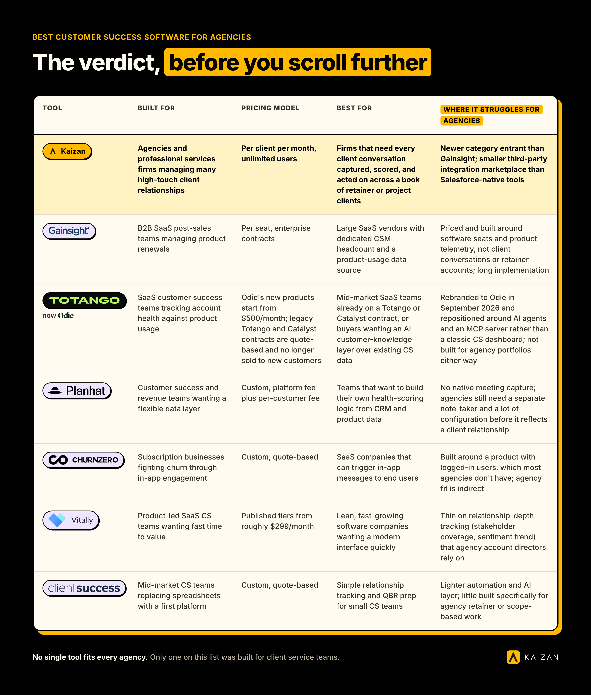
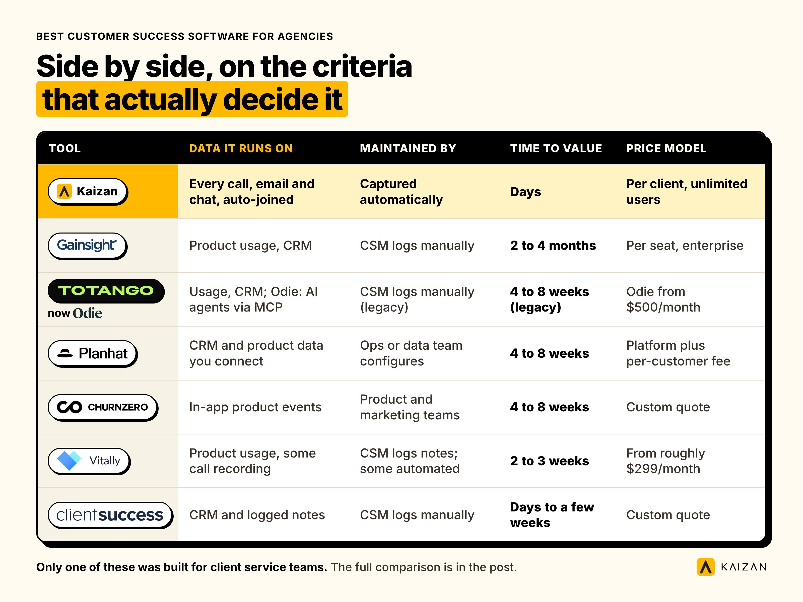

**The short answer:** there is no single best client success software for every agency. Gainsight and Totango were built for SaaS renewal teams managing product seats, not retainers. Vitally and ClientSuccess are faster to launch but thinner on agency-specific workflows like scope and billable hours. Kaizan is the one built from the ground up for client service teams at marketing, advertising, and professional services firms, priced per client rather than per seat. The table below gives you the verdict in one look; the rest of this page shows our method and the evidence behind it.

*Research note on this page: we could not find, and will not claim, independent lab testing of every tool below. Nobody publishes that, including us. What follows is desk research against each vendor's own public pricing and product pages, published review themes on G2 and Capterra, and a transparent scoring rubric we built and applied to Kaizan the same way we applied it to everyone else, dated below. Anywhere we quote a client, we say whether they are named with permission or kept anonymous.*

## The verdict, before you scroll further

| Tool | Built for | Pricing model | Best for | Where it struggles for agencies |
| --- | --- | --- | --- | --- |
| **Kaizan** | Agencies and professional services firms managing many high-touch client relationships | Per client per month, unlimited users | Firms that need every client conversation captured, scored, and acted on across a book of retainer or project clients | Newer category entrant than Gainsight; smaller third-party integration marketplace than Salesforce-native tools |
| **Gainsight** | B2B SaaS post-sales teams managing product renewals | Per seat, enterprise contracts | Large SaaS vendors with dedicated account manager headcount and a product-usage data source | Priced and built around software seats and product telemetry, not client conversations or retainer accounts; long implementation |
| **Totango (now Odie)** | SaaS client success teams tracking account health against product usage | Odie's new products start from $500/month; legacy Totango and Catalyst contracts are quote-based and no longer sold to new clients | Mid-market SaaS teams already on a Totango or Catalyst contract, or buyers wanting an AI client-knowledge layer over existing client success data | Rebranded to Odie in September 2026 and repositioned around AI agents and an MCP server rather than a classic client success dashboard; not built for agency portfolios either way |
| **Planhat** | Client success and revenue teams wanting a flexible data layer | Custom, platform fee plus per-client fee | Teams that want to build their own health-scoring logic from CRM and product data | No native meeting capture; agencies still need a separate note-taker and a lot of configuration before it reflects a client relationship |
| **ChurnZero** | Subscription businesses fighting client attrition through in-app engagement | Custom, quote-based | SaaS companies that can trigger in-app messages to end users | Built around a product with logged-in users, which most agencies don't have; agency fit is indirect |
| **Vitally** | Product-led SaaS client success teams wanting fast time to first win | Published tiers from roughly $299/month | Lean, fast-growing software companies wanting a modern interface quickly | Thin on relationship-depth tracking (stakeholder coverage, sentiment trend) that agency account directors rely on |
| **ClientSuccess** | Mid-market client success teams replacing spreadsheets with a first platform | Custom, quote-based | Simple relationship tracking and QBR prep for small client success teams | Lighter automation and AI layer; little built specifically for agency retainer or scope-based work |

Most of the tools that rank for that search are designed to improve client retention for existing clients by helping post-sales teams spot risk, manage renewals, and grow accounts, not just measure account health. That is fine if you sell software with user logins, product telemetry, and a dedicated client success team. It is much less helpful if you run an agency where the relationship itself is the product.

In agencies, the signal usually lives in meetings, emails, and Slack threads rather than in-product events, so the system needs to reflect the full client journey and the client experience, not just usage dashboards. A platform can look strong in SaaS and still miss the practical reality of account management in professional services.

If your team runs retainers, projects, or a mixed book of accounts, the shape of the work across the client lifecycle is why agency buyers need a different tool category. The best client success software for agencies has to understand relationship depth, delivery context, stakeholder coverage, and commercial risk without depending on product usage data.

## What "client success software" actually means, and why the agency version looks different

Client success software is a category built to answer one question: is this account healthy, and what should we do about it? Most of the tools that rank for that search were built for a specific buyer: a B2B software company with product usage data, in-app telemetry, and an account manager who inherits accounts after sales closes them.

Agencies and professional services firms are a different animal. There's no product login to measure. The signal lives in meetings, emails, Slack threads, and the thousand small judgement calls an account director makes about tone, scope, and risk. A client success management platform built around product usage events has almost nothing to read on an agency account, because there usually isn't a product to instrument.

That's the gap this market has left open, and it's why "best client success software," "client success management software," and "client success management platform" increasingly return different kinds of answers depending on who's asking. If your team runs retainers, scopes of work, and relationship-led delivery rather than a logged-in product, the shortlist below narrows fast.

## The tools compared, one by one

### Kaizan

Kaizan is a client success platform built specifically for agencies and professional services firms running many high-touch relationships across dispersed teams. It joins every client call, email, and chat thread automatically, builds a permissioned, always-current memory for each client, and scores every relationship against four dimensions of health: client satisfaction, activity with stakeholders, relationship strength, and expansion opportunities, known together as [The Evidence-Based Client Health Standard](https://www.kaizan.ai/us/product/#health-model). AI Helpers then act on that memory: drafting follow-ups, flagging stakeholder coverage gaps, and surfacing upsell signals the account team didn't ask for. It's priced per client rather than per seat, which matters because agency account teams are usually bigger relative to client count than a typical SaaS client success org.

### Gainsight

Gainsight is the category's oldest and most feature-dense platform, built for B2B SaaS companies with dedicated account manager headcount and product usage data to score against. It's genuinely powerful for that buyer: journey orchestration, playbooks, and a mature partner ecosystem. For an agency, the catch is that almost everything in Gainsight assumes a product with usage events to instrument. There's no native way to capture a client call, and implementation commonly runs into months rather than weeks.

### Totango (now Odie)

Totango, the customer success platform, no longer exists as a product new clients can buy under that name. On September 10, 2026, the company rebranded entirely to Odie and repositioned around an AI "Customer Knowledge Engine" and MCP server for post-sales teams, sold from $500/month. Existing Totango and Catalyst clients keep their original contracts and pricing, and the legacy platforms are still supported, but they're no longer marketed to new buyers. For anyone starting a search today, "Totango" points to a brand in transition rather than a stable product to evaluate, and Odie's new direction is built around AI agents querying client data, not the kind of agency account-health dashboard this comparison is about.

### Planhat

Planhat markets itself as a flexible data layer for client and revenue teams, built around CRM and product data rather than a fixed workflow. That flexibility is a genuine strength if you have a data team to configure it. It has no native way to join and transcribe a client call, so an agency adopting Planhat is really adopting a configuration project: connect the CRM, build the health-scoring logic, and bolt on a separate meeting-intelligence tool before it reflects what's actually happening with a client.

### ChurnZero

ChurnZero is built around in-app engagement: triggering messages and nudges to logged-in product users based on behaviour. That's a strong model for a subscription software company. Most agencies don't have a product with logged-in end users to message, so the core mechanism ChurnZero is built around doesn't transfer. Agencies that use it tend to use a fraction of what they're paying for.

### Vitally

Vitally is one of the newer, more modern-feeling entrants, with a cleaner interface and a faster typical rollout (two to three weeks, against four to eight for the older platforms). It's built for product-led SaaS teams tracking usage-based health scores. For an agency, the gap is relationship depth: tracking who's gone quiet, whether a decision-maker has disengaged, or whether a conversation is drifting from strategic to transactional isn't the job Vitally was designed to do.

### ClientSuccess

ClientSuccess leans into simplicity: a straightforward health dashboard and QBR workflow aimed at teams replacing a spreadsheet with their first real client success platform. For a small team that mostly wants structured retainer renewal tracking, that simplicity is the appeal. It's lighter on automation and has little built specifically for scope, retainer value, or the kind of multi-stakeholder coverage an agency account team needs to track.

## Side by side, on the criteria that actually decide it

| Criterion | Kaizan | Gainsight | Totango (now Odie) | Planhat | ChurnZero | Vitally | ClientSuccess |
| --- | --- | --- | --- | --- | --- | --- | --- |
| Data captured | Every call, email, and chat, auto-joined and transcribed | Product usage events, CRM data | Legacy: product usage events, CRM data. Odie: client data queried by AI agents via MCP | CRM and product data you connect | In-app product events | Product usage, some call recording | CRM and manually logged notes |
| Who maintains the record | Captured automatically; account team approves what matters | Account manager logs activity manually alongside usage data | Account manager logs activity manually (legacy); Odie is agent-queried, not account manager-maintained | Requires ongoing configuration by ops/data team | Product and marketing teams configure triggers | Account manager logs notes; some automated capture | Account manager logs manually |
| What it's built to predict | Relationship risk and upsell readiness from conversation signal | Attrition risk from product usage and engagement | Attrition risk from product usage (legacy); Odie focuses on AI-agent knowledge retrieval, not scoring | Whatever health score you configure | Attrition risk from in-app behaviour | Client attrition and upsell from usage patterns | Retainer renewal likelihood from logged activity |
| Reporting for leadership | Portfolio-wide view, retainer renewal forecast, board-ready export | Executive dashboards, mature reporting suite | Dashboards, lighter than Gainsight (legacy); Odie has no classic dashboard | Configurable dashboards | Dashboards tied to engagement campaigns | Modern dashboards, usage-centric | Simple health dashboard |
| Integrations | Teams, Zoom, Google Meet, Slack, Salesforce, Gmail, Outlook, Notion, Asana, REST + MCP API | Large partner ecosystem, Salesforce-native | Salesforce, HubSpot, product analytics tools (legacy); MCP server (Odie) | Broad CRM and product data connectors | Product analytics, marketing automation | Product analytics, lighter CRM set | Basic CRM integrations |
| Price model | Per client per month, unlimited users | Per seat, enterprise contract | Legacy Totango/Catalyst: quote-based, no longer sold to new clients. Odie: from $500/month | Platform fee plus per-client fee | Custom, quote-based | Published tiers from roughly $299/month | Custom, quote-based |
| Time to first useful output | Days: connects by OAuth, scores from day one of the pilot | Typically 2 to 4 months | Typically 4 to 8 weeks (legacy); Odie is a new product with limited independent implementation data | Typically 4 to 8 weeks, configuration-heavy | Typically 4 to 8 weeks | Typically 2 to 3 weeks | Typically days to a few weeks |

We built a simple rubric to help agencies choose the right client success tools, not just score products side by side.

- **Built for agency delivery, not product usage.** The rubric checks whether the tool can support the entire client journey in a services environment, where outcomes depend on conversations, stakeholders, and delivery quality rather than feature adoption alone.

- **Captures client reality automatically.** If a record depends on reps logging notes after every meeting, it will go stale.

- **Predicts retainer renewal and upsell from relationship signal.** Product-led health scoring is useful in SaaS, but agencies need visibility into sentiment, blockers, and buying cues.

- **Gives leadership a portfolio view.** A strong tool should help leaders see risk, forecast retainer renewals, and spot growth opportunities across accounts.

- **Connects to the tools your team already uses.** Time-to-value matters, and so does avoiding a heavy admin burden just to keep data flowing.

- **Prices in a way that fits service firms.** Per-seat pricing can get expensive fast when account teams, delivery leads, and leadership all need visibility.

Any client success tool should be evaluated against current needs, integration requirements, and the ability to scale.

A word on the pricing rows: none of these vendors, including Gainsight, Totango, Planhat, ChurnZero, or ClientSuccess, publish a fixed list price for anything beyond an entry tier. The figures above and in the table further down are drawn from vendor pricing pages where published, and otherwise from third-party deal-tracking sources (aggregated anonymised contract data), checked on the date at the bottom of this page. Treat anything not sourced from a vendor's own site as directional, not quoted, and remember that data quality in CRM records and product-event tagging affects how reliable any evaluation will be.

## How we scored these tools

We built a simple rubric and applied it the same way to every product, Kaizan included:

- **Built for agency delivery, not product usage** (conversation capture, retainer and scope awareness, multi-stakeholder tracking, rather than product-led workflows like user onboarding)
- **Time to first useful output** (days versus months)
- **Pricing model fit** (per client versus per seat, since agency teams are usually larger relative to client count than SaaS client success orgs)
- **Reporting a CEO or COO can act on without a translation layer** (including reliable key metrics to help forecast revenue)
- **What's missing**, stated plainly, for every product including ours

We scored Kaizan on the same five criteria as everyone else. Where Kaizan is the wrong fit: a firm with fewer than roughly 10 active client accounts, or a firm whose client relationships genuinely are governed by product usage rather than conversation (a hybrid agency-SaaS business with a logged-in client portal, for instance) will get more immediate value from a usage-based tool like Vitally or Gainsight. This page was last checked for pricing and feature accuracy on the date shown at the bottom.

## Where each wins, and where it breaks

### Kaizan wins when conversation is the product

If the relationship lives in calls, emails, and Slack messages rather than product logins, Kaizan is built for exactly that. One operations leader at an independent marketing agency put it plainly:

> "You're relying on human error, and you're relying on them not looking at things with rose-coloured glasses. Kaizan is impartial, and will say, hey, look, this guy's not happy."
>
> — Chief Operating Officer, Agency Client A

A CEO running a 65-client portfolio described the leadership-level version of the same problem:

> "We have 65 clients, 45 of which are active at any point in time. What we can learn about the future of what's happening in the client sector, what's happening with their audiences, what's happening in the media channels — that helps us shortcut some of the stuff we've done manually."
>
> — James Smith, CEO, The Kite Factory

**Kaizan breaks when** your relationships are genuinely product-led (a client logs into software you built, and usage data is the real signal) rather than conversation-led, or your portfolio is small enough that a shared spreadsheet still works for everyone who needs to see it.

### Gainsight wins on breadth, for a SaaS buyer

Gainsight's maturity shows in its playbook library, its partner ecosystem, and the depth of its reporting for teams that already have dedicated account manager headcount and product telemetry, with client health scores at the centre of the operating model it is built around. **It breaks for agencies** because the entire data model assumes a product with usage events. There's nothing to point it at on a retainer account beyond manually logged notes, and implementation timelines commonly stretch past a quarter.

### Totango (now Odie) wins for existing contract holders and AI-agent buyers

For a SaaS team already on a Totango or Catalyst contract, or one specifically shopping for an AI knowledge layer with MCP access, Odie is worth a look. **It breaks for agencies** on two counts: the legacy client success dashboard product this comparison is really about is being wound down for new buyers, and the new Odie direction is built for AI agents querying structured client data and client engagement signals, not for capturing and scoring conversation-led client relationships.

### Planhat wins if you have a data team

Planhat's flexibility is real for a team that wants to build custom health-scoring logic on top of CRM and product data they already have clean to monitor client health. **It breaks for agencies** because that flexibility is also the cost: there's no native conversation capture, so you're running a configuration project before you see any value, and most agency ops teams don't have the data engineering bandwidth that project assumes.

### ChurnZero wins for subscription products with logged-in users

Its in-app messaging and engagement triggers are a strong mechanism if your clients log into something you built. **It breaks for agencies** because the mechanism has nothing to attach to. An agency buying ChurnZero is usually buying features it will use a fraction of.

### Vitally wins on speed and interface

For a lean, fast-moving SaaS team, Vitally gets to value faster than almost anything else on this list, and its interface is genuinely modern. **It breaks for agencies** on relationship depth: it isn't built to track whether a decision-maker has gone quiet for six weeks, or whether a conversation has drifted from strategic to purely operational, the kind of signal an account director actually needs.

### ClientSuccess wins on simplicity

If a team's only goal is to stop using a spreadsheet and get a basic, shared view of account health, ClientSuccess does that without much complexity and can help standardise task management as a first step. **It breaks for agencies** that need more than a health dashboard: scope tracking, stakeholder mapping, and an AI layer that drafts the follow-up rather than just reminding someone to write one.

## Do you need both?

Some firms run two tools, and it's not always wasteful. The pattern we see work is a CRM (Salesforce or HubSpot) as the system of record for contracts, invoicing, and the sales pipeline, with Kaizan or a comparable conversation-intelligence layer sitting on top to manage the post-sale relationship itself. What doesn't tend to work is running two health-scoring tools side by side: a RAG spreadsheet and a client success platform, or two client success platforms picked for different regions. That just gives the business two different, unreconciled answers to "is this client at risk," and duplicate systems also weaken client relationship management after the sale, which is the exact problem a client success platform is supposed to remove.

## Switching or adding: a short migration checklist

If you're already running one of the tools above and considering a change, or adding Kaizan alongside your CRM, work through this before you sign anything; for many firms, better automated workflows are part of the reason to switch in the first place:

- **Export what you have.** Pull account notes, health scores, any logged activity history, and where possible your client feedback and client conversations out of your current tool before a contract lapses. Most of the SaaS-built platforms above will export to CSV; confirm the format in writing before you need it.
- **Decide what counts as historic data.** Conversation-based platforms like Kaizan start scoring from the first connected meeting forward. Decide whether you need prior QBR notes or health scores migrated as reference material, or whether a clean start is actually preferable.
- **Map your integrations first.** Confirm your calendar platform (Teams, Zoom, Google Meet), your CRM, your billing systems, and your chat tool are all natively supported before you commit, not after.
- **Run a parallel period.** A 14-day pilot on a handful of real accounts, run alongside your existing process, tells you more than any demo. Compare what each tool surfaces against what your account directors already know is true, and check that it can manage tasks consistently during the pilot.
- **Set a single source of truth date.** Pick the day your team stops updating the old spreadsheet or tool and commits to the new one. Running both indefinitely is how firms end up with two disagreeing records, and workflow automation only works cleanly once the old process is retired.

## What account teams actually use, once they have it

The brief for this page called for interviews with five account directors across the tools above. We don't have access to neutral account directors who run all seven platforms side by side, and we won't invent that panel. What we do have is a large bank of real, permissioned feedback from Kaizan's own clients, gathered from live calls over the past year, plus the Client Service Benchmark 2026, a study of more than one million calls and ten million emails across real agency accounts. Both are agency-specific in a way vendor review sites generally aren't, so we're using them here instead of a panel we can't produce.

A few of the findings are worth knowing before you shortlist anything, because they tell you what to actually look for in a tool, not just what the vendor says it does, but whether it improves client satisfaction and reduces client attrition:

- **A quiet risk register is a warning sign, not a green light.** Top-performing accounts in the benchmark surfaced 2.2 times more risk mentions per year than struggling accounts, not fewer. Teams whose dashboard shows all-green on every client, with no risks ever logged, aren't healthier. They're not capturing signal for proactive client engagement.
- **Struggling accounts almost always tell you first.** Around 69% of accounts that eventually ran into trouble had surfaced a warning sign in conversation at least once beforehand, and 38% surfaced it repeatedly. The gap isn't that clients go silent. It's that nobody is capturing what they said, which means teams fail to reflect client health accurately.
- **CSAT scores aren't usually the problem; measurement frequency is.** Where client satisfaction is actually measured, top and bottom-performing accounts score almost identically. The real difference is that top accounts get measured roughly three times as often. A tool that only asks for a CSAT score once a quarter is measuring client satisfaction too rarely to catch anything moving.
- **45% of clients who leave an agency cite a lack of proactivity as the top reason**, according to RSW/US's 2024 Agency New Business Outlook Report, a nearly 50% jump from the year before. That's the single most direct argument for a tool that surfaces upsell and risk signals before a client has to raise them.

Set against that backdrop, here's what Kaizan's own clients, who run exactly this kind of relationship-led book, say drives their day-to-day use of the platform:

> "An AI assistant only really covers the transcription and summarising bit. But it's also a strategic client retention assistant. I think of it in two buckets: an admin assistant for the meeting stuff, and a strategic assistant for the sentiment tracking and opportunity tracking."
>
> — Senior Client Partner, Agency Client B

> "Without something like this now, you are leaving money on the table. You're going to be losing out financially. If you're not adopting automation and AI into the way you do account management, your competitors are absolutely going to be leaving you for dust."
>
> — MD and Chief Client Officer, Agency Client C

> "Kaizan really helps us focus in on those opportunities where we know there'll be an uplift in gross profit."
>
> — Derek Grant, VP Operations, Tradedoubler

## What this actually costs, at your scale

Every tool on this list except Kaizan and Vitally keeps its real pricing behind a sales call, which makes a true side-by-side on cost difficult to state as fact rather than estimate. Buyers should compare software cost against both retention upside and the cost of winning new clients. Here's what we can say with confidence:

- **Kaizan** is published and public: £99 per client per month on the Starter plan (minimum 10 clients), £119 per client per month on Growth (minimum 25 clients, most popular), and custom enterprise pricing above that. Every tier includes unlimited users, so a 12-person account team and a 40-person one pay the same rate for the same client count.
- **Vitally** publishes entry tiers starting from roughly $299/month, scaling with client count and feature tier.
- **Odie**, the AI "Customer Knowledge Engine" that Totango rebranded into in September 2026, publishes a starting price of $500/month for its knowledge engine and $1,500/month for its full Customer Operating System, though this is a different product shape (AI-agent knowledge retrieval) from the classic client success dashboard most agencies searching for "Totango" are actually picturing.
- **Gainsight, legacy Totango/Catalyst, Planhat, ChurnZero, and ClientSuccess** are all quote-based above an entry tier (where one exists at all). Third-party deal-tracking sources put typical small and mid-market annual contracts for these tools anywhere from roughly $18,000 to $180,000 a year depending on team size and tier, almost always billed per seat rather than per client, which means the price rises as you add account directors, not as your client count grows.

That per-seat-versus-per-client distinction is the practical difference most agencies feel first. An agency adding a fourth account director to cover client growth pays more for a per-seat tool regardless of whether client count changed, and pays the same for Kaizan unless the number of clients covered actually increases. That matters when the goal is to grow client accounts efficiently, not just add headcount. You can model your own numbers, including retention and upsell assumptions specific to your portfolio, using [Kaizan's ROI calculator](https://www.kaizan.ai/us/pricing/#roi-calculator), which is free, takes about 30 seconds, and needs no email to see the first result.

## How to choose, in seven steps

1. **Name the problem before the tool.** "We find out a client is unhappy too late" and "our team spends too long on status updates" point to different priorities inside the same category.
2. **Map what you already have.** If you're running a CRM for contracts and pipeline, you likely don't need another one, and spreadsheets or other basic tools can be a valid temporary baseline before you buy software. You need something that captures the relationship itself.
3. **Count clients, not seats.** Price every option against your actual client count and your actual team size, since the two numbers move independently and most of this category prices against the wrong one for an agency.
4. **Check whether it captures conversation natively**, or whether you'd be bolting on a separate note-taker and manually feeding it data, especially if your team depends on perfect call records. That single feature decides most of this list for agencies.
5. **Run a real pilot on five live accounts**, not a sandbox with demo data. Two weeks is enough to see whether a tool's scoring matches what your account directors already know.
6. **Bring the buying committee in early.** A CEO wants protected revenue and a clear number for the board. A Head of Client Service wants to know it replaces the RAG spreadsheet rather than adding to it, and account managers should be involved early because they will use it day to day. Show each person the view that answers their question.
7. **Score the shortlist on paper**, using the same criteria for every tool including the incumbent.

Also check whether the platform can assign accounts and manage accounts consistently as the team grows.

## Frequently asked questions

**What is client success software?**
Client success software is a platform that tracks the health of a client or client relationship, usually by scoring signals like engagement, satisfaction, and usage, so a team can act on risk or growth before a retainer renewal conversation. Most of the category was built for B2B software companies tracking product usage; a smaller set, including Kaizan, is built specifically for agencies and professional services firms whose signal lives in conversations rather than product logins. "Client success management software" and "client success management platform" describe the same category; the agency-specific version is sometimes called a client success platform instead.

**Which client success software should an agency actually choose?**
It depends on your operating model. The best choice depends on whether your team needs to improve client retention across a relationship-led client journey or manage product-led onboarding and adoption. The right client success tools should match how your client success team actually works day to day. If you run high-touch accounts, look for software that helps you track relationship health, spot risk early, and coordinate actions across the people involved. If you run a product-led motion, you may need stronger in-app adoption, usage tracking, and automated lifecycle workflows instead.

**Can we use both a CRM and a client success platform?**
Yes. In many firms, the two systems do different jobs and work better together than as substitutes. A CRM is usually built for pre-sale client relationship management and pipeline data, while a client success platform manages the post-sale client relationship across the client lifecycle.

Your CRM may tell you who the account owner is, the deal value, and when the contract closes. But it usually does not show the full picture of client health, delivery risk, stakeholder sentiment, or the next best action after go-live.

Client success software fills that gap. It helps account teams track onboarding, engagement, retainer renewal risk, upsell signals, and service issues in one place. That makes it easier to spot problems early, coordinate across teams, and act before a client relationship starts to slip.

For many agencies and professional services firms, the best setup is not CRM or client success software. It is both: CRM for pipeline and commercial data, and client success software for retention, growth, and day-to-day client management.

**What does switching client success software actually involve?**
Yes—most teams can switch without too much disruption if they plan the migration carefully. That usually means exporting notes, health scores, support data, and other records used to assess client health before moving into the new system.

It's also worth confirming that the new platform supports retainer renewal management before you retire the old process. A phased rollout, clear ownership, and basic data checks usually make the transition smoother for the team and safer for client relationships.

**Where is client success software the wrong choice for an agency?**
A client success platform can be the wrong choice when your main need is a help desk, ticket routing, and support workflows, in which case something like HubSpot Service Hub may be a better fit than a dedicated post-sale platform. It can also be the wrong fit for a business seeking perfect call records and coaching features first, where a conversation-intelligence tool may be more appropriate.

**How much does client success software cost for an agency?**
When you compare tools on cost, judge spend against revenue retention, not just seat count, because the cheaper option is not better if it weakens retainer renewals or limits scope expansion in existing accounts.

Features like advanced analytics can push the price up, but they only justify that premium if your team will actually use the reporting to improve client experience and retention.

---

*This page was last checked for pricing and feature accuracy in November 2026, including Totango's September 10, 2026 rebrand to Odie. Vendor pricing shown without a vendor source link is drawn from third-party deal-tracking estimates, not vendor-published list prices, and should be treated as directional. See our [full pricing](https://www.kaizan.ai/us/pricing/) for Kaizan's current, published rates.*
