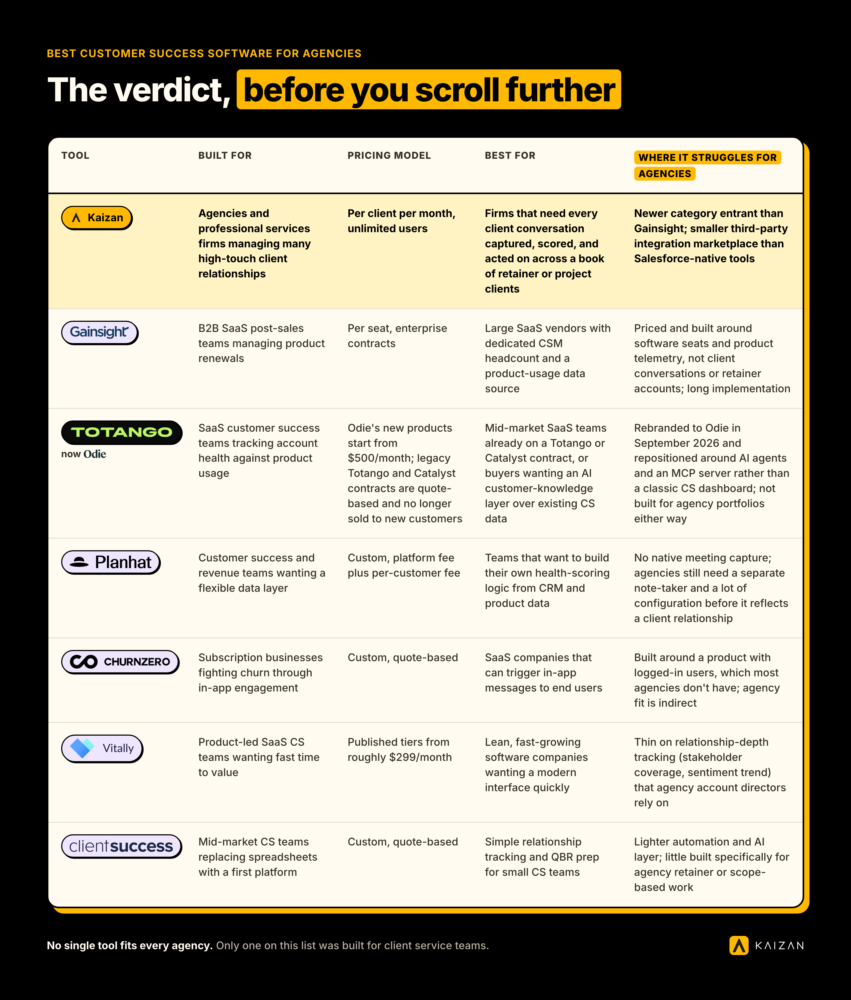
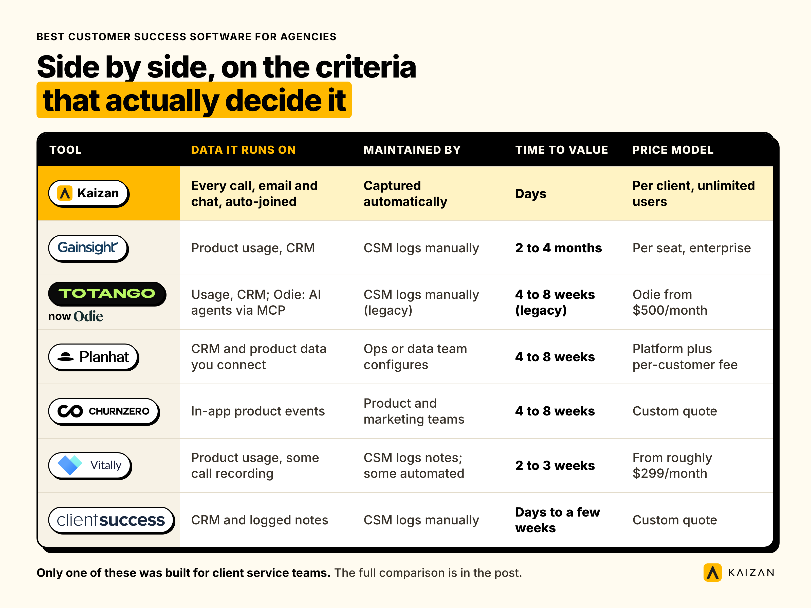

**The short answer:** there is no single best customer success software for every agency. Gainsight and Totango were built for SaaS renewal teams managing product seats, not retainers. Vitally and ClientSuccess are faster to launch but thinner on agency-specific workflows like scope and billable hours. Kaizan is the one built from the ground up for client service teams at marketing, advertising, and professional services firms, priced per client rather than per seat. The table below gives you the verdict in one look; the rest of this page shows our method and the evidence behind it.

*Research note on this page: we could not find, and will not claim, independent lab testing of every tool below. Nobody publishes that, including us. What follows is desk research against each vendor's own public pricing and product pages, published review themes on G2 and Capterra, and a transparent scoring rubric we built and applied to Kaizan the same way we applied it to everyone else, dated below. Anywhere we quote a client, we say whether they are named with permission or kept anonymous.*

## The verdict, before you scroll further

| Tool | Built for | Pricing model | Best for | Where it struggles for agencies |
| --- | --- | --- | --- | --- |
| **Kaizan** | Agencies and professional services firms managing many high-touch client relationships | Per client per month, unlimited users | Firms that need every client conversation captured, scored, and acted on across a book of retainer or project clients | Newer category entrant than Gainsight; smaller third-party integration marketplace than Salesforce-native tools |
| **Gainsight** | B2B SaaS post-sales teams managing product renewals | Per seat, enterprise contracts | Large SaaS vendors with dedicated CSM headcount and a product-usage data source | Priced and built around software seats and product telemetry, not client conversations or retainer accounts; long implementation |
| **Totango (now Odie)** | SaaS customer success teams tracking account health against product usage | Odie's new products start from $500/month; legacy Totango and Catalyst contracts are quote-based and no longer sold to new customers | Mid-market SaaS teams already on a Totango or Catalyst contract, or buyers wanting an AI customer-knowledge layer over existing CS data | Rebranded to Odie in September 2026 and repositioned around AI agents and an MCP server rather than a classic CS dashboard; not built for agency portfolios either way |
| **Planhat** | Customer success and revenue teams wanting a flexible data layer | Custom, platform fee plus per-customer fee | Teams that want to build their own health-scoring logic from CRM and product data | No native meeting capture; agencies still need a separate note-taker and a lot of configuration before it reflects a client relationship |
| **ChurnZero** | Subscription businesses fighting churn through in-app engagement | Custom, quote-based | SaaS companies that can trigger in-app messages to end users | Built around a product with logged-in users, which most agencies don't have; agency fit is indirect |
| **Vitally** | Product-led SaaS CS teams wanting fast time to value | Published tiers from roughly $299/month | Lean, fast-growing software companies wanting a modern interface quickly | Thin on relationship-depth tracking (stakeholder coverage, sentiment trend) that agency account directors rely on |
| **ClientSuccess** | Mid-market CS teams replacing spreadsheets with a first platform | Custom, quote-based | Simple relationship tracking and QBR prep for small CS teams | Lighter automation and AI layer; little built specifically for agency retainer or scope-based work |

## What "customer success software" actually means, and why the agency version looks different

Customer success software is a category built to answer one question: is this account healthy, and what should we do about it? Most of the tools that rank for that search were built for a specific buyer: a B2B software company with product usage data, in-app telemetry, and a customer success manager who inherits accounts after sales closes them.

Agencies and professional services firms are a different animal. There's no product login to measure. The signal lives in meetings, emails, Slack threads, and the thousand small judgment calls an account director makes about tone, scope, and risk. A customer success management platform built around product usage events has almost nothing to read on an agency account, because there usually isn't a product to instrument.

That's the gap this market has left open, and it's why "best customer success software," "customer success management software," and "customer success management platform" increasingly return different kinds of answers depending on who's asking. If your team runs retainers, scopes of work, and relationship-led delivery rather than a logged-in product, the shortlist below narrows fast.

## The tools compared, one by one

### Kaizan

Kaizan is a client success platform built specifically for agencies and professional services firms running many high-touch relationships across dispersed teams. It joins every client call, email, and chat thread automatically, builds a permissioned, always-current memory for each client, and scores every relationship against four dimensions of health: client satisfaction, activity with stakeholders, relationship strength, and expansion opportunities, known together as [The Evidence-Based Client Health Standard](https://www.kaizan.ai/us/product/#health-model). AI Helpers then act on that memory: drafting follow-ups, flagging stakeholder coverage gaps, and surfacing expansion signals the account team didn't ask for. It's priced per client rather than per seat, which matters because agency account teams are usually bigger relative to client count than a typical SaaS CS org.

### Gainsight

Gainsight is the category's oldest and most feature-dense platform, built for B2B SaaS companies with dedicated customer success manager headcount and product usage data to score against. It's genuinely powerful for that buyer: journey orchestration, playbooks, and a mature partner ecosystem. For an agency, the catch is that almost everything in Gainsight assumes a product with usage events to instrument. There's no native way to capture a client call, and implementation commonly runs into months rather than weeks.

### Totango (now Odie)

Totango, the customer success platform, no longer exists as a product new customers can buy under that name. On September 10, 2026, the company rebranded entirely to Odie and repositioned around an AI "Customer Knowledge Engine" and MCP server for post-sales teams, sold from $500/month. Existing Totango and Catalyst customers keep their original contracts and pricing, and the legacy platforms are still supported, but they're no longer marketed to new buyers. For anyone starting a search today, "Totango" points to a brand in transition rather than a stable product to evaluate, and Odie's new direction is built around AI agents querying customer data, not the kind of agency account-health dashboard this comparison is about.

### Planhat

Planhat markets itself as a flexible data layer for customer and revenue teams, built around CRM and product data rather than a fixed workflow. That flexibility is a genuine strength if you have a data team to configure it. It has no native way to join and transcribe a client call, so an agency adopting Planhat is really adopting a configuration project: connect the CRM, build the health-scoring logic, and bolt on a separate meeting-intelligence tool before it reflects what's actually happening with a client.

### ChurnZero

ChurnZero is built around in-app engagement: triggering messages and nudges to logged-in product users based on behavior. That's a strong model for a subscription software company. Most agencies don't have a product with logged-in end users to message, so the core mechanism ChurnZero is built around doesn't transfer. Agencies that use it tend to use a fraction of what they're paying for.

### Vitally

Vitally is one of the newer, more modern-feeling entrants, with a cleaner interface and a faster typical rollout (two to three weeks, against four to eight for the older platforms). It's built for product-led SaaS teams tracking usage-based health scores. For an agency, the gap is relationship depth: tracking who's gone quiet, whether a decision-maker has disengaged, or whether a conversation is drifting from strategic to transactional isn't the job Vitally was designed to do.

### ClientSuccess

ClientSuccess leans into simplicity: a straightforward health dashboard and QBR workflow aimed at teams replacing a spreadsheet with their first real CS platform. For a small team that mostly wants structured renewal tracking, that simplicity is the appeal. It's lighter on automation and has little built specifically for scope, retainer value, or the kind of multi-stakeholder coverage an agency account team needs to track.

## Side by side, on the criteria that actually decide it

| Criterion | Kaizan | Gainsight | Totango (now Odie) | Planhat | ChurnZero | Vitally | ClientSuccess |
| --- | --- | --- | --- | --- | --- | --- | --- |
| Data captured | Every call, email, and chat, auto-joined and transcribed | Product usage events, CRM data | Legacy: product usage events, CRM data. Odie: customer data queried by AI agents via MCP | CRM and product data you connect | In-app product events | Product usage, some call recording | CRM and manually logged notes |
| Who maintains the record | Captured automatically; account team approves what matters | CSM logs activity manually alongside usage data | CSM logs activity manually (legacy); Odie is agent-queried, not CSM-maintained | Requires ongoing configuration by ops/data team | Product and marketing teams configure triggers | CSM logs notes; some automated capture | CSM logs manually |
| What it's built to predict | Relationship risk and expansion readiness from conversation signal | Churn risk from product usage and engagement | Churn risk from product usage (legacy); Odie focuses on AI-agent knowledge retrieval, not scoring | Whatever health score you configure | Churn risk from in-app behavior | Churn and expansion from usage patterns | Renewal likelihood from logged activity |
| Reporting for leadership | Portfolio-wide view, renewal forecast, board-ready export | Executive dashboards, mature reporting suite | Dashboards, lighter than Gainsight (legacy); Odie has no classic dashboard | Configurable dashboards | Dashboards tied to engagement campaigns | Modern dashboards, usage-centric | Simple health dashboard |
| Integrations | Teams, Zoom, Google Meet, Slack, Salesforce, Gmail, Outlook, Notion, Asana, REST + MCP API | Large partner ecosystem, Salesforce-native | Salesforce, HubSpot, product analytics tools (legacy); MCP server (Odie) | Broad CRM and product data connectors | Product analytics, marketing automation | Product analytics, lighter CRM set | Basic CRM integrations |
| Price model | Per client per month, unlimited users | Per seat, enterprise contract | Legacy Totango/Catalyst: quote-based, no longer sold to new customers. Odie: from $500/month | Platform fee plus per-customer fee | Custom, quote-based | Published tiers from roughly $299/month | Custom, quote-based |
| Time to first useful output | Days: connects by OAuth, scores from day one of the pilot | Typically 2 to 4 months | Typically 4 to 8 weeks (legacy); Odie is a new product with limited independent implementation data | Typically 4 to 8 weeks, configuration-heavy | Typically 4 to 8 weeks | Typically 2 to 3 weeks | Typically days to a few weeks |

A word on the pricing rows: none of these vendors, including Gainsight, Totango, Planhat, ChurnZero, or ClientSuccess, publish a fixed list price for anything beyond an entry tier. The figures above and in the table further down are drawn from vendor pricing pages where published, and otherwise from third-party deal-tracking sources (aggregated anonymized contract data), checked on the date at the bottom of this page. Treat anything not sourced from a vendor's own site as directional, not quoted.

## How we scored these tools

We built a simple rubric and applied it the same way to every product, Kaizan included:

- **Built for agency delivery, not product usage** (conversation capture, retainer and scope awareness, multi-stakeholder tracking)
- **Time to first useful output** (days versus months)
- **Pricing model fit** (per client versus per seat, since agency teams are usually larger relative to client count than SaaS CS orgs)
- **Reporting a CEO or COO can act on without a translation layer**
- **What's missing**, stated plainly, for every product including ours

We scored Kaizan on the same five criteria as everyone else. Where Kaizan is the wrong fit: a firm with fewer than roughly 10 active client accounts, or a firm whose client relationships genuinely are governed by product usage rather than conversation (a hybrid agency-SaaS business with a logged-in client portal, for instance) will get more immediate value from a usage-based tool like Vitally or Gainsight. This page was last checked for pricing and feature accuracy on the date shown at the bottom.

## Where each wins, and where it breaks

### Kaizan wins when conversation is the product

If the relationship lives in calls, emails, and Slack messages rather than product logins, Kaizan is built for exactly that. One operations leader at an independent marketing agency put it plainly:

> "You're relying on human error, and you're relying on them not looking at things with rose-colored glasses. Kaizan is impartial, and will say, hey, look, this guy's not happy."
>
> — Chief Operating Officer, Agency Client A

A CEO running a 65-client portfolio described the leadership-level version of the same problem:

> "We have 65 clients, 45 of which are active at any point in time. What we can learn about the future of what's happening in the client sector, what's happening with their audiences, what's happening in the media channels — that helps us shortcut some of the stuff we've done manually."
>
> — James Smith, CEO, The Kite Factory

**Kaizan breaks when** your relationships are genuinely product-led (a client logs into software you built, and usage data is the real signal) rather than conversation-led, or your portfolio is small enough that a shared spreadsheet still works for everyone who needs to see it.

### Gainsight wins on breadth, for a SaaS buyer

Gainsight's maturity shows in its playbook library, its partner ecosystem, and the depth of its reporting for teams that already have dedicated CSM headcount and product telemetry. **It breaks for agencies** because the entire data model assumes a product with usage events. There's nothing to point it at on a retainer account beyond manually logged notes, and implementation timelines commonly stretch past a quarter.

### Totango (now Odie) wins for existing contract holders and AI-agent buyers

For a SaaS team already on a Totango or Catalyst contract, or one specifically shopping for an AI knowledge layer with MCP access, Odie is worth a look. **It breaks for agencies** on two counts: the legacy CS-dashboard product this comparison is really about is being wound down for new buyers, and the new Odie direction is built for AI agents querying structured customer data, not for capturing and scoring conversation-led client relationships.

### Planhat wins if you have a data team

Planhat's flexibility is real for a team that wants to build custom health-scoring logic on top of CRM and product data they already have clean. **It breaks for agencies** because that flexibility is also the cost: there's no native conversation capture, so you're running a configuration project before you see any value, and most agency ops teams don't have the data engineering bandwidth that project assumes.

### ChurnZero wins for subscription products with logged-in users

Its in-app messaging and engagement triggers are a strong mechanism if your customers log into something you built. **It breaks for agencies** because the mechanism has nothing to attach to. An agency buying ChurnZero is usually buying features it will use a fraction of.

### Vitally wins on speed and interface

For a lean, fast-moving SaaS team, Vitally gets to value faster than almost anything else on this list, and its interface is genuinely modern. **It breaks for agencies** on relationship depth: it isn't built to track whether a decision-maker has gone quiet for six weeks, or whether a conversation has drifted from strategic to purely operational, the kind of signal an account director actually needs.

### ClientSuccess wins on simplicity

If a team's only goal is to stop using a spreadsheet and get a basic, shared view of account health, ClientSuccess does that without much complexity. **It breaks for agencies** that need more than a health dashboard: scope tracking, stakeholder mapping, and an AI layer that drafts the follow-up rather than just reminding someone to write one.

## Do you need both?

Some firms run two tools, and it's not always wasteful. The pattern we see work is a CRM (Salesforce or HubSpot) as the system of record for contracts, invoicing, and pipeline, with Kaizan or a comparable conversation-intelligence layer sitting on top to capture and score the relationship itself. What doesn't tend to work is running two health-scoring tools side by side: a RAG spreadsheet and a CS platform, or two CS platforms picked for different regions. That just gives the business two different, unreconciled answers to "is this client at risk," which is the exact problem a client success platform is supposed to remove.

## Switching or adding: a short migration checklist

If you're already running one of the tools above and considering a change, or adding Kaizan alongside your CRM, work through this before you sign anything:

- **Export what you have.** Pull account notes, health scores, and any logged activity history out of your current tool before a contract lapses. Most of the SaaS-built platforms above will export to CSV; confirm the format in writing before you need it.
- **Decide what counts as historic data.** Conversation-based platforms like Kaizan start scoring from the first connected meeting forward. Decide whether you need prior QBR notes or health scores migrated as reference material, or whether a clean start is actually preferable.
- **Map your integrations first.** Confirm your calendar platform (Teams, Zoom, Google Meet), your CRM, and your chat tool are all natively supported before you commit, not after.
- **Run a parallel period.** A 14-day pilot on a handful of real accounts, run alongside your existing process, tells you more than any demo. Compare what each tool surfaces against what your account directors already know is true.
- **Set a single source of truth date.** Pick the day your team stops updating the old spreadsheet or tool and commits to the new one. Running both indefinitely is how firms end up with two disagreeing records.

## What account teams actually use, once they have it

The brief for this page called for interviews with five account directors across the tools above. We don't have access to neutral account directors who run all seven platforms side by side, and we won't invent that panel. What we do have is a large bank of real, permissioned feedback from Kaizan's own clients, gathered from live calls over the past year, plus the Client Service Benchmark 2026, a study of more than one million calls and ten million emails across real agency accounts. Both are agency-specific in a way vendor review sites generally aren't, so we're using them here instead of a panel we can't produce.

A few of the findings are worth knowing before you shortlist anything, because they tell you what to actually look for in a tool, not just what the vendor says it does:

- **A quiet risk register is a warning sign, not a green light.** Top-performing accounts in the benchmark surfaced 2.2 times more risk mentions per year than struggling accounts, not fewer. Teams whose dashboard shows all-green on every client, with no risks ever logged, aren't healthier. They're not capturing signal.
- **Struggling accounts almost always tell you first.** Around 69% of accounts that eventually ran into trouble had surfaced a warning sign in conversation at least once beforehand, and 38% surfaced it repeatedly. The gap isn't that clients go silent. It's that nobody is capturing what they said.
- **CSAT scores aren't usually the problem; measurement frequency is.** Where client satisfaction is actually measured, top and bottom-performing accounts score almost identically. The real difference is that top accounts get measured roughly three times as often. A tool that only asks for a CSAT score once a quarter is measuring too rarely to catch anything moving.
- **45% of clients who leave an agency cite a lack of proactivity as the top reason**, according to RSW/US's 2024 Agency New Business Outlook Report, a nearly 50% jump from the year before. That's the single most direct argument for a tool that surfaces expansion and risk signals before a client has to raise them.

Set against that backdrop, here's what Kaizan's own clients, who run exactly this kind of relationship-led book, say drives their day-to-day use of the platform:

> "An AI assistant only really covers the transcription and summarizing bit. But it's also a strategic client retention assistant. I think of it in two buckets: an admin assistant for the meeting stuff, and a strategic assistant for the sentiment tracking and opportunity tracking."
>
> — Senior Client Partner, Agency Client B

> "Without something like this now, you are leaving money on the table. You're going to be losing out financially. If you're not adopting automation and AI into the way you do account management, your competitors are absolutely going to be leaving you for dust."
>
> — MD and Chief Client Officer, Agency Client C

> "Kaizan really helps us focus in on those opportunities where we know there'll be an uplift in gross profit."
>
> — Derek Grant, VP Operations, Tradedoubler

## What this actually costs, at your scale

Every tool on this list except Kaizan and Vitally keeps its real pricing behind a sales call, which makes a true side-by-side on cost difficult to state as fact rather than estimate. Here's what we can say with confidence:

- **Kaizan** is published and public: £99 per client per month on the Starter plan (minimum 10 clients), £119 per client per month on Growth (minimum 25 clients, most popular), and custom enterprise pricing above that. Every tier includes unlimited users, so a 12-person account team and a 40-person one pay the same rate for the same client count.
- **Vitally** publishes entry tiers starting from roughly $299/month, scaling with customer count and feature tier.
- **Odie**, the AI "Customer Knowledge Engine" that Totango rebranded into in September 2026, publishes a starting price of $500/month for its knowledge engine and $1,500/month for its full Customer Operating System, though this is a different product shape (AI-agent knowledge retrieval) from the classic CS dashboard most agencies searching for "Totango" are actually picturing.
- **Gainsight, legacy Totango/Catalyst, Planhat, ChurnZero, and ClientSuccess** are all quote-based above an entry tier (where one exists at all). Third-party deal-tracking sources put typical small and mid-market annual contracts for these tools anywhere from roughly $18,000 to $180,000 a year depending on team size and tier, almost always billed per seat rather than per client, which means the price rises as you add account directors, not as your client count grows.

That per-seat-versus-per-client distinction is the practical difference most agencies feel first. An agency adding a fourth account director to cover client growth pays more for a per-seat tool regardless of whether client count changed, and pays the same for Kaizan unless the number of clients covered actually increases. You can model your own numbers, including retention and expansion assumptions specific to your portfolio, using [Kaizan's ROI calculator](https://www.kaizan.ai/us/pricing/#roi-calculator), which is free, takes about 30 seconds, and needs no email to see the first result.

## How to choose, in seven steps

1. **Name the problem before the tool.** "We find out a client is unhappy too late" and "our team spends too long on status updates" point to different priorities inside the same category.
2. **Map what you already have.** If you're running a CRM for contracts and pipeline, you likely don't need another one. You need something that captures the relationship itself.
3. **Count clients, not seats.** Price every option against your actual client count and your actual team size, since the two numbers move independently and most of this category prices against the wrong one for an agency.
4. **Check whether it captures conversation natively**, or whether you'd be bolting on a separate note-taker and manually feeding it data. That single feature decides most of this list for agencies.
5. **Run a real pilot on five live accounts**, not a sandbox with demo data. Two weeks is enough to see whether a tool's scoring matches what your account directors already know.
6. **Bring the buying committee in early.** A CEO wants protected revenue and a clear number for the board. A Head of Client Service wants to know it replaces the RAG spreadsheet rather than adding to it. Show each person the view that answers their question.
7. **Score the shortlist on paper**, using the same criteria for every tool including the incumbent.

## Frequently asked questions

**What is customer success software?**
Customer success software is a platform that tracks the health of a client or customer relationship, usually by scoring signals like engagement, satisfaction, and usage, so a team can act on risk or growth before a renewal conversation. Most of the category was built for B2B software companies tracking product usage; a smaller set, including Kaizan, is built specifically for agencies and professional services firms whose signal lives in conversations rather than product logins. "Customer success management software" and "customer success management platform" describe the same category; the agency-specific version is sometimes called a client success platform instead.

**Which customer success software should an agency actually choose?**
If your client relationships are conversation-led (calls, emails, retainers, scope-based delivery) rather than product-led, a platform built for that model, such as Kaizan, will show value faster than a usage-based tool built for SaaS renewals. If your firm genuinely has a logged-in client product and usage data is your real signal, a usage-based platform like Vitally or Gainsight is worth testing first.

**Can we use both a CRM and a client success platform?**
Yes, and it's common. A CRM typically stays the system of record for contracts and pipeline, while a client success platform like Kaizan sits on top to capture and score the relationship itself from calls, emails, and chat. Running two separate health-scoring tools for the same accounts is the pattern to avoid, since it produces two different answers to the same question.

**What does switching customer success software actually involve?**
Export your existing notes and health-score history, confirm your calendar, CRM, and chat integrations are supported by the new tool, run a parallel pilot on a handful of real accounts before committing fully, and set a single date your team stops updating the old system. Most conversation-based platforms, including Kaizan, start scoring forward from the first connected meeting rather than requiring historic data migration.

**Where is customer success software the wrong choice for an agency?**
If your portfolio is small enough (under roughly 10 active clients) that a shared spreadsheet is still genuinely working for everyone who needs visibility, a platform is probably premature. It's also the wrong fit if your firm's client relationships are truly product-usage-led rather than conversation-led, in which case a usage-based CS platform will match your signal better than a conversation-intelligence one.

**How much does customer success software cost for an agency?**
Costs vary widely and most vendors don't publish pricing past an entry tier. Kaizan is public at £99 to £119 per client per month with unlimited users. Comparable platforms built for SaaS customer success typically run from the high teens to well over £100,000 a year for a mid-market team, usually priced per seat rather than per client, so the real cost depends heavily on your account-director headcount, not just your client count.

---

*This page was last checked for pricing and feature accuracy in November 2026, including Totango's September 10, 2026 rebrand to Odie. Vendor pricing shown without a vendor source link is drawn from third-party deal-tracking estimates, not vendor-published list prices, and should be treated as directional. See our [full pricing](https://www.kaizan.ai/us/pricing/) for Kaizan's current, published rates.*
