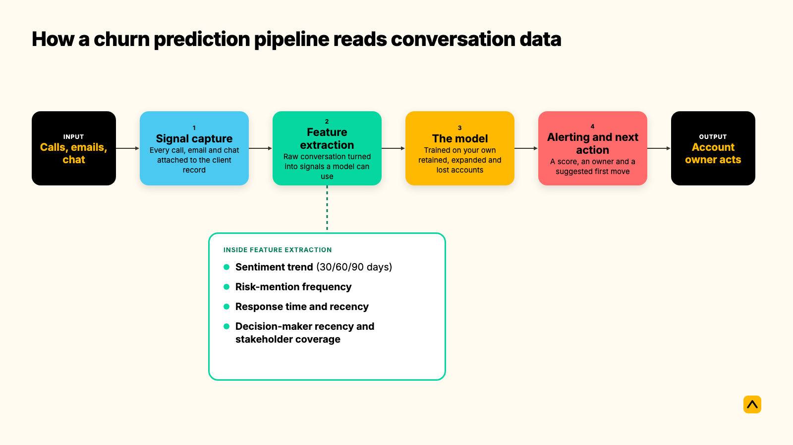
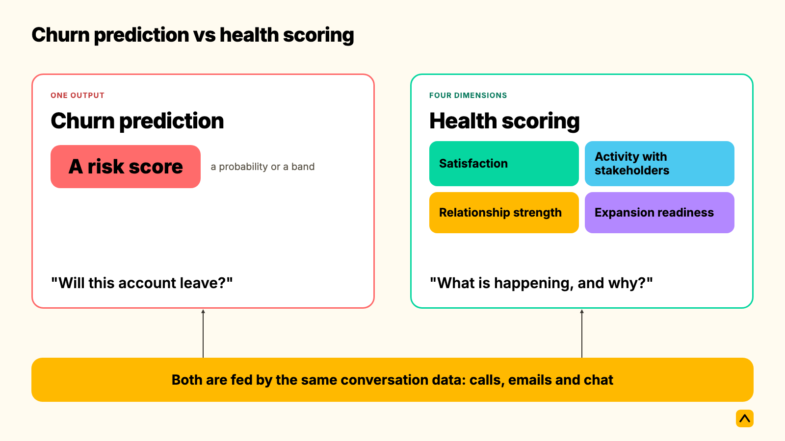

Customer churn prediction software scores the likelihood that a client relationship ends before the client says a word. On conversation data specifically, that means it reads what gets said on calls, in emails, and in chat threads, not what gets clicked inside a product. That distinction is the whole story for professional services firms, because there is no login screen to measure.

**Who this is for:** heads of AI and technology weighing whether to build this in-house or buy it, and heads of client service who need the business case for a churn model that actually fits how an agency or consultancy works.

**Key takeaways**

- Churn prediction software for conversation-heavy businesses reads sentiment, risk mentions, response times, and stakeholder coverage, instead of product usage logs.
- It is not the same thing as health scoring, though the two are related. Churn prediction answers "will this account leave." Health scoring answers "what is happening, and why."
- Professional services firms retain 84% of clients on average, so roughly one client in six is up for renewal risk every year.
- A churn model is only as good as the labels it trains on: retained, expanded, and lost accounts, not just the accounts that left.

## What is customer churn prediction software?

Customer churn prediction software is a system that assigns a risk score to each client relationship, based on patterns that preceded past departures and past renewals. It is a specific application of predictive analytics, applied to the question agencies and consultancies actually lose sleep over: which client leaves next, and is there still time to act.

Most churn prediction tools were built for subscription software, where the inputs are logins, feature usage, and support tickets. A client services relationship has none of that. What it has instead is a stream of calls, emails, and chat messages, so a churn prediction model built for this world has to read conversation data, meaning the words said, who said them, how often, and in what tone.

### Customer churn prediction and prevention

Prediction is the easy half of the phrase. A risk score with nowhere to go is a dashboard nobody opens. Customer churn prediction and prevention means the score triggers a recommended next step, such as a stakeholder to re-engage or an escalation to schedule, before the renewal conversation starts. Software that only scores risk without routing it to an owner and an action is not doing the prevention half of the job.

### Predictive analytics customer churn

Predictive analytics is the broader discipline: using historical data to forecast a future outcome. Applied to customer churn, it means training a model on what retained, expanded, and lost accounts looked like in the months before the outcome was known, then scoring live accounts against those same patterns. The predictive part only holds if the model is trained on outcomes that actually happened, not assumptions about what should predict churn.

### Where to find customer churn prediction platforms

Three places, with different strengths.

- **Built into a client success or client health platform.** The churn score sits alongside a wider relationship health model, so a team sees the why behind the will-they-leave. Kaizan works this way: CARE scores every client relationship, and the risk read comes from the same conversation data as everything else the platform does.
- **As a module inside a SaaS-focused customer success platform**, such as Gainsight, Totango, or Vitally. Strong on product usage and support ticket signals, weaker on agency-style relationships where there is no product telemetry to read.
- **As a custom build**, usually a data science team working from CRM exports and call transcripts. Flexible, but it carries the full cost of ingestion, labeling, and maintenance that a platform already absorbs.

A plain CRM is not on this list. A CRM stores what happened on a call if someone typed it in. It does not score anything from the conversation itself. For a wider look at the retention category this sits inside, see [customer retention software for agencies and service firms](https://www.kaizan.ai/us/blog/client-software/customer-retention-software-for-agencies/).

## Why this matters in revenue terms

The average professional services firm retains 84% of its clients year over year, according to retention benchmarks compiled from Bain & Company and other industry sources. That means roughly one client in six is up for renewal risk every year, in a typical firm, whether or not anyone is watching for it.

Two findings from Kaizan's analysis of over 1 million calls and 10 million emails across client accounts change how that risk should be read.

- **Accounts that go on to grow show more risk conversation, not less.** Top-performing accounts surface 2.21 times more risk phrases per year than bottom-performing ones, 15.3 versus 6.9. The healthiest relationships are not the quiet ones. A quiet risk register on an active account is a warning sign, not a green light.
- **Struggling accounts almost always say something first.** About 69% of accounts that went on to struggle raised a warning sign in conversation at least once, and 38% raised the same concern repeatedly across multiple periods, which tracks with [what one agency found once it could see the warning](https://www.kaizan.ai/us/blog/client-health/np-digital-early-warning-alerts/): clients who leave rarely leave without warning. The problem is that nobody was listening across every call, every email, and every account at once. Catching that moment, and [re-engaging before a client goes quiet for good](https://www.kaizan.ai/us/blog/playbooks-and-templates/re-engage-inactive-clients/), is where most of the value sits.

Firms that act on these signals early see it in the number that matters. Kaizan clients report an average 26%+ revenue increase per client, and protect an average 45% of revenue otherwise at risk, by acting on signals while there is still time rather than after the renewal is already lost.

## The components of a churn prediction pipeline

A working churn prediction system on conversation data has four parts. Each does a specific job, and skipping any of them is where most builds and most off-the-shelf tools fall short.

### Signal capture

Every call, email, and chat message tied to a client gets captured and attached to that client's record, automatically, not manually logged by an account manager who may or may not remember to do it. This is the step most agencies already fail at: account teams typically touch several separate tools per client per week, and a meaningful share of what gets said never makes it into any system of record at all.

### Feature extraction

Raw conversation does not predict anything on its own. It has to be turned into signals a model can use.

- **Sentiment trend** over 30, 60, and 90 days, not a single sentiment snapshot. A client who was warm and has gone neutral is a stronger signal than one who has always been blunt.
- **Risk mention frequency and trajectory.** A risk raised once is not alarming. The same concern raised across four consecutive weeks is.
- **Response time and communication recency.** Days since the last meaningful contact, excluding automated emails. Three weeks of silence on an active account is a signal worth reading.
- **Decision-maker recency and stakeholder coverage.** When did the budget holder last engage, and is the relationship running through one person or several. Single-threaded accounts, where one contact on each side carries the whole relationship, are one of the strongest predictors of loss.

### The model

The model is trained on what actually happened to an organization's own book of clients: who renewed, who expanded, and who left, with the conversation patterns that preceded each outcome. This matters because a generic churn model trained on someone else's accounts learns someone else's patterns. A model calibrated on an organization's own retained, expanded, and lost accounts learns what churn actually looks like in that specific client base, which is a materially different and more reliable signal.

### Alerting and the next action

A risk score becomes useful the moment it reaches a person with the context to act on it, along with a suggested first move: re-engage a dormant stakeholder, schedule a save conversation, loop in a more senior contact. Without this step, prediction is just an interesting number.

## How churn prediction differs from the terms it gets confused with

| Term | What it measures | Where the data comes from | What it tells you |
| --- | --- | --- | --- |
| Churn prediction software | The probability a specific account leaves | Conversation history, CRM, usage logs where they exist | Who is at risk, and roughly how urgently |
| Client health scoring | The overall state of the relationship across several dimensions | The same conversation data, plus relationship and growth signals | What is happening and why, not just a yes or no on churn |
| CSAT and NPS surveys | How a client rated the relationship at the moment they were asked | A periodic survey response | A snapshot, sampled only when someone sends the survey |
| CRM win-loss reporting | Why a deal or renewal was won or lost, after the fact | Notes entered once the outcome is already known | A retrospective record, not a forecast |

### Churn prediction vs. health scoring: which do you need

These two get used interchangeably, and they are related but not the same thing. Churn prediction is a single output: a risk score, usually expressed as a probability or a band. Health scoring is a diagnostic: it breaks a relationship into the dimensions that make it strong or fragile, so a team sees which one needs attention, not just that something is wrong.

In practice, the best churn prediction is a byproduct of good health scoring, not a replacement for it. [Kaizan's health model](https://www.kaizan.ai/us/product/#health-model), known externally as the Evidence-Based Client Health Standard and internally as CARE, scores every client relationship across four dimensions: how the client feels about the work, whether the right people are being engaged often enough, whether the relationship is deepening or going transactional, and whether the conditions are right to grow it. A risk read calibrated against an organization's own retained, expanded, and lost accounts sits on top of that same scoring, so the churn signal comes with the why already attached, not just a number.

If a tool only gives a risk score with no breakdown underneath it, a team can see that an account is in trouble but not what to do about it. That is the gap a pure churn-prediction tool leaves, and the gap health scoring closes.

## How it works in practice: a worked example

Take an anonymized account from Kaizan's own client portfolio, Agency Client A, scored 1.4 out of 10 overall on its most recent review period, down from 1.5 the period before. The breakdown told a clearer story than the headline number: satisfaction at 0.7, relationship strength at 2.1, activity at 2.5, and expansion readiness at 0.4. But the detail that mattered most was not any single score. It was the volume of conversation behind it. Almost nothing had been logged for the account in the review window.

That silence was the flag, not a reassurance.

> "We're trying to be proactive in predicting which clients might be a churn risk, and Kaizan is a huge part of helping to identify that."
>
> — Chief Operating Officer, Agency Client B

For another agency leader, the shift showed up directly in how long it took to answer the question leadership actually asks.

> "Kaizan is fast becoming the key input to my churn report. Something that used to take me hours now takes me minutes."
>
> — MD and Chief Client Officer, Agency Client C

And for a CEO running a portfolio of accounts across an agency group, the churn question was really a revenue question in disguise.

> "I just want to know, is my revenue at risk? Client health is a very big indicator for hitting those revenue numbers. And that's what I need to know."
>
> — Senior leader, Agency Client D

The action that follows a flag like Agency Client A's is rarely dramatic. It is usually a specific stakeholder to re-engage, a senior contact to loop back in, or an honest conversation scheduled before the renewal date forces one. The value of the prediction is entirely in how much runway it buys the account team to have that conversation on their own terms.

## How to measure churn prediction: formula and a worked calculation

Two measurements matter, for two different audiences.

**Model quality**, for the team evaluating the system: precision and recall. Precision is the share of accounts flagged as at-risk that genuinely were. Recall is the share of accounts that actually churned that the model caught in time. A model that flags half the portfolio as at-risk has high recall and useless precision, since nobody can act on half a book of clients at once. The tradeoff between the two matters more than either number alone.

**Revenue protected**, for the business case:

Revenue at risk = Portfolio value × Annual attrition rate

Revenue protected = Revenue at risk × Early-signal protection rate

Worked example, for a 150-person professional services firm with 40 clients averaging $120,000 in annual value.

- Portfolio value: 40 clients times $120,000 equals $4,800,000
- At the professional-services average attrition rate of roughly 16%, the inverse of the commonly cited 84% average retention rate, revenue at risk equals $4,800,000 times 0.16, or $768,000 per year
- At a 45% early-signal protection rate, the average Kaizan clients see from acting on CARE-driven alerts, revenue protected equals $768,000 times 0.45, or $345,600 per year, recovered without closing a single new deal

The 84% retention figure is an industry-wide average compiled from multiple sources and should be treated as directional for any single firm. The real number for a given book of clients depends heavily on service line, contract length, and client concentration.

## Data requirements for churn prediction on conversation data

Before any model produces a usable score, four things need to be in place.

- **Enough conversation history to establish a baseline.** A handful of calls tells a model very little. Three to six months of consistent capture across calls, emails, and chat gives the signal extraction something to work with.
- **Labeled outcomes to train against.** The model needs examples of accounts that were retained, accounts that expanded, and accounts that were lost, not just the lost ones. Training on losses alone teaches a model what failure looks like, not what success looks like, and the two are not simply opposites.
- **Integration with the systems that hold the conversation.** Email, calendar, call recording, and CRM, connected automatically rather than relying on manual logging, which is where most of the signal gets lost today.
- **A defensible data handling posture.** Conversation data is sensitive client information. Any platform doing this work should be able to show SOC 2 Type II certification, encryption in transit and at rest, zero-retention commitments with any foundation model providers, and per-tenant data isolation, since none of it should be used to train a shared or public model.

For a head of AI or technology taking this to a client security review, that last point is usually the one that decides the conversation. [Kaizan's security practices](https://www.kaizan.ai/us/security/) cover this in detail, including SOC 2 Type II certification, GDPR compliance, and zero-retention API contracts with OpenAI and Anthropic.

## Common mistakes, and what they cost

- **Training only on accounts that already left.** This produces a model that recognizes failure after the fact and struggles to generalize to accounts struggling in a new way. Train on the full spread: retained, expanded, and lost.
- **Reading quiet accounts as healthy accounts.** The data says the opposite. A relationship with almost no conversation activity is one nobody has eyes on, which is a different problem from a relationship that is genuinely fine.
- **Relying on a survey for the how-do-they-feel signal.** Where CSAT is actually measured, happy and struggling accounts often score close to identical. The real gap is how often anyone bothers to ask. A quarterly survey cannot catch a risk that develops over three weeks.
- **Scoring the account but not the stakeholders inside it.** A relationship that looks fine in aggregate can still be running through a single contact on each side. That is a structural vulnerability a headline risk score will not show.
- **Shipping a score with no owner.** If a flagged account does not land on someone's desk with a suggested next step, the prediction changes nothing.

## How to get started in 30 days

1. **Week 1: connect the conversation sources.** Email, calendar, call recording tools, and the CRM. This step determines whether the model has anything real to read.
2. **Week 2: let a baseline build.** Resist the urge to act on day-one scores. A model needs a few weeks of live conversation to separate signal from noise on a new account base.
3. **Week 3: calibrate against known outcomes.** Flag the accounts everyone already knows are shaky, and the ones everyone is confident about. Check whether the scores agree with what the team already knows. Disagreement here is useful information, not a failure.
4. **Week 4: pilot the action loop on five accounts.** Pick a small number of flagged accounts, assign an owner to each, and run the recommended next action. The point of the pilot is to prove the loop from signal to action works before rolling it across the whole portfolio.

## Frequently asked questions

**What is customer churn prediction and prevention?**
Prediction is the risk score. Prevention is what happens next: a recommended action, routed to an account owner, before the renewal conversation starts. Software that only produces a score without a next step only does half the job.

**What is predictive analytics for customer churn?**
It is the practice of training a model on historical outcomes, meaning which accounts were retained, expanded, or lost, and the conversation patterns that preceded each one, then applying those patterns to score live accounts.

**Where can you find customer churn prediction platforms?**
Inside client success and client health platforms, where the score sits alongside a wider relationship model, as a module in SaaS-focused customer success tools built for product usage data, or as a custom build on top of CRM exports and call transcripts.

**How do you measure churn prediction accuracy?**
With precision and recall for model quality, and with revenue protected, portfolio value times attrition rate times the share caught early, for the business case. Neither number means much without the other.

**How is churn prediction different from health scoring?**
Churn prediction outputs a single probability that an account leaves. Health scoring breaks the relationship into the dimensions driving that risk, so a team sees what to fix, not just that something is wrong. The strongest setups use health scoring as the foundation and derive the churn read from it.

**Who owns churn prediction in an agency?**
Typically the head of client service owns acting on the signal, while a head of AI or technology owns whether the underlying system meets the firm's data and security standards. Both need visibility into the same score.

**Can churn prediction work without much historical data?**
It can start working within the first baseline period, three to six months of consistent conversation capture, but accuracy improves as the model sees more complete outcomes, meaning full renewal cycles rather than a handful of calls.

**Does churn prediction need a CRM integration?**
It benefits from one, but conversation data, meaning calls, emails, and chat, is the primary input on relationships that do not generate product usage logs. A CRM adds account metadata and deal history. It is not a substitute for reading the conversations themselves.

**Will this replace a quarterly QBR or satisfaction survey?**
No, and it should not try to. Surveys and QBRs are useful checkpoints. Churn prediction on conversation data fills the gap between them: the weeks where a relationship can shift before the next scheduled check-in arrives.

---

To see how Kaizan scores churn risk on your own conversation data, [book a demo](https://www.kaizan.ai/us/).
