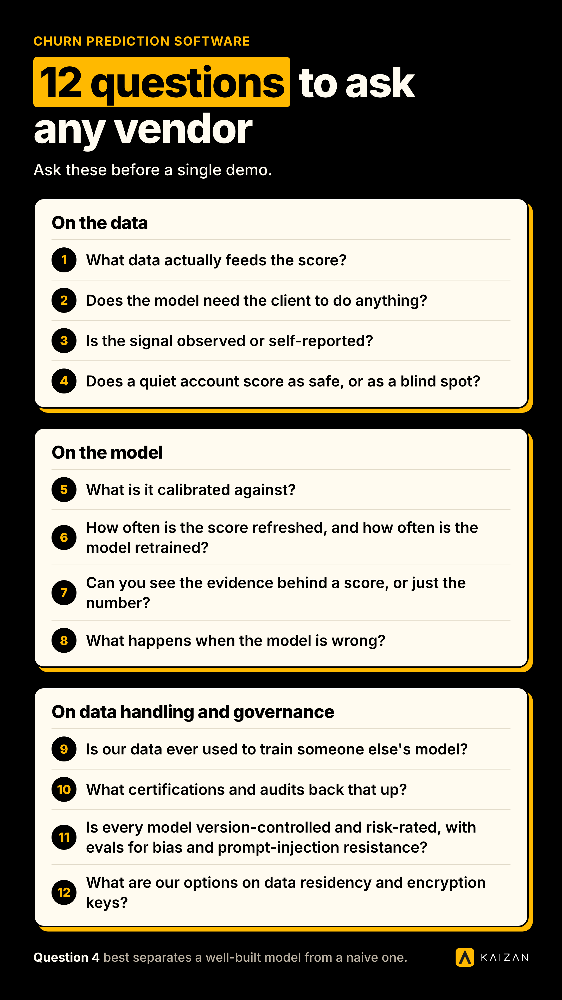

Churn prediction software scores the risk that a client leaves, but two different kinds of model hide under that label. Usage-data models watch what a customer does inside a product: logins, features, seats. Conversation-data models watch what a client says in calls, emails and chat. Ask any vendor which one they built, before you ask about price.

## The two kinds of churn prediction software, hiding under one label

Almost half of marketers, 45%, name a lack of proactivity as the top reason they put an agency or service firm under review ([RSW/US, 2024 Agency New Business Outlook Report](https://www.rswus.com/)). Churn prediction software exists to close that gap: score the relationship before the client decides to leave, not after. But "churn prediction" describes two genuinely different products, built for two genuinely different businesses.

**Usage-data models** were built for product-led SaaS. They score risk from what a customer does inside a piece of software: logins, feature adoption, seat utilization, support ticket volume, NPS surveys. Gainsight, ChurnZero, Totango and similar tools sit in this category. The model works because the product generates a constant stream of behavioral exhaust, and that exhaust is a reasonable proxy for how the relationship is going.

**Conversation-data models** were built for relationship-led services: agencies, consultancies, managed service providers, anyone whose "product" is a team of people, not software a client logs into. There is no login data to score, because the client never logs into anything. These models instead score risk from the calls, emails, chat threads and meeting notes that make up the relationship itself. Kaizan's CARE model is one example: it scores client satisfaction, activity with stakeholders, relationship strength and expansion signals from the team's own conversations, re-tuned weekly against what has actually predicted a kept client, a lost client or a won pitch at that firm ([kaizan.ai/product](https://www.kaizan.ai/us/product/#health-model)).

A Chief Operating Officer at one agency client described the shift this way:

> "We're trying to be proactive in predicting which clients might be a churn risk. And Kaizan is a huge part of helping to identify that."
>
> — COO, Agency Client A

The table below is the fast version of this whole article. Everything after it is detail.

| Criterion | Usage-data churn models | Conversation-data churn models |
| --- | --- | --- |
| Built for | Product-led SaaS with login, feature and seat data | Relationship-led services: agencies, consultancies, managed services |
| Primary signal | Product telemetry, tickets, NPS surveys | Calls, emails, chat, meeting notes |
| Core question it answers | Is this account using the product less? | Is this relationship weakening? |
| Requires from the client | Active product usage to generate signal | Nothing extra; works off the team's existing communications |
| Typical vendors | Gainsight, ChurnZero, Totango, Vitally, Planhat | A smaller set of conversation-intelligence platforms, including Kaizan |
| Where it breaks | No usage data exists when the "product" is people's time | Weaker signal if a firm genuinely does have rich product usage to score |

If your firm bills for people's time and expertise rather than software seats, a usage-data model has nothing to watch. If your firm ships a product with its own telemetry, a conversation-data model is reading half the relationship. Most buyers land clearly on one side once they ask the question directly, which is exactly why so few churn-prediction vendor pages ask it.

## Where each one wins, and where each breaks

### Choose a usage-data model when your clients live inside your product

If clients log into a dashboard, an app or a portal every week, usage data is real evidence. A drop in logins, a dormant seat, a support ticket spike: these are observable facts about the relationship, not interpretations of it. Usage-data churn models are mature, well-benchmarked and the right default for software companies with a genuine self-serve or product-led usage layer.

Where they break: a services business has no usage layer to watch. An agency, a consultancy or an outsourced team cannot infer relationship health from login frequency, because there is no login. Forcing a usage-data model onto a relationship business produces a score with nothing real underneath it, which is the single most common buying mistake in this category.

### Choose a conversation-data model when the relationship is the product

Conversation-data models earn their keep in exactly the situation usage-data models cannot reach: a team that talks to clients rather than shipping them software. The evidence in favor of this approach is stronger than most buyers expect. In Kaizan's analysis of over a million calls and ten million emails across its client portfolio, struggling accounts were rarely silent about it. Close to four in ten of the weakest accounts raised the same warning sign repeatedly, across multiple periods, in ordinary conversation, before the relationship broke down ([The Client Service Benchmark 2026, Finding 06](https://www.kaizan.ai/us/resources/white-paper/)). The signal was there. Nobody was scoring it.

Where conversation-data models break, including Kaizan's own: they need a reasonable volume of calls, emails and messages to work from. A client relationship run almost entirely through a third party, or one with very little recorded communication, gives the model thin material. And no conversation-data model replaces judgment entirely. The output is a score and the evidence behind it, not a verdict; a team still has to read the risk and decide what to do about it.

A second agency leader described the practical effect of moving from gut feel to a conversation-scored view:

> "Kaizan is fast becoming the key input to my churn report. Something that used to take me hours now takes me minutes."
>
> — MD and Chief Client Officer, Agency Client B

## Do you need both?

Most firms need exactly one. The overlap case is narrower than vendors in this space like to suggest, but it is real: a company that sells software with genuine usage telemetry and also runs a high-touch services or implementation team alongside it. A platform business with an embedded customer success function is the clearest example. There, a usage-data model can watch the product side, and a conversation-data model can watch the relationship side, and the two answer different questions about the same account.

For a pure services business, running both is rarely worth the cost. A usage-data model with no usage to score will return a flat or meaningless signal, and a second tool is a second thing for the account team to check, log into and trust. If your firm's clients do not use a shared product, the usage-data half of a "run both" stack is dead weight.

## The question list: what to ask any churn prediction vendor

These are the questions worth asking every vendor on a shortlist, including the ones Kaizan finds uncomfortable to answer. A vendor that dodges three or more of these is telling you something.

### On the data

1. **What data actually feeds the score?** Get the literal list: calls, emails, chat, CRM fields, tickets, surveys. A vague answer ("all your client data") usually means the model leans harder on whatever is easiest to collect, not whatever is most predictive.
2. **Does the model need the client to do anything?** Usage-data tools need the client logging in. Conversation-data tools need the team's own calls and emails to be captured, which usually means a meeting bot or email integration, not client participation.
3. **Is the signal observed or self-reported?** A survey score is an opinion a client chose to give you, often when they were already unhappy enough to say so, or too polite to. A conversation signal is something the team actually said or heard. One client, reflecting on the shift, put it plainly:

> "You can get a very good feedback from an account manager on what's happening. You get their view. If something is not going so well, they might not want to tell you, or maybe they themselves are nearly ignoring it. It's much easier now for me to jump in and look at it. You can see a bit more objective what is working, what is not working."
>
> — Head of International Client Team, Agency Client C

4. **Does a quiet account score as safe, or as a blind spot?** This is the single best question to separate a well-built model from a naive one. Kaizan's own portfolio data shows the opposite of what intuition suggests: the strongest accounts surface roughly twice as many risk mentions as the weakest ones, 15.3 against 6.9 per account per year ([The Client Service Benchmark 2026, Finding 07, the Risk Paradox](https://www.kaizan.ai/us/resources/white-paper/)). A healthy, well-covered relationship generates more conversation for risk to show up in. A model that reads silence as a green light has the logic backward; ask the vendor directly how their model treats it.

### On the model

5. **What is it calibrated against?** A model benchmarked only against a generic industry average will flag things that are normal for your firm and miss things that are not. Ask whether it learns from your own won pitches, kept clients and lost accounts, and how often that calibration runs.
6. **How often is the score refreshed, and how often is the model retrained?** These are two different questions. A score can update weekly while the underlying model goes stale for months. Kaizan's own health model is re-tuned weekly against live client outcomes; ask every vendor for their number, not a marketing phrase like "continuously."
7. **Can you see the evidence behind a score, or just the number?** A score with no evidence is unauditable. If an account manager cannot click through to the call or email that moved the number, nobody can sanity-check the model, coach against it, or defend it to a client-facing team that does not trust a black box.
8. **What happens when the model is wrong?** Every model produces false positives and false negatives. Ask for an honest estimate of each, and ask what a team is supposed to do when the score and their own judgment disagree. A vendor with no answer here has not thought about it.

### On data handling and governance

This is the section a Head of AI or Technology lead will not let a vendor skip, and the one a churn-prediction vendor page is least likely to answer unprompted.

9. **Is our data ever used to train someone else's model?** The answer you want is a flat no, with per-tenant isolation and a zero-retention agreement with any underlying foundation model provider. Kaizan, for example, runs zero-retention contracts with its model providers and never aggregates client data into a shared or foundation model ([kaizan.ai/security](https://www.kaizan.ai/us/security/)).
10. **What certifications and audits back that up?** SOC 2 Type II, ISO 27001, GDPR and CCPA compliance, and a quarterly third-party penetration test are the baseline for any vendor handling client communications at scale. Ask for the report, not just the logo.
11. **Is every model version-controlled and risk-rated, with evals for bias and prompt-injection resistance?** A mature vendor can show you a model registry: what is in production, what it is rated, and what it was tested against before shipping. Most cannot.
12. **What are our options on data residency and encryption keys?** Per-tenant encryption keys and a choice of EU or US data residency matter once a client contract requires it, and procurement will ask regardless. Customer-managed keys (BYOK) at higher tiers is a reasonable marker of a vendor built for enterprise review, not bolted on afterward.

Ask these twelve before a single demo. The answers tell you more about whether a vendor will survive your own security review than any feature list will.

## Switching or adding: a migration checklist

Most firms are not starting from nothing. They are leaving a monthly RAG spreadsheet, a homegrown tracker, or a usage-data tool that never fit a services business in the first place. A clean switch covers four things:

- **Historic account notes.** Spreadsheets and CRM free-text fields rarely import cleanly into a new model. Plan to treat the last two or three quarters of manual notes as reference material, not training data, and let the new model build its own picture from fresh conversations.
- **A parallel run before cutover.** Run the new model alongside the old process for a full reporting cycle, usually a month, before retiring the spreadsheet. This is the only reliable way to see whether the new score agrees with what the account team already knows, and where it catches something the team missed.
- **Who owns the first calibration.** Someone needs to sign off on what "at risk" means for your book before the first exec report goes out. Without an owner, the first wrong-looking score becomes a reason to distrust the whole system.
- **What happens to the old tool.** Decide in advance whether the usage-data tool, if there was one, gets switched off immediately or kept running for the handful of clients where it genuinely applies. Paying for two overlapping systems past the parallel-run period is the most common unforced cost in a switch like this.

A 14-day pilot on your own data, before any commercial conversation, is the fastest way to test most of this without the risk of a full switch. Kaizan runs this as standard ([kaizan.ai/pricing](https://www.kaizan.ai/us/pricing/)); ask any vendor on your shortlist whether they offer the same, and treat a no as information.

## How we approached this

The category split (usage-data versus conversation-data churn models) reflects how churn prediction tools are actually built and marketed as of November 2026, checked against vendor sites and product documentation at the time of writing. The Kaizan-specific figures and quotes are sourced from Kaizan's own published materials: [The Client Service Benchmark 2026](https://www.kaizan.ai/us/resources/white-paper/) (analysis of over a million calls and ten million emails across Kaizan's client portfolio, anonymized, 12-month period), the [security and trust center](https://www.kaizan.ai/us/security/), and the [product page](https://www.kaizan.ai/us/product/). Client quotes are used with the anonymity level each speaker's company agreed to. Pricing is confirmed current as of November 2026; recheck before relying on it, since vendor pricing changes without much notice in this category.

## Frequently asked questions

**What's the difference between usage-data and conversation-data churn prediction?**
Churn prediction software scores the risk that a client leaves, but two different kinds of model hide under that label. Usage-data models watch what a customer does inside a product: logins, features, seats. Conversation-data models watch what a client says in calls, emails and chat. Ask any vendor which one they built, before you ask about price.

**Which type should we choose?**
Choose a usage-data model if your clients log into a product you built. Choose a conversation-data model if your "product" is a team of people and the relationship runs through calls, emails and meetings instead. Most firms know which one describes them the moment they hear the distinction.

**Can we use both?**
Yes, if you genuinely run both a usage-based product and a high-touch services layer alongside it, such as a platform business with an embedded customer success team. For a pure services firm with no shared product, a usage-data tool has nothing to watch and is not worth the extra cost or admin.

**What does switching involve?**
Plan for a parallel run of about a month against your current process, treat old spreadsheet notes as reference rather than training data, assign someone to own the first calibration, and decide upfront what happens to any tool you are replacing. A 14-day pilot on your own data before signing anything de-risks most of this.

**Where is each type the wrong choice?**
A usage-data model is the wrong choice for any relationship with no login data to score, which includes most agencies, consultancies and managed-service firms. A conversation-data model is a weaker fit for a business with rich product telemetry and comparatively thin client communication.

**How often should the model be retrained?**
Ask for a specific cadence, not a marketing phrase. A model that is only benchmarked against a generic industry average once at setup will miss what is normal or abnormal for your specific client base. Look for a model re-tuned on a regular, stated schedule against your own outcomes.

**Is our data ever used to train someone else's model?**
It should not be. Ask for per-tenant data isolation and a zero-retention agreement with any underlying AI model provider, confirmed in writing, not implied by a privacy policy. A vendor unable to answer this clearly in one sentence is a red flag on a question this important.
