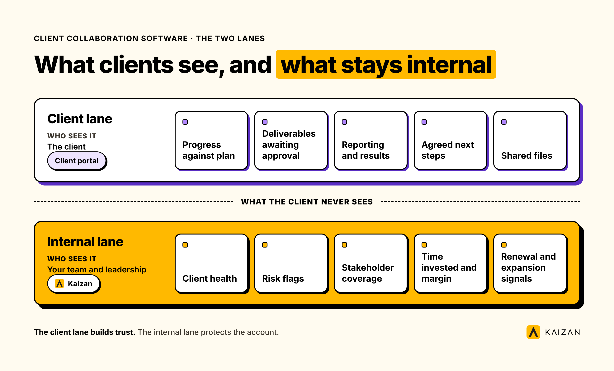
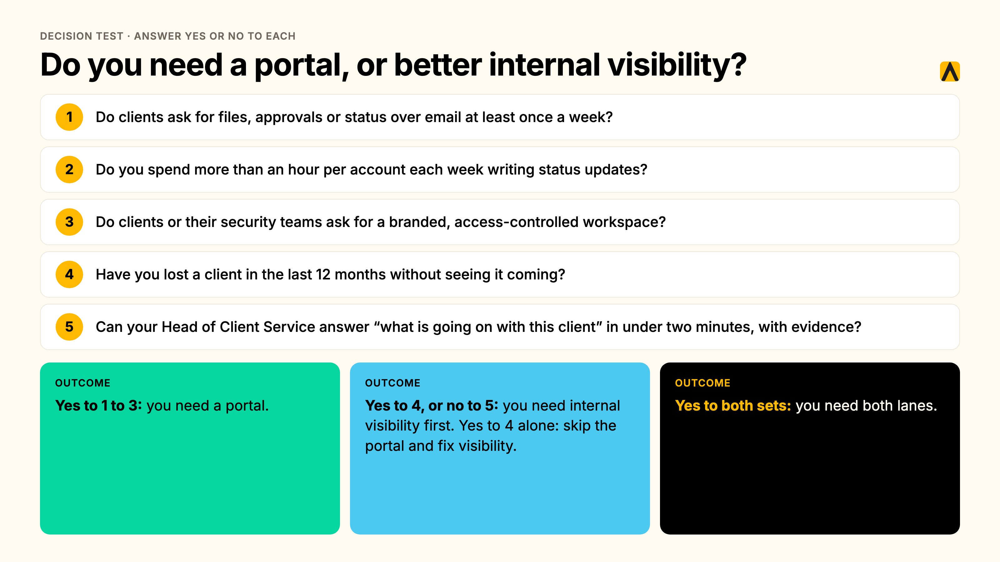
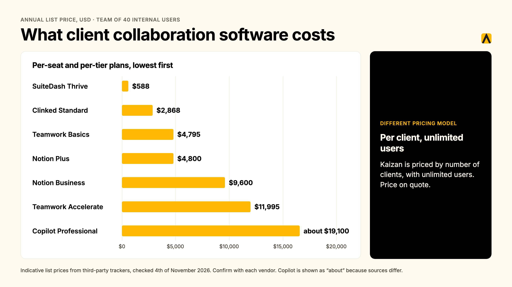
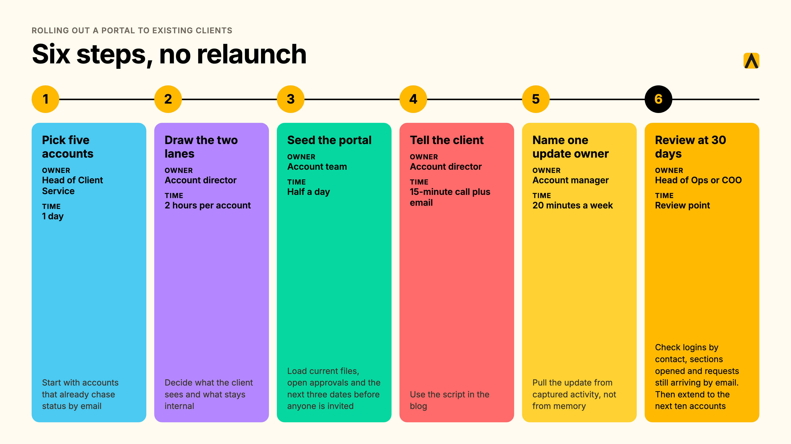

Client collaboration software gives agencies and their clients one shared place to work together: files, approvals, messages and progress updates. A client portal is the branded front door to that space. Neither tells your team how the client feels. That internal view of health, risk and stakeholder coverage needs a second layer behind the portal.

**Key takeaways**

- Client collaboration software covers what clients see. It does not cover what your team needs to know.
- We compare 8 tools in three groups: portal-first platforms (SuiteDash, Clinked, Copilot, Moxo), workspaces with client access (Notion, Google Drive and Docs, Teamwork) and an internal client success platform (Kaizan).
- Per-seat tools cost more as your team grows. Flat-rate portals do not. Kaizan prices per client.
- A portal shows clients what you did. It cannot show you what you missed.
- A five-question test below tells you whether you need a portal at all.

We make Kaizan, and Kaizan is on this list. We say where it fits and where it does not.

## What is client collaboration software, and how does it differ from a client portal?

Client collaboration software is the shared workspace between a service team and its clients. It handles file sharing, approvals, messaging and task visibility, so clients stop chasing status over email. A client portal is the branded, login-protected entry point to that workspace, usually with your logo, your domain and a separate login for each client contact.

Vendors sell the two as one product, which is why shortlists go wrong. Buyers compare portal polish and miss the question underneath: what do you do with everything your team learns about the client that never belongs in a portal?

Project management tools organize your team’s work and sometimes add client seats. CRMs record contacts and deals. Neither is built for the client-facing surface, and neither tracks how the relationship is going. Our guide to client management software for agencies sorts the full market by type. This page covers the collaboration and portal slice.

## What should clients see, and what should stay internal?

Answer this before you buy any client collaboration software. Every agency has two audiences for client information. The client needs a clear picture of the work. Your team needs an honest picture of the relationship. We call these the two lanes.

| Lane | Who sees it | What lives there |
|---|---|---|
| Client lane | The client | Progress against plan, deliverables awaiting approval, reporting and results, agreed next steps, shared files |
| Internal lane | Your team and leadership | Client health, risk flags, stakeholder coverage, time invested and margin, renewal and expansion signals |

### Progress and deliverables

Clients want three answers: what is done, what is next and what is waiting on them. Show progress against the agreed plan, deliverables awaiting approval and the date of the next update. Keep it current to the week. A stale status page is worse than none, because it tells the client nobody is watching.

### Reporting and results

Put the outcomes the client grades you on in the client lane: performance reports, campaign results, milestone summaries. Tie each one to a goal the client has named. In Kaizan’s benchmark data, top-cohort account teams reference client goals in 11.2% of interactions, against 7.8% for bottom-cohort teams ([The Client Service Benchmark 2026](https://kaizan.ai/white-paper)). Reporting that names the goal does the same work in writing.

### What to keep internal: health, risk, margin and stakeholder notes

Four things stay in your lane: the health score, the risk register, who has and has not been spoken to, and what the account costs you to run. Show a client “sentiment declining” in a shared space and the client stops being candid. Ask your team to log risk where the client can read it and the team stops logging it.

The data backs the split. Top accounts surface 2.21 times more risks than bottom accounts (15.3 against 6.9 risk phrases per account per year). A quiet risk register on an active account is a warning sign, not a green light. About 69% of struggling accounts (18 of 26 in the benchmark sample) surfaced their own warning signs in conversation at least once. Struggling clients are not silent. They are already telling you, in calls and emails, not in a portal.

Proactivity lives in this lane too. 45% of marketers cite agency lack of proactivity as the top trigger for an agency review (RSW/US, 2024 Agency New Business Outlook Report). A portal shows what you delivered. It cannot show you the signal you missed.

> “You can get a very good feedback from an account manager on what’s happening. You get their view. If something is not going so well, they might not want to tell you, or maybe they themselves are nearly ignoring it. It’s much easier now for me to jump in and look at it. You can see a bit more objective what is working, what is not working.”
>
> Head of International Client Team, Agency Client A

## The 8 best client collaboration tools for agencies, compared

We grouped the tools by the job each one does. Portal-first platforms give clients a branded space. Workspaces with client access reuse a tool your team already runs. An internal client success platform serves the other lane. Prices are list prices in USD unless marked, and they change, so confirm with the vendor before you buy.

| Tool | Type | Best fit | Pricing model | Entry price | Main limitation |
|---|---|---|---|---|---|
| SuiteDash | Portal-first, all-in-one | Small agencies wanting one flat price | Flat, unlimited staff and clients | $19 per month | Breadth over polish |
| Clinked | Portal-first | Firms needing a secure, branded portal | Flat per workspace, 100 members included | $239 per month (Standard) | High entry price for small teams |
| Copilot | Portal-first | Premium client experience | Per portal, client caps, per-internal-user fees | $39 per month annual (Starter) | Fees grow with team size |
| Moxo | Portal-first, workflow-led | Structured approvals and onboarding | Plan tier and active users | $99 to $200 per month (sources conflict) | Built for workflows, not ongoing retainers |
| Notion | Workspace with guest access | Teams who like to build | Per member, guests free | About $10 per member per month (Plus, annual) | You build and maintain it |
| Google Drive and Docs | Shared files | Agencies with few clients | Included in Workspace, per user | Included with Workspace | No status, approvals or alerts |
| Teamwork | Project management with client users | Delivery-led agencies | Per user, client users free | $9.99 per user per month billed yearly | Project view, not relationship view |
| Kaizan | Internal client success platform | Seeing client health behind any portal | Per client, unlimited users | Priced by number of clients. Price on quote. | No client-facing portal |

### SuiteDash

SuiteDash combines a CRM, white-labeled client portals, project management, invoicing and file sharing in one platform. It suits small agencies that want one tool and one flat price. Staff and clients are unlimited on every plan, and the three plans cost $19, $49 and $99 per month ([Zite](https://www.zite.com/blog/client-management-portal), [Software Advice](https://www.softwareadvice.com/project-management/suitedash-profile/)). Some reviewers report slower performance with large data sets. Verdict: the lowest cost route to a branded portal. It gives you no view of client health.

### Clinked

Clinked sells branded client portals as flat-rate workspaces. The Standard plan costs $239 per month with 100 members and 1 TB of storage, with a custom domain, tasks, shared calendar and chat ([Clinked pricing](https://www.clinked.com/pricing?unit=1)). Annual billing saves 20% and a two-year term saves 35%. Guests are unlimited ([Fitgap](https://us.fitgap.com/products/clinked)). Verdict: a strong fit for firms that need a secure, branded portal and can carry the entry price. A small team will find $239 steep.

### Copilot

Copilot is a white-label portal built for professional services, with messaging, files, billing and contracts. Starter costs $39 per month on annual billing ($59 monthly) and Professional costs $149 ($189 monthly), with an extra $39 per internal user beyond the plan’s included seats ([Copilot plans](https://copilot.app/guide/plans)). Professional supports up to 500 clients ([Copilot guide](https://www.copilot.com/guide/plans)). Third-party reviews report the product has rebranded as Assembly ([Agiled](https://agiled.app/blog/copilot-review)). Verdict: the most polished client-side experience on this list. Per-internal-user fees add up for larger teams.

### Moxo

Moxo runs client portals around structured workflows: approvals, file requests, e-signatures and audit trails. Pricing depends on plan tier and active users. Moxo’s own blog lists Business at $99 per month ([Moxo](https://www.moxo.com/blog/moxo-pricing)), while other 2026 reviews report $200 per month ([Agiled](https://agiled.app/blog/moxo-pricing)). Confirm the current figure with Moxo. Verdict: a good fit for onboarding and approval-heavy engagements. It does not replace an always-on retainer workspace.

### Notion

Notion works as a client workspace if your team builds it. You share specific pages with clients as guests, and guests do not use paid seats. Plus costs about $10 and Business about $20 per member per month billed annually, though published figures vary by source ([Lifestack](https://lifestack.ai/blog/notion-pricing)). Verdict: flexible and cheap for small client lists. Permissions work page by page, so every share needs a check, and someone must own the build.

### Google Drive and Docs

Shared folders and documents cost nothing extra if your team runs Google Workspace, and clients need only a Google account or a share link. They handle files and comments well. They give you no structured status, no approval flow and no alert when something stalls. Verdict: the right starting point for an agency with a handful of clients. It stops working when clients ask where things stand.

### Teamwork

Teamwork is project management built for client work, with client users who view projects without taking a paid seat. The Free plan covers up to 5 users, Basics costs $9.99 and Accelerate $24.99 per user per month billed yearly ([Teamwork pricing](https://www.teamwork.com/pricing/), [SaaS CRM Review](https://www.saascrmreview.com/teamwork-review/)). Verdict: ideal for delivery-led agencies that want the client view inside the project tool. The view centers on projects, not on the relationship.

### Kaizan

Kaizan is a client success platform, and it serves the internal lane. It captures every client meeting, email and chat into a permissioned client memory, scores each relationship against The Evidence-Based Client Health Standard (the CARE Framework), and gives the account team the next action to take. Integrations cover Gmail, Outlook, Teams, Zoom, Slack, HubSpot and Salesforce ([Kaizan integrations](https://kaizan.ai/integrations/)). Security includes SOC 2 Type II, zero retention and per-role access ([Kaizan product](https://kaizan.ai/product/)).

Kaizan does not host a client-facing portal. It sits behind whichever portal you choose, and it drafts the weekly client update from real conversations so the portal stays current. Kaizan is priced by number of clients, with unlimited users. Price on quote, with a free 14-day pilot on your own data ([Kaizan pricing](https://kaizan.ai/pricing/)).

> “Our clients expect us to innovate, and they’ve been excited about our use of Kaizan.”
>
> Gabriella Krite, Managing Partner, Operations, The Kite Factory

Verdict: choose Kaizan when the problem is losing visibility, not file sharing. Pair it with any portal above.

## How we assessed these tools

We built this comparison from vendor pricing and product pages, vendor documentation and third-party 2026 reviews and listings. We scored each tool against five criteria: the client-facing surface, internal visibility into the relationship, pricing model fit as team and client counts grow, effort to keep it current, and security posture. Kaizan makes one of the eight tools here, so we state where it does not compete: it has no client portal.

Three limits apply. We did not run hands-on tests of every product for this edition. Vendors change prices often and third-party sources disagree on several figures, which we flag in each entry. Pricing was compiled in October 2026 and should be confirmed before purchase.

## Client dashboard software: the internal view behind the portal

A client dashboard comes in two kinds. The client-facing dashboard lives in the portal and shows progress and results. The internal dashboard is the one your leadership uses on Monday morning, and it answers a different question: which clients are healthy, which are at risk and why.

A useful internal client dashboard software view shows every client in the book with a health score, the risks behind it, stakeholder coverage and the renewal outlook. Click a row and you see the conversations underneath. Kaizan scores health across four dimensions: client satisfaction, activity with stakeholders, relationship and interaction quality, and expansion opportunities. We explain the method in [how to measure client health with AI](https://kaizan.ai/blog/measuring-client-health-client-service-using-ai/).

The score earns trust because it comes from conversation evidence, not from a survey. In our benchmark, top and bottom accounts score identically on CSAT where it is measured (7.1 against 7.1). The difference is frequency: top accounts are measured 41 times a year against 14 for bottom accounts. Satisfaction surveys miss the early signal. Conversations carry it.

> “You’re relying on human error and you’re relying on them not looking at things with rose colored glasses. Kaizan is impartial and will say, hey, look guys, this guy’s not happy.”
>
> COO, Agency Client B

## Client tracking: what to capture automatically so the portal stays current

Portals go stale for one reason. Someone has to update them by hand. Client tracking that depends on account managers typing notes fails at the same point, and it fails quietly in the background of every busy week.

> “About 35 to 40% of an account handler’s job now is admin, and there’s a problem where that admin is getting in the way of having proper relationship driven conversations.”
>
> Chief Client Officer, Agency Client C

The relationship also lives in email, not in the portal. Top-cohort accounts see 2.91 times more client-initiated email threads than bottom-cohort accounts (The Client Service Benchmark 2026). Clients keep writing to people, even when you give them a portal. Capture that traffic automatically:

- Meetings and calls, with decisions, owners and dates
- Emails on the client’s threads
- Chat messages from Slack and Teams
- Stakeholders and who has gone silent
- CRM fields kept in sync, so nobody re-keys them

> “I immediately found it incredibly useful, initially because I was so used to frantically scribbling notes in meetings. And so the fact that that part was taken away from me was really useful.”
>
> Senior Client Partner, Agency Client D

We cover the gap between inbox and relationship in [the client relationship is bigger than your inbox](https://kaizan.ai/blog/the-client-relationship-is-bigger-than-your-inbox/), and the stakeholder side in [stakeholder mapping 101](https://kaizan.ai/blog/stakeholder-mapping-101-why-is-it-critical-in-managing-client/).

## Do you need a portal, or better internal visibility?

Run this five-question test.

1. Do clients ask for files, approvals or status over email at least once a week?
2. Do you spend more than an hour per account each week writing status updates?
3. Do clients or their security teams ask for a branded, access-controlled workspace?
4. Have you lost a client in the last 12 months without seeing it coming?
5. Can your Head of Client Service answer “what is going on with this client” in under two minutes, with evidence?

Yes to questions 1 to 3 means you need a portal. Yes to question 4, or no to question 5, means you need internal visibility first. Yes to both sets means you need both lanes. Yes to question 4 alone means skip the portal and fix visibility. A portal will not stop the next surprise.

## What client collaboration software costs

Pricing models decide the bill more than feature lists do. Per-seat tools charge for your team. Flat-rate portals charge for the workspace. Kaizan charges for the number of clients, with unlimited users. Count clients and seats before you shortlist.

Here is the annual list price for a team with 40 internal users, in USD:

| Tool and plan | Annual cost, 40 internal users | Note |
|---|---|---|
| SuiteDash Thrive | $588 | $49 per month, unlimited staff and clients |
| Clinked Standard | $2,868 | $239 per month, 100 members included, monthly billing |
| Teamwork Basics | $4,795 | $9.99 per user per month billed yearly, client users free |
| Notion Plus | $4,800 | About $10 per member per month billed annually, guests free |
| Notion Business | $9,600 | About $20 per member per month billed annually |
| Teamwork Accelerate | $11,995 | $24.99 per user per month billed yearly |
| Copilot Professional | About $19,100 | $149 per month plus about 37 extra internal users at $39, assuming 3 seats are included |

Kaizan prices on a different axis. It is priced by number of clients, with unlimited users. Price on quote.

For the return side, take an illustrative 200-person firm with 100 people on client delivery, 80 clients averaging £250,000 in annual revenue and a 16% annual client attrition rate. The 16% reflects the commonly cited 84% average client retention for professional services ([First Page Sage via Agiled](https://agiled.app/statistics/client-retention-statistics)). Kaizan’s calculator methodology credits 45% of at-risk revenue as protected, 4.8% of portfolio value as expansion and 5.4 recovered admin hours per client-facing person per week. On those inputs the model returns about £1.44M in protected revenue, £0.96M in expansion revenue and £0.75M in recovered capacity. These are modeled figures built on stated assumptions, with no guaranteed outcome. Treat them with a grain of salt, because no public data confirms results at this scale. Kaizan portfolio data shows 21%+ average revenue growth per client. Run your own numbers in the [ROI calculator](https://kaizan.ai/pricing/).

## How to roll out a portal to existing clients without a relaunch

A mid-relationship rollout needs a plan, an owner and a script.

1. **Pick five accounts.** Owner: Head of Client Service. Time: one day. Start with accounts that already chase status by email.
2. **Draw the two lanes for each account.** Owner: account director. Time: two hours per account. Decide what the client sees and what stays internal.
3. **Seed the portal.** Owner: account team. Time: half a day. Load current files, open approvals and the next three dates before anyone is invited.
4. **Tell the client.** Owner: account director. Time: a 15-minute call and one email. Use the script below.
5. **Name one update owner per account.** Owner: account manager. Time: 20 minutes a week. Pull the update from captured activity, not from memory.
6. **Review at 30 days.** Owner: Head of Ops or COO. Check logins by contact, sections opened and requests still arriving by email. Then extend to the next ten accounts.

Script for the client call: “From Monday you will have one place for files, approvals and weekly progress. Email still works for anything urgent. You will get a short update every Friday. If a section is not useful, tell us and we will change it.”

## FAQs

### What is a client portal, and how is it different from client collaboration software?

Client collaboration software gives agencies and their clients one shared place to work together: files, approvals, messages and progress updates. A client portal is the branded front door to that space. Neither tells your team how the client feels. That internal view of health, risk and stakeholder coverage needs a second layer behind the portal.

### What is the best client dashboard software for agencies?

The best client dashboard software depends on the audience. For clients, a portal such as SuiteDash, Clinked or Copilot shows progress and deliverables. For your own team, an internal dashboard such as Kaizan scores every client on health, risk and coverage from real conversations. Most agencies need one of each.

### What is client tracking?

Client tracking is the continuous record of every interaction with a client: emails, meetings, calls and chat, tied to the people involved. Tracking done by hand goes stale. Tracking captured automatically shows when contact thins, who is missing from the conversation and which accounts need attention before the client raises it.

### What should clients see, and what should stay internal?

Clients should see progress, deliverables awaiting approval, reporting and agreed next steps. Keep client health scores, risk flags, stakeholder coverage, margin and renewal signals internal. The client lane builds trust. The internal lane protects the account. Mixing them hands clients your working notes and hides your warning signs.

### Do agencies actually need a client portal?

Not always. Agencies need a portal when clients chase files, approvals or status in email every week. Agencies with a handful of clients and a shared drive can skip it. If the real problem is losing clients without warning, a portal does not fix it. Internal visibility does.

### How do we stop the portal going stale?

Stop depending on manual updates. Pull progress from the tools your team already uses, and capture meetings, emails and calls automatically so the status draws from real activity. Name one update owner per account, and retire any portal section nobody has opened in 30 days.

### How do we roll a portal out to existing clients?

Pilot with five accounts, never the whole book. Tell each client what changes, what stays in email and when the first update lands. Seed the portal with current files and open actions before inviting anyone. Review usage after 30 days, then extend to the next group.

### Will the team actually use it?

Adoption follows effort. If the portal needs a second round of manual updating, teams stop updating it. Choose tools that reuse work already done, assign one owner per account and track weekly logins by account team. A portal that adds admin fails. One that removes admin sticks.

## Next step

See the internal lane working on your own accounts with a [free 14-day Kaizan pilot](https://kaizan.ai/pricing/).

Pick the lane first. Then pick the tool.
