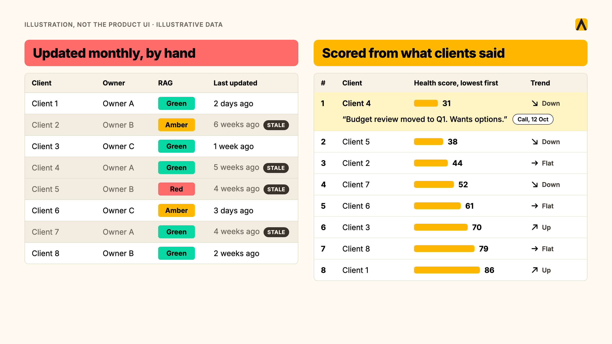
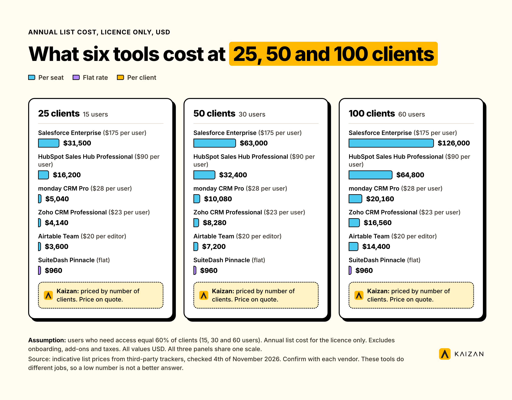
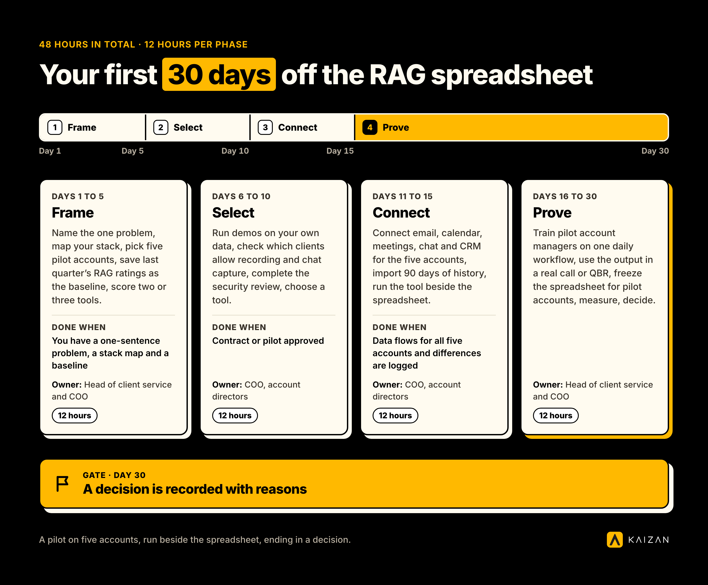

Client management software is a system that records every client's contacts, conversations, work and health in one place, so an agency can serve, keep and grow its clients. It covers five types of tool: CRMs, project tools, client portals, agency operations platforms and client success software. The right type depends on the problem you need to fix first.

**Who this guide is for:** [heads of client service](https://kaizan.ai/for/client-service-director/) and COOs at agencies, consultancies and professional services firms who run retainers, serve several stakeholders per client, and need to know which clients are at risk.

**Key takeaways**

- Sort tools by the job they do, not by the label on the box. There are five types, and most buyers need one or two.
- A CRM records what people type. Client success software records what clients say.
- Count clients, not seats. Per-seat prices grow with your headcount. Per-client prices grow with your portfolio.
- Pilot on five accounts for 14 days before you sign anything.
- List prices in this guide were checked on 29 October 2026 and come from third-party price trackers, not vendor pages. Treat competitor numbers as indicative, not hard fact, and confirm with each vendor before you buy.

## What Is Client Management Software?

Client management software gathers what an agency knows about each client: the people, the conversations, the work, the money and the mood. It gives account teams a centralised platform for storing client data and client details before a call. It gives leaders one place for managing client interactions from one client database and asking which clients are at risk. Buyers also search for it as a client management system, a client management platform, a client management app or a client management programme. The names differ. The job is the same.

### Client Management Software Vs CRM

A CRM system is the record of contacts and deals, with contact management as its core job. It was built to move a prospect through a sales pipeline, and it holds what a salesperson types into a field. Unlike CRM software, broader client management software starts after the deal closes. It follows the relationship through delivery, renewal and expansion.

Try this test on your own stack. Ask: what did the client's finance director say on last Tuesday's call? A CRM answers only if someone logged the call. Client success software answers because it captured the call. Client relation management, the CRM side of this story, is a narrower topic with its own guide.

### What Client Management Means In An Agency

An agency's relationship with a client is not one contact and one contract. A retainer has a day-to-day lead, a marketing director, a procurement owner and a finance approver. Each one forms a view of the work, which is why [stakeholder mapping](https://kaizan.ai/blog/stakeholder-mapping-101-why-is-it-critical-in-managing-client/) comes first. Delivery, billing and renewal run on different calendars. Software built around a single buyer misses most of this.

The scale is real. Kaizan's own customer base describes its typical daily user as an account director or account manager who owns a portfolio of [6 to 25 client relationships](https://kaizan.ai/faq/). At that load, managing clients across multiple clients gets harder without a shared record that protects customer relationships with existing clients.

## The Five Types Of Client Management Software

Software for client management is not one category. It is five, and each does a different job. Pick the type first. Pick the tool second.

| Type | The job it does | What it records | Tools in this guide | Where it stops |
| --- | --- | --- | --- | --- |
| CRM | Tracks contacts, companies and deals | What people type in | HubSpot, Salesforce, Zoho CRM, monday CRM | Sees only what someone logs |
| Project and work tools | Plans tasks and shares boards | Tasks, status, files | Airtable | Does not read client conversations |
| Client portal | Shares files, approvals and messages with clients | Documents and approvals | SuiteDash, Moxo | Shows the client your work, not the client's mood |
| Agency operations platform (PSA) | Runs projects, time, budgets and margin | Hours, budgets, profit | Teamwork.com, Productive, Scoro | Tracks delivery, not the relationship |
| Client success software | Captures client conversations and scores relationship health | Calls, emails and chat, with evidence | Kaizan, Planhat | Needs conversation data to work |

### CRMs: The Record Of Contacts And Deals

A CRM is where your sales team lives. It is the right place for companies, contacts, deal stages, forecasts, lead management, and tracking potential clients through follow-up. It is also where a sales rep and wider sales teams use the CRM for deal follow-up. It is the wrong place to learn that a client's marketing director went quiet three weeks ago, because that fact never reaches a field.

### Project And Work Tools With Client Views

Project tools help teams manage projects and keep client projects organised. A board can help a client track progress on a campaign. A flexible database such as Airtable can hold a client list, a QBR calendar and a RAG column. You build it, you maintain it, and teams can assign tasks inside it, but it only holds what your team enters.

### Client Portals And Client Collaboration Software

Portals give clients a branded login for files, approvals, invoices and messages in a centralised location for client documents. They fix a real problem: portals help teams manage client documents more easily when clients are chasing your team for documents. Client collaboration software has its own guide, so we treat portals as one type here.

### Agency Operations Platforms

PSA tools such as Teamwork.com, Productive and Scoro run the business side of delivery: time, budgets, resourcing and margin. They tell you whether a retainer makes money. They do not tell you whether the client plans to renew it.

### Client Success Software

This type listens to the relationship itself. It captures meetings, emails and chat, builds a memory for each client, scores the health of the relationship and flags risk with the evidence behind it. Most client success software is built for B2B SaaS companies. Planhat is a well-known example. Kaizan is built for marketing agencies and professional services firms, where one client has many stakeholders and the relationship lives in calls and inboxes.

Client tracking sits at the line between types. A CRM tracks the [touchpoints](https://kaizan.ai/blog/client-experience-touchpoints-what-are-they-and-how-can-you-optimise/) people log. Client success software tracks the touchpoints that happen.

### Which Type Do You Need? A 60-Second Decision Table

| Your problem today | The type that fixes it first |
| --- | --- |
| We lose clients without warning | Client success software |
| The CEO asks what is going on with a client and nobody can say | Client success software |
| Deals and contacts sit in five inboxes | CRM |
| Clients chase us for files and approvals | Client portal |
| We do not know which retainers make money | Agency operations platform |
| We want a custom tracker and have someone to build and maintain it | Project and work tool |

Start with one type. Add a second only when a second problem outranks the first. A CRM beside client success software is a pairing that keeps the deal record and the relationship record separate.

## Why Agencies Outgrow Spreadsheets And CRMs

A spreadsheet and a CRM share one weakness. Both hold what someone remembered to type. Four problems follow.

### The Monthly RAG Spreadsheet Problem

The Friday RAG update is a snapshot of opinion, built by hand, looking backward. A head of client service described her health tracker as a Google Sheet her team updates every month, and called the process manual. Another said the sheet is always lagging behind when it comes to issues.

The cost is [proactivity](https://kaizan.ai/blog/from-reactive-to-proactive-how-great-client-teams-stay-ahead/). In the RSW/US 2024 New Year Outlook, [45% of marketers named lack of proactivity as the top reason they reviewed new agencies](https://www.vktr.com/the-wire/agencies-and-marketers-see-more-opportunities-in-2024-but-require-proactive-strategies-to-succeed-rswus-releases-comprehensive-2024-new-year-outlook-report-for-marketing-and-advertising-industry). A tracker that refreshes monthly is reactive by design.

Surveys have the same flaw. In Kaizan's 2026 benchmark, top and bottom client cohorts scored the same CSAT, 7.1 out of 10, where it was measured. The difference was frequency: top accounts were measured [41 times a year against 14](https://kaizan.ai/white-paper). The satisfaction gap most reports cite is a measurement gap.

### The Relationship Lives In Inboxes And Calls, Not CRM Fields

Client information [scatters across email, chat, meeting tools and spreadsheets](https://kaizan.ai/blog/the-client-relationship-is-bigger-than-your-inbox/). One prospect running a homegrown CRM told us that half of the updates and notes never get logged. Email retention makes it worse. A Senior Growth Director at an agency we serve put it this way:

> "Our emails delete after 60 days. So something I really like is, what did my clients say about this test result?"
>
> — Senior Growth Director, Agency Client A

Client tracking that depends on manual entry breaks at the first busy week.

### When An Account Director Leaves, The Context Leaves Too

A client's history and key client records sit in the heads of the people who served it. When one leaves, the next person starts cold. A senior leader at a large global agency named the fix she wanted:

> "I'm excited at the prospect of somebody else remembering things for me."
>
> — Senior leader at a large global agency, Agency Client B

She also named the limit of any human memory: "I can't know the 20 different conversations that are happening on one client before I go and meet with that client."

### Which Clients Are At Risk, And Why Nobody Can Answer With Evidence

Leaders get a view filtered through the account manager. A Head of International Client Team explained the gap:

> "You can get a very good feedback from an account manager on what's happening. You get their view. If something is not going so well, they might not want to tell you, or maybe they themselves are nearly ignoring it. It's much easier now for me to jump in and look at it. You can see a bit more objective what is working, what is not working."
>
> — Head of International Client Team, Agency Client C

The warnings exist. In Kaizan's 2026 benchmark, 18 of 26 struggling accounts, about 69%, [raised their own warning signs in conversation at least once](https://kaizan.ai/white-paper). The sample is small and the finding is directional. The point holds: the signal lives in conversations, and a field-based record never sees it.

Keeping a client costs far less than replacing one. Harvard Business Review reports that, depending on the study and the industry, [winning a new customer costs 5 to 25 times more than keeping an existing one](https://hbr.org/2014/10/the-value-of-keeping-the-right-customers).

## Must-Have Features Of A Client Management Platform

Judge every tool on the job each feature does for your team. A long feature list is not a reason to buy.

### One Client Record

The job: stop hunting across five tools before a call. Kaizan calls this [client memory](https://kaizan.ai/product/), a permissioned, always-current client database for each client’s details and communication history that the account team and the firm's own AI tools can question. Ask any vendor to show one client's last 30 days of customer communications in that record without asking a colleague.

### Client Tracking: Emails, Meetings And Calls Captured Automatically

The job: remove manual logging. A Managing Director and Chief Client Officer put the cost plainly:

> "About 35 to 40% of an account handler's job now is admin, and there's a problem where that admin is getting in the way of having proper relationship driven conversations."
>
> — MD and Chief Client Officer, Agency Client D

Check which sources the tool captures on its own: [meetings, email and chat](https://kaizan.ai/faq/). If a source needs a person to paste it in, expect gaps.

### Client Dashboard Software: Internal Views Against Client-Facing Views

Client dashboard software shows the state of a client on one screen, and for internal use it may also support project tracking where relevant. Two products hide under that name. An internal dashboard shows health, risk and activity to your team. A client-facing dashboard shows deliverables and results to the client. Decide which you need. They solve different problems.

### Client Collaboration And Portals

The job: stop clients chasing your team for files and approvals. If that is your top complaint, a portal beats email. Client collaboration software has its own guide.

### Client Management Workflow And Automation

A client management workflow is the repeatable sequence of client management processes from onboarding to meeting prep, recap, action tracking, QBR and renewal. Use workflow automation to automate tasks such as recaps, agendas, follow-ups and CRM updates, cutting repetitive tasks and other routine tasks. Keep the relationship decisions human. A Head of International Client Team described the discipline this adds:

> "Before you have a meeting, you send them an agenda. Afterwards you send them actions and summaries. We never did that before, more or less, unless it was a very important meeting."
>
> — Head of International Client Team, Agency Client C

### Health Scoring And Early Risk Alerts

This is the layer a CRM cannot supply. [Measuring client health with AI](https://kaizan.ai/blog/measuring-client-health-client-service-using-ai/) covers the method in depth. Kaizan calls its method [The Evidence-Based Client Health Standard](https://kaizan.ai/product/#health-model), known inside the product as CARE. It scores every relationship on four dimensions: Client Satisfaction, Activity with Stakeholders, Relationship Strength, and Expansion Opportunities. Sub-elements include CSAT, Market and Sector Awareness, Decision-Maker Recency, Communication Recency and Risk Mention Trend. Each score cites the conversation behind it.

> "You're relying on human error and you're relying on them not looking at things with rose coloured glasses. Kaizan is impartial and will say, hey, look guys, this guy's not happy."
>
> — COO, Agency Client E

A score without evidence is an opinion. Insist on the quote or message behind every flag.

### A Portfolio View For Leadership

The job: answer "which clients are at risk, and why" in one screen. The view should rank accounts, show trend and let a leader click through to the evidence. Derek Grant, VP Operations at [Tradedoubler](https://kaizan.ai/blog/how-tradedoubler-is-driving-20-greater-operational-efficiency-across/), uses it to find growth: "Kaizan really helps us focus in on those opportunities where we know there'll be an uplift in gross profit."

### Integrations

List your stack before you shop: CRM, email, calendar, meeting tool, chat, document store. Look for native connections to HubSpot, Salesforce, Slack, Teams, Zoom, Gmail and Outlook. A custom integration quote is a cost, not a feature.

### Security, Permissions, SOC 2 And GDPR

Clients ask first. Kaizan's [data policy](https://kaizan.ai/blog/your-data-is-yours-thats-our-policy/) and [security page](https://kaizan.ai/security/) show the kind of commitment to request, including robust security features that protect client data. Request role-based permissions, the SOC 2 report, a data processing agreement and the data residency terms. Check which of your clients prohibit recording or private chat capture, because those accounts will show thin data in any tool.

### AI Features Worth Paying For, And The Gimmicks

Worth paying for: drafts grounded in client memory, meeting prep, risk alerts with source quotes, next actions you can approve or decline, and [API or MCP access](https://kaizan.ai/blog/mcp-vs-api-in-plain-english/) so your own AI tools read the same client memory. Gimmicks: summaries with no client context, scores with no evidence, and a chatbot that cannot cite its source. A COO who uses Kaizan drew the line this way:

> "The note taker is great and it's better than a lot of the other ones. But all of the additional stuff is the value for us. It's what it does with the notes, but it's not the notes themselves."
>
> — COO, Agency Client E

## The 12 Best Client Management Software Tools For Agencies In 2026

Kaizan publishes this guide, and Kaizan is one of the 12 tools. We assessed it by the same method as the other eleven, and we state its limits in the same plain terms. Prices were checked on 29 October 2026 and are list prices. Competitor tools are priced in USD. Competitor prices come from third-party trackers rather than vendor pages, so they are not hard figures. Treat them as indicative.

| Tool | Type | Best fit | Pricing model and list price | Integrations | Main limitation |
| --- | --- | --- | --- | --- | --- |
| HubSpot | CRM | Agencies that run sales and marketing in one system | Per seat. Free CRM for 2 seats. Sales Hub Professional about $90 per seat per month | Large app marketplace, Gmail and Outlook sync | Holds only what people log. Onboarding fees on higher tiers |
| Salesforce | CRM | Larger firms with an admin and complex sales | Per user. $25 Starter Suite, $100 Pro Suite, $175 Enterprise per month | AppExchange ecosystem | Needs admin time and implementation budget |
| Zoho CRM | CRM | Small agencies on a tight budget | Per user. Free for 3 users. $14 to $52 per month on annual billing | Zoho suite, 900+ marketplace extensions | Process automation starts at Professional |
| monday CRM | CRM | Teams that want visual boards | Per seat. $12, $17 or $28 per month on annual billing, 3-seat minimum | 850+ integrations, email sync on Standard | No free CRM plan. Seats sold in buckets |
| Teamwork.com | Agency operations (PSA) | Agencies that track budgets, hours and margin | Per user. Free plan. Paid from about $9.99 per month | Time, budget and resource tracking built in | Tracks delivery, not the relationship |
| Productive | Agency operations (PSA) | Agencies that plan resources and budgets | Per user. About $9 to $32 per month, sources vary | Budgeting, time and expenses built in | Tracks delivery, not the relationship |
| Scoro | Agency operations (PSA) | Firms that want quote-to-cash in one tool | Per user. $19.90 to $59.90 per month, 5-user minimum reported | Quotes, projects and billing in one | Five-user minimum reported. Tracks delivery, not the relationship |
| SuiteDash | Client portal | Small firms that want a white-label portal | Flat rate. $19, $49 or $99 per month, unlimited users | Zoom, WordPress, PayPal | Shows work to clients. Does not score health |
| Moxo | Client portal | Regulated firms with approval workflows | Flat team plan reported at $500 per month, unlimited seats | Structured workflows and approvals | Highest entry price among the portals we checked |
| Kaizan | Client success software | Agencies and professional services firms with many stakeholders per client | Per client. Priced by number of clients. Price on quote. Unlimited users | [CRM, email, calendar, meeting, chat and work tools](https://kaizan.ai/integrations/) | Needs conversation data. Annual contract only |
| Planhat | Client success software | B2B SaaS customer success teams | Quote-based, by customer account count | Confirm the connector list with the vendor | Built around SaaS customer lifecycles |
| Airtable | Project and work tool | Teams that want to build their own tracker | Per editor. Free for 5 editors. Team $20 per month on annual billing | Synced tables, automations, Portals add-on | You build and maintain it. Holds what you enter |

### HubSpot

**What it is:** a CRM software option with a free tier and add-on hubs for sales, marketing and service, and a **client management tool** for agencies that want sales and marketing in one system. **Best for:** agencies whose sales and marketing run in one place. **Standout:** the free CRM, plus a large ecosystem and built-in **marketing automation**. **Pricing:**[free for two seats, with Sales Hub Professional around $90 per seat per month and Enterprise around $150](https://www.saasworthy.com/blog/hubspot-crm-pricing), plus reported onboarding fees of $1,500 and $3,500 on those tiers. **Limits:** it records what people log, though agencies using its marketing features can also run **targeted email campaigns** for clients. The relationship lives in inboxes and calls, and HubSpot sees it only if someone types it in. **Agency verdict:** keep it as the deal record. Choose a different type when the problem is client risk.

### Salesforce

**What it is:** the most configurable CRM on this list. **Best for:** larger firms with an admin and a complex sales process. **Standout:** depth and ecosystem. **Pricing:** [$25 for Starter Suite, $100 for Pro Suite and $175 for Enterprise per user per month](https://meetergo.com/en/magazine/salesforce-starter-suite-pricing), billed annually, with add-ons and implementation extra. **Limits:** it needs administration, and it records what people enter. **Agency verdict:** right when sales complexity is your constraint. Wrong when your constraint is knowing how clients feel.

### Zoho CRM

**What it is:** a low-cost CRM with five editions. **Best for:** small agencies and small businesses that need a pipeline on a budget. **Standout:** price. **Pricing:**[free for three users, then $14, $23, $40 or $52 per user per month on annual billing](https://meetergo.com/en/magazine/zoho-crm-pricing). **Limits:** Blueprint process control starts at Professional, and the record still depends on manual entry. **Agency verdict:** a sound starter CRM. It does not read client conversations.

### Monday CRM

**What it is:** a visual **monday sales crm** and **user friendly platform** built on monday's board interface. **Best for:** teams that already run work in monday. **Standout:** easy adoption plus synced email features and templates that **create personalised emails** on Standard. **Pricing:**[$12, $17 or $28 per seat per month on annual billing, with a three-seat minimum](https://saascrmreview.com/monday-com-pricing/), and **paid plans start** at $12 per seat per month, with no free CRM plan. **Limits:** seats are sold in buckets, and feature caps rise with each tier. **Agency verdict:** a good fit for pipeline visibility. It will not warn you about a client.

### Teamwork.com

**What it is:** project management with budget, resource and profitability tracking for client work. **Best for:** agencies that want to know whether a retainer makes money. **Standout:** margin and workload planning. **Pricing:** [a free plan, with paid plans from about $9.99 per user per month](https://costbench.com/software/agency-project-management/teamwork-agency/). **Limits:** it tracks delivery, so it cannot tell you how the client feels about it. **Agency verdict:** pair it with a tool that listens to clients.

### Productive

**What it is:** an agency operations platform covering budgets, time, resourcing and reporting. **Best for:** agencies that plan capacity and budgets tightly. **Standout:** budgeting and profitability in one place. **Pricing:** [Essential from about $9 per user per month, rising to about $32 on the top tier](https://www.g2.com/products/productive/reviews?page=4), though trackers report different ceilings. **Limits:** it records delivery, not conversations. **Agency verdict:** choose it when the CFO asks about margin. Add client success software when the CEO asks about renewal risk.

### Scoro

**What it is:** a work management platform for agencies and professional services firms that connects quotes, projects, time and billing, including generating invoices. **Best for:** firms that want quote-to-cash in one tool. **Standout:** the quote-to-invoice chain also helps teams accept online payments. **Pricing:**[Core about $19.90 to $23.90, Growth about $38.90 and Performance about $59.90 per user per month](https://agiled.app/blog/scoro-pricing), with a five-user minimum reported. **Limits:** it tracks delivery and money, not client conversations. **Agency verdict:** choose it to run operations. It does not replace a view of client health.

### SuiteDash

**What it is:** a flat-rate portal that bundles a CRM, projects, invoicing and white-label client logins, with client communication handled inside the portal. **Best for:** small firms that want clients to log in to a branded space. **Standout:** unlimited users and unlimited contacts on every plan. **Pricing:**[$19, $49 or $99 per month, or $180, $480 and $960 per year](https://agiled.app/blog/suitedash-review), with no free plan and a 14-day trial. **Limits:** it shows your work to clients. It does not score how they feel about it. **Agency verdict:** the cheapest way to fix file chasing. Not a way to find at-risk clients.

### Moxo

**What it is:** a client portal built around structured workflows and approvals. **Best for:** regulated firms that need auditable client processes. **Standout:** approval flows with unlimited seats. **Pricing:** [a team plan reported at $500 per month or $5,000 per year](https://resources.rework.com/tools/client-portal/best-suitedash-alternatives). Clinked, a per-user alternative, starts around $11 per user per month. **Limits:** the highest entry price among the portals we checked. **Agency verdict:** right for compliance-heavy client work. Heavy for a ten-person agency.

### Kaizan

**What it is:** a **popular client management software** option for agencies, though more specifically client success software for marketing agencies and professional services firms. It captures every client meeting, email and message into client memory for **managing client interactions**, scores each relationship against [The Evidence-Based Client Health Standard](https://kaizan.ai/product/#health-model) (CARE), and gives the account team the next action to approve or decline. **Best for:** agencies where one client has several stakeholders and the relationship lives in calls and inboxes. **Standout:** risk and growth signals with the quote behind each, giving teams **valuable insights**, and the same client memory available to your own AI tools through [API and MCP](https://kaizan.ai/blog/mcp-vs-api-in-plain-english/). **Pricing:** Kaizan is priced by number of clients. Price on quote. Users are unlimited. Contracts are annual, and every engagement starts with [a free 14-day pilot on your own data](https://kaizan.ai/pricing/). **Limits:** it needs conversation data to work. Accounts that block recording or private chat capture produce thin scores. It is not a CRM and sits beside one. Per-client pricing rises as your portfolio grows. **Agency verdict:** choose it when the problem is losing clients without warning. Choose a CRM, a PSA or a portal when the problem is deals, margin or files.

**Reported results:** Kaizan reports an average 26%+ revenue growth per client across its customer portfolio, an average 33% lower cost to serve and an average 40% cut in manual admin by **automating routine tasks**, which frees teams for higher-value work such as **marketing strategies**. Its calculator credits an average 45% of at-risk revenue as protected. These are Kaizan's own figures, not independent measurements, so test them in the pilot.

### Planhat

**What it is:** a customer platform for customer success teams, covering health scores, accounts and revenue signals. **Best for:** B2B SaaS companies managing customer lifecycles. **Standout:** depth for subscription businesses. **Pricing:** [quote-based and priced by the number of customer accounts, not seats](https://www.vendr.com/marketplace/planhat). Public trackers report typical annual contracts from about $17,500 to about $40,000, with implementation extra. **Limits:** it is built around SaaS customer lifecycles, so agency retainers with many stakeholders and calls as the main signal are a looser fit. **Agency verdict:** choose it if you run a SaaS product. Choose software built for professional services if you sell retainers.

### Airtable

**What it is:** a flexible database you shape into a client tracker, a QBR calendar or a RAG board. **Best for:** teams with someone who enjoys building and maintaining systems. **Standout:** flexibility. **Pricing:** [free for five editors, then $20 per editor per month on Team and $45 on Business with annual billing](https://www.layer3labs.io/guides/airtable-pricing-guide). **Limits:** you build it, you maintain it, and it holds what your team enters. It is the spreadsheet with better formatting. **Agency verdict:** a good bridge off the spreadsheet. It will not tell you what a client said last week.

## How We Assessed These Tools

Kaizan's client service team assessed all 12 tools on 29 October 2026. We worked from each vendor's public pricing and documentation and from third-party price trackers. We did not run hands-on trials of the eleven tools that are not Kaizan, so we describe what each vendor and tracker publishes and nothing more.

We judged each tool on nine criteria and weighted them for a retainer agency: whether it fixes your number one problem (20 points), automatic capture of emails, meetings and chat (15), health and risk alerts with evidence (15), adoption effort (10), fit with your stack (10), pricing model fit (10), portfolio view (8), security and permissions (7), and time to first useful output (5). Change the weights to match your own priorities and score your own shortlist.

Kaizan sells one of the tools reviewed. We placed it by the same rules, and we name its limits.

## How To Choose Client Management Software In Seven Steps

### 1. Start With The Problem, Not The Features

Write one sentence: "We lose clients without warning" or "Clients chase us for files" or "We cannot see which retainers make money." Use the decision table above to find the type. A tool that wins on features and misses your sentence will sit unused.

### 2. Map Your Current Stack

List where client information lives: CRM, inbox, calendar, meeting tool, chat, spreadsheet, drive. Mark the two places where information gets lost. The right tool connects to those two first.

### 3. Count Clients, Not Seats

Per-seat tools charge for headcount. Per-client tools charge for your portfolio. Run both models on your own numbers. Take an agency with 50 clients and 30 people who need access. At list price, Salesforce Enterprise costs $63,000 a year (30 users at $175 a month). Zoho CRM Professional costs $8,280 (30 users at $23 a month). Kaizan is priced by number of clients. Price on quote. It stays the same if 10 more people need access, and it rises only as you add clients. Competitor prices here are indicative list prices from third-party trackers, not hard figures. The next section shows the full comparison at 25, 50 and 100 clients.

### 4. Manual Entry Against Automatic Capture

The biggest adoption risk is a tool that asks account managers to type more. Ask each vendor: what does the tool capture without a human doing anything? A COO at an agency that adopted client success software described what changed:

> "We didn't realise that there was a problem of the throughput of connecting everything together and having a searchable place to go for each client. We didn't realise we needed it, but once we had it, we were like, oh my God, we were missing the boat."
>
> — COO, Agency Client E

### 5. Pilot On Five Accounts For 14 Days

Pick two healthy accounts, two uncertain ones and one at risk. Run the tool beside your RAG spreadsheet. Log every case where the tool saw something the spreadsheet missed. Kaizan runs [a free 14-day pilot on your own data](https://kaizan.ai/pricing/). Ask every other vendor for the same.

### 6. Give Each Buyer What They Need To See

- **Head of client service:** proof that it replaces the RAG spreadsheet, and the evidence behind every flag.
- **COO:** the adoption plan, the admin hours removed, the fit with your stack and who maintains it.
- **CFO:** price per client, revenue at risk each year, and the payback period.

### 7. Score The Shortlist

Use the nine weighted criteria in the assessment above to choose the right client management software. Change the weights to match your biggest recent loss. Score two or three tools. Choose the highest score only if the pilot agrees, so you can streamline operations.

## How Much Does Client Management Software Cost?

Client management software costs from $0 to more than $100,000 a year. The price model decides where you land. Prices below are list prices checked on 29 October 2026. Competitor prices are in USD. Competitor prices come from third-party trackers, not vendor pages, and are not hard figures. Confirm each one with the vendor.

| Pricing model | Tools | List price | What pushes the price up |
| --- | --- | --- | --- |
| Per seat | HubSpot, Salesforce, Zoho CRM, monday CRM, Teamwork.com, Productive, Scoro, Airtable | $9 to $175 per user per month | Headcount, onboarding fees ($1,500 and $3,500 reported on HubSpot tiers), add-ons, seat minimums |
| Flat rate | SuiteDash, Moxo | $19 to $99 per month (SuiteDash). Around $500 per month (Moxo, reported) | Storage and automation tiers |
| Per client or account | Kaizan, Planhat | Priced by number of clients, price on quote (Kaizan). Quote-based (Planhat) | Client count, annual contract, implementation |

### Cost At 25, 50 And 100 Clients

This comparison assumes the number of users who need access equals 60% of your client count: 15, 30 and 60 users. That ratio is our assumption. Replace it with your own headcount. Figures are annual list cost. Kaizan is priced by number of clients. Price on quote.

| Tool and plan | 25 clients, 15 users | 50 clients, 30 users | 100 clients, 60 users |
| --- | --- | --- | --- |
| Salesforce Enterprise ($175 per user) | $31,500 | $63,000 | $126,000 |
| HubSpot Sales Hub Professional ($90 per user) | $16,200 | $32,400 | $64,800 |
| monday CRM Pro ($28 per user) | $5,040 | $10,080 | $20,160 |
| Zoho CRM Professional ($23 per user) | $4,140 | $8,280 | $16,560 |
| Airtable Team ($20 per editor) | $3,600 | $7,200 | $14,400 |
| SuiteDash Pinnacle (flat) | $960 | $960 | $960 |

The table shows indicative list price for the licence only, and competitor figures are not hard numbers. It leaves out onboarding fees, add-ons, implementation and taxes. It also compares tools that do different jobs, so a low number is not a better answer. A CRM at $8,280 does not warn you about a client. Read cost beside the decision table, not instead of it.

### What The Cost Buys: A Modelled Example

Take a 200-person agency with 100 clients averaging £120,000 a year each, and a client delivery team of 80. Published benchmarks put professional services client retention at [84% a year](https://agiled.app/statistics/client-retention-statistics), which is 16% attrition. Benchmarks for marketing agencies run lower, from [60% to 70%](https://pushleads.com/agency-growth-blueprint/marketing-agency-growth-benchmarks/) in some sources, so use your own figure.

Kaizan's pricing calculator method gives this result in its Expected mode:

| Line | Annual value |
| --- | --- |
| Revenue at risk from 16% attrition | £1,920,000 |
| Revenue protected from churn (45% of at-risk revenue) | £864,000 |
| Revenue from white space (8% pool, 60% counted) | £576,000 |
| Capacity recovered (9 admin hours a week per person, 60% handed back) | £596,160 |
| Total modelled benefit | £2,036,160 |

This is a model, not a result, and it is meant to show how stronger customer retention can protect revenue and support better sales figures. The agency size, revenue per client and team size are examples we chose. The shares come from the [pricing calculator](https://kaizan.ai/pricing/). Run your own numbers there. Kaizan is priced by number of clients, with price on quote.

## Which Client Management Software Fits A 10, 50 And 200+ Person Agency?

The right stack changes with size, because the main constraint changes.

| Agency size | Main constraint | Start with | Add when |
| --- | --- | --- | --- |
| 10 people | One or two leads hold every client in their heads, and a spreadsheet still works | A free CRM (HubSpot for two seats or Zoho CRM for three users) and, if files are the pain, a flat-rate portal such as SuiteDash | Margin gets blurry: add a PSA such as Teamwork.com or Productive |
| 50 people | Clients outnumber what one head of client service can hold, and resourcing and margin need tracking | A CRM (HubSpot, Zoho CRM or monday CRM) plus a PSA (Teamwork.com, Productive or Scoro) | A client leaves without warning: add client success software |
| 200 people | Dispersed teams, many stakeholders per client, and a board that asks for retention evidence | A CRM as the system of record (Salesforce or HubSpot Professional), a PSA, and client success software | Your own AI tools need client context: connect them through API or MCP |

Kaizan serves firms of 200 to 10,000 people, so it belongs in the 200-person row. Below that size, spend on the CRM and the PSA first. Planhat fits the 200-person row only if you sell software rather than retainers.

At 200 people, no one holds the portfolio in their head. That is the point where a record built from conversations pays for itself.

## Your First 30 Days: Moving Off The RAG Spreadsheet

A move off the spreadsheet takes about 48 hours of work across 30 days. The plan below runs a pilot on five accounts and ends with a decision.

| Phase | Days | What happens | Owner | Hours | Done when |
| --- | --- | --- | --- | --- | --- |
| 1. Frame | 1 to 5 | Name the one problem, map your stack, pick five pilot accounts, save last quarter's RAG ratings as the baseline, score two or three tools | Head of client service and COO | 12 | You have a one-sentence problem, a stack map and a baseline |
| 2. Select | 6 to 10 | Run demos on your own data, check which clients allow recording and chat capture, complete the security review, choose a tool | COO, account directors | 12 | Contract or pilot approved |
| 3. Connect | 11 to 15 | Connect email, calendar, meetings, chat and CRM for the five accounts, import 90 days of history, run the tool beside the spreadsheet | COO, account directors | 12 | Data flows for all five accounts and differences are logged |
| 4. Prove | 16 to 30 | Train pilot account managers on one daily workflow, use the output in a real call or QBR, freeze the spreadsheet for pilot accounts, measure, decide | Head of client service and COO | 12 | A decision is recorded with reasons |

### How To Tell Whether It Worked

Measure one number before and after: the minutes it takes to answer "what is going on with this client?" Record the sample size and the dates. Add two checks: did the tool flag something the spreadsheet missed, and did an account manager use its output in a live conversation?

### What To Automate And What Must Stay Human

Automate capture, recaps, agendas, follow-up drafts and CRM updates. Keep the call with the client, the judgement about a risk and the decision to escalate with a person. A tool that proposes a next action should let your team approve or decline it.

### Common Pitfalls

- **Piloting only healthy accounts.** Include one at-risk account, or you will not see the tool earn its keep.
- **Skipping the client permissions check.** Clients that block recording will show thin data. Find them in phase 2.
- **Running two systems forever.** Set a date to freeze the spreadsheet.
- **Measuring nothing.** Without a baseline, the decision becomes an opinion.

## What Changed When Agencies Added Client Success Software

These are the words of agency leaders who run Kaizan. They describe what changed in how they see and act on client risk.

A Head of International Client Team described the shift in visibility:

> "I have a pretty good view now of what is happening on our clients everywhere and can spot things when things are not working as expected or when things are going really well, in a much earlier way."
>
> — Head of International Client Team, Agency Client C

A COO described how it changed risk work:

> "We're trying to be proactive in predicting which clients might be a churn risk. And Kaizan is a huge part of helping to identify that."
>
> — COO, Agency Client E

An MD and Chief Client Officer described what it did to a report:

> "Kaizan is fast becoming the key input to my churn report. Something that used to take me hours now takes me minutes."
>
> — MD and Chief Client Officer, Agency Client D

James Smith, CEO of The Kite Factory, described the time saved after each call: "It'll take me 15 seconds to read through a summary and be like, actually, what's the sentiment of that meeting? What's happened? What are the key takeouts? It means I can save half an hour, an hour of my time."

### A Counter-Example: Where The Tool Did Not Help

Client success software depends on conversation data. When a client blocks that data, the tool has less to work with. A Growth Director at an agency we serve described an account where the client prohibits meeting recording:

> "The follow up looked so odd." The account had "very, very limited contact," and she "almost wanted to say, okay, don't even look at Care for this."
>
> — Growth Director, Agency Client F

A Senior Client Partner described the same limit from the other side. For the one client who will not let his team use it, he goes back to scribbling notes, and it costs him time and stress.

The lesson: treat a health score as unreliable on any account with thin data, and say so. Ask clients for capture consent at contract. Keep a manual process for the accounts that refuse.

## Client Management Software FAQs

### What Is Client Management Software?

Client management software is a system that records every client's contacts, conversations, work and health in one place, so an agency can serve, keep and grow its clients. It covers five types of tool: CRMs, project tools, client portals, agency operations platforms and client success software. The right type depends on the problem you need to fix first.

### What Is The Best Client Management App For Agencies?

The best client management app depends on your first problem. Choose a CRM such as HubSpot or Zoho CRM for deals, a PSA such as Teamwork.com or Productive for margin, a portal such as SuiteDash for files, and client success software such as Kaizan for client risk and growth.

### What Is A Client Management Programme?

A client management programme is the set of habits and software an agency uses to run client relationships: who owns each client, how often the team meets them, how conversations are recorded and how health is reviewed. The software supports the programme. It does not replace the rules.

### What Is The Best Client Service Software For Agencies?

Client service software for agencies should capture client conversations automatically, score relationship health with evidence and show leaders which clients are at risk. Kaizan and Planhat sit in this type. Kaizan is built for agencies and professional services firms of 200 to 10,000 people. Planhat is built for B2B SaaS.

### What Is A Client Management Workflow?

A client management workflow is the repeatable sequence an account team follows for each client: onboarding, an agenda before each meeting, a recap and actions afterward, a QBR and a renewal review. Good software automates the recaps, agendas and follow-ups and leaves relationship decisions to people.

### Is A CRM The Same Thing, And Do We Need More If We Already Have HubSpot?

No. A CRM records contacts and deals that people log. Client management software for an agency captures what clients say on calls, email and chat, and scores relationship health. Keep your CRM as the system of record. Add client success software beside it when you need to know which clients are at risk.

### How Much Does Client Management Software Cost?

Prices run from free to more than $100,000 a year. Per-seat tools cost $9 to $175 per user per month. Flat-rate portals cost $19 to $99 per month. Per-client tools such as Kaizan are priced by number of clients, with unlimited users. Kaizan's price is on quote. Competitor prices are indicative, not hard figures. Onboarding and add-ons cost extra.

### Is There Free Client Management Software?

Yes, with limits. HubSpot's CRM is free for two seats, Zoho CRM is free for three users, Teamwork.com has a free plan and Airtable is free for five editors. Free tiers cap users, records or features, and none score client health. Limits are indicative, so confirm them. Kaizan offers a free 14-day pilot on your own data.

### How Long Does It Take To Roll Out?

A CRM or portal can run within days. Agency operations platforms take weeks because budgets and rates must be loaded. Kaizan's standard onboarding takes two weeks, with 90 days of history imported, and most clients reach full team adoption within 30 days of kickoff. Account manager habits slow every rollout.

### Will This Replace Our RAG Spreadsheet?

Client success software replaces the RAG spreadsheet when it scores health from conversations and cites the evidence. Run both side by side on five accounts for 14 days. If the tool catches what the spreadsheet missed, retire the sheet for those accounts and expand.

### What Is Client Dashboard Software?

Client dashboard software shows the state of a client on one screen. An internal dashboard shows your team health, risk and activity. A client-facing dashboard shows the client deliverables and results. Choose by audience, because the two solve different problems.

## About This Guide

**Disclosure:** Kaizan publishes this guide and sells one of the 12 tools. We assessed every tool by the same method and state Kaizan's limits. List prices were checked on 29 October 2026.

**Author:** James Caples, Client Success Manager at Kaizan. James onboards agency and professional services teams onto Kaizan and works with account teams on how they track, protect and grow client relationships.

### Sources

- Kaizan pricing, FAQ and benchmark: [pricing](https://kaizan.ai/pricing/), [FAQ](https://kaizan.ai/faq/), [Client Service Benchmark 2026](https://kaizan.ai/white-paper)
- RSW/US 2024 New Year Outlook: [press release](https://www.vktr.com/the-wire/agencies-and-marketers-see-more-opportunities-in-2024-but-require-proactive-strategies-to-succeed-rswus-releases-comprehensive-2024-new-year-outlook-report-for-marketing-and-advertising-industry)
- Client retention benchmarks: [Agiled statistics](https://agiled.app/statistics/client-retention-statistics), [Pushleads benchmarks](https://pushleads.com/agency-growth-blueprint/marketing-agency-growth-benchmarks/)
- HubSpot pricing: [SaaSworthy](https://www.saasworthy.com/blog/hubspot-crm-pricing)
- Salesforce pricing: [meetergo](https://meetergo.com/en/magazine/salesforce-starter-suite-pricing)
- Zoho CRM pricing: [meetergo](https://meetergo.com/en/magazine/zoho-crm-pricing)
- monday CRM pricing: [SaaS CRM Review](https://saascrmreview.com/monday-com-pricing/)
- Teamwork.com pricing: [CostBench](https://costbench.com/software/agency-project-management/teamwork-agency/)
- Productive pricing: [G2](https://www.g2.com/products/productive/reviews?page=4)
- Scoro pricing: [Agiled](https://agiled.app/blog/scoro-pricing)
- SuiteDash pricing: [Agiled](https://agiled.app/blog/suitedash-review)
- Moxo and Clinked pricing: [Rework](https://resources.rework.com/tools/client-portal/best-suitedash-alternatives)
- Planhat pricing: [Vendr](https://www.vendr.com/marketplace/planhat)
- Airtable pricing: [Layer3 Labs](https://www.layer3labs.io/guides/airtable-pricing-guide)

Competitor prices come from third-party trackers, not vendor pages, and are not hard figures. Vendors change prices often. Confirm each price on the vendor's own page before you buy.
