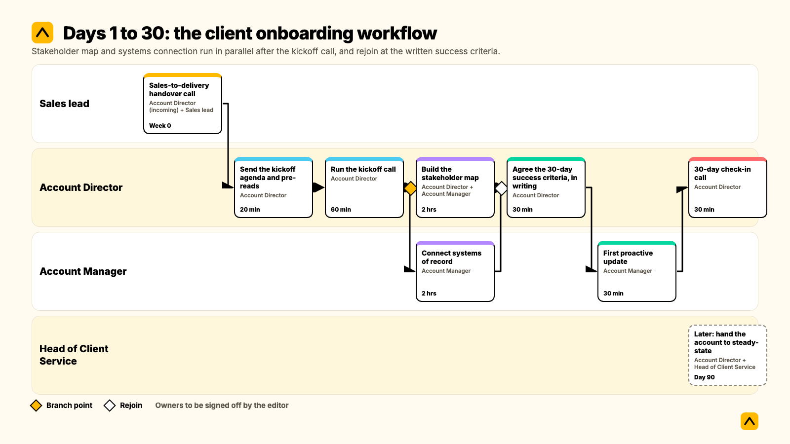
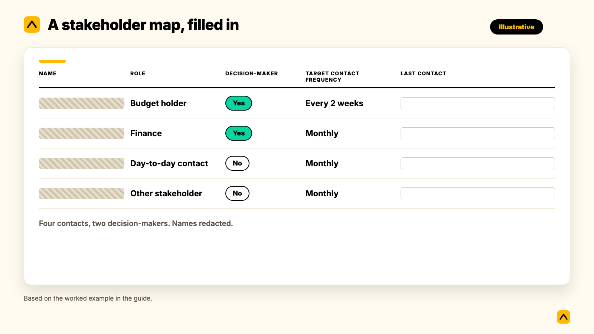
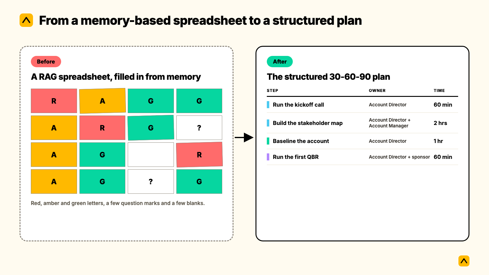

A client onboarding process, also called a customer onboarding process, is the structured plan that takes a new account from signed contract to steady-state delivery, usually mapped across 30, 60 and 90 days. Done well, it locks scope in writing, maps every stakeholder on the client side, and gets the team proactively flagging risks before the client has to raise them first. This guide is for agencies, consultancies and other professional services firms running retainer or project-based client relationships. It gives you the steps, who owns each one, how long it takes, the exact wording to copy, and a worked example.


## When this applies, and when it doesn't

Run the full version below when a new logo signs, when an existing client moves to a materially different scope (a new service line, a new region, a new budget tier), or when the account lead on a live relationship changes and the client notices the gap. Compress it to a one-week version for a small project-based engagement with a single stakeholder and a fixed end date. The plan still holds: lock scope, name the decision-maker, agree how you'll report, and schedule the first proactive check-in. You're just running all four in week one instead of spreading them across 90 days.

Skip it, and the pattern is well documented: 45% of marketing decision-makers now cite a lack of proactivity from their agency as the top trigger for a review, up roughly 50% year-on-year, according to RSW/US's 2024 Agency New Business Outlook Report (drawn from a database of over 7,000 agencies and 30,000 marketing contacts). Most of that proactivity gap opens in the first 90 days, before anyone has a cadence, a stakeholder map, or a written definition of what success looks like.

## Before day 1: the handover from sales (Week 0)

The onboarding clock starts before the client ever meets the delivery team. What sales promised, what the client is sensitive about, and who the real decision-maker is all live in someone's head until this handover puts it in writing.

| Step | Owner | Time | Failure mode if skipped |
| --- | --- | --- | --- |
| Sales-to-delivery handover call: scope, commercials, promises made, red flags | Account Director (incoming) + Sales lead | 45 min | The team re-promises something sales already walked back, or misses a sensitivity nobody flagged |
| Build the internal account brief: scope, success criteria, known risks | Account Director | 1 hr | Everyone on the account works from a different idea of what "success" means |
| Confirm the kickoff date, attendee list and agenda with the client | Account Director | 30 min | The kickoff opens with logistics instead of substance |

A Head of Operations at one agency client described the version of this that goes wrong: new starters couldn't find the reports already sent to a client, because nothing outside individual inboxes was ever saved anywhere searchable. "Is there any way we could save all our reports in a shared place? Technically, yes, but no one's going to [do it manually]," as she put it, on why a voluntary filing habit never survives contact with a busy account team (Head of Operations, Agency Client C). The handover brief exists to break that pattern at the start, not to patch it later.

## Days 1-30: the client onboarding workflow



The first 30 days have one job: turn a signed contract into a relationship with a written definition of success, a named decision-maker, and systems that hold the account's history instead of one person's memory.

| Step | Owner | Time | Script or template |
| --- | --- | --- | --- |
| Send the kickoff agenda and pre-reads | Account Director | 20 min | See Scripts, below |
| Run the kickoff call: scope, decision-makers, reporting cadence, escalation path | Account Director | 60 min | - |
| Build the stakeholder map: every contact, role, decision-maker flag, target contact frequency | Account Director + Account Manager | 2 hrs | See Scripts, below |
| Connect systems of record: shared drive, CRM, meeting recorder, reporting template | Account Manager | 2 hrs | - |
| Agree the 30-day success criteria with the client, in writing | Account Director | 30 min | - |
| First proactive update: get ahead of one risk or question before the client raises it | Account Manager | 30 min | - |
| 30-day check-in call: review progress against the written criteria | Account Director | 30 min | See Scripts, below |

The stakeholder map deserves more care than it usually gets. [Kaizan's Client Service Benchmark 2026](https://www.kaizan.ai/us/white-paper/), drawn from over 1 million calls and 10 million emails across a 12-month, anonymised sample, found that top-performing and bottom-performing accounts engage almost exactly the same share of the decision-makers they've identified: 52.7% against 50.0%. The gap isn't who gets covered. It's how often: top accounts run 1.81x more decision-maker calls and 2.06x more decision-maker emails per month than the bottom cohort, with identical headcount on both sides. The practical takeaway for week one: don't just list every stakeholder, set a contact frequency target next to each one, and track whether you're hitting it. A decision-maker who has gone quiet for six weeks is worth escalating on its own, even when the rest of the account looks healthy.



## Days 31-60: building the cadence and the first health baseline

This is customer success onboarding in its most literal sense: turning a one-off kickoff into a repeatable rhythm the account can run on without anyone having to remember to do it.

| Step | Owner | Time |
| --- | --- | --- |
| Establish the recurring contact cadence against the stakeholder map | Account Manager | Ongoing |
| Baseline the account: first client-health read, first CSAT or sentiment check, first risk log | Account Director | 1 hr |
| Surface one piece of outside thinking the client didn't ask for (a market move, a competitor, a benchmark) | Account Manager | 1 hr |
| 60-day review: confirm scope is holding, flag any drift before it compounds | Account Director | 30 min |

Two findings from the same benchmark data are worth building into this stage directly. First, the AM cadence that separates top and bottom-performing accounts isn't a different style of conversation, it's more of the same one: 1.84x more calls per year and 1.47x more emails, with identical portfolio size, identical email-to-call ratio and identical talk-time share. The account team that shows up more often, in the same way, outperforms the one looking for a cleverer approach.

Second, the client satisfaction score most teams treat as an outcome is often a measurement artefact. Where CSAT is actually measured, top and bottom-performing accounts score identically at 7.1 out of 10. The difference is that top accounts get measured roughly three times more often (41 times a year against 14). If your 60-day baseline is the first time you've checked in on sentiment since kickoff, you're not behind on performance, you're behind on measurement, and that's the easier problem to fix first.

## Days 61-90: the first QBR and the handover to steady-state

The last stretch of a client onboarding process steps the account out of "new" and into business as usual. If this stage is skipped, onboarding never formally ends, and nobody owns the account's health once the energy of a new logo wears off.

| Step | Owner | Time |
| --- | --- | --- |
| Prepare the first QBR: performance against success criteria, risks closed, what's next | Account Director | 3 hrs |
| Run the first QBR with the client | Account Director + sponsor | 60 min |
| Hand the account from onboarding mode to steady-state: confirm owner, cadence and health baseline | Account Director + Head of Client Service | 45 min |
| Close the loop: what worked, what didn't, one change to make for the next onboarding | Account Director | 30 min |

The handover step is the one teams skip, because nothing forces it. Without an explicit moment where onboarding mode ends, the 30-day urgency either never fades (burning out the account team on a client that's actually stable) or fades too far (leaving a client quietly under-served because nobody re-confirmed the cadence past day 90). Put a date in the calendar for it on day 1, not day 85.

## A worked example: one account, start to finish

The following is an illustrative composite, built from the pattern above rather than one named client, to show what the plan looks like filled in rather than described.

**Day -5.** The handover call surfaces that sales verbally promised a monthly in-person review the client hadn't asked for twice. The Account Director flags it in the brief so delivery doesn't under- or over-deliver against a promise nobody wrote down.

**Day 1.** Kickoff runs to the agenda in the Scripts section below. The client names a second decision-maker (finance) the sales process never surfaced.

**Day 6.** The stakeholder map goes out: 4 contacts, 2 flagged as decision-makers, contact frequency targets set at every 2 weeks for the budget holder and monthly for the rest.

**Day 18.** The Account Manager spots a competitor's product launch relevant to the client's category and raises it unprompted on the next call, two weeks ahead of the 60-day target for proactive market intelligence.

**Day 28.** The 30-day check-in confirms scope is holding. One success criterion (reporting cadence) is behind; the client agrees a revised date rather than being surprised by it later.

**Day 52.** The finance stakeholder, added on day 1, goes quiet for five weeks. The gap gets flagged and closed with a direct email before it reaches the six-week threshold the benchmark data treats as a warning sign.

**Day 70.** The first QBR runs. Three of four 30-day success criteria are confirmed met; the fourth (reporting cadence) is shown resolved since day 28.

**Day 90.** The account moves to steady-state with a named owner, a confirmed cadence, and a written note on what nearly went wrong (the undocumented in-person review promise) for the next onboarding to avoid.

## Scripts and wording to copy

Adjust the bracketed sections. The structure is what does the work, not the exact phrasing.

**Kickoff agenda email (Day 1)**

```
Subject: [Client] x [Agency] kickoff, [date]

Hi [Primary contact],

Looking forward to getting started. Here's what we'll cover on [date] at [time]:
1. Confirm scope and what success looks like in the first 90 days
2. Walk through who's who on both sides, and how we'll reach each other
3. Agree reporting cadence and the escalation path if something needs to move fast
4. Set the date for our first 30-day check-in

Could you send across [documents needed]? Having these before the call means we spend the time on decisions, not logistics.

[Account Director]
```

**Stakeholder map request (Day 3-7)**

```
Subject: Quick one before we get going

Hi [Primary contact],

So we're talking to the right people at the right points, could you share:
- Who else should we loop in, and on what (budget sign-off, creative approval, technical review)?
- Who's the final decision-maker if we need a fast answer?
- Any preference on how often we check in with each person?

This stays between us. It just means nobody gets missed.

[Account Manager]
```

**30-day check-in agenda (Day 25-30)**

```
Subject: 30 days in, a quick review

Hi [Primary contact],

Ahead of our call on [date], a short recap against what we agreed on day 1:
- [Success criterion 1]: [status]
- [Success criterion 2]: [status]
- [Success criterion 3]: [status]

On the call, I'd like to cover anything that's surprised you, one thing we could be doing better, and what the next 30 days should focus on.

[Account Director]
```

## How to tell whether the onboarding worked

Track three things from day 1, not day 90, or there's no baseline to measure against:

- **Time to first proactive flag.** How many days until the account team raises a risk or question before the client does. Shrinking this number is the clearest sign the onboarding built the right habits.
- **Decision-maker contact frequency against target.** Set in week one, reviewed at 30, 60 and 90 days.
- **Written success criteria met.** The ones agreed on day 7, checked at day 30, 60 and 90, not redefined after the fact to match what happened.

On the first measure, the research backs up a pattern worth knowing before you panic at an early risk log: across a sample of struggling accounts, about 69% had surfaced a warning sign in conversation at least once before things went wrong, and about 38% surfaced the same warning sign repeatedly across multiple periods. Struggling accounts are rarely silent. A Search Lab COO put the operating version of this plainly: "We're trying to be proactive in predicting which clients might be a churn risk" (COO, Agency Client D). A risk log with nothing in it after 60 days is usually a sign nobody's listening closely enough yet, not a sign the account is fine.

## What to automate, and what must stay human

Automate the capture, not the relationship.

**Safe to automate:** meeting notes and follow-up drafts via an [AI Assistant](https://www.kaizan.ai/us/product/), the stakeholder map populating itself from who's actually on calls and emails, reminders when a decision-maker goes quiet past target, and the account brief pulling forward into the QBR deck automatically instead of being rebuilt from scratch.

**Keep human:** the kickoff call itself, the judgement call on whether a client's silence is fine or a risk, and the actual QBR conversation.

The case for automating capture specifically, rather than leaving it to whoever remembers, comes through clearly in how practitioners describe the alternative. A Senior Client Partner at one agency client described the shift: "I immediately found it incredibly useful, initially because I was so used to frantically scribbling notes in meetings. So the fact that that part was taken away from me was really useful" (Senior Client Partner, Agency Client B). And on handing off an account mid-relationship, a Managing Partner at another agency client pointed to the time saved when a senior person doesn't have to sit through a whole call to get what they need: "Senior team time that's saved by not having to be on every call. You just jump in and watch that 30-second clip rather than have to be on the whole thing to still get the same outcome" (Managing Partner, Agency Client A). That's the test worth applying to any part of this plan: if a human has to remember to do it, it will eventually get skipped; if a system captures it automatically and a human decides what to do about it, it holds up.

## Pitfalls: where this process breaks, and the fix



| Symptom | Fix |
| --- | --- |
| The stakeholder map gets built once at kickoff and never updated | Put a 30/60/90-day review of it on the calendar before day 1, not as an afterthought |
| Success criteria live in someone's notebook, not anywhere the client agreed to in writing | Send them back to the client in the kickoff follow-up email and ask for a one-line confirmation |
| Onboarding never formally ends; the account just quietly stops getting the extra attention | Put the day-90 handover meeting in the calendar on day 1, with a named recipient |
| The only proactive update in 90 days is the QBR itself | Build the day 14-21 proactive check-in into the plan explicitly, don't leave it to initiative |
| A new account lead inherits the account with no usable history of what happened before them | Capture meetings and decisions as they happen rather than relying on handover notes written weeks later, when memory has already faded |

That last pattern is common enough to be worth naming on its own. Teams that rely on individual memory and ad hoc notes for institutional knowledge consistently find the gap surfaces at the worst moment, when someone leaves or a new person picks up an account mid-stream. The fix isn't a better handover document. It's not needing one, because the history was captured as it happened rather than reconstructed from memory afterwards.

## Frequently asked questions

**What is a client onboarding workflow?**
A client onboarding workflow is the repeatable sequence of steps, owners and timings an agency runs every time a new account starts, usually mapped across 30, 60 and 90 days. It typically covers the sales handover, scope lock, stakeholder mapping, systems setup, a 30-day check-in, and a first quarterly review, each with a named owner so it runs the same way regardless of who's on the account.

**What is customer success onboarding?**
Customer success onboarding is the process of getting a new account to its first measurable value and into a sustainable contact cadence, rather than just getting the contract signed. For agencies, that means a written definition of success agreed with the client by day 7-14, and a cadence of proactive contact that continues well past the kickoff call.

**What are the customer onboarding steps, in order?**
The core steps are: the internal sales-to-delivery handover, the client kickoff call, building the stakeholder map, connecting systems of record, agreeing written success criteria, a 30-day check-in, a 60-day review, a first QBR, and a formal handover to steady-state delivery. Each step needs an owner and a time estimate, not just a description.

**What are the customer onboarding process steps a team should document?**
Document who owns each step, how long it takes, the artefact it produces (a stakeholder map, a written success-criteria email, a QBR deck), and the failure mode if it's skipped. A documented process survives staff changes; an undocumented one lives in one account director's head and leaves with them.

**What is a client onboarding process, specifically for agencies?**
It's the structured plan, usually spanning 30, 60 and 90 days, that takes a new agency-client relationship from signed contract to steady-state delivery: locking scope, mapping stakeholders, setting a cadence, and formally closing out onboarding mode rather than letting it fade indefinitely.

**How long does this take?**
For a standard retainer account, 90 days from kickoff to the first QBR and formal handover. Compress it to a single week for a small, single-stakeholder project with a fixed end date; stretch the week-0 handover and systems-connection steps for an enterprise client with procurement or security review.

**Who should own it?**
The Account Director owns the plan end to end and is accountable for the day-90 handover. The Account Manager typically owns the stakeholder map and systems setup. The Head of Client Service owns the handover sign-off and should be the one confirming the account has genuinely moved to steady-state, not just that 90 days have passed.

**What if the client refuses or ignores the written success criteria?**
Send them anyway, with a short deadline for objection ("let me know by Friday if this doesn't match what you're expecting"). Silence isn't the same as agreement, but a written record the client didn't dispute is far stronger than a verbal understanding nobody can point back to later.

**How do we know it worked?**
Track time to first proactive flag, decision-maker contact frequency against target, and whether the written success criteria were actually met at 30, 60 and 90 days. A falling time-to-first-flag number is the clearest single sign the onboarding built the right habits rather than just filled a calendar.

**What should we automate?**
Capture and drafting: meeting notes, follow-up emails, the stakeholder map updating itself from who's actually in the room, and alerts when a decision-maker goes quiet past target. Keep the kickoff call, the judgement calls on risk, and the QBR conversation itself human. Automating the admin is what makes the rest of this plan sustainable past the first account it's tried on; it's also the fastest way for an onboarding process to compound, since Kaizan's own client portfolio sees average revenue growth of 26%+ per client year on year once accounts move past onboarding into a well-run steady state.

---

If you want to see what an onboarding this structured looks like running on your own accounts, [book a demo](https://www.kaizan.ai/us/).
