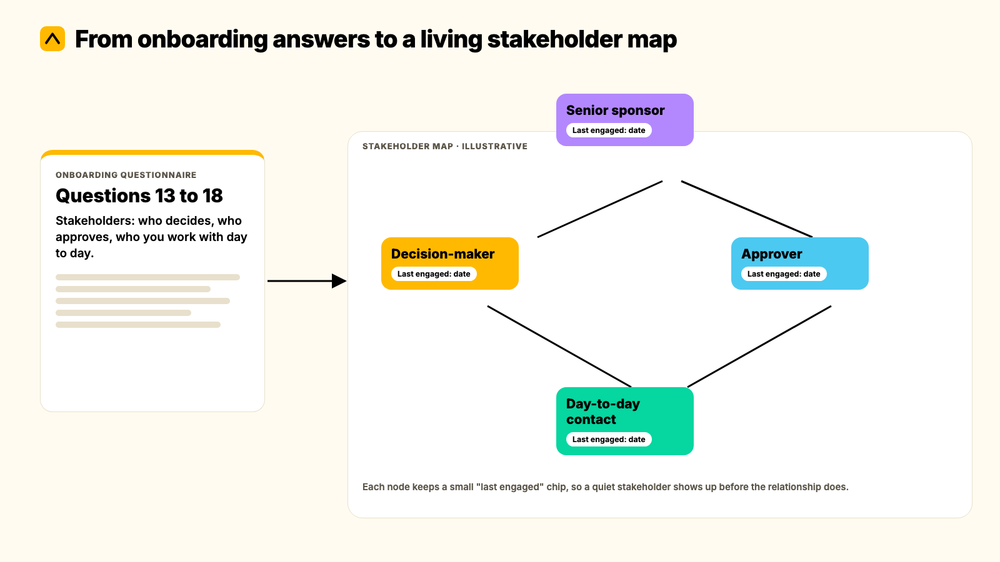

A client onboarding questionnaire is a structured set of questions an agency sends a new client before or during kickoff, covering goals, stakeholders, brand, working style and reporting. This one has 40 questions in seven groups, with a filled example beside each blank and variants for marketing, creative and consulting firms.

Most onboarding questionnaires online stop at 15 questions, because anything longer gets abandoned. That's the wrong trade-off. The problem with a short questionnaire isn't length. It's that nobody tells the account team which question actually matters and why. Below, every one of the 40 questions carries a one-line reason it's there, so a junior account manager can cut the list to what the engagement needs without guessing which ten to drop.

## What's in it

- **40 questions** across seven groups: company and commercial context, goals and success metrics, stakeholders and decision-making, brand and positioning, working style and communication, reporting and measurement, and risk and history.
- **A reason for every question**, so you know what a good answer unlocks and what a missing one puts at risk.
- **A filled, anonymised example** from a mid-sized agency's engagement, so you can see what a completed row looks like next to the blank.
- **Three variants**: the default set below works for most marketing and advertising agencies as written; a creative-agency variant and a consulting-firm variant swap out six of the questions (Group 4) for ones suited to brand work and advisory engagements.
- **A decision guide** for when to send a short form first and when the full questionnaire earns its length.

## How to use it

1. **Send it before kickoff, not during it.** The questionnaire goes out the day the contract is signed, with a two-week deadline. Sent on the kickoff call itself, it turns into a verbal scramble and half the questions never get a real answer.
2. **Route it to more than one person.** One client contact rarely knows the budget holder's priorities, the brand guidelines, and the internal politics. Send Groups 1-3 to the commercial contact and Groups 4-7 to whoever runs delivery on the client side, or split it however your account lead judges best.
3. **Read the answers before the kickoff call, not during it.** The call is for the three or four answers that need a follow-up question, not for reading the form out loud.
4. **Log the answers somewhere the whole account team can see them.** A questionnaire that lives in one person's inbox stops being useful the day that person is on leave.
5. **Flag the gaps, don't just file them.** A blank answer to "who is the most senior person who cares about this account" is itself a signal worth raising with the account lead, not a box to leave empty.

### What a good answer looks like

Take question 8, "what is the single metric this engagement will be judged against internally, even if it's not in the contract." A weak answer says *brand awareness*. A usable answer says:

> "Our CMO reports to the board on marketing-sourced pipeline every quarter. If that number doesn't move, this gets reviewed at renewal, regardless of how the campaigns performed on their own terms."

The first answer gives you nothing to act on. The second tells you which number to protect, who's watching it, and when the conversation turns hard. That's the difference a good onboarding questionnaire is built to surface, and it's why each question below carries a reason rather than standing alone.

## The 40 questions

All 40 are here, grouped by theme. Each carries the one-line reason it's on the list. For marketing client onboarding questionnaires and advertising agencies, this set works as written. Group 4 is the one that changes by firm type; the swaps for creative agencies and consulting firms are in the next section.

### Group 1: Company and commercial context

1. What is the client's official company name, primary website, and any brand name used instead of the legal entity? *Avoids misnaming the client in decks, contracts and reports from week one.*
2. Who is the primary budget holder for this engagement, and do they sit inside or outside the team we'll work with day to day? *Flags whether decision-maker access needs building deliberately, rather than assumed.*
3. What is the contract value, billing cadence, and renewal or review date? *Sets the account tier and the first real deadline on the calendar.*
4. Which other agencies, consultancies, or in-house teams are working on adjacent parts of this account? *Surfaces where scope can collide before day 30, not after.*
5. Is there a parent company, holding group, or procurement function we need to be aware of? *Flags approval chains and conflicting mandates early.*
6. What triggered this engagement: a new initiative, a replacement for a previous provider, or an expansion of existing work? *A replacement account needs different early-warning questions than a brand-new one (see question 37).*

### Group 2: Goals and success metrics

7. In the client's own words, what does success look like in 6 months? In 12 months? *The client's own phrasing, not our paraphrase of it, is what gets repeated back at renewal.*
8. What is the single metric this engagement will actually be judged against internally, even if it's not written into the contract? *The contract KPI and the internal judgment metric are often two different things. Only one of them decides renewal.*
9. What has been tried before that didn't work, and why? *Stops the team from re-pitching an idea the client has already rejected, for reasons nobody told them.*
10. What would make this client recommend us to a peer? *A different question from "what does success look like". This one is about the relationship, not the deliverable.*
11. What would make this client consider the engagement a failure, even if every deliverable lands on time? *The fastest way to find the real risk is to ask what it looks like, directly.*
12. Are there non-negotiable constraints: budget caps, timing, brand guidelines, or legal and compliance limits? *Cheaper to learn in week one than to discover mid-project.*

### Group 3: Stakeholders and decision-making

13. Who is the day-to-day contact, and how much authority do they actually have to approve work? *A contact without approval authority means every deliverable has a hidden second round of sign-off.*
14. Who else needs to see or sign off on deliverables before they go live? *The list almost always has more names on it than the org chart suggests.*
15. Who is the most senior person who cares about this account, even if we rarely speak to them directly? *This is the person whose opinion decides renewal, whether or not they're on the weekly call. It maps directly to the stakeholder-coverage question in the section below.*
16. How does this client prefer to make decisions: a single approver, group consensus, or committee sign-off? *Changes how much lead time to build into every deadline.*
17. Is there anyone on the client side who was against bringing us on, and why? *Knowing this before the first review meeting changes how that meeting gets handled.*
18. Who should we never go around, and who should we escalate to if something goes wrong? *Written down once, so it isn't improvised during an actual escalation.*

### Group 4: Brand, audience and positioning

This is the marketing and advertising agency default. See the variants below for creative agencies and consulting firms.

19. Who is the target audience for this work, in plain language rather than a persona deck? *A persona deck survives the pitch. Plain language is what the team actually remembers in month three.*
20. What does the client's brand sound like, and what should it never sound like? *The second half of this question gets skipped more often than the first, and it's the half that prevents a brand crisis.*
21. Which competitors does the client watch most closely, and why? *Tells you who the client is actually measuring themselves against, which is rarely the obvious market leader.*
22. What assets, guidelines, or prior creative work should we review before starting? *Stops the team from re-doing research the client already paid for once.*
23. Are there words, images, topics, or associations we must avoid? *The question every creative review wishes had been asked in week one.*
24. What has worked well creatively or strategically in the past, and what has the client explicitly rejected before? *The fastest filter against re-pitching a rejected idea with a new coat of paint.*

### Group 5: Working style and communication

25. What is the client's preferred channel for day-to-day updates: email, Slack, a shared doc, or something else? *Gets this settled once, instead of re-negotiated every time a new account person joins.*
26. How often does the client expect a status update, and in what format? *A mismatch here is one of the most common sources of "we never hear from them" complaints that have nothing to do with the work itself.*
27. What is the client's time zone, and are there working hours we should respect? *Easy to miss on a multi-region account, and a quiet source of friction when it's missed.*
28. Who should be copied on what, and who should never be copied on internal discussion? *Prevents the single most avoidable email mistake in client service.*
29. Does the client have a preferred meeting cadence, and is there a standing call already on the calendar? *Tells you whether you're setting the rhythm or fitting into one that already exists.*
30. Is there a tool the client insists on using for files, approvals, or project tracking? *Better to adapt to this once than to fight it for the life of the account.*

### Group 6: Reporting and measurement

31. What reporting does the client already receive from other providers or internal teams? *Stops you from duplicating a report that already exists, or contradicting one that does.*
32. What access or data do we need from the client to report accurately: analytics, CRM, or a previous agency handover? *The most common cause of a reporting delay in month one is access that nobody requested until it was needed.*
33. Which numbers does the client's leadership actually look at, versus the ones we think matter? *These are not always the same list, and the gap between them is worth surfacing early.*
34. Has the client been burned by inflated or confusing reporting before? *Explains a surprising amount of early client skepticism that otherwise looks like it's about the work.*
35. What is the agreed definition of each core metric, so the team isn't debating definitions in month three? *A disagreement over what "engagement" or "qualified lead" means is a scope argument wearing a measurement costume.*
36. How will the two sides jointly review performance, and how often? *Puts a cadence in place before the first review becomes an ambush.*

### Group 7: Risk, history and context

37. Why did the client leave their previous provider, if there was one? *The single highest-value question on the list when question 6 shows this is a replacement account.*
38. Is there anything about this account that has already gone wrong, even before kickoff? *A delayed contract, a budget cut mid-negotiation, or a stakeholder change are all context the account team should have, not discover.*
39. What is the client's appetite for risk: do they want bold ideas, or safe, proven ones? *Prevents the account team from pitching the wrong register of idea in the first 90 days.*
40. Is there anything you haven't asked that we should know? *The least structured question on the list and, in our experience building this template, consistently the one that surfaces the detail none of the other 39 were built to catch.*

## Variants by firm type

Group 4 is where a marketing agency, a creative agency and a consulting firm genuinely diverge. The other 34 questions hold for all three; swap in the relevant six below.

**Creative agency variant (replaces questions 19-24):**

- 19c. Who is the audience for this work, described as a type of person rather than a demographic slide?
- 20c. What creative territories has the client already explored and rejected, and what was wrong with each?
- 21c. Who on the client side has creative approval, and do they have a personal style preference that differs from the brand guidelines?
- 22c. What is the one piece of work, from any brand, that the client points to and says "something like that"?
- 23c. Are there words, images, topics, or associations we must avoid?
- 24c. How will creative be judged internally: gut feel from one senior stakeholder, a research panel, or performance data?

**Consulting firm variant (replaces questions 19-24):**

- 19x. What specific problem is this engagement meant to solve, stated as a decision the client needs to make?
- 20x. What data, documents, or systems access will the consulting team need, and who grants it?
- 21x. Has this problem been studied before, internally or by another firm, and what did that work conclude?
- 22x. Who internally will implement the recommendations, and are they involved in this engagement from the start?
- 23x. What internal politics or history should the team know before presenting findings?
- 24x. What does "actionable" look like to this client: a slide deck, a working prototype, or a fully costed plan?

## Client onboarding form or questionnaire: which to use and when

A client onboarding form and a client onboarding questionnaire solve different problems, and most firms only need the second one to realize that. A form collects facts: logins, billing contacts, brand asset links. A questionnaire collects judgment: goals, politics, risk appetite, what success actually means to the person who'll decide renewal. Treating them as the same document is why so many onboarding questionnaires read like intake forms and miss everything that predicts churn.

| Situation | Use a form | Use this questionnaire |
| --- | --- | --- |
| Logins, billing contacts, tool access | Yes | Not needed |
| Goals, stakeholder politics, risk appetite | Not suited to it | Yes |
| Single stakeholder, small retainer, fast turnaround | A short form alone is often enough | Optional; consider a 15-20 question cut |
| Multi-stakeholder account, six figures or more | Form for logistics, sent separately | Yes, in full |
| Heavy procurement or legal involvement | Form first, pre-contract | Questionnaire after signature, during onboarding |
| Replacement account (client left a previous provider) | Not suited to it | Yes, with extra weight on Group 7 |

The practical pattern most firms land on: a short form clears logistics in the sales-to-delivery handoff, and this questionnaire runs in parallel or immediately after, because it needs the contract signed before some of the answers (budget, risk appetite, internal politics) get given honestly.

### Account tiers

Not every tier needs all 40 questions filled out with the same depth.

- **New business and small retainers.** Groups 1, 2 and 3 in full. Groups 4-7 can be a shorter conversation on the kickoff call rather than a written questionnaire.
- **Core accounts.** All 40 questions, written, logged, and revisited at the first quarterly review.
- **Strategic or flagship accounts.** All 40, plus a second pass three months in, because stakeholder answers (Group 3) and risk appetite (Group 7) shift once the relationship is live and the honeymoon period ends.

## A filled example

The answers below are a composite, built from the kind of answers account leads give across real onboarding conversations, anonymised and combined so no single client is identifiable. The engagement: a 35-person performance marketing agency onboarding a direct-to-consumer skincare brand on an $18,000-a-month retainer.

| Question | Filled answer |
| --- | --- |
| 2. Who is the primary budget holder? | "Our VP of Growth signs off, but she reports into the CMO on anything over $15k a month, so the CMO sees our numbers too." |
| 8. What's the single metric this gets judged against? | "Blended CAC. The board tracks it monthly. If it climbs two months running, marketing spend gets questioned, regardless of brand metrics." |
| 15. Who's the most senior person who cares, even if we rarely speak to them? | "The founder checks the dashboard every Monday. We've never had him on a call." |
| 37. Why did the client leave their previous provider? | "They stopped sending a monthly report after month four and we found out through a Slack thread, not a conversation." |

Notice what this example does: it names a number (blended CAC), a reporting cadence (monthly, Monday), and a specific failure mode from the previous provider (a report that stopped, discovered informally). None of that sits in a typical intake form. All of it changes how the first 90 days should be run.

### Common mistakes when filling it in

- **Treating it as a form to tick through fast.** The questionnaire is slowest, and most valuable, on exactly the questions that feel awkward to ask (17, 34, 37). Rushing past those defeats the point.
- **Sending it to one contact only.** A single client contact answers from their own vantage point. Group 3 in particular needs input from whoever runs delivery on the client side, not just the commercial lead.
- **Filing the answers and never looking at them again.** An onboarding questionnaire that lives in a folder is indistinguishable from one that was never filled in. The value is in the team actually reading it before the first few client calls.
- **Accepting a vague answer without a follow-up.** "Brand awareness" is not an answer to question 8. A follow-up question ("and who reports that number upward, and how often") usually gets the real one.

### How to keep it current without manual updating

The honest limitation of any static questionnaire, Word doc or Google Form included, is that the answers are only ever as current as the day someone filled them in. A stakeholder listed in question 13 moves teams in month four. A decision-maker named in question 15 goes quiet for six weeks and nobody updates the file.

This is the specific gap a [client success platform](https://www.kaizan.ai/us/) is built to close rather than a static document. Kaizan keeps a permissioned, always-current record for each client built from every call, email and message, so the stakeholder map built from your onboarding answers updates itself as the relationship changes, instead of going stale the week after kickoff. In Kaizan's Evidence-Based Client Health Standard, this maps to the Activity with Stakeholders dimension, specifically Key Stakeholder Coverage against target: whether the people you named in Group 3 are still the ones actually being engaged, and how recently. A questionnaire answer is a snapshot. A live stakeholder-coverage score is the same question, answered continuously.

## Frequently asked questions

**Is a client onboarding form the same as this questionnaire?**
No. A client onboarding form collects facts, such as logins, billing contacts and tool access. This questionnaire collects judgment: goals, stakeholder politics, risk appetite and what success actually means to the person who decides renewal. Most firms need both, sent at different points in onboarding.

**Is this questionnaire suitable for a marketing agency specifically?**
Yes, the default 40 questions above are written for marketing and advertising agencies. Creative agencies and consulting firms should swap the six Group 4 questions for the variant listed in this guide.

**What onboarding questions should I ask a new client?**
At minimum, cover company and commercial context, goals and success metrics, stakeholders and decision-making, working style, reporting, and recent history, especially if the client is replacing a previous provider. The 40 questions above are organised into exactly those seven groups.

**Is this the same as a client intake form?**
No, for the same reason it isn't the same as an onboarding form. A client intake form is typically the shortest, most factual version of this conversation, used mainly in legal, financial or healthcare contexts. This questionnaire is built for the judgment calls an account team needs, not just the facts a system of record needs.

**How do I fill it in?**
Send it to more than one contact on the client side, read the answers before the kickoff call, and follow up on anything vague rather than filing it as given. The "How to use it" section above has the full sequence.

**Can I customise it for my firm?**
Yes. The per-firm-type variants already swap the six questions that differ most by firm type (Group 4). Most firms also trim Groups 4-7 for smaller accounts, as covered in the account-tier guidance above.

**How do I keep it current?**
A filled questionnaire is a snapshot from day one. Stakeholders move, decision-makers go quiet, and priorities shift. Revisit the answers at each quarterly review at minimum, and see the section above on why a live, always-current record closes this gap in a way a static document can't.

---

For the step that comes before this one, see our guide to the client onboarding process for agencies, and for the step that comes after, our piece on client onboarding software covers whether a tool is worth adding once the questionnaire is filled in.
