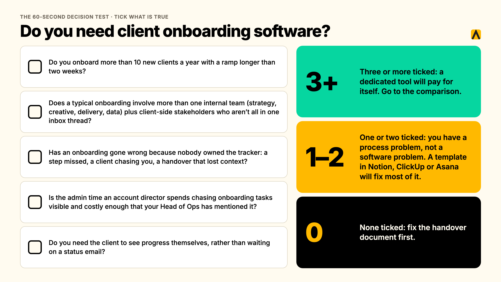
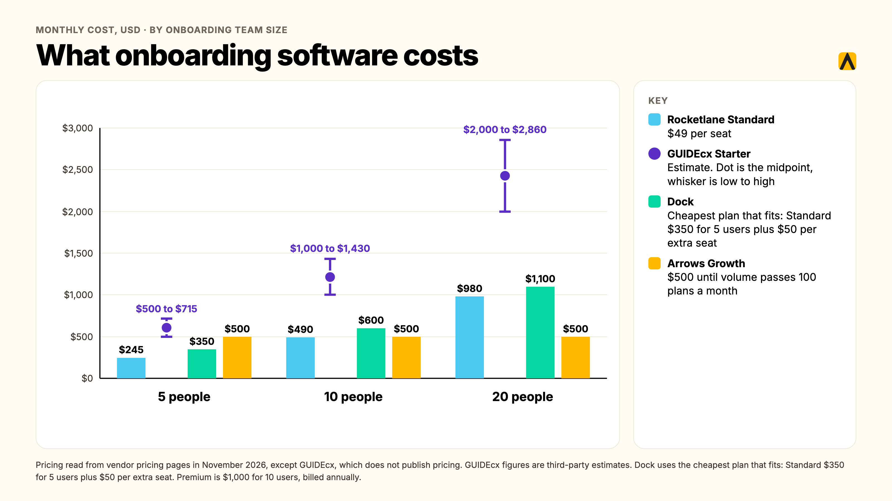
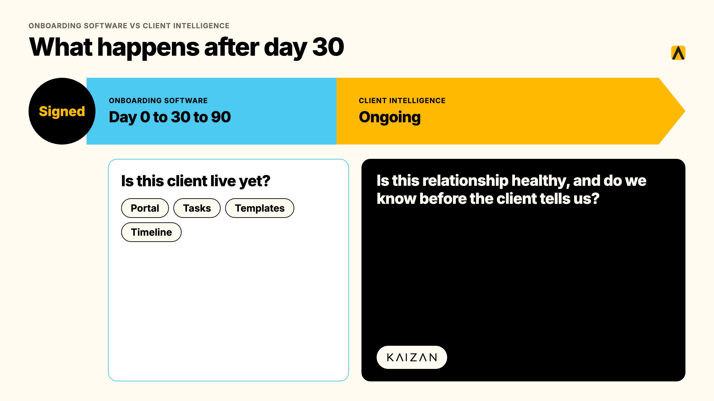

Client onboarding software is a category of tool that moves a new client from signed contract to live engagement: shared task lists, document collection, a client-facing portal, and a timeline everyone can see. Most agencies and professional services firms don't need one. The honest trigger is volume and headcount, not ambition: once you're running more than roughly 10 concurrent onboardings with more than one internal team touching each one, a spreadsheet and an inbox stop being able to hold it, and a dedicated tool earns its cost. Below that line, a good template inside the project management tool you already pay for usually beats buying something new.

**Key takeaways**

- Most agencies under 10 concurrent onboardings don't need dedicated client onboarding software. A template in the PM tool you already own usually does the job.
- Once onboarding crosses multiple internal teams and the client's own stakeholders at volume, the spreadsheet starts losing information, and that's the real buying signal.
- Client onboarding software and client intelligence software are not the same category. One gets a client live. The other watches the relationship after it's live. Most firms eventually need both, never one instead of the other.
- Pricing models vary more than features do: per-seat (Rocketlane, GUIDEcx), flat with included seats (Dock), and usage-based on a specific CRM (Arrows). The model matters more than the sticker price once you know your headcount and client count.
- We compare Rocketlane, GUIDEcx, Dock and Arrows below, with pricing checked directly against each vendor's live pricing page in November 2026.

## The 60-second decision test: do you need client onboarding software?

Every vendor on this page sells onboarding software, so none of them will tell you when the honest answer is no. We will. Run through these five questions before you look at a single tool.

- Do you onboard **more than 10 new clients a year** with a ramp longer than two weeks?
- Does a typical onboarding involve **more than one internal team** (strategy, creative, delivery, data) plus client-side stakeholders who aren't all in one inbox thread?
- Has an onboarding **gone wrong because nobody owned the tracker** — a step missed, a client chasing you, a handover that lost context?
- Is the admin time an account director spends chasing onboarding tasks **visible and costly enough that your Head of Ops has mentioned it**?
- Do you need the **client to see progress themselves**, rather than waiting on a status email?

**Three or more ticked:** a dedicated tool will pay for itself. Go to the comparison below.

**One or two ticked:** you have a process problem, not a software problem. A well-built template in Notion, ClickUp or Asana, the tool your delivery team already lives in, will fix most of this for free. See "Automating client onboarding with the tools you already have" further down.

**None ticked:** you don't have an onboarding problem worth solving with software yet. Fix the handover document first.

For context: agencies in the 10 to 200-person range are the ones who most often ask this question, and most of them answer it with a flat 'we have ten clients and a spreadsheet, why would we pay for this,' which is usually the right call. The volume threshold matters more than the firm's size on paper, because a 300-person firm with five long-standing enterprise clients onboards less often than a 40-person firm adding a new logo every month.

## What client onboarding software is, and what it isn't

Client onboarding software (sometimes called customer onboarding software, client onboarding solutions, or customer onboarding software solutions when buyers search for it; these are the same category, not different tools) is built around a single job: get a new client from a signed contract to a live, working engagement, with both sides able to see what's left to do. The shared shape across every product in this category is a client-facing portal, a task or milestone list, document and form collection, and a timeline with owners and dates.

It is **not**:

- **A CRM.** It doesn't manage the sales pipeline that got you to a signed contract. It starts where the CRM handoff ends.
- **General project management.** Asana, Monday and ClickUp run your delivery work for the life of the account. Onboarding software is purpose-built for the first-30-to-90-day ramp, with client-facing views that a general PM tool usually bolts on as an afterthought.
- **A client health or relationship platform.** Onboarding software is time-boxed: it exists to get a client live, then its job is done. What happens to the relationship in month four, month fourteen, or at renewal is a different problem, covered later in this guide.

### Why agencies outgrow the spreadsheet and their CRM

The default onboarding tool at almost every agency is a monthly RAG spreadsheet, kept by whoever remembered to update it. It's the same workaround we hear about client health generally: one Head of Client Service at a UK digital agency, speaking anonymously, told us her team's tracker is "literally in Google Sheets" and "quite manual," updated by hand each month. It works until the agency scales past a handful of concurrent onboardings, and then it fails in four predictable ways:

1. **The relationship lives in inboxes and calls, not fields.** A spreadsheet only knows what someone typed into it. The actual state of an onboarding, who's waiting on what, what the client said on last Tuesday's call, lives in email threads and Slack messages the tracker never sees.
2. **Context leaves when an account director leaves, or is just on leave.** A Head of Operations at one professional services firm described the same pattern on their project management tooling: her team was "not doing planning," they were "doing project management," chasing the tracker instead of running the onboarding, and new hires had to rebuild context from scratch because nothing was centrally held.
3. **Nobody can evidence which onboardings are at risk until a client raises it.** By the time a new client emails to ask where their deliverable is, the spreadsheet has already failed its one job: giving someone internal the chance to catch it first.
4. **It's backward-looking by design.** A spreadsheet tells you what happened last time someone updated it. It was never built to flag that a step is three days overdue right now.

There's a wider pattern behind this. In RSW/US's 2024 Agency New Business Outlook survey of agency new-business and marketing decision-makers, 45% of marketers cited an agency's lack of proactivity as their top reason for conducting a review, a roughly 50% jump on the year before. Onboarding is the first test of exactly that: it's the first 30 to 90 days in which a new client decides whether the agency chases them, or the agency stays ahead of them.

## The features that actually matter

Most product pages in this category list the same twenty features. Here's what each one is actually for, and which ones are worth paying extra for.

**Client-facing portal.** The single feature that separates onboarding software from a plain PM tool. The client should see their own tasks, due dates and uploaded files without needing a login to your internal system. Every tool compared below includes one; the differences are in how branded it looks and how much it nags the client to act.

**Templates and workflow automation.** A reusable onboarding plan per client type (enterprise vs. mid-market, retainer vs. project) that auto-generates tasks and due dates on kickoff. This is what actually saves time; without it, you're just moving your spreadsheet into a nicer interface.

**Task and document collection.** Forms, file requests, e-signatures, chased automatically rather than by a human sending the third reminder email.

**Time tracking and capacity reporting.** Matters far more to a Head of Ops than to the client. If you're billing onboarding hours or trying to prove the admin load on account directors, this is the data source.

**Integrations.** The two that matter most are your CRM (so a closed-won deal creates the onboarding automatically) and your delivery tool (so onboarding hands off cleanly into the project that runs afterwards). A tool with no CRM trigger means someone manually starts every onboarding, which defeats half the point.

**Permissions and security.** Who on the client side sees what, and whether your own team's internal notes stay internal. Worth checking before a procurement or security review asks, not after.

**AI features worth paying for, and the gimmicks.** Worth paying for: auto-drafted status updates pulled from actual task activity, and risk flags when a step is overdue. Gimmicks: generic AI chat bolted onto a client portal with no connection to the actual onboarding data, and AI-written welcome messages nobody reads twice.

### 60-second decision table

| Your problem | Look for |
| --- | --- |
| Clients chase us for status | Client-facing portal with live task visibility |
| Every onboarding looks different | Templates with auto-generated tasks per client type |
| Deals go cold between sales handoff and kickoff | Native CRM integration that triggers onboarding automatically |
| We can't prove how much time onboarding costs | Time tracking and capacity reporting |
| Account directors are buried in admin | Automated reminders and document chasing |
| Security review is coming | Role-based permissions, SSO, audit logs |

## The client onboarding software compared

We looked at four tools agencies and professional services firms actually shortlist for client onboarding: Rocketlane, GUIDEcx, Dock and Arrows. A fifth name, Mitti, shows up on some tool-list articles for this keyword. It's Mitti by SafetyCulture, a frontline workforce and training platform, and it onboards your own staff, not your clients, so we've left it out. If you landed here looking for it, you want employee onboarding software, not this category.

|  | Rocketlane | GUIDEcx | Dock | Arrows |
| --- | --- | --- | --- | --- |
| Pricing model | Per seat, minimum 5 seats | Per seat (licenses), minimum 4 | Flat per tier, seats included | Flat per tier, scales with plan volume |
| Entry price | $49 per user/month, Standard | Not published; estimates run $100-143 per license/month | $350/month flat, Standard | $500/month flat, Growth |
| Free tier | No, 14-day trial | No | Yes, 10 workspaces | No |
| Best for | Onboarding plus ongoing PS delivery: budgets, time, resourcing | High-volume, templated onboarding with strict client accountability | Branded client portals, bundled with sales rooms | Teams running sales and CS inside HubSpot |
| One real limitation | Cost scales with your headcount, not your client count | Pricing opacity; real floor likely near $6,000-8,580 a year | Jumps straight to $350/month with no mid-tier | Only works if HubSpot is your CRM |

Pricing checked directly against each vendor's own pricing page in November 2026, except GUIDEcx, which does not publish pricing. Those figures are third-party estimates; confirm with GUIDEcx sales directly.

### Rocketlane

Rocketlane is the broadest tool here: a professional services automation platform with onboarding as one module alongside budgeting, resourcing, time tracking and margin reporting. That breadth is the appeal for firms that want one system running the whole engagement, not just the first 30 days.

Standout features: a branded client portal with magic-link login, project templates, resource and capacity planning, and an add-on called AI Fills, $29 per user/month, that turns meeting recordings into status updates and project notes.

Pricing: Standard is $49 per user/month and Premium is $69 per user/month, both billed annually with a 5-seat minimum. Enterprise is custom. All plans are priced per internal team member, not per client, so cost scales with your headcount rather than your client book.

Verdict for agencies: the strongest fit once you want onboarding and ongoing delivery project management in one tool. Per-seat pricing means the cost climbs as your account team grows, which is worth modelling before you commit.

### GUIDEcx

GUIDEcx positions itself for enterprise-style onboarding with heavy structure: role-based task assignment, automated client nudges, and templated project plans built for consistency across a large onboarding volume.

Standout features: role-based task assignment, so a client-side stakeholder only sees their own tasks, automated progress nudges, and reporting built around onboarding health across a portfolio.

Pricing: three tiers, Starter, Premium and Advanced, none published. Third-party pricing guides report a roughly $100 to $143 per license per month range for the entry tier with a 4-license minimum, putting the real floor somewhere near $6,000 to $8,580 a year. Treat this as an estimate, not a quote, and confirm directly with GUIDEcx.

Verdict for agencies: worth shortlisting if you're running high volumes of near-identical onboardings and want the structure to enforce consistency. The lack of public pricing is itself a filter: if a five-minute quote matters to you, this isn't the fastest option to evaluate.

### Dock

Dock is a broader revenue-enablement tool, originally built for sales deal rooms, that added client onboarding and client portals as a solution rather than its sole product. It's the only tool here with a genuinely usable free tier.

Standout features: customisable, branded client workspaces, content and template libraries shared across sales and onboarding, and a pricing model where your clients never pay or need an account, only your internal team does.

Pricing: Free (10 workspaces, limited content), Standard $350/month flat for 5 users with additional seats at $50/month, Premium $1,000/month billed annually for 10 users, Enterprise custom for 25+ users. This is flat-rate pricing with seats included, not per-seat from the first user, which makes it predictable but means the jump from free to Standard is steep.

Verdict for agencies: a reasonable option for a smaller agency that wants a professional-looking client portal without per-seat pricing, as long as the jump to $350/month flat doesn't sting. One G2 reviewer in 2026 put it plainly: pricing is tailored to sales teams rather than individual contributors or consultants, since every paid plan starts at a 5-user minimum.

### Arrows

Arrows is the specialist option: onboarding plans and digital sales rooms built natively inside HubSpot, with no separate login or interface for your team to learn.

Standout features: onboarding plans that live directly on a HubSpot deal, ticket or custom object, with more than 35 data points synced back into HubSpot properties and reporting, plus dynamic due dates and automated phase-locking based on HubSpot field values.

Pricing: the Growth plan starts at $500/month, billed annually, covering up to 100 new onboarding plans a month. Enterprise is custom. Pricing scales with onboarding-plan volume, not internal seats, and there's no free tier.

Verdict for agencies: the easy choice if HubSpot is already your system of record and you want onboarding data to show up in the same reports your leadership already looks at. The wrong choice the moment your CRM isn't HubSpot; it doesn't try to be a general-purpose tool and shouldn't be bought as one.

## How we assessed these tools

We compared each tool on five things: what the client-facing portal actually looks like, how onboarding plans connect to the CRM or PM tool an agency already runs, the real floor of the pricing once seat minimums are applied, what's missing at the entry tier, and what each vendor's own customers say about it in independent reviews. Pricing for Rocketlane, Dock and Arrows was read directly from each vendor's live pricing page in November 2026. GUIDEcx does not publish pricing, so those figures are third-party estimates, flagged as such throughout. We did not take a trial of every tool; this is a desk comparison built from vendor documentation, published pricing and independent review sites, not a hands-on product test.

## How to choose client onboarding software in seven steps

1. **Define the problem before the tool.** Write down the actual symptom: late deliverables, lost context, client chasing you, admin eating account director time. A tool bought to fix a vague feeling never gets adopted.
2. **Map your current stack.** List what you already pay for: CRM, PM tool, e-signature, file sharing. Most of the features in this category already exist somewhere in your stack; the question is whether they're joined up.
3. **Count clients, not seats, with a worked example.** A 40-person agency onboarding 20 clients a year with 6 people touching each onboarding pays Rocketlane roughly $49 x 6 = $294/month on Standard. The same agency on Dock's Standard tier pays $400/month: the flat $350 covers 5 users, plus one extra seat at $50. Dock's pricing is a flat tier plus $50 per extra seat, not client volume. Run your own numbers before you shortlist.
4. **Weigh manual entry against automatic capture, and the adoption risk that comes with each.** A tool that requires account directors to manually update every status will be abandoned within a quarter, the same way the spreadsheet was. Ask every vendor to show you what updates itself versus what a human has to type.
5. **Run a 14-day pilot on five real accounts.** Not a demo with sample data. Five live onboardings, with the account directors who'll actually use it, before you sign an annual contract.
6. **Show the shortlist to everyone who has to live with it.** The Head of Client Service needs to see it won't just replace the spreadsheet with more admin. The Head of Ops needs to see the team will actually open it. The person who signs the invoice needs the three-number pitch: cost, time saved, risk reduced.
7. **Score the shortlist against your actual answers to steps 1 to 4**, not against a generic feature checklist. The tool with the most features is rarely the one that gets used.

## What it costs, by onboarding team size

Because three of these four tools price by internal seats rather than by client, the honest cost comparison is by the number of people who touch onboarding, not by your client count. The table below models a team of 5, 10 and 20 people who need access, using each vendor's published entry-tier pricing. GUIDEcx uses the third-party-estimated range since no published figure exists; Dock is shown at the cheapest plan that fits each team size (Standard at $350 for 5 users, plus $50 per extra seat).

| Internal team size | Rocketlane Standard ($49/seat) | GUIDEcx Starter (est. $100-143/seat) | Dock (flat tier plus extra seats) | Arrows Growth (flat, volume-based) |
| --- | --- | --- | --- | --- |
| 5 people | $245/month | $500-715/month | $350/month (Standard, 5 users included) | $500/month |
| 10 people | $490/month | $1,000-1,430/month | $600/month (Standard $350 plus 5 extra seats at $50) | $500/month, same tier |
| 20 people | $980/month | $2,000-2,860/month | $1,100/month (Standard $350 plus 15 extra seats at $50) | $500/month, until plan volume exceeds 100/month |

The pattern is consistent: per-seat tools (Rocketlane, GUIDEcx) scale linearly with headcount, which rewards a lean onboarding team and punishes a large one. Dock sits in between: a flat tier covers the first few seats, then cost rises by $50 for each extra seat. Volume-based tools (Arrows) are indifferent to headcount entirely and instead track how many onboardings you run, which suits a small team handling a lot of clients.

## Which option fits which size of firm

**A 10-person agency.** You almost certainly fail the decision test above. If you've bought something anyway, Dock's free tier or a well-built Notion template will do the job without a contract.

**A 50-person agency.** This is the size where the decision test starts returning real yeses. If your CRM is HubSpot, Arrows is the lowest-friction option because there's no second tool to open. If it isn't, Rocketlane's Standard tier at a lean 5 to 8-person onboarding team is the most predictable cost, and the time-tracking and resourcing features earn their keep as you scale delivery, not just onboarding.

**A 200-person agency or professional services firm.** You likely need the structure GUIDEcx is built for, or Rocketlane's Premium tier with budgeting and margin reporting layered in, because onboarding volume and client complexity both go up at once. This is also the size at which the question in the next section, what happens after onboarding ends, starts to matter more than which onboarding tool you picked.

## Onboarding software vs. client intelligence: what happens after day 30

Every tool compared above is built to answer one question well: is this client live yet? None of them is built to answer the question that matters for the following three years: is this relationship healthy, and do we know before the client tells us?

That's not a criticism. It's a boundary. Onboarding software is time-boxed by design, the portal, the tasks and the templates exist to get a client from signed to live, and then its job is done. What happens next, whether a decision-maker has gone quiet, whether sentiment is sliding before anyone raises it, whether there's a genuine expansion opportunity the account team hasn't acted on, sits in a different category entirely: client intelligence software, sometimes called customer success software for professional services and client service teams.

This is the gap a lot of agencies fall into. They buy onboarding software, the new client goes live cleanly, and then eighteen months later nobody can answer "what's actually going on with this client?" without three calls and a dig through old emails, because the tool that managed the first 30 days was never meant to watch the next 1,000. We see this pattern directly in our own client conversations: a Head of Operations at one agency told our team that automating project management was the top priority on her agenda because her account managers were "not doing planning," they were "doing project management," chasing admin instead of running relationships, well past the point any onboarding tool would still be involved.

Kaizan sits on the other side of that boundary. It's a client success platform (or customer success software, depending on which term your team uses) for marketing, advertising and professional services firms with 150 to 10,000 employees, built to protect and grow revenue from the clients you already have, not to run the first 30 days. It turns every client call, email and message into a single, permissioned, always-current memory per client, scores each relationship against The Evidence-Based Client Health Standard (our name for the CARE methodology, measuring Client satisfaction, Activity with stakeholders, Relationship strength and Expansion opportunities), and surfaces the next action before a renewal conversation goes wrong, not after. Kaizan customers see 26%+ average revenue growth per client across the portfolio.

The two categories are complements, not alternatives. If you're also running delivery inside Asana, Jira, Notion, ClickUp, Monday or Wrike once onboarding ends, Kaizan reads project status, tasks and milestones from those same tools and folds them into each client's ongoing health signal, so the handoff from "onboarded" to "being actively managed" doesn't lose the context the onboarding tool built. If you don't need onboarding software at all per the decision test above, that's fine too: Kaizan's own onboarding is built to need none of the structure this article is about. New customers connect their calendar and inbox by OAuth and are live the same day, with CARE scores and findings back within 14 days on a free pilot, because the product it's replacing is the RAG spreadsheet, not a project plan.

## Automating client onboarding with the tools you already have

If the decision test sent you here, you don't need a line item for onboarding software. You need a better template inside the tool your delivery team already opens every day.

A working build takes three parts, all inside tools most agencies already pay for:

1. **A template board or project, cloned per new client**, in Notion, ClickUp or Asana, with every task, owner and due date pre-filled from your standard onboarding sequence. Build it once properly, then clone it; don't rebuild it from memory each time.
2. **A client-visible view**, shared as a guest link or a lightweight view-only board, so the client sees progress without a status email. This is the one feature a dedicated tool would add; most PM tools can approximate it with a shared view or a free-tier tool like Dock bolted on just for the client-facing layer.
3. **A trigger from your CRM**, even a simple one: a Zapier or native automation that creates the cloned board the moment a deal closes, so onboarding starts without someone remembering to kick it off manually.

We saw this exact pattern play out with one of our own agency clients: before they adopted any dedicated tooling, their new-client onboarding ran entirely by hand, and the friction showed up as the same complaint we hear from Heads of Ops everywhere, error-prone manual entry and an onboarding process everyone agreed was inefficient, but nobody had budget approval to fix with a new subscription. The fix wasn't a new tool. It was building the three-part structure above inside the project tool they already paid for, and it closed most of the gap a dedicated onboarding product would have charged them for.

This is also where the decision test's threshold earns its keep: the moment you cross roughly 10 concurrent onboardings with multiple internal teams involved, the manual-clone-and-trigger approach starts needing the automation and reporting a dedicated tool bundles in. Below that line, the three-part build above is the better spend of your budget.

## FAQs

**Do agencies actually need client onboarding software?** Most don't. The real trigger is running more than roughly 10 concurrent onboardings with more than one internal team involved, not firm size or ambition. Below that line, a well-built template inside the project management tool you already pay for will usually outperform a new subscription.

**What is the best client onboarding software?** There isn't a single best one; it depends on your CRM and your pricing sensitivity. Rocketlane is the strongest all-rounder if you want onboarding plus ongoing delivery management in one tool. Arrows is the best fit if HubSpot is already your system of record. GUIDEcx suits high-volume, highly templated onboarding where consistency matters more than price transparency. Dock is the most accessible for a smaller team that wants a free tier to start on.

**What are the best client onboarding solutions for small agencies?** For a small agency, Dock's free tier or a cloned template inside Notion or ClickUp (see "Automating client onboarding with the tools you already have" above) will cover most needs without a seat-based contract. Most small agencies fail the decision test in this guide and don't need a paid tool at all.

**What happens after onboarding ends?** Onboarding software's job finishes once the client is live. What happens afterward, relationship health, renewal risk, expansion opportunities, sits in a different category: client intelligence or customer success software. See "Onboarding software vs. client intelligence" above for how the two fit together.

**How much does client onboarding software cost?** It depends heavily on the pricing model. Per-seat tools like Rocketlane ($49 to $69/user/month) and GUIDEcx (estimated $100-143/license/month) scale with your internal team size. Dock ($350/month for 5 users, plus $50/month per extra seat, up to $1,000/month for Premium) is a flat tier plus $50 per extra seat. Volume-based tools like Arrows ($500/month) scale with how many onboardings you run, not your headcount. Model your own numbers using the worked example in the cost table above before comparing sticker prices.

**Can we automate onboarding with the tools we already have?** Yes, for most agencies under the volume threshold in the decision test. A cloned template board with a client-visible view and a CRM trigger, built once inside Notion, ClickUp or Asana, covers the core job a paid tool would otherwise do.

**Do we need it if we already have a project management tool?** Only if your PM tool's client-facing experience is weak and your onboarding volume is high enough to justify a dedicated layer. Most PM tools can approximate a client portal with a shared view; a dedicated onboarding tool is worth the extra cost mainly for its templates, automated nudges and CRM triggers, not for capabilities a PM tool entirely lacks.

**Will the team actually use it?** This is the real adoption risk, and it's worth testing in a 14-day pilot before signing an annual contract. The failure pattern is consistent across the tools we've seen agencies try: a tool that requires manual status updates gets treated exactly like the spreadsheet it replaced, and usage quietly drops within a quarter. Ask every vendor, in the pilot, how much of the status update is automatic versus typed by a human.

## Where to go from here

If the decision test above put you in the "you need a tool" bucket, use the comparison, the cost table and the seven-step process to run your own shortlist and pilot. If it put you in the "build it yourself" bucket, start with the three-part structure in the tools-you-already-have section and revisit this page once your onboarding volume grows past the threshold.

Either way, once your new clients are live, the harder and longer-running question starts: do you know what's actually happening across every client relationship, before the client has to tell you? That's the problem client intelligence software like Kaizan is built to solve, not during onboarding, but for the years of the relationship that follow it.

[Book a demo with Kaizan](https://www.kaizan.ai/us/) to see how client intelligence picks up where onboarding software leaves off.
