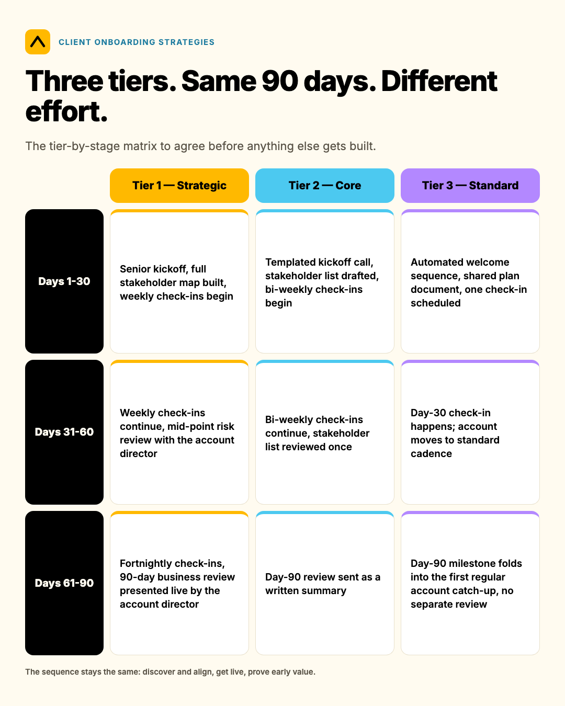
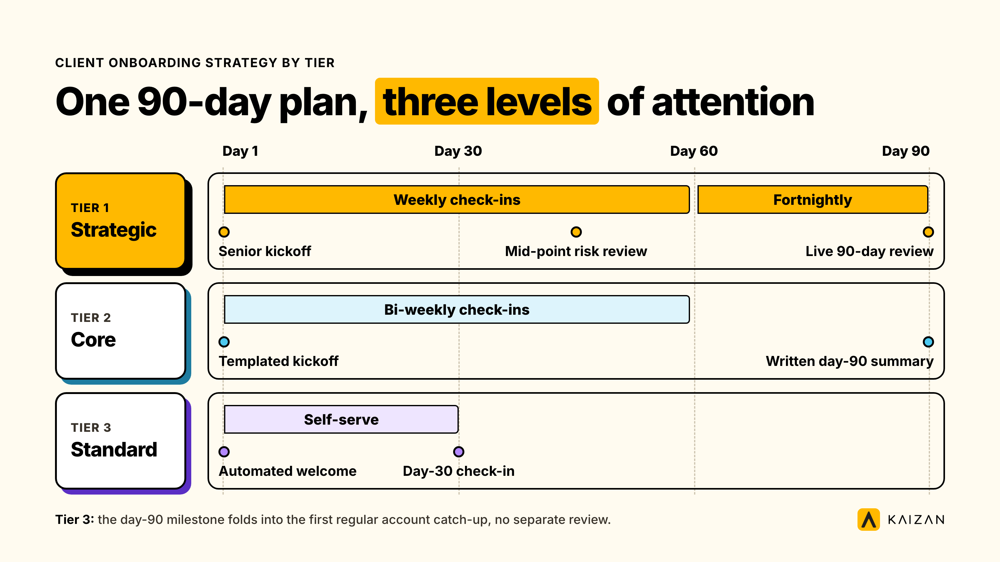

*A client onboarding strategy by tier runs three onboarding tracks instead of one, sized to what each account is worth: a high-touch track for strategic accounts, a guided track for the core book, and a light, templated track for the rest. The tier decides who owns onboarding, how long it runs, and what's automated versus handled by a person.*

Most onboarding guides describe one process and assume every new client deserves the same 90 days. In practice, giving your smallest logo the same senior attention as your flagship account means overspending on the small account, underspending on the big one, or both. In RSW/US's 2024 Agency New Business Outlook survey of agency new-business and marketing decision-makers, 45% of marketers cited an agency's lack of proactivity as their top reason for conducting a review, a roughly 50% jump on the year before. Onboarding is the first test of exactly that, and the resourcing has to match the stakes, which are not the same for every client.

**Key takeaways**

- Three tracks, not one: a strategic track, a core track, and a light-touch track, each with its own owner, timeline and cost to deliver.
- Tier the client first, then build onboarding around the tier. Reversing the order is the most common failure mode.
- What you withhold below Tier 1 should be a stated design choice, not an unspoken gap a client discovers on their own.
- Professional services firms retain roughly 83-85% of clients a year on average across recent benchmark studies, which means losing something close to 1 in 6 accounts annually before any intervention.
- Kaizan clients see 26%+ average revenue growth per client and protect 45% of revenue at risk through early signal, which is the argument for spending differently across tiers rather than equally.

## When to tier onboarding, and when not to

Tiering only pays for itself once a book is large enough that treating every client identically costs you somewhere. As a rough guide: once a firm is running more than about 15-20 live client relationships with a visible spread in account value, whether that's measured in revenue, growth potential or strategic weight, single-process onboarding starts failing in one of two directions. Either the flagship accounts get a generic checklist that undersells the relationship, or every new logo gets the full white-glove treatment and the account team runs out of hours before the quarter ends.

Below that line, tiering is premature. A firm with a handful of concurrent clients doesn't need three tracks; it needs one good track, applied consistently, which is the subject of our guide to the client onboarding process as a 30-60-90 day plan. Tiering is a refinement on top of a working process, not a substitute for having one.

The other precondition is that service or pricing tiers already exist somewhere in the business: in the commercial model, the account team's own informal rules about who gets senior attention, or the CARE-based portfolio view most teams eventually build for ongoing account management (what we call The Evidence-Based Client Health Standard). If those distinctions exist for how you serve a client after onboarding, the honest move is to carry the same distinctions into the first 90 days, rather than starting every relationship identically and only diverging later.

## The three onboarding tracks: client onboarding strategies that actually scale

Tiering by client is a common idea in account service generally; the useful version for onboarding is specific about what changes and what doesn't. Across the three tracks below, the sequence of a 30-60-90 day plan stays the same (discover and align, get live, prove early value). What changes is who's in the room, how often, and how much of it a person does versus a system.

### Tier 1 — Strategic accounts

The top band by revenue, growth potential or strategic weight, typically the 10-20% of logos that carry a disproportionate share of portfolio revenue.

- **Owner:** the account director or a senior partner, personally, not delegated to the most junior person on the bench.
- **What it gets:** a kickoff with senior leadership from both sides in the room; a dedicated stakeholder map built in week one, covering every decision-maker, not just the day-to-day contact; weekly structured check-ins through day 60, tapering to fortnightly; a 90-day business review presented by the account director, not emailed.
- **What's deliberately withheld from the tiers below:** the senior-partner cadence itself, and the depth of the stakeholder map. Tier 2 gets a stakeholder list; Tier 1 gets a stakeholder map that's maintained through the relationship.

### Tier 2 — Core accounts

The majority of the book by count: profitable, stable relationships that don't carry outsized individual risk but collectively make up most of portfolio revenue.

- **Owner:** the assigned account manager, with the account director reviewing at day 30 and day 90 only.
- **What it gets:** a templated kickoff call, a standard stakeholder list (not a full map), bi-weekly check-ins through day 60, and a day-90 review sent as a written summary rather than presented live.
- **What's deliberately withheld from Tier 3:** the bi-weekly cadence and the day-90 written review. Tier 3 gets neither as standard.

### Tier 3 — Standard accounts

Smaller or newer accounts, often the most numerous tier by logo count and the smallest by revenue share.

- **Owner:** whoever owns the account day to day, with no separate onboarding owner.
- **What it gets:** a fully templated, mostly self-serve kickoff: a welcome sequence, a shared document with the plan, and one scheduled check-in at day 30. No separate business review; the day-90 milestone folds into the first regular account catch-up.
- **What this tier doesn't get, by design:** dedicated onboarding hours beyond the single day-30 check-in. This is the tier automation should carry almost entirely, covered further down.

The tier-by-stage matrix below is the artefact to agree before anything else gets built, since every other decision, what gets automated, what the client sees, follows from these three rows.

| Stage | Tier 1 — Strategic | Tier 2 — Core | Tier 3 — Standard |
| --- | --- | --- | --- |
| Days 1-30 | Senior kickoff, full stakeholder map built, weekly check-ins begin | Templated kickoff call, stakeholder list drafted, bi-weekly check-ins begin | Automated welcome sequence, shared plan document, one check-in scheduled |
| Days 31-60 | Weekly check-ins continue, mid-point risk review with the account director | Bi-weekly check-ins continue, stakeholder list reviewed once | Day-30 check-in happens; account moves to standard cadence |
| Days 61-90 | Fortnightly check-ins, 90-day business review presented live by the account director | Day-90 review sent as a written summary | Day-90 milestone folds into the first regular account catch-up, no separate review |

## Customer onboarding best practices: size the stakes before you tier

The best-practice argument for tiering is a numbers argument, not a service-design preference. Professional services firms retain somewhere in the region of 83-85% of clients a year on average, with First Page Sage's 2026 analysis of over 10,000 firms putting the figure at 84%, and several other 2025-2026 studies converging in the same range. Figures like this vary by source and methodology, so treat the range as directional rather than a single agreed number, but the direction is consistent: a typical firm loses something close to 1 in 6 accounts annually, even before a bad year.

That revenue isn't lost evenly. It concentrates in accounts that were never given a chance to form a real relationship in the first 90 days, which is exactly the population a generic, one-size onboarding produces.

Here's an illustrative worked example, built for this guide rather than drawn from a single client's real numbers (every input below is a stated assumption, not a survey finding): a 300-person agency with 40% of its headcount client-facing (120 people), running a portfolio worth $20M a year. At 16% average attrition, that's $3.2M of revenue at risk annually before anyone intervenes. If the top tier holds a reasonably typical 35-40% of total portfolio revenue across perhaps 12-15 accounts, as is common in agencies that already tier by value, that's upward of $1.1M-$1.3M riding on a small enough group of relationships that giving them a different first 90 days, rather than the same templated kickoff as everyone else, is not a hard case to make internally.

Kaizan's own published portfolio mechanics put a number on what's recoverable once a firm is actively managing that risk rather than discovering it late: Kaizan clients see 26%+ average revenue growth per client, and the platform's own ROI model credits roughly 45% of revenue at risk as protected through early signal, both figures drawn from Kaizan's own customer portfolio, not the illustrative example above. The same math scales whether a firm sits at the 150-employee end of this range or the 10,000-employee end; only the absolute dollars change, not the argument for treating the top band of accounts differently from day one.

## A worked example, end to end: one Tier 1 onboarding

Here's how the Tier 1 track plays out on one account, built as a composite from common patterns across client-service teams rather than a single named case; we could not source a cleared, on-the-record case study specific to tiered onboarding for this guide, and have flagged that gap rather than invent one (see our research notes).

A 40-person digital agency wins a $400,000 retainer, its third-largest account by value. Under a single, untiered process, this would get the same templated kickoff as a $40,000 project. Instead:

**Day 1.** The account director, not the assigned account manager alone, joins the kickoff call. Both sides name a senior sponsor. The stakeholder map is started in the same meeting, not after it.

**Day 7.** The stakeholder map is complete: eight named contacts across the client's organisation, each tagged with their role in the decision, not just their job title. This is the artefact Tier 2 and Tier 3 don't get.

**Days 14-50.** Weekly 30-minute check-ins, alternating between the account manager (operational) and the account director (relationship, risk and expansion signals). One of Kaizan's own anonymised client contacts, a managing partner at an agency, described the value of exactly this kind of senior cadence this way:

> "The other thing we'd look at it for is senior team time that's saved by not having to be on every call, and you just jump in and watch that 30-second clip rather than have to be on the whole thing to still get the same outcome."
>
> — Managing Partner, Agency Client A

The senior check-in doesn't require the account director's full attention on every call; it requires their presence and a fast way to catch up on what they missed, which is a cadence problem to solve, not a time-cost to absorb in full.

**Day 90.** The account director presents the business review in person, not by email, covering what was delivered, what the client's stakeholders said in between formal meetings, and one expansion signal the team is already acting on. A relationship-first instinct for exactly this kind of senior account work came through in how another client contact described their own approach:

> "For me, it's a relationship builder. I've been doing this for 30 years. I'm a pick-up-the-phone, I'm-gonna-come-and-see-you kind of person, and we don't live in that world anymore."
>
> — MD and Chief Client Officer, Agency Client B

Where it broke down in an earlier, untiered version of this same account type: the senior partner was looped in only for the kickoff call, then handed fully to a mid-level account manager by day 10. By day 60, the client's finance stakeholder, never personally met by anyone senior, raised a budget concern that had been building for three weeks. Nobody above account-manager level knew until the client escalated it. The failure mode wasn't a missed task. It was an unstaffed relationship at exactly the tier that couldn't afford one.

## Scripts and wording to copy

**Tier 1 kickoff email (from the account director, not the account manager):**

> Subject: Looking forward to getting started together
>
> [Name], I wanted to reach out personally ahead of our kickoff on [date]. I'll be on the call alongside [account manager], and we'll be building out a full stakeholder map in that first session so we know who else on your side we should be looping in early, rather than finding out later. Expect a short check-in from me directly at day 30 and day 90, separate from [account manager]'s regular updates.

**Tier 2/3 kickoff email (templated, sent by the account manager):**

> Subject: Welcome aboard — here's what the next 90 days look like
>
> [Name], welcome to the team. Attached is our standard 30-60-90 day plan with the milestones we'll hit together. I'll check in at the points marked on the plan; flag anytime if you need something sooner.

**The line for when a client pushes back on the lighter-touch model (Tier 2 or 3):**

> "Our senior team's time is focused on the accounts where that depth makes the most difference right now, and we revisit that every quarter, including for you. What I can commit to is [specific cadence], and you'll always know exactly who to call if something needs to move faster than that."

This is a statement of a model, not an apology for one. Clients who hear tiering explained as a deliberate structure rarely object to it; clients who discover it by noticing a peer got more, without ever being told why, are the ones who escalate.

## How to tell whether it worked

The honest metric for a tiered onboarding isn't "did the client go live," which almost every onboarding manages eventually. It's whether the depth of the relationship at day 90 matches the tier the account was supposed to get.

A few measures worth tracking, each tied to a sub-element of what we call The Evidence-Based Client Health Standard (our name for the CARE methodology, which measures Client Satisfaction, Activity with Stakeholders, Relationship Strength and Expansion Opportunities):

- **Stakeholder coverage at day 90, by tier.** In Kaizan's 2026 Client Service Benchmark, the client-to-team headcount ratio held identical across top- and bottom-performing accounts, at 9.12 contacts per internal team member, but top accounts engaged 1.71x more client stakeholders overall (242 vs. 142) and ran 2.91x more client-initiated email threads. The lesson for onboarding: coverage should scale with the relationship from day one, not stay flat while headcount does.
- **Decision-maker contact frequency, not just coverage.** The same benchmark found both top- and bottom-performing accounts engage roughly half of their defined decision-makers (around 52.7% vs. 50.0%), but top accounts run 1.81x more decision-maker calls and 2.06x more decision-maker emails. If your Tier 1 stakeholder map isn't converting into more frequent contact with the people on it by day 60, the map was decorative.
- **How often you're actually measuring satisfaction.** The same dataset found that when CSAT is measured, top and bottom cohorts score identically; the real gap is frequency, with top accounts measured roughly 2.9x more often (41 times a year versus 14). A Tier 1 account with no satisfaction check-in before day 60 isn't being managed at the tier it was sold.
- **Don't mistake a quiet risk log for a safe account.** The same benchmark's "Risk Paradox" finding: top-performing accounts actually surface 2.21x more risk phrases in conversation than lower-performing ones. Silence on a newly onboarded Tier 1 account is a signal to check in harder, not a sign everything is fine.

The baseline to set before you start: your current onboarding completion rate and time-to-first-value today, by tier, measured before you introduce the new tracks. We weren't able to source published data isolating onboarding completion rate as its own metric for this guide, since Kaizan's own platform operates across the full relationship rather than owning the onboarding phase specifically, so this baseline has to come from your own current process. Track it at day 30, 60 and 90 for one full quarter before judging whether the tiered version moved it.

## What to automate and what must stay human

**Automate, regardless of tier:** the welcome sequence and kickoff scheduling; document collection and e-signature chasing; the day-30 and day-90 status update draft (a draft a person reviews, not one that sends itself); calendar invites for every check-in in the plan; CRM and project-tool updates that mirror onboarding milestones, so the information isn't trapped in one person's inbox.

**Keep human, and scale by tier:** who delivers the kickoff and the 90-day review; stakeholder mapping itself, which an automated contact import can seed but shouldn't finish, since the judgment about who actually holds influence versus who simply has a title doesn't come from a CRM field; the read on a client's tone in the first 30 days, exactly the kind of signal that predicts first-year retention and isn't yet reliably automatable; and the decision to escalate or slow down, since a system can flag that a decision-maker has gone quiet for two weeks, but a person still has to decide what that means for this specific relationship.

Tier 3 is where the automation-to-human ratio should be most aggressive. If an account manager is spending meaningful personal time hand-holding a Tier 3 kickoff, the templated track has failed, and the fix is a better template, not more hours.

## Pitfalls

**Tiering by gut feel, never revisited.** Symptom: the same dozen accounts have been "Tier 1" for three years regardless of what's happened to their revenue or risk profile. Fix: review tier assignments on the same cadence as your commercial or account-planning cycle, typically quarterly or annually, using the criteria on a one-page tier definition sheet agreed up front, not memory.

**Withholding visibly instead of by design.** Symptom: a Tier 2 client notices a peer getting a business review presented in person while theirs arrives by email, and nobody ever explained why. Fix: say the model out loud, even to the clients receiving less of it. The script earlier in this guide exists for this exact moment.

**No migration path.** Symptom: an account grows from Tier 3 to genuinely Tier 1 revenue over 18 months, but nobody notices because tiering was only ever applied at the point of onboarding, not revisited afterward. Fix: tier reviews need an explicit trigger, a renewal, a QBR, a revenue threshold crossed, that pulls an account up or down, not just a one-time label assigned on day one.

**Treating the lightest tier as "no onboarding."** Symptom: Tier 3 accounts have the highest early churn in the portfolio, and nobody connects it to the fact they got a templated email and nothing else. Fix: light-touch still means a plan, a single scheduled human check-in, and a clear owner, even if that owner is the only person touching the account day to day. The difference between Tier 1 and Tier 3 should be depth, not the presence or absence of a process.

## Frequently asked questions

**What is a client onboarding strategy by tier?**
A client onboarding strategy by tier runs three onboarding tracks instead of one, sized to what each account is worth: a high-touch track for strategic accounts, a guided track for the core book, and a light, templated track for the rest. The tier decides who owns onboarding, how long it runs, and what's automated versus handled by a person.

**What are the best client onboarding strategies for a growing agency?**
The strategies that hold up as a firm grows are the ones that scale down as cleanly as they scale up: a templated, mostly automated track for the bulk of the book, with a deliberately heavier, senior-owned track reserved for the accounts carrying the most revenue or risk. Trying to run one uniform process past roughly 15-20 concurrent clients is the most common reason onboarding quality becomes inconsistent.

**What are customer onboarding best practices once you've tiered?**
Agree the tier definitions in writing before building anything else. Give each tier a named owner, a stated timeline, and an explicit list of what's withheld at the tiers below, rather than leaving the gap unspoken. Measure stakeholder coverage, contact frequency and satisfaction by tier, not just whether the client technically went live, and revisit tier assignments on a fixed cadence rather than leaving them static.

**How long should onboarding take for each tier?**
All three tracks can follow the same 30-60-90 day structure; what changes is the cadence and depth within it, not the overall length. A Tier 1 account gets weekly contact tapering to fortnightly; Tier 3 gets a single scheduled check-in at day 30 with the rest handled by a template. Stretching Tier 1 much beyond 90 days usually means the stakeholder map or the business review slipped, not that the tier needs more time by design.

**Who should own onboarding at each tier?**
Tier 1 should have a named senior owner, typically the account director, personally present at kickoff and the 90-day review. Tier 2 sits with the assigned account manager, with light senior oversight at day 30 and day 90. Tier 3 has no separate onboarding owner; it's folded into whoever owns the account day to day.

**What if a client pushes back on getting the lighter-touch model?**
State the model rather than defending it. Clients rarely object to a disclosed structure; they object to discovering, unprompted, that a peer got more. Commit to a specific, real cadence for their tier and to revisiting it on a set schedule, and name who they can escalate to if something needs to move faster than that cadence allows.

**How do we know a tiered onboarding strategy actually worked?**
Track stakeholder coverage, decision-maker contact frequency and how often satisfaction is actually measured, by tier, at day 30, 60 and 90, for at least one full quarter before and after introducing the tiers. A quiet account isn't necessarily a healthy one: benchmark data shows the best-performing accounts surface more risk signals in conversation, not fewer, so absence of complaints is not the success metric.

## Where to go from here

Tiering the first 90 days only works if the tiers themselves are agreed before anyone builds a single email template. Start with a one-page tier definition worksheet, criteria, what each tier gets by day, and what's deliberately withheld below Tier 1, before touching the onboarding plan itself.

Once clients are onboarded, the harder question starts: does every account team actually know what's happening across the full portfolio, by tier, without waiting for a client to raise it? That's the problem Kaizan is built to solve, scoring every relationship against The Evidence-Based Client Health Standard and surfacing the next action before a renewal conversation goes wrong, not after.

[Book a demo with Kaizan](https://www.kaizan.ai/us/) to see how client intelligence picks up where tiered onboarding leaves off.
