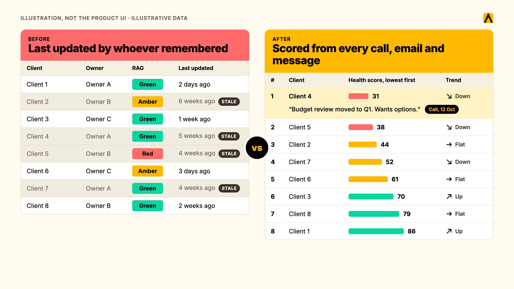
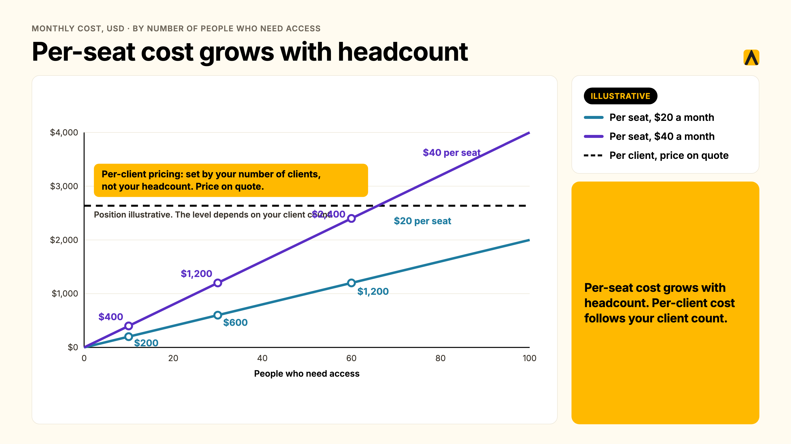
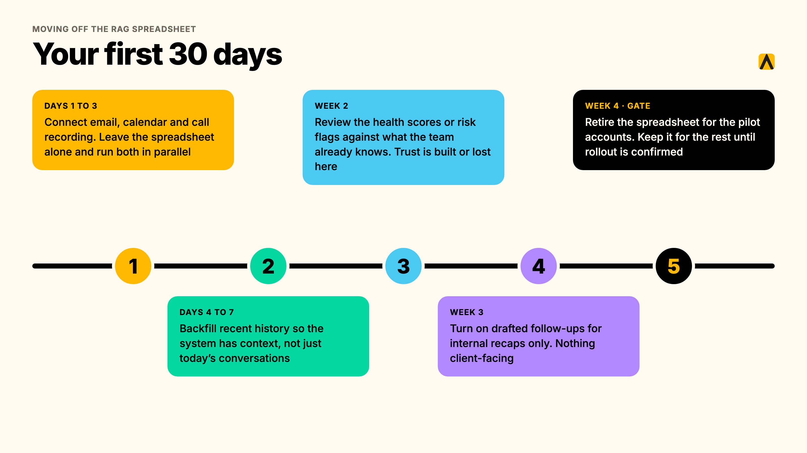

Most agencies and professional services firms don't have a tools problem. They have a tools-that-don't-talk-to-each-other problem. A CRM holds the contact. A project tool holds the task. A spreadsheet holds the RAG status, updated once a month by whoever remembers. None of them holds the relationship.

**Customer success tools** are the software that captures, scores, acts on and reports what's actually happening inside a client relationship: the calls, the emails, the quiet stakeholder, the risk nobody wrote down. This guide sorts the market into four jobs, compares 25 tools against each one, and gives you a way to choose that starts with your problem, not a vendor's feature list.

**This is for you if** you run client service, account management or operations at an agency, consultancy or professional services firm with somewhere between 150 and 10,000 people, and you're trying to work out what belongs in your stack, what's duplicating what, and what you're missing.

**Key takeaways**

- The stack splits into four jobs: capture, system of record, score and health, and act and automate. Most firms are strong on one or two and blind on the rest.
- A CRM and a client success platform solve different problems. One is the record. The other tells you what's happening inside the record, and what to do about it.
- At 10 clients a spreadsheet works. At 50 it starts lying to you. At 200 someone is guessing.
- Pricing in this category runs from free tiers for solo capture tools to five figures a year for enterprise customer success platforms, and the right model (per seat, per client, per account) depends on how many people touch each client.

## What the client service tech stack is, and what it isn't

The client service tech stack is every tool your account team touches to keep a client relationship running: the system that holds the contact, the tool that captures the call, the dashboard that scores the relationship, and whatever drafts the follow-up afterward. It is not one product. It is not your CRM alone, and it is not a single "customer success tool" that does everything.

Most of what gets sold as a complete stack is actually one lane wearing a trench coat. A note-taker captures the call and stops. A CRM records the deal and the contact, and stops. A survey tool asks for an NPS score twice a year, and stops. None of them, on their own, can tell a Head of Client Service which of their 40 accounts needs attention this week, and why.

## The four jobs in a client service tech stack

Every tool in this category does one (sometimes two) of four jobs. Naming the job first, rather than the product category, is the fastest way to see what you're missing.

### Capture

Getting the conversation into a system in the first place: the call, the email thread, the Slack message, the meeting notes nobody typed up. This is table stakes. If a conversation happens and nothing captures it, everything downstream is guessing.

### System of record

Where the contact, the deal, the contract and the account history live. This is your CRM. It answers "who is this client and what have we sold them," not "how do they feel about it right now."

### Score and health

Turning captured conversations into a judgment: is this relationship getting stronger or weaker, and why. This is the layer most agencies don't have, and the one a monthly RAG spreadsheet tries and fails to replace.

### Act and automate

Doing something with the score: drafting the follow-up, flagging the quiet stakeholder, updating the CRM, prepping the QBR deck. This is where admin time actually gets recovered, and it only works if the capture and scoring layers underneath it are accurate.

A **60-second decision table**, to find your starting point:

| If your problem is… | You're missing… | Look at |
| --- | --- | --- |
| We don't know a client is unhappy until they tell us | Score and health | A client success platform (Kaizan, Gainsight, ChurnZero, Planhat) |
| Calls get summarised, then the summary disappears | Capture feeding a system of record | A capture tool wired into a CRM, or a platform that does both |
| Our CRM has the contact but nothing about how the relationship feels | System of record paired with score and health | Add a client success layer on top of HubSpot or Salesforce, don't replace it |
| Account managers spend their week on admin, not clients | Act and automate | Automation workflows (below), or a platform with built-in Helpers |
| We have five tools and nobody's sure which one is current | All four, badly integrated | An audit before a purchase |

## Why agencies outgrow spreadsheets and their CRM

A spreadsheet is free, familiar, and fine for a handful of clients. It breaks for four reasons, all structural rather than a training problem.

**The monthly RAG spreadsheet is backward-looking.** Someone sits down once a month, recalls the last four weeks from memory, and colours a cell. By the time it's amber, the client has usually already raised the issue, or decided not to.

**The relationship lives in inboxes and calls, not CRM fields.** A CRM logs the deal. It does not log that the client mentioned a budget freeze on a call three weeks ago, or that the decision-maker hasn't replied to anything in a month. [Agency Client](https://kaizan.ai/us/product/), a Head of Client Service at a mid-sized digital agency, put it plainly in a persona interview: half of the updates and notes from client calls never get logged anywhere at all.

**When an account director leaves, the context leaves with them.** Nobody else was on every call. The replacement starts from zero, and the client notices.

**Nobody can answer "is this account at risk?" with evidence.** Not a feeling. Not a hunch from the last QBR. Evidence: who went quiet, what they said, when it changed.

This isn't a hypothetical. In Kaizan's 2026 benchmark of 1 million-plus calls and 10 million-plus emails across real client service teams, the accounts that later churned weren't silent. Close to 69% of struggling accounts raised a warning sign in conversation at least once, and in about 38% of cases the same risk theme recurred across more than one period. The signal was almost always there. The team just didn't have a system built to catch it. The same research found something that runs against instinct: top-performing accounts actually surface *more* risk mentions than bottom-performing ones, 2.21 times as many. A quiet risk register on an active account is a warning sign, not a green light, because the strongest relationships are the ones where problems get said out loud early enough to fix.

## The features that actually matter

Not every feature on a vendor's homepage earns its place. Here's what to check for, lane by lane.

- **Automatic capture, not manual entry.** If logging a call depends on someone remembering to do it, it won't happen consistently. The [Head of Client Service persona evidence](https://kaizan.ai/us/for/client-service-director/) is blunt on this: teams that rely on manual logging lose roughly half their updates.
- **A health score with a defined method**, not a single number nobody can explain. Ask what it's built from and whether you can see the inputs.
- **Alerting that reaches people where they already work** — Slack, Teams, email — rather than a dashboard nobody opens.
- **A portfolio view for leadership**: which accounts need attention this week, not a report compiled after the fact.
- **Integrations with your actual stack**: Salesforce or HubSpot for the CRM layer, Slack or Teams for chat, Zoom, Google Meet or Microsoft Teams for calls, Google Drive, Notion or SharePoint for documents, and your project tool (Asana, Jira, monday, ClickUp) for work tracking.
- **Permissions that match your org chart.** Who can see what, by account and by team, matters more once you're past about 50 clients.
- **AI features worth paying for**: drafted follow-ups you'd actually send with light editing, and risk or expansion signals flagged from real conversations. The gimmick version is a chatbot that answers generic questions with no client context behind it.

## The 25 best customer success tools for client service teams, compared by job

This list sorts 25 tools by the job they do, not by marketing category, because that's the only way to compare them honestly. A capture tool and a **customer success CRM** aren't competing for the same budget line, even though both get called "customer success tools" in search results. Pricing below is list pricing at the time of writing (November 2026) where published; several vendors are quote-only, marked accordingly, and should be re-checked before you buy.

### Capture: getting the conversation into a system

| Tool | Best for | Pricing model | Real limitation |
| --- | --- | --- | --- |
| **Gong** | Revenue teams wanting call analytics at scale | Quote-based, typically enterprise-priced | Built for sales cycles, not ongoing account relationships; expensive for pure client service use |
| **Fireflies** | Lightweight call capture and transcription | Free tier; paid from roughly $10 to $19 per seat/month | Captures the meeting it joins and stops there; no account-level memory across calls |
| **Otter** | Teams already inside Google or Microsoft Workspace | Free tier; paid from roughly $8.33 per seat/month | Same ceiling as Fireflies: transcription, not relationship intelligence |
| **Fathom** | Solo users wanting a free, simple recorder | Free tier is generous; paid add-ons for teams | No native CRM or health-scoring layer; needs pairing with something else |
| **Microsoft Copilot** | Firms standardised on Microsoft 365 | Included in eligible M365 plans or add-on licensing | General-purpose assistant, not built for client-specific memory or account health |

### System of record: the CRM layer

| Tool | Best for | Pricing model | Real limitation |
| --- | --- | --- | --- |
| **HubSpot** | Firms wanting CRM, marketing and service in one suite | Free CRM tier; paid tiers scale per seat | Client health and relationship scoring aren't native; needs an add-on or integration |
| **Salesforce** | Enterprises with complex sales and service processes | Per-seat, quote-based at scale | Powerful but heavy to configure; account health is a bolt-on, not core |

### Score and health: customer success management tools

| Tool | Best for | Pricing model | Real limitation |
| --- | --- | --- | --- |
| **Gainsight** | Large SaaS customer success orgs | Quote-based; typically five figures a year and up | Built for product-usage data; weaker on conversation-driven signals that dominate services relationships |
| **ChurnZero** | Mid-market SaaS wanting churn prediction | Quote-based | Same SaaS-usage bias as Gainsight; less suited to agencies where the signal is in calls and email, not product logs |
| **Totango** | Enterprise CS teams tracking adoption journeys | Quote-based | Steep setup; strongest where there's a product to instrument, less so for pure services firms |
| **Planhat** | CS teams wanting a flexible data model | Quote-based | Flexibility means more configuration work before it's useful |
| **Vitally** | Mid-market SaaS teams | Starts around $600/month for small teams, scales up | SaaS-first design; conversation capture for agencies is not the core use case |
| **ClientSuccess** | Straightforward CS management for smaller teams | Quote-based | Lighter feature set than Gainsight-tier platforms |
| **Custify** | SMB to mid-market CS teams | Quote-based | Smaller ecosystem of integrations than the category leaders |
| **Kaizan** | Agencies, consultancies and professional services firms running many client relationships across dispersed teams | Kaizan is priced by number of clients. Price on quote. [Full pricing](https://kaizan.ai/us/pricing/) | Priced per client, not per seat, which suits firms where many people touch one account but is a different model to budget for than a per-seat tool |

### Act and automate: turning a score into a task

| Tool | Best for | Pricing model | Real limitation |
| --- | --- | --- | --- |
| **Zapier** | Connecting tools that don't natively talk | Free tier; paid from roughly $20/month | General-purpose automation, not built for client service specifically; you design every workflow yourself |
| **Make** | Teams wanting more complex automation logic than Zapier | Free tier; paid from roughly $9/month | Steeper learning curve than Zapier for non-technical users |
| [**monday.com**](http://monday.com) | Visual work and project tracking with CRM add-ons | Per-seat, from roughly $9/seat/month | Project management core, with client health as an add-on, not a native strength |
| **ClickUp** | All-in-one task and project management | Free tier; paid from roughly $7/seat/month | Same pattern as monday: strong on tasks, thin on relationship health |
| **Asana** | Teams prioritising clean project tracking | Free tier; paid from roughly $10.99/seat/month | No client health or sentiment layer at all; purely a work tool |

### Report and feedback

| Tool | Best for | Pricing model | Real limitation |
| --- | --- | --- | --- |
| **Qualtrics** | Enterprises running formal CSAT and NPS programmes | Quote-based | Survey-based, so it measures sentiment a few times a year, not continuously |
| **Survicate** | Lightweight, fast survey deployment | Free tier; paid from roughly $75/month | Same structural limit as any survey tool: periodic, not continuous |
| **AgencyAnalytics** | Agencies reporting on marketing performance to clients | From roughly $100/month | Built for marketing metrics dashboards, not relationship health |
| **Looker Studio** | Teams wanting free, flexible dashboards | Free | You have to build and maintain every report yourself; no native client data capture |
| **Rocketlane** | Client onboarding project tracking | Per-seat, quote-based at scale | Strong at onboarding specifically; not built for the ongoing relationship after day 30 |

**Why Kaizan sits in the score-and-health lane and not in reporting or automation alone:** it captures calls, email and chat automatically, scores every relationship against [The Evidence-Based Client Health Standard](https://kaizan.ai/us/product/#health-model), and then drafts the follow-up, updates the CRM and flags the risk, which spans capture, scoring and action rather than one lane. That's a deliberate design choice, not a claim that one tool should replace all four lanes for every firm. A 10-person team running five clients off HubSpot and a shared inbox doesn't need this. A 60-person agency running 80 relationships across three offices usually does.

## How we assessed these tools

Pricing and feature claims above were checked against each vendor's own published pricing and product pages in November 2026. Where a vendor publishes no price, it's marked quote-based rather than estimated. This list was compiled and reviewed by Kaizan's content team, which includes people who have run client service functions at agencies; Kaizan appears in the comparison with its positioning disclosed, not hidden. Pricing changes often in this category: re-check before you commit.

## Customer success automation: what to automate first

"Customer success automation" covers the act-and-automate lane above, but the question that actually matters is sequencing: what to automate first, so you build trust in the system before asking a team to rely on it for client-facing work.

1. **Call and email capture.** This should be fully automatic from day one. If a human has to remember to log something, it won't happen consistently enough to build a health score on top of it.
2. **Internal summaries and recaps.** Low risk, because nothing client-facing goes out unreviewed. This is where most teams should start.
3. **Risk and opportunity flagging.** Surfacing a quiet stakeholder or a mentioned budget concern to a human, who decides what to do next. Still no client-facing output yet.
4. **Drafted follow-ups and CRM updates.** This is where the controls matter: a draft that a person reviews and sends is different from an email that goes out unreviewed. Kaizan's own quality bar for this, confirmed internally, requires at least 80% of drafted outputs to be accepted without edits before a capability ships to every account.
5. **QBR and account brief prep.** Compiling the deck or the brief from real conversation history, reviewed before the meeting, not generated live in it.

What should stay human, at every stage: the decision to escalate a relationship, the judgment call in a difficult conversation, and anything going to a client that hasn't been read by a person first. Automation should clear the admin around those moments, not replace the moments themselves.

## Customer success CRM, spreadsheet or platform: what to use at 10, 50 and 200 clients

There's no universal answer here, but there are real thresholds where the tool that worked stops working. These are drawn from patterns in Kaizan's own customer conversations across firms at each size, not from a formal study, so treat them as a starting point rather than a rule.

**At around 10 clients:** a CRM (or even a well-kept spreadsheet) plus email and calendar is usually enough. One person, or a small team, can hold the context in their heads. The risk here isn't the tool, it's that nothing is written down anywhere other than memory.

**At around 50 clients:** the spreadsheet starts lying. Updates lag, RAG statuses go stale between the monthly review cycle, and the first account director departure costs the firm real institutional knowledge. This is usually the point where firms add a dedicated **customer success CRM** or client success layer on top of their existing CRM, because the system of record alone can't answer "how is this relationship doing" and the spreadsheet can't keep up with the volume.

**At around 200 clients:** manual anything breaks. A portfolio view becomes non-negotiable, because no individual leader can hold 200 relationships in their head, and the firm needs automatic capture, scoring and alerting just to know where to look each week. This is also typically where multi-team segmentation and tiered account permissions start to matter, because a 200-client portfolio usually spans several teams or offices.

Kaizan is built for firms with somewhere between 150 and 10,000 employees, where client-facing teams are large enough and client counts high enough that a manual process genuinely can't keep up. Smaller firms can work with it too, in the right circumstances, typically when they're running a high volume of touchpoints across a dispersed team even at a smaller headcount, but the feature set is built with that 150-plus range in mind.

## How to choose a customer success tool in seven steps

1. **Start with the problem, not the feature list.** Use the decision table above. "We don't know a client is unhappy until they tell us" needs a different tool than "calls get summarised and then lost."
2. **Map your current stack before adding to it.** List every tool that touches a client relationship today, and what job each one actually does. Most firms find overlap they didn't know they had.
3. **Count clients, not seats, when you price it out.** A per-seat tool at $40/seat/month looks cheap until you realise 12 people touch every account. Seats are unique people, so a per-seat bill follows headcount: a 30-person agency has at most 30 seats, which is $600/month for a $20/seat tool and $1,200/month for a $40/seat tool, however many accounts it covers. Per-client pricing works differently: Kaizan is priced by number of clients, so unlimited users don't add to the bill. Per-client cost follows your client count, not your headcount. Run your own numbers.
4. **Weigh manual entry against automatic capture honestly.** A tool that depends on someone remembering to log a call will see the adoption numbers above within a quarter: roughly half of it simply won't happen.
5. **Pilot on a small number of real accounts for two weeks**, not a sandbox with demo data. Five accounts is enough to see whether the capture is accurate and whether the team actually opens the thing.
6. **Know what each person in the buying committee needs to see.** A Head of Client Service wants evidence they can take upward and proof it replaces the spreadsheet rather than adding to it. A Head of Ops or COO wants to know the team will actually use it without extra admin, and what it costs against the current stack.
7. **Score the shortlist against your own criteria**, not a vendor comparison page.

## What customer success tools cost

Pricing in this category runs across three models, and they don't compare cleanly without converting to a common unit.

| Band | What's typical | Example |
| --- | --- | --- |
| Free to low-cost capture tools | $0 to $20 per seat/month | Fireflies, Otter, Fathom free tiers |
| Mid-market CS platforms | Quote-based, often $600 to a few thousand dollars a month for smaller teams | Vitally, Custify, ClientSuccess |
| Enterprise CS platforms | Quote-based, typically five figures a year and up | Gainsight, Totango |
| Per-client platforms for services firms | Priced by number of clients, unlimited users. Price on quote. | Kaizan |

Kaizan is priced by number of clients, with no additional cost as the team using it grows. A per-seat enterprise CS platform at the same client count can cost less or more depending entirely on how many seats you need, which is exactly why step three above (count clients, not seats) matters before you compare two quotes.

## Which software fits which size of firm

- **10-person team, under 15 clients:** CRM plus a free capture tool is usually enough. Spend the budget on getting into the habit of logging things consistently before buying a platform.
- **30 to 80 people, 20 to 75 clients:** this is where a dedicated client success layer earns its cost, because the spreadsheet has started lying and a dedicated account director is likely covering 8 to 15 relationships alone.
- **150 to 500 people, 50 to 200-plus clients across several offices:** a portfolio-level platform with multi-team segmentation becomes close to essential, because no single leader can hold that many relationships in view.
- **500 to 10,000 people, enterprise portfolios:** custom integrations, per-practice calibration and SSO become the deciding factors as much as the core scoring feature.

## Your first 30 days moving off the spreadsheet

1. **Days 1 to 3:** connect email, calendar and call recording. Don't touch the spreadsheet yet; let both run in parallel.
2. **Days 4 to 7:** backfill recent history so the system has context, not just conversations from today onward.
3. **Week 2:** start reviewing the health scores or risk flags against what the team already knows. This is where trust gets built or lost; if the system flags something the team already knew about, that's a win, not a redundancy.
4. **Week 3:** turn on drafted follow-ups for internal recaps only, nothing client-facing yet.
5. **Week 4:** retire the spreadsheet for the pilot accounts. Keep it running for the rest of the portfolio until the rollout is confirmed.

## An example: what changed when an agency added a client intelligence layer

Greg Gifford, Chief Operating Officer at SearchLab, described the problem most agencies don't know they have until it's solved: "We didn't realize that there was a problem of the throughput of connecting everything together and having a searchable place to go for each client. We didn't realize we needed it, but once we had it, we were like, oh my God, we were missing the boat."

The effect wasn't just time saved. It showed up in how the agency talks about its own budget: "It is the one tool that whenever we have efficiency discussions or cost cutting discussions or budget discussions, it is never even on the table to discuss [Kaizan], because it is absolutely vital to everything that we do, and we cannot live without it." SearchLab also uses the layer directly against churn risk: "We're trying to be proactive in predicting which clients might be a churn risk, and Kaizan is a huge part of helping to identify that."

At Gravity Global, the shift showed up in a specific recurring task. Ada Cavalmoretti, Group Account Director, described the change plainly: it reduces the manual tasks that take a long time but aren't valuable, freeing the team to focus on clients. A colleague's churn reporting, separately, went from something that used to take hours to something that now takes minutes.

A fair counter-example, if you're building the case for change internally: this only works when the whole account team adopts it together. A partial rollout, where only one or two people on a client use the system while the rest still work from memory and a shared inbox, produces a patchy health score that's less trustworthy than the spreadsheet it replaced, because half the conversations never get captured. The fix isn't the tool; it's rolling out to a whole pod or client team at once rather than one person at a time.

## Frequently asked questions

**What is the best CSM software for agencies?**
There isn't a single best CSM software for every agency, because the right one depends on the job you're missing: capture, system of record, scoring, or automation. For agencies specifically, where the signal lives in calls and email rather than product usage data, a platform built for conversation-driven relationships (like Kaizan) tends to fit better than a SaaS-first CS tool built around usage logs.

**What is customer success automation, and which workflows should we automate first?**
Customer success automation means using software to handle the repeatable admin around a client relationship: capturing calls, drafting follow-ups, updating the CRM, flagging risk. Start with capture and internal summaries, since nothing client-facing goes out unreviewed, and only automate drafted client-facing emails once you've confirmed accuracy on internal-only tasks first.

**What are the best customer success management tools for agencies?**
For agencies and professional services firms, the strongest customer success management tools are the ones built around conversation data (calls, email, chat) rather than product usage, since that's where the relationship signal actually lives. Gainsight and Totango are strong where there's a product to instrument; Kaizan and similar services-focused platforms are built for firms where the product is the relationship itself.

**Do we need a customer success CRM, a spreadsheet or a platform?**
At around 10 clients, a CRM and careful habits are usually enough. At around 50, most firms need a dedicated customer success CRM or health-scoring layer because the spreadsheet can't keep pace. At around 200, a full platform with automatic capture and a portfolio view becomes close to essential, because no individual can track that many relationships manually.

**How much do customer success tools cost?**
Capture-only tools run free to roughly $20 per seat a month. Mid-market platforms are often quote-based, from several hundred to a few thousand dollars a month. Enterprise CS platforms typically run into five figures a year. Platforms priced per client rather than per seat, like Kaizan, are priced by number of clients with unlimited users, so the cost follows your client count rather than your headcount. Price on quote.

**Are there free customer success tools?**
Yes, for the capture lane specifically: Fireflies, Otter and Fathom all offer free tiers for call recording and transcription, and Looker Studio is free for building your own dashboards. None of these free tiers includes a health score, risk alerting or automated action on what they capture; that layer is where the paid tiers and dedicated platforms earn their cost.

**Do we need these tools if we already have a CRM?**
A CRM tells you who the client is and what you've sold them. It doesn't tell you how the relationship is doing right now, because that signal lives in calls, emails and the things clients say that never get typed into a CRM field. Most firms keep their CRM as the system of record and add a client success layer on top of it, rather than replacing one with the other.

**How long does it take to roll out?**
For automatic-capture platforms, integrations typically connect within a day and recent history backfills within the first two weeks, so a health score is live almost immediately. Full team adoption, where account managers rely on drafted follow-ups and the system genuinely replaces old habits, more commonly takes 30 to 45 days.

**Will this replace our RAG spreadsheet?**
It should, for the accounts it covers, but trust has to be earned first. Run the platform in parallel with the spreadsheet for the first two to three weeks, confirm the health scores match what the team already knows is true, then retire the spreadsheet account by account rather than all at once.

---

See how Kaizan fits into the score-and-health lane of your own stack. [Book a demo](https://kaizan.ai/us/pricing/).
