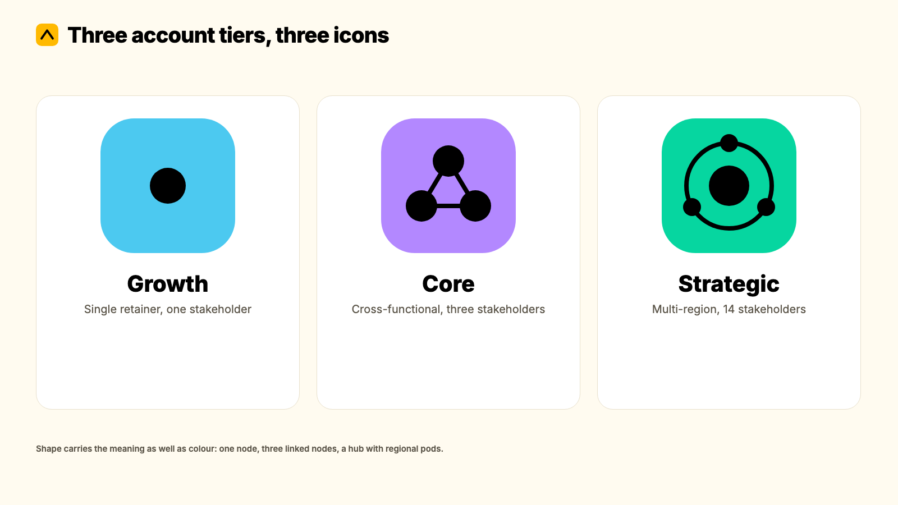
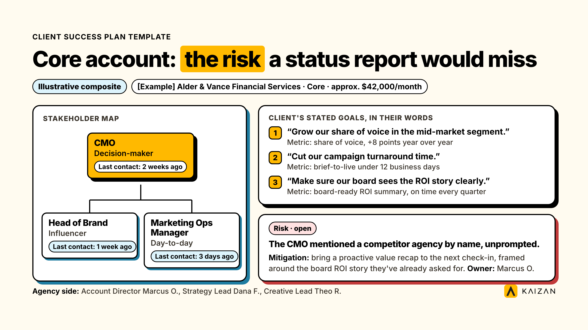

A client success plan is a living, one-page document for a single account: the client's own stated goals, who the key stakeholders are, the milestones and metrics that prove progress, the risks being tracked, and who owns the next review. Use it in place of a status report that only tracks what you delivered, not what it bought the client.

This guide covers what belongs in a customer success plan template, how it differs from an account plan and a QBR deck, three filled examples at different account sizes, the client-facing version you can build jointly, how to tell whether the plan is actually working, and how to keep the whole thing current without someone updating it by hand every month.

This is written for Heads of Client Service running a book of retained accounts, not for SaaS teams running product-adoption playbooks. The fields that matter, and the point of writing any of it down, change when the relationship is a service built on trust and delivery, not a license renewal.

**Key takeaways**

- A customer success plan only earns its place if someone opens it between reviews, not just before them. A plan that only gets read the night before a QBR is a QBR prep document wearing a different name.
- The three filled examples below exist because a blank template and a filled one teach different things. Copy the filled one closest to your account size, then adjust it, rather than starting from a blank page.
- This is not an account plan and not a QBR deck. The comparison table below settles exactly where each one lives and what happens when teams confuse them.

## What is a customer success plan, and why do agencies need one?

A customer success plan is a single document, per client, that holds what the relationship is actually trying to achieve, who the people are on both sides, and what's at risk, reviewed on a set cadence rather than written once at onboarding and left to go stale. It replaces the account lead's memory, and the monthly RAG spreadsheet, as the place the relationship actually lives.

The case for writing one down at all starts with what happens when nobody does. RSW/US's 2024 Agency New Business Outlook Report, drawn from a database of more than 7,000 US and Canadian agencies, found that 45% of marketers now cite a lack of proactivity from their agency as the single biggest trigger for a review, a sharp jump from the year before. A client success plan is one of the few mechanisms that forces proactivity into a cadence rather than leaving it to whichever account lead happens to be paying close attention that month.

It also answers the objection every Head of Client Service has before they've finished reading this far: does this replace the spreadsheet, or is it one more thing on top of it? Done properly, a client success plan is the spreadsheet's replacement, not its neighbor. The monthly RAG tracker gives you a color. A success plan gives you the goal the color is being measured against, the person who said it mattered, and what you're doing about the risk behind a status that just turned amber.

Who should own it is worth settling before anyone writes a word. The account lead owns the plan day to day; a Head of Client Service owns the standard it's held to across the book, which account tiers get which depth of plan, and what triggers escalation when a plan shows a repeated risk. Many agencies already run tiering under names like Bronze, Silver and Gold, or Growth, Core and Strategic; whichever labels your firm uses, the plan's depth should follow the tier, not a single template forced across every account regardless of size.

Across Kaizan's own client portfolio, accounts get an average revenue increase of 26%+ year over year. That number isn't produced by a document. It's produced by teams that know the client's actual goals well enough to act on them before the client has to ask, and a written plan is the cheapest way to get every account lead doing that consistently, not just the naturally good ones.

## Customer success plan vs account plan vs QBR: what's the difference

All three get used loosely enough that teams end up building one when they need another, or skipping all three because nobody can agree which one they're supposed to own.

|  | Client success plan | Account plan | QBR deck |
| --- | --- | --- | --- |
| What it is | A living record of one client's goals, stakeholders, risks and milestones | A commercial growth strategy for one account, usually sales- or leadership-owned | A point-in-time presentation reviewing the last quarter |
| Updated | Continuously, between reviews | Annually or at renewal | Built fresh each quarter, then archived |
| Owner | The account lead | Account lead plus leadership or new business | The account lead, presented to the client |
| Audience | Internal, plus a client-facing joint version | Internal only | Shared directly with the client |
| Answers | "Where does this relationship stand right now, and what are we doing about it?" | "How much bigger could this account get, and how do we get there?" | "What did we deliver last quarter, and what's next?" |
| Fails when | Written once at onboarding and never reopened | Treated as a sales forecast with no delivery input | Built from memory the night before, instead of from the plan |

The cleanest way to hold the distinction: an account plan is about growth potential, a QBR is about one quarter, and a client success plan is the living record that feeds both of them. A QBR built without an up-to-date success plan behind it is usually built from whoever's memory is freshest. An account plan without one is usually a revenue forecast with no evidence behind it. None of the customer success plans you'll write this year should look identical to each other either; a single retainer and a multi-region strategic account need the same seven fields, but not the same depth inside them, which is exactly what the three filled examples below are built to show.

## How to write a client success plan: section by section

Use the blank template as your structure. Here's what each field is actually for, not just what to call it.

### Executive summary & relationship snapshot

One honest paragraph: where the relationship stands today, and what changed since the last review. This is the field most teams either skip or pad with status-report language ("delivery continues as planned"). Write it the way you'd describe the account out loud to your own boss, not the way you'd describe it to the client.

### The client's stated goals & success metrics

Write the client's goals in the client's own words, pulled from what they've actually said, not what your team assumes a client like them wants. This is the single highest-leverage field in the whole document. Kaizan's own Client Service Benchmark, drawn from more than a million client service calls and ten million emails, found that the account teams in the top-performing cohort name the client's own stated objective in roughly 1 in 9 conversations, against roughly 1 in 13 for the weakest accounts. The gap looks small on paper and is large in effect, because it's coachable at the level of a single call: did the last conversation name a specific client goal, yes or no. A plan that captures those goals in writing turns that habit from something one strong account lead happens to do into something every account on the book does by default.

Derek Grant, VP Operations & General Manager UK/US at Tradedoubler, described what that discipline unlocks on the commercial side specifically:

> "Kaizan really helps us focus in on those opportunities where we know there'll be an uplift in gross profit."
>
> — Derek Grant, VP Operations & General Manager UK/US, Tradedoubler

That kind of focus starts with a goals field that's actually accurate, not aspirational.

### Stakeholder map

List everyone who matters on the client side, flagged by role and by how recently you've had a meaningful conversation with them. Kaizan's benchmark data found something counterintuitive here: the client-to-team contact ratio holds almost identical across the strongest and weakest accounts, at roughly nine client stakeholders for every internal team member either way. What differs is scale. The strongest accounts simply run more of everything: 1.71x more client stakeholders actively engaged (242 vs 142 in the dataset) and nearly three times more client-initiated contact. The fix for a thin relationship usually isn't a different shape of stakeholder map. It's engineering more of the right kind of contact against the map you already have, which is exactly what a stakeholder section that actually gets reviewed forces you to do.

The same data shows the two coachable markers that separate strong relationships from weak ones aren't really about stakeholder count at all. Teams in the top cohort bring in outside thinking, competitor moves, sector trends, context the client couldn't have read from inside their own walls, roughly 20 times more often than the weakest accounts. A stakeholder map tells you who to talk to. It doesn't tell you to bring something worth saying, which is why this field sits next to the goals field, not instead of it.

### Milestones & timeline

Date, milestone, named owner, status. Nothing here should ever sit at "in progress" for more than two consecutive reviews without a note explaining why.

### Risks & health signals to watch

This is the field most plans get wrong by leaving empty when nothing looks obviously broken. Kaizan's benchmark found that accounts in the top-performing cohort actually surface 2.21x more risk signals than the weakest accounts (15.3 risk mentions per account per year, against 6.9), not fewer. A quiet risk section on an active account is a warning sign, not a green light; it usually means nobody's listening closely enough to catch what's already being said, rather than that nothing's wrong.

The same dataset found that roughly 69% of accounts that later became genuinely at risk had raised a concern in conversation at least once beforehand, and about 38% raised the same concern more than once. Struggling accounts aren't usually silent. They're telling you, just not in the place anyone's looking. Greg Gifford, Chief Operating Officer at Agency Client B, put the operating goal behind this field plainly:

> "We're trying to be proactive in predicting which clients might be a churn risk."
>
> — Chief Operating Officer, Agency Client B

A risk section that only gets filled in once something's gone visibly wrong is a post-mortem, not a plan.

### Growth & expansion opportunities

Only list these once the sections above are genuinely healthy. Pushing growth into a relationship that's still shaky on satisfaction or stakeholder coverage usually lands, to the client, as exactly the wrong moment to be asked for more budget.

### Review cadence & owners

Name who reviews this, how often, and what triggers an off-cycle look. Without an explicit trigger (a senior stakeholder goes quiet, a risk recurs twice), "we'll review it when something comes up" quietly becomes "we'll review it never."

## Three filled examples, by account size

A blank template and a filled one teach different things. Here's a fuller look at each tier. All three are composite accounts, built from patterns that show up across agency relationships, not one real client's data, so you can see exactly how the fields differ by account size without anyone's actual numbers being published.

### Growth account

A single retainer, one agency contact, one client-side day-to-day contact, around $9,000 a month in the filled example. On paper, this tier looks the easiest to manage, which is exactly why it's the one most likely to go stale. In the filled example, the relationship is stable but thin: a marketing manager is warm and responsive, replies within a day, and has never once raised a formal complaint. But the one person who actually holds the budget, the Finance Director, hasn't been in a meaningful conversation in seven weeks. Nothing in the weekly status email would ever catch that, because the weekly status email only reaches the day-to-day contact who's already happy. The plan flags that single-threading risk directly, with a 15-minute budget-health call booked as the mitigation, rather than waiting for a renewal conversation to surface it as a surprise. The milestone section carries exactly two live items, deliberately, because a Growth-tier plan that tries to track ten milestones is solving a problem this account doesn't have.

### Core account

A cross-functional retainer with three active client-side stakeholders (a CMO, a Head of Brand, a Marketing Ops Manager) and three named goals, each with its own metric, at roughly $42,000 a month. This is the tier where most agencies' own internal process starts to strain, because one account lead is now juggling three relationships with three different cadences of contact, on top of the delivery work itself. The filled example includes a risk that most monthly status reports would never catch: the client's CMO mentioned a competitor agency by name, unprompted, on an unrelated call about campaign creative. Nobody flagged it to the account lead in writing. It only surfaced because the plan's risk section asks, explicitly, for anything raised in passing, not just formal complaints. The plan treats that mention as a signal worth a proactive response: bringing a value recap to the next check-in, framed around the board-level ROI story the client has already asked for, rather than waiting to see if the comment repeats itself.

### Strategic account

A multi-region retainer with 14 client-side stakeholders across three markets, at roughly $210,000 a month. At this tier, the stakeholder map does most of the work, because the real risk rarely lives in the headline relationship (the global CMO, who's engaged and happy) and almost always lives in a regional pod nobody's checked on recently. In the filled example, APAC's primary client contact left the business four weeks ago. No formal introduction to the replacement has happened, and the regional pod has quietly gone six weeks without a meaningful conversation on that side of the account, even as EMEA and the Americas stay healthy. A plan built at the group level alone would have missed this entirely, because the group-level summary still reads "stable." The filled example solves this by running the plan at two levels: one group-level view for the executive sponsor relationship and the consolidated reporting goal, and one pod-level section per region, each reviewed on its own cadence, so a quiet region surfaces before the global CMO starts asking why.

## The joint, client-facing version: a shared goals worksheet

The internal plan above is built for your team. The shared goals worksheet is built to hand to the client, or better, to fill out together with them in the room.

It strips out anything that shouldn't travel outside your team: stakeholder risk flags, internal mitigation notes, account economics. What's left is the part worth co-owning: the goals, who's responsible for what on each side, the review cadence, and open items either side can raise.

Teams that build this jointly, rather than drafting it internally and sending it over for sign-off, get a different kind of document out of it. It stops being your plan that the client reviews, and starts being the plan both sides are accountable to. James Smith, CEO of The Kite Factory, described what that shared visibility looks like in practice across a large book of accounts:

> "We have 65 clients, 45 which are active at any point in time. What we can learn about the future of what's happening in the client sector, what's happening with their audiences, what's happening in the media channels, that helps us shortcut some of the stuff we've done manually."
>
> — James Smith, CEO, The Kite Factory

That kind of shared context is exactly what a joint worksheet is built to carry, rather than leaving it scattered across whichever calls happened to cover it.

## Variants by firm type and account tier

| Firm type or tier | Which version to use |
| --- | --- |
| Small or growth-stage agency (one plan owner per client) | Internal plan only; the shared worksheet is optional until the account justifies a formal joint review |
| Mid-size agency, tiered accounts | Internal plan for every retained client; shared worksheet for Core and Strategic tiers |
| Strategic or enterprise accounts, multi-region | Internal plan at the group level, with a regional pod section each; shared worksheet reviewed jointly every quarter |
| Professional services firm (consulting, research, legal) | Same structure; swap "campaign" and "deliverable" language in the milestones section for your own delivery units |

## Common mistakes when filling in a client success plan

**Writing your goals instead of the client's.** A goals field full of what your team wants to deliver, rather than what the client actually said they wanted, is an activity log wearing a success plan's headings. The tell is a goal phrased as an output ("launch three campaigns this quarter") rather than an outcome in the client's own language ("get our cost per lead down without cutting volume"). If you can't point to a specific conversation where the client said something close to the words in the goals field, rewrite it.

**Treating it as a one-time document.** A plan written once at onboarding and never reopened is a kickoff deck, not a living plan. If nobody's edited it in two review cycles, it's already gone stale, and the account lead is quietly back to running the relationship from memory, which is exactly the failure mode the plan was meant to replace.

**Skipping the risk section because nothing's visibly wrong.** As the data above shows, the strongest accounts surface more risk signals than the weakest ones, not fewer. An empty risk section usually means nobody's listening closely enough, not that there's nothing to hear. A useful habit: if the risk section is empty two reviews in a row, treat that as its own signal and ask why, rather than taking it as good news.

**Running one template for every account tier.** A single retainer and a multi-region strategic account don't need the same level of stakeholder detail or the same review cadence. Forcing both into one format usually means under-serving the big account and over-building the small one, which is why the three filled examples above are different depths, not just different numbers plugged into the same shape.

**No named owner for the next review.** A plan with no explicit owner and no scheduled next review date is a document that exists until someone remembers to open it again, which in practice means it doesn't. Put a date and a name on it the moment the plan is created, not after the first review happens to get scheduled.

**Letting the plan and the CRM disagree.** When the success plan says a stakeholder is engaged but the CRM hasn't logged contact with them in two months, one of the two is wrong, and it's usually the plan, because nobody reconciled it. Pick one system of record for contact recency and point the other one at it.

## How to tell whether a client success plan is actually working

A plan that exists is not the same as a plan that's working. Three things are worth checking across your book, not just on the one account that's currently giving you trouble.

**How much of the plan changed at the last review.** A plan where every field reads identically to the review before it either describes a genuinely unchanging account, which is rare, or has stopped being updated honestly. Look for at least one meaningful change, a new risk, a closed milestone, a stakeholder flagged as quiet, at every single review.

**How many risks were caught before the client raised them.** This is the number worth reporting upward. An account lead who can point to two risks the plan surfaced before the client mentioned them formally is doing the job the plan exists to support. An account lead who can't point to any, across a full quarter, is either running an unusually quiet book or not using the risk section the way it's meant to be used.

**How long a flagged stakeholder stays flagged.** If the plan has been noting "Finance Director, last contact 7 weeks ago" for three consecutive reviews with no action taken, the plan has become a record of a known gap rather than a tool for closing it. A flag that sits unresolved for more than one review cycle should trigger the off-cycle review trigger described above, not just get copied forward.

## How to keep a client success plan current without manual updates

The honest objection to all of this: who actually has time to keep a stakeholder map, a risk log and a goals section updated across an entire book of accounts, on top of doing the work? For most teams, the answer is nobody does, which is why the plan quietly reverts to a kickoff document that nobody reopens.

Kaizan built its Client Health Model to solve exactly that gap. Every account is scored continuously against what we call the Evidence-Based Client Health Standard, four dimensions of relationship health, known internally as CARE, covering client satisfaction, activity with stakeholders, relationship strength, and expansion opportunities, scored from the actual calls, emails and meetings the account team is already having rather than from a form someone fills in once a month. In plain terms, that means the stakeholder map updates itself when a decision-maker goes quiet, the risk log picks up a concern the moment it's mentioned on a call, and the goals section can be checked against what the client is actually saying in conversation, not just what was written down at onboarding.

That matters because measurement frequency, not the underlying sentiment, is usually the real gap. Kaizan's benchmark found that where client satisfaction is actually measured, the strongest and weakest accounts score almost identically, at 7.1 out of 10 either way. The real difference is how often anyone checks: the strongest accounts get measured roughly 2.9 times more often (41 times a year, against 14). A success plan reviewed once a quarter is working from the same gap. Senior Client Partner Joe Etchells, at Agency Client A, described what changes when that picture stops depending on memory:

> "When I look at my client portfolio as a whole, I think it's getting better and more representative and more accurate at portraying where we're at with these client relationships."
>
> — Senior Client Partner, Agency Client A

And Mark Raymond, Co-founder of Anything Is Possible, summed up what continuous visibility replaces:

> "Kaizan provides a view of the real-time sentiment and service levels across our clients."
>
> — Mark Raymond, Co-founder, Anything Is Possible

Teams using Kaizan this way save an average of 5.4 hours of admin per person, every week, and protect an average of 45% of revenue that would otherwise have been at risk, because the plan is being kept current by the conversations the team is already having, not by someone blocking out an afternoon to update a document. You can see how the [Client Health Model](https://www.kaizan.ai/us/product/#health-model) and [AI Assistant](https://www.kaizan.ai/us/product/#ai-assistant) do this automatically on your own accounts.

## Frequently asked questions

**What is a customer success plan?**
A customer success plan is a living document, per client, that records the client's own stated goals, the stakeholders who matter, the milestones and metrics that prove progress, and the risks being tracked, reviewed on a set cadence rather than written once and filed away.

**Is a customer success plan the same as an account plan?**
No. An account plan is usually a commercial growth strategy for one account, owned by leadership or new business and updated annually or at renewal. A customer success plan is the living, continuously updated record the account lead keeps between reviews, and often feeds the account plan with evidence rather than guesswork.

**How often should you update a client success plan?**
At minimum, monthly for your top-tier accounts and quarterly for the rest, with an explicit off-cycle trigger (a senior stakeholder going quiet, a risk recurring twice) that forces an update outside the normal cadence.

**Do you need a success plan for every client, or just key accounts?**
Every retained client benefits from one, but the depth should scale with the account. A Growth-tier account might need a one-page version reviewed monthly; a Strategic account needs the fuller stakeholder map and a regional structure, reviewed at both the group and pod level.

**What's the difference between a customer success plan and a QBR deck?**
A QBR deck is a point-in-time presentation reviewing the last quarter, built fresh each time and shared directly with the client. A customer success plan is the living record behind it. A QBR built without an up-to-date plan behind it is usually built from whoever's memory happens to be freshest that week.

**Who should own the client success plan?**
The account lead owns it day to day. A Head of Client Service should own the standard it's held to across the whole book, which tiers get which depth of plan, and what triggers escalation when the same risk shows up on a plan twice.

**What shouldn't go in a client success plan?**
Anything that belongs in the account plan instead: speculative upsell revenue with no client-side signal behind it, or commercial terms and margin detail that have nothing to do with the relationship itself. Keep the plan to what's true about the relationship right now, not what you'd like to be true about its revenue next year.

**Can clients see their own success plan?**
Not the internal version, which carries risk flags and account economics the client shouldn't see. The shared goals worksheet is built specifically to be client-facing, stripped down to what's worth co-owning.

---

If you want your client success plans to stay current without anyone blocking out time to update them, on your own accounts, [book a demo](https://www.kaizan.ai/us/).
