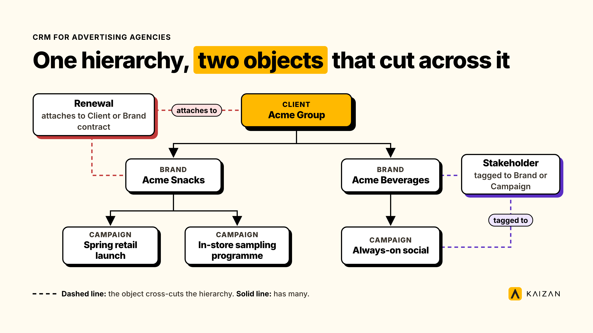

A standard CRM assumes one deal closes one account. An advertising agency account rarely works that way: one client can own several brands, each brand runs its own campaigns, and each campaign carries its own stakeholders and renewal date.

This guide sets out the five objects an agency CRM needs beyond the standard account, contact and deal: client, brand, campaign, stakeholder and renewal. It covers the fields that belong to each, the fields that actually predict a renewal, how to build the model in Salesforce or HubSpot, and what still won't fit in a CRM no matter how it's configured.

## Why the standard CRM data model breaks for advertising agencies

Every CRM, out of the box, is built around three objects: an Account (the company), a Contact (a person at that company), and a Deal or Opportunity (what's being sold, with one owner and one close date). That model holds up fine for a business selling one product to one buyer on one timeline.

It doesn't hold up for an advertising agency, because the "account" is rarely one company making one decision. A single client, a CPG group or an automotive manufacturer, say, can run five or six brands through the same agency at once. Each brand has its own P&L, its own marketing lead, its own approval chain, and a renewal date that has nothing to do with the others. Force that client into a single Account record and one of two things happens. Either every brand's activity gets logged against one bloated record that no report can cleanly split apart, or each brand gets its own disconnected Account with no link back to the parent, so nobody above account-director level can see what the client is actually worth.

This isn't theoretical. We've watched it happen inside a real account-management setup at a full-service advertising and marketing agency. The default assumption, that communications get grouped by email domain into one client folder, broke the moment a client ran several business units off the same domain. Data from one division bled into another's reporting, and the team had to manually rebuild parent-and-child folder structures and re-map stakeholder lists division by division before leadership could trust the numbers again. The same problem resurfaced with a second multi-division client a few months later.

The fix isn't a better CRM. It's a different data model sitting inside the one the agency already has.

## The five objects an agency CRM actually needs

A client CRM stops being useful the moment it only has room for three objects. An advertising agency needs five, each with its own owner and its own fields.

**Client.** The commercial entity that holds the master contract. This is the name on the agency's own revenue report and the logo in a case study. It's the parent record everything else rolls up to.

**Brand.** The business unit the agency is actually briefed by, day to day. A client with one product line has one brand. A client with a portfolio can have a dozen, each run by a different internal marketing lead.

**Campaign.** One brief, one flight, one deliverable set, with its own start and end date. A single brand can run several campaigns in parallel, across different channels, at different stages of production.

**Stakeholder.** A named person tagged to a brand, a campaign, or both, with a role: decision-maker, day-to-day contact, procurement, legal or compliance, finance, executive sponsor. One stakeholder can sit across several brands when their role spans the account.

**Renewal.** The commercial event itself: the date, the named owner, the contract it sits under, and the probability of it closing. A renewal usually attaches to the client's master contract, but a brand with its own statement of work needs its own renewal record, because its clock runs on a different date.

| Object | Sits under | Relationship | A field this object needs that the others don't |
| --- | --- | --- | --- |
| Client | — | has many Brands | Master contract end date |
| Brand | Client | has many Campaigns | Annual brand budget; brand-level renewal date, where it applies |
| Campaign | Brand | tags many Stakeholders | Flight dates, channel, deliverables |
| Stakeholder | Brand and/or Campaign | tagged across many objects | Role type, date of last contact |
| Renewal | Client or Brand | attaches to one contract | Named owner, notice period, probability |

In practice, one client record unfolds like this:

- **Client:** Acme Group
    - **Brand:** Acme Snacks
        - **Campaign:** Spring retail launch
        - **Campaign:** In-store sampling programme
    - **Brand:** Acme Beverages
        - **Campaign:** Always-on social
    - **Renewal:** master contract, owner the Acme account director, due January 2027
    - **Renewal:** Acme Beverages statement of work, owner the Acme Beverages brand lead, due September 2026

Kaizan's 2026 Client Service Benchmark, built from an anonymised dataset of real account activity, found the strongest-performing accounts actively engage an average of 242 client stakeholders, against 142 on the weakest accounts, while holding the same ratio of roughly nine client contacts for every person on the agency team ([Kaizan Client Service Benchmark 2026](https://www.kaizan.ai/us/resources/white-paper/)). Collapse 242 people into one flat Contacts list under a single Account record and nobody can tell which brand or campaign any of them belongs to. That's usually the point where stakeholder mapping in the CRM stops being trusted and starts living in someone's personal notes instead.

## What to track against each object

Once the five objects exist, each one needs its own short field list. This isn't exhaustive, and an agency should drop anything it won't actually keep current, but it's the starting set we'd build from.

**Client fields**

- Client name and legal entity
- Industry and vertical
- Master contract type: MSA, retainer, or project-only
- Master contract end date and required notice period
- Total annual value across all brands
- Senior agency sponsor, the executive who owns the relationship
- Rolled-up health status, built from the brands underneath it

**Brand fields**

- Brand name, linked to its parent Client
- Services in scope for this brand
- Annual brand budget
- Brand-level renewal date, where the brand runs its own statement of work
- Brand health status
- Agency-side brand lead
- Client-side marketing lead

**Campaign fields**

- Campaign name, linked to its parent Brand
- Flight dates: start and end
- Channel and deliverables
- Budget
- Status: briefed, in production, live, wrapped, reported
- Outcome summary once it closes

**Stakeholder fields**

- Name, title, email, linked to one or more Brands or Campaigns
- Role type: decision-maker, day-to-day, procurement, legal, finance, executive sponsor
- Date of last contact
- Agency-side relationship owner
- Engagement notes: sentiment, preferences, what they've asked for

**Renewal fields**

- Contract it attaches to: Client-level or Brand-level
- Renewal date and required notice period
- Named owner, never "the account team"
- Stage or probability
- Key risks logged against it

## The fields that actually predict a renewal

Of every field across the five objects above, three do most of the work in predicting whether a renewal actually happens.

The first is a named renewal owner. The most common gap we see in agency CRMs isn't a missing renewal date, it's a renewal with no single person accountable for it, a gap that usually only surfaces once the renewal is already at risk.

The second is decision-maker contact recency, not decision-maker count. Kaizan's 2026 Client Service Benchmark found that top- and bottom-performing accounts engage almost the same share of their defined decision-makers, roughly half either way. The gap isn't who gets contacted. It's how often: top accounts run decision-maker calls 1.8 times more often and decision-maker emails twice as often as the weakest accounts. A CRM field for "decision-maker last contacted" predicts more than a field for "number of decision-makers mapped."

The third is tracking the renewal at the right object. A master contract renewal and a single brand's statement-of-work renewal are different events, with different notice periods and different people in the room. Attach both to the Client record and the brand-level one gets missed, because it comes due on a different calendar from the one everyone's watching.

> For me, it's a relationship builder. I've been doing this for 30 years. I'm a pick-up-the-phone, I'm-going-to-come-and-see-you kind of person, and we don't live in that world any more.
>
> — MD and Chief Client Officer, Agency Client C (full-service advertising agency)

The fields in a CRM don't build that relationship. They just need to be structured so the team can see where it's thinning before a renewal date forces the conversation.

## How to build this in Salesforce or HubSpot

Most agencies already run Salesforce or HubSpot. The fix here isn't new software. It's a different object structure inside the CRM already paid for.

**In Salesforce.** Custom objects are available on every edition that supports them at all, not only Enterprise. Professional Edition supports up to 50 custom objects, Enterprise up to 200, and Unlimited up to 2,000, so the five-object model in this guide fits comfortably even on Professional. Build Brand as a custom object with a lookup to Account (Client). Build Campaign as a custom object related to Brand, or repurpose Salesforce's native Campaign object if the team already uses it for marketing attribution. Model Stakeholder as Contact records joined to Brand and Campaign through a junction object carrying a Role picklist, so one person can sit on several brands without duplicating their record. Track Renewal as an Opportunity record type attached to Brand or Account, with a required Owner field and its own Close Date, kept separate from any other renewal on the account.

**In HubSpot.** The native Company, Contact and Deal objects won't stretch this far on their own. HubSpot's custom objects sit behind the Enterprise tier and are capped at 10 custom objects per portal, so plan the object count carefully before committing to this model. Within that limit, build Brand as a custom object associated to Company. Campaign can reuse HubSpot's native Campaigns tool if brand-level reporting isn't required, or a custom object if it is. Model Stakeholder as Contacts with a custom Role property, associated to Brand through HubSpot's native object associations. Track Renewal as a Deal associated to Brand (or Company), with a mandatory Deal Owner property and a Renewal Date property kept separate from Close Date.

Whichever platform the agency runs, one decision matters more than any field name: which object level owns the renewal, client or brand. A master contract renewal and a single brand's statement-of-work renewal are different events with different notice periods, and this is usually where a renewal gets missed. Confirm the exact object and property limits against the agency's own Salesforce or HubSpot edition before committing to a rollout timeline, since both platforms revise these limits from time to time. Kaizan connects natively to both platforms, reading the CRM records this guide describes rather than asking a team to maintain a second copy of them ([see integrations](https://www.kaizan.ai/us/integrations/)).

## What still won't fit in a CRM, and where it belongs

A CRM is a system of record. It stores what a person decided to type in. It was never built to capture what happened: the call where a brand manager mentioned a reorganisation, the email thread where procurement asked about pricing before anyone flagged it internally, or a stakeholder going quiet for six weeks before a QBR.

Those signals are the leading indicators for whether the five objects above are about to change, and a renewal probability field only moves because a person updated it, usually after the fact.

This is the layer a CRM alone doesn't reach, and it's also where the data behind this guide's field lists should come from if an agency wants it populated automatically rather than typed in by an account director on a Friday afternoon. Tools built specifically to capture client conversations and turn them into a relationship health signal, such as Kaizan's [Evidence-Based Client Health Standard](https://www.kaizan.ai/us/product/#health-model), sit on top of the CRM rather than replacing it: the client, brand, campaign, stakeholder and renewal structure stays the system of record, while the signal layer surfaces which stakeholder has gone quiet, which brand's renewal risk is climbing, and who on the account team needs to make a call this week.

An agency doesn't need to rip out Salesforce or HubSpot to get this. It needs the CRM holding the right five objects, and something reading the conversations that happen around them.

## Frequently asked questions

**What should an advertising agency track in its CRM beyond deals?**
Five objects: the client (the commercial parent and master contract), the brand (the business unit actually being served), the campaign (one brief, one flight, one deliverable set), the stakeholder (a named contact with a role, tagged to a brand or campaign), and the renewal (the date, owner, and contract it attaches to). Standard CRM objects only cover three of these.

**Can Salesforce or HubSpot handle a client-brand-campaign hierarchy out of the box?**
Not natively. Both platforms support custom objects that can model it. Salesforce allows custom objects on every edition from Professional upward. HubSpot restricts custom objects to its Enterprise tier, capped at 10 per portal. Either platform can model this; neither ships it as a default.

**Is a CRM enough to predict which clients will renew?**
A well-structured CRM tells you the facts: who the stakeholders are, when the contract is due, who owns the renewal. It doesn't tell you that a decision-maker has gone quiet for six weeks, or that a brand manager mentioned a budget freeze on a call. Those signals come from the conversations themselves, which is why most agencies pair their CRM with a layer that reads calls and emails directly.

**Should a renewal be tracked at the client level or the brand level?**
Both, when a brand runs its own statement of work. A master contract renewal and a brand-level SOW renewal are different events with different notice periods and different stakeholders. Attaching both to a single Client-level record is the most common reason a brand-level renewal gets missed.
