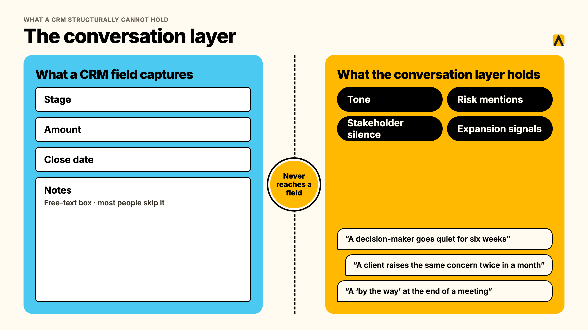
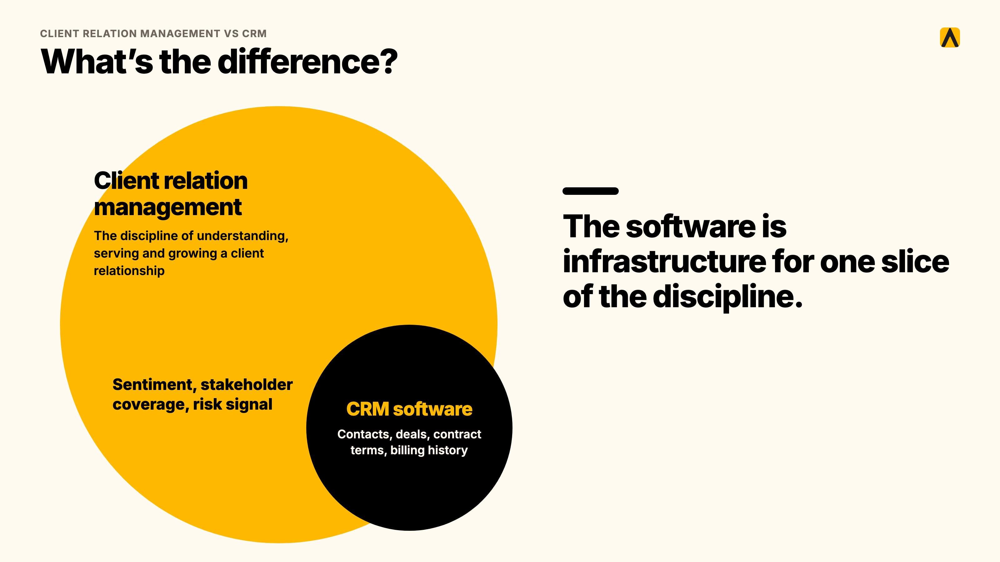

A CRM for a service business stores contacts, deals, and activity logs. It was built to run a sales pipeline, not to hold a client relationship. The emails, calls, and meetings where a relationship actually lives mostly never reach a CRM field, which is how a team can keep a clean CRM and still get blindsided by a client who leaves.

**Key takeaways**

- A CRM is a system of record. It stores what someone chose to type in, when they remembered to. It was never built to capture the conversation itself.
- Struggling accounts almost always show warning signs first, just not inside the CRM. In Kaizan's own benchmark data, roughly 69% of struggling client accounts surface a warning sign in conversation at least once, and 38% do so repeatedly, long before anyone logs a risk.
- Client relation management is the discipline. CRM is the software that supports part of it. Treating the two as the same thing is why so many "CRM problems" are actually relationship-visibility problems.
- You do not need to replace Salesforce or HubSpot to fix this. Client health scoring can write back into the CRM you already run, so leadership still has one place to look.
- Account managers are not the problem. About 35 to 40% of an account handler's job is now admin, by one agency's own chief client officer's estimate, which leaves little time to fill in everything a CRM field expects.

Some teams search for this as CRM account management, hoping to find one system that handles both the deal and the ongoing account relationship. The honest answer is that no CRM, however well configured, was built to do both well, and the rest of this guide explains why.

## What a CRM for a service business is actually built to do

A CRM earns its place. It is the one list everyone agrees on: who the client is, who signed the contract, what is in the pipeline, what was invoiced, what is renewing and when. For an advertising agency, a consultancy, or any other service business running dozens or hundreds of client relationships at once, that list is not optional. Finance needs it. New business needs it. Leadership needs it for a single number they can defend upward.

None of that is the complaint here. The complaint is what gets asked of a CRM once it is in place: to also tell you how a relationship is actually doing. That is a different job, and it is not one a system built around fields and pipeline stages was ever designed to do.

## What a CRM structurally cannot hold: the conversation layer

### Where the relationship actually happens

[A client relationship does not happen inside a CRM](https://www.kaizan.ai/us/blog/client-software/client-relationship-bigger-than-your-inbox/). It happens on a call where a decision-maker goes quiet for the first time in six weeks. It happens in an email thread where a client raises the same concern twice in a month. It happens in a Slack message, a passing comment on a QBR call, a "by the way" at the end of a meeting that never makes it into the notes.

None of that has a field. A CRM has a stage, an amount, a close date, and a free-text notes box that most people skip. The actual texture of the relationship, tone, hesitation, what was said and what was left unsaid, has nowhere to go.

### The data that never reaches a field

One agency's internal CRM project makes the point cleanly. A commercial director we spoke with was building a homegrown CRM to centralize client emails, meeting notes, and account signals for his team's roughly 200 client relationships. He was candid about the gap he was trying to close: account managers were not consistently maintaining the system. The placements, pipelines, and status updates were all structurally present in the CRM. The actual account signals, rate pressure, early frustration, a client testing the market, were not, because nobody had built a way to capture them without someone manually typing them in.

That is not a training problem. It is what happens whenever a system depends on a busy person remembering to log something that did not feel urgent at the time.

An agency COO put the same gap more bluntly, describing how account health gets assessed without a system behind it:

> "You're relying on human error, and you're relying on them not looking at things with rose-colored glasses."
>
> — Chief Operating Officer, Agency Client A

And an agency's head of international client teams described the problem from the other direction, the moment he got visibility he had never had before:

> "You can get very good feedback from an account manager on what's happening. You get their view. If something is not going so well, they might not want to tell you, or maybe they themselves are nearly ignoring it. It's much easier now for me to jump in and look at it. You can see a bit more objective what is working, what is not working."
>
> — Head of International Client Team, Agency Client B

Both quotes describe the same structural issue. A CRM, like a manual status report, depends on a human choosing to surface a signal. The signal usually exists. It is usually sitting in an inbox or a call recording. It almost never makes the trip into a CRM field, because nothing requires it to.

### Why this is structural, not a discipline problem

It is tempting to read all of this as an adoption issue: get account managers to log better, add mandatory fields, run a refresher session. That misreads the cause. Across Kaizan's own client conversations, one theme comes up constantly: client-facing time is the scarce resource, not goodwill.

> "About 35 to 40% of an account handler's job now is admin, and there's a problem where that admin is getting in the way of having proper relationship-driven conversations."
>
> — MD and Chief Client Officer, Agency Client C

With that much of the week already gone to admin, a CRM field competing for the same few minutes against an actual client conversation will lose, every time, and it should. The fix is not more discipline. It is removing the requirement that a human manually transcribe a conversation into a system before anyone can see it.

Outside estimates of how much CRM data goes stale or unentered vary a great deal depending on who is measuring and what they count, from single-digit monthly decay rates to claims that the majority of CRM records are incomplete within a year. Most of that research comes from vendors with something to sell, so treat the range as directional rather than precise. What is consistent across every source, including Kaizan's own data below, is the direction: the gap between what a CRM holds and what is actually happening with a client grows the busier an account team gets.

## Client relation management vs CRM: what's the difference

The two terms get used interchangeably, and that is part of the problem. Client relation management is the discipline: the ongoing work of understanding, serving, and growing a client relationship, across however many people and tools touch that client. A CRM, customer relationship management software, is one tool that supports part of that discipline: the record-keeping part.

Think of it as two overlapping circles rather than one. CRM software covers the administrative core of client relation management, contacts, deals, contract terms, billing history. What it does not cover is the larger circle: the sentiment, stakeholder coverage, and risk signal that actually determine whether a relationship grows or quietly ends. A service business can run excellent client relation management with a mediocre CRM, and a business can also run a pristine CRM while being genuinely blind to how its clients feel. The software is not the discipline. It is infrastructure for one slice of it.

## Which system should own the client: CRM or client success platform

This is the question every buyer of a CRM for a service business ends up asking once the CRM is live and the relationship-visibility gap is still there. It deserves a straight answer: your CRM stays the system of record. A client success platform becomes the system of truth for relationship health. Neither replaces the other.

|  | CRM (Salesforce, HubSpot) | Client success platform (Kaizan) |
| --- | --- | --- |
| What it owns | Contacts, deals, pipeline stage, contract and billing data | Relationship health, risk signals, stakeholder coverage, expansion readiness |
| Where the data comes from | Manual entry, plus what syncs in from sales tools | Every call, email, and message, captured automatically |
| What it answers | Who is the client, what is the deal worth, when does it renew | How is this relationship actually doing, right now, and why |
| Update frequency | Whenever someone remembers to log something | Continuously, from the conversation itself |
| Who it's built for | Finance, new business, deal reporting | Account teams and leadership managing relationship health |

A COO at one agency we work with made the ownership question concrete in a single line: Kaizan does not compete with the CRM record, it fills in what the record was never built to hold.

> "The note taker is great, and it's better than a lot of the other ones. But all of the additional stuff is the value for us. It's what it does with the notes, but it's not the notes themselves."
>
> — Chief Operating Officer, Agency Client A

That "additional stuff" is the health score, the risk flag, and the stakeholder map, the layer that sits on top of the CRM rather than competing with it.

## Adding client health scoring to Salesforce or HubSpot

If you already run a CRM for a service business, the fix is additive, not a replacement project. You do not need to rip out your CRM to close this gap. The practical move for most service businesses is to feed relationship health back into the system leadership already looks at, so nobody has to open a second tab to find out what is going on.

Here is what that looks like in practice, based on [Kaizan's published integration behavior](https://www.kaizan.ai/us/integrations/) with the two CRMs most service businesses run:

1. **Connect the CRM by OAuth.** Both the HubSpot and Salesforce integrations run on two-way sync, so the connection reads existing records and writes back to them.
2. **Kaizan ingests the conversation layer.** Every call, email, and chat thread tied to that client gets captured and attributed to the account automatically, no manual tagging required.
3. **The health score gets calculated continuously**, scored against [The Evidence-Based Client Health Standard](https://www.kaizan.ai/us/product/#health-model) (Kaizan's name for its CARE methodology), covering four plain-language dimensions: Client Satisfaction, Activity with Stakeholders, Relationship Strength, and Expansion Opportunities.
4. **The score writes back into the record you already use.** In Salesforce, the health score writes back to the Account object directly. In HubSpot, the sync covers deals, contacts, notes, activity, and custom properties, so the score and any flagged risk can live as a property on the record your team already opens.
5. **The evidence stays attached, not buried.** A risk flag on the CRM record links back to the specific call or email that triggered it, so a Head of Client Service checking an account in Salesforce or HubSpot can see not just a score, but why.

What this does not require is choosing between tools. The CRM keeps its job as the contract and pipeline record. The health score, and the evidence behind it, becomes a property on that same record instead of living in a spreadsheet nobody else opens.

## Why account managers don't update the CRM

It is worth separating two different failures that get blamed on the same cause. One is a genuine CRM hygiene problem, duplicate contacts, dead fields, stale deal stages. The other, bigger one is that account managers are not withholding information out of carelessness. They are triaging between an email that keeps a client happy and a CRM field that keeps a dashboard accurate, and the email wins.

The pattern shows up directly in how account managers describe their own week. One commercial leader building an internal CRM for his team told us account managers were not consistently maintaining the data his project depended on, not from a lack of will but because nothing about the system made that update feel necessary at the time it mattered. Another agency's chief client officer put a number on the same pressure: with 35 to 40% of an account handler's time already gone to admin, a non-essential CRM update is one of the first things to slip.

The fix is not a better onboarding deck on why the CRM matters. It is reducing how much of the update depends on someone remembering to type it in, which is the same reason capture-first tools exist across every function that has this problem, from sales to customer support to client service.

## Signs your CRM is missing the client relationship

If any of these sound familiar, the CRM is doing its job as a system of record and simply was never asked to do the other job.

- You cannot answer "what's actually going on with [client]?" in under a minute without pulling up emails, Slack, and a call recording first.
- The CRM says a relationship is healthy, and then a client raises a cancellation out of nowhere on a call nobody flagged.
- Updates live wherever the account manager who wrote them happened to be that day: a notebook, a personal doc, a Slack DM, occasionally the CRM.
- When an account director leaves or goes on leave, the context leaves with them, and a new hire rebuilds it from scratch.
- Leadership asks for a portfolio-wide view of risk and gets a RAG spreadsheet that was last updated three weeks ago.
- A decision-maker has gone quiet for over a month, and nobody noticed until the renewal conversation.

Kaizan's own benchmark data backs up how common the first two points are. Across a year of anonymized client service data, struggling accounts were rarely silent about it: about 69% surfaced a warning sign in conversation at least once, and 38% did so repeatedly, across multiple periods. The signal exists. It was never going to show up in a CRM field on its own.

## What this costs: the Head of Ops view

For a Head of Ops or COO, the CRM-gap problem is not an abstract visibility issue. It shows up as cost to serve, as time, and as revenue that was recoverable and was not recovered because nobody saw it coming.

Kaizan's [client portfolio](https://www.kaizan.ai/us/pricing/) sees, on average:

- **26%+ average revenue growth per client**, driven by catching expansion signals and risk earlier than a CRM-only workflow would.
- **45% of at-risk revenue protected** through early signals surfaced before a renewal conversation goes wrong.
- **33% lower cost to serve** each client, from automating the admin a CRM update used to require by hand.
- **5.4 hours of admin saved per person, per week**, time that a CRM update, meeting note, or status report used to take out of an account manager's day.

These are platform averages across Kaizan's client portfolio, not a guarantee for any single agency, and the size of the gain depends on how much of the relationship currently lives outside any system at all. For a service business evaluating whether to extend its CRM with a client health layer, the honest framing is the one a sales call with one prospect put plainly: the real question is not whether the CRM is working. It is whether it was ever built to answer the question leadership is actually asking it.

Kaizan is priced by number of clients. Price on quote.

## How to close the gap without replacing your CRM

Closing this gap on an existing CRM for a service business takes six steps, in this order:

1. **Audit what your CRM actually captures today**, against what you need to know about a relationship: when did it last get an honest answer, not a demo answer.
2. **Keep the CRM as the system of record.** Do not plan a CRM migration to fix a visibility problem. That is a much bigger project solving the wrong thing.
3. **Add automatic conversation capture** across the tools client teams already use for calls and email, so the signal stops depending on someone remembering to log it.
4. **Score relationship health separately from pipeline stage**, using a framework that covers satisfaction, stakeholder activity, relationship depth, and expansion readiness, not a single CSAT number.
5. **Write the score and the risk flags back into the CRM**, so leadership still has one place to check, with the evidence linked rather than buried in a separate tool.
6. **Pilot on a handful of accounts first.** Fourteen days on real client data will tell you more than a demo with sample records.

## Frequently asked questions

**What does a CRM for a service business miss?**
A CRM for a service business stores contacts, deals, and activity logs. It was built to run a sales pipeline, not to hold a client relationship. The emails, calls, and meetings where a relationship actually lives mostly never reach a CRM field, which is how a team can keep a clean CRM and still get blindsided by a client who leaves.

**What is client relation management, and how is it different from CRM?**
Client relation management is the ongoing discipline of understanding, serving, and growing a client relationship. CRM, customer relationship management software, is one tool that supports part of that discipline: the administrative record of contacts, deals, and contract terms. A business can run strong client relation management with a basic CRM, or a clean CRM while being genuinely blind to client sentiment. The two are not interchangeable.

**What does a CRM not capture?**
A CRM does not capture the conversation itself: the tone of a call, a concern raised twice in a month, a decision-maker who has gone quiet, a passing comment that signals an upsell opportunity. It only holds what someone chose to type into a field, and most of what matters in a relationship never gets typed in, because nobody has time to transcribe every call by hand.

**Which system should own the client: the CRM or the client success platform?**
Both, for different things. The CRM stays the system of record for contacts, deals, and billing. A client success platform becomes the system of truth for relationship health: risk signals, stakeholder coverage, and expansion readiness, continuously updated from actual conversations rather than manual entry.

**Can we add client health scoring to Salesforce or HubSpot?**
Yes. Kaizan connects to both by OAuth with two-way sync, captures every call, email, and chat tied to a client automatically, scores the relationship against four plain-language health dimensions, and writes the score back into the CRM record your team already uses, directly to the Account object in Salesforce, or as a synced property in HubSpot.

**Do we need to replace our CRM?**
No. The CRM keeps doing the job it was built for: contacts, deals, and contract records. Adding relationship health scoring on top of it closes the gap without a migration project, and the evidence behind each score writes back into the same record leadership already checks.

**Why do account managers not update the CRM?**
Mostly because they are triaging between a CRM field and an actual client conversation, and the conversation wins, which is the right call in the moment. With roughly 35 to 40% of an account handler's week already gone to admin, a non-essential update is one of the first things to slip. The fix is capturing the signal automatically rather than asking a busy person to remember to log it.

**Will the team actually use it?**
That is the real adoption risk with any system layered onto a CRM, and it is worth testing before committing to anything. A layer that still requires manual entry gets treated exactly like the CRM fields it was meant to fix: ignored under pressure. The honest test is whether the health score updates itself from conversations that already happen, or whether it just adds another field for someone to fill in.

---

If you want to see what a health score written back to your own CRM record looks like, [book a demo](https://www.kaizan.ai/us/).
