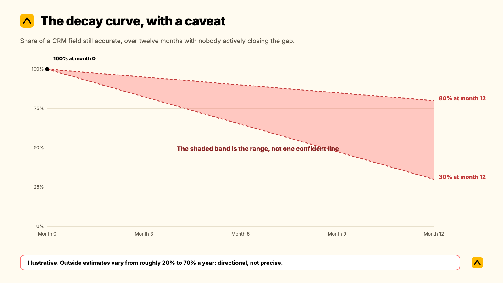

CRM hygiene for account teams means keeping the fields that actually drive decisions accurate and current: stakeholder contacts, deal or account stage, last-touch dates, and risk or health flags. It decays because updating those fields competes with an actual client conversation for the same few minutes, and the conversation wins.

**Key takeaways**

- CRM hygiene decays because it is a behaviour problem, not a data problem. Updating a field competes with an actual client conversation, and the conversation wins, every time, for good reason.
- Outside estimates of how fast CRM data goes stale vary enormously, from roughly 20% to 70% a year depending on the field and who is measuring. Treat any single number in that range as directional, not precise.
- In Kaizan's own benchmark data, 69% of struggling client accounts surface a warning sign in conversation at least once, and 38% do so repeatedly, long before anyone logs a risk in a CRM field.
- A reminder email does not fix this. Cutting how much of the update depends on someone remembering to type it in does.
- One agency's own commercial leadership put a number on the gap directly: by his account, about half of the updates and notes his team generates never reach the system of record at all.

Some teams search for this as CRM data hygiene, hoping for a checklist. There is one below. But a checklist alone will not hold, because the reason CRM records decay is rarely the fields themselves. It is what account managers are triaging against every time a field asks for two minutes they do not have.

## When this applies, and when it doesn't

This guide is for account and client service teams running a CRM (Salesforce, HubSpot, or similar) alongside project or delivery tools, where the CRM is meant to reflect account health and not just pipeline. It applies if any of the following sound familiar: nobody can answer "what's going on with this client?" without opening three tools first; the CRM says an account is fine right up until it isn't; an account director leaves and takes the context with them.

It does not apply, or applies much less, if your CRM is purely a new-business pipeline with no ongoing account management layer, or if your team is under 10 accounts and still runs health checks from memory without friction. Below that scale, process overhead can cost more than the problem it solves.

## Why CRM hygiene decays: a behaviour problem, not a data problem

**Written for the Head of Ops / COO.** The instinct when a CRM goes stale is to blame the data: duplicate contacts, dead fields, a migration nobody finished. That is rarely the real cause. The real cause is a resourcing decision account managers make dozens of times a day, usually without noticing they're making it.

### The data decay curve, with a caveat

Industry estimates of how fast CRM and contact data decays are all over the place. The most commonly repeated benchmark puts B2B contact data decay at around 2% a month, compounding to roughly 22% a year, a figure that traces back to older MarketingSherpa research and has been recycled across dozens of vendor blogs since. Other sources, measuring differently or counting faster-moving fields like job titles and phone numbers, claim decay as high as 60-70% a year, with outdated contact information and outdated data among the most common forms of decay. We could not find a single rigorous, independently audited source for either end of that range. Most of the research comes from vendors selling data-cleaning or enrichment tools, which is reason enough to treat any specific percentage as directional. What is not in dispute across any source we reviewed: the gap between what a CRM says and what is actually true about a relationship grows every month nobody actively closes it, and it grows faster the busier an account team gets, leaving them working from outdated information.

### Why account managers don't update the CRM

Treat this as the real diagnosis, not an excuse. Independent, non-Kaizan research on sales teams found reps spend an average of 5.5 hours a week on manual CRM data entry, and a separate survey of frequent CRM users found 52% cite keeping client data up to date as their single biggest CRM problem, with 48% pointing to data entry itself. Those figures come from sales-rep research, not account management specifically, but the mechanism is identical to what we hear from client service teams: admin and an actual client conversation are competing for the same few minutes, and whichever one has a human waiting on the other end of it wins. That is how dirty data and incomplete data build up in a busy CRM system.

We hear the same pattern directly from agencies we work with. A Head of Operations at one mid-size agency described the project management tool her team was supposed to be keeping current as the single biggest drag on her client service team that year, not because the tool was wrong, but because keeping it updated had become a second job nobody had time for:

> "That's the thing that's really holding back our client services team. They're like, I'm not doing planning, I'm doing project management, and they shouldn't be anymore."
>
> — Head of Operations, Agency Client A

The same operations leader had already tried the obvious fix, asking the team to save client reports to a shared drive so new starters could find them, and watched it fail exactly where every manual hygiene initiative fails:

> "Is there any way that we could save all our reports that we send over email in SharePoint? And I was like, I mean, technically, yes, but no one's going to..."
>
> — Head of Operations, Agency Client A

A Chief Operating Officer at another agency described the same gap from the budget side, where the cost of a tool that still requires manual logging shows up as unused seats rather than bad data:

> "We are paying for a lot of licences and they are not [being] used."
>
> — Chief Operating Officer, Agency Client B

And a Group Commercial Director at a third agency, mid-sized and UK-based, put a number on the underlying gap: when his team sat down to assess their own CRM discipline, their honest estimate was that about half of the updates and notes an account manager generates in a normal week never make it into the system at all.

> "About half of our updates and notes are never logged."
>
> — Group Commercial Director, Agency Client C

None of these are discipline problems. They are the predictable result of asking a busy person to manually transcribe something a system could capture on its own, when automated tools could remove much of that burden.

## The CRM data hygiene audit: what to actually keep clean

Not every field in a CRM decays at the same rate, and not every field matters the same amount. Before you run an audit, agree on what "clean" means for your team, with clean and accurate data defined as current, complete, and trustworthy in the CRM. These are the fields worth the effort, roughly ordered by how fast they go stale:

- **Stakeholder contacts and roles.** Who is the actual decision-maker today, not six months ago. This is usually the fastest-decaying field, because people change roles more often than any other CRM fact changes, and inaccurate contact details create missed opportunities.
- **Last meaningful contact date.** When did a senior person on your side last genuinely engage this stakeholder, not just cc them. A quiet decision-maker is one of the clearest early warning signs a relationship holds.
- **Deal or account stage and renewal date.** The one field most CRMs get right by default, because finance and new business both depend on it. Still worth auditing for accounts that quietly slipped a stage.
- **Risk or sentiment flags.** Whatever field is supposed to hold "is this account okay." In most CRMs we see, this field is either missing, badly out of date, or filled in only after a client has already raised the problem out loud.
- **Action items and owners.** What was promised, to whom, and whether it happened. The field most likely to be technically present and practically useless, because it depends entirely on someone remembering to close the loop.
- **Custom health or scoring properties.** Any property meant to summarise relationship health for a leadership rollup. Worth checking separately, because accurate data matters here: leadership uses these fields for decisions, and a stale health score is more dangerous than no health score because it creates false confidence.

## The six steps

Each step names an owner and a realistic time, because a step nobody owns does not happen, and a step with no time estimate gets deprioritised the first busy week.

### Step 1: Decide what "clean" means before you audit anything

**Owner:** Head of Ops / COO. **Time:** 30 minutes, once.

Pick the five or six fields from the list above that actually matter for your team, not every field the CRM technically has. Write down, in one sentence each, what "accurate" means for each one: a stakeholder record is accurate if the named contact is still in that role and still the right person to reach; a risk flag is accurate if it would match what the account team would say out loud if asked today.

**Script to use in the kickoff:** "We are not trying to make the CRM perfect. We are agreeing on the five fields that actually change how we run this business, so we know what we're protecting."

**Failure mode:** Skipping this step and auditing everything. Teams that try to fix all fields at once lose momentum in the first week and the whole effort quietly dies.

### Step 2: Run the baseline audit

**Owner:** A nominated lead per pod or team, not the Head of Ops personally. **Time:** 15 to 20 minutes per account, once.

For each account, check the five or six fields against step 1's definition of accurate. Mark each one clean, stale, or missing. Do not fix anything yet. The point of this pass is to see the actual size of the problem before anyone starts arguing about causes.

**Failure mode:** Combining the audit with the fix. Teams that try to correct every stale field as they find it never finish the audit, and never get the baseline number that makes the business case for step 4.

### Step 3: Name the behaviour problem out loud

**Owner:** Head of Ops / COO, in a team meeting. **Time:** 10 minutes.

Share the audit results from step 2 without blame. The framing that works: "This isn't about anyone not caring. It's that updating this field competes with an actual client conversation, and the conversation should win. We're going to stop asking you to choose."

**Script to use:** "If keeping the CRM honest genuinely required you to skip a client call, you'd be right to skip the CRM. We're changing what the CRM asks of you, not asking you to try harder."

**Failure mode:** Running this as a discipline conversation instead. The moment a hygiene initiative reads as "try harder," account managers tune it out, correctly, because they already know the real constraint is time.

### Step 4: Turn on automatic capture for the fields that decay fastest

**Owner:** Head of Ops / COO, with whoever owns the CRM admin. **Time:** Half a day to connect; ongoing after that with no manual work.

Stakeholder contact, last-touch date, and sentiment or risk signal are the three fields most likely to be stale and most capturable from conversation data without anyone typing anything. If you run Kaizan alongside Salesforce or HubSpot, this step is largely a connection, not a project: both integrations run two-way sync by OAuth. In HubSpot, the sync covers deals, contacts, notes, activity, and custom properties. In Salesforce, the relationship health score, scored against [The Evidence-Based Client Health Standard](https://www.kaizan.ai/us/product/#health-model), writes back directly to the Account object. Every call, email, and chat thread tied to an account is captured and attributed automatically, and the evidence behind a risk flag links back to the specific conversation that triggered it, so nobody has to take a score on faith.

**Failure mode:** Automating the fields that were never the problem (deal stage, renewal date, which the CRM already handles well) and leaving the ones that actually decay, stakeholder and sentiment, as manual fields. Automation only helps if it targets where the hygiene problem actually lives.

### Step 5: Assign one owner per account for what has to stay human

**Owner:** Head of Client Service, assigning by account. **Time:** 15 minutes per account, once, then folded into normal account ownership.

Not everything should be automated. Judgement calls, like whether a risk flag is serious enough to escalate, or whether an expansion signal is real or a client being polite, need a named human to make the call and be accountable for it. Automatic capture should feed that person evidence. It should not make the decision for them.

**Script to use with the team:** "The system tells you when a decision-maker has gone quiet or a risk phrase has shown up twice. You decide what that means and what we do about it. We're not automating the judgement, just the noticing."

**Failure mode:** Treating automatic capture as a replacement for account ownership rather than an input to it. A health score nobody is accountable for acting on is just a new field that will decay exactly like the old one, except leadership will trust it more by mistake.

### Step 6: Set a review cadence and a scorecard

**Owner:** Head of Ops / COO. **Time:** 30 minutes a month.

Pick a cadence, monthly is typical, and a small set of numbers to check: percentage of accounts with a current stakeholder record, percentage with a sentiment or risk flag updated in the last 30 days, and the number of accounts where no senior contact has happened in over six weeks. This is the scorecard that makes hygiene visible to leadership without anyone combing through individual records.

**Failure mode:** Reviewing the scorecard without a next action attached. A number that goes unaddressed for two cycles in a row stops being read at all.

## A worked example, end to end

This is an illustrative example built from patterns we see across agency clients, not one specific account.

A 40-person account management team at a mid-size agency runs its book through HubSpot, with project status tracked separately in Asana.

**Step 2.** The baseline audit finds that 60% of stakeholder records are more than a year old, and the custom "account health" field, added eighteen months earlier with good intentions, has not been touched on 70% of accounts since it was created.

**Step 3.** The team does not start by fixing the field. It starts by naming the behaviour problem: the health field was added as one more thing to remember, on top of an already full week, and nobody disputes that it lost to client work every time.

**Step 4.** The team connects automatic capture, and within the first week, stakeholder records and a live sentiment signal start updating themselves from the calls and emails already happening, with no new typing required from anyone.

**Step 5.** The Head of Client Service assigns an owner per account specifically for acting on the flags that now arrive automatically: a quiet decision-maker, a risk phrase appearing twice in a month, an unanswered scope question.

**Step 6.** The COO reviews the scorecard at the next monthly leadership meeting and for the first time can say, with evidence rather than a gut feel, which ten accounts actually need attention this month.

Nothing in that sequence required a CRM migration. The CRM stayed exactly where it was. What changed was how much of its accuracy depended on someone remembering to type something in.

## Scripts and wording to copy

Three more, beyond the ones embedded in the steps above, that come up often enough to be worth having ready.

**Introducing the audit to the wider team, without sounding like an inspection:**
"We're checking five fields across the book this month, not grading anyone. The goal is to find out where the system and reality have drifted apart, and where poor data quality is creeping in, so we can stop asking people to close that gap by hand."

**Responding to "we already tried a CRM cleanup and it didn't stick":**
"The last cleanup fixed the fields. This one changes what's asking you to fill them in. It's the difference between one-time data cleanup and ongoing data hygiene practices. If the fix doesn't survive a busy week without anyone touching it, it isn't actually fixed."

Maintaining clean CRM data takes continuous improvement, not a one-off push.

**Escalating a stale risk flag to a client-facing conversation:**
"I noticed [stakeholder] hasn't been on a call with us in six weeks and the last two mentions of [topic] came up without a clear resolution. Want me to loop in before the renewal conversation, or do you already have this in hand?"

## How to tell whether it worked

Track the same scorecard from step 6, including the key metrics, over at least two cycles before judging it. The signal to watch is not whether every field is perfect; it is whether the baseline number keeps moving without anyone having to run a manual push to move it. The aim is better data quality and measurable data quality improvements over time.

For scale, these are Kaizan's own portfolio averages, published on our pricing page, not a guarantee for any single firm: clients see **26%+ average revenue growth per client**, **45% of at-risk revenue protected** through earlier signals, **33% lower cost to serve** each client, and **5.4 hours of admin saved per person, per week**, time that used to go into exactly this kind of manual update. The size of the gain for any one firm depends on how much of the relationship currently lives outside any system at all, which is precisely what the baseline audit in step 2 measures, with cleaner records supporting operational efficiency and stronger client relationships.

## What to automate, and what must stay human

**Automate:** capturing the conversation itself (calls, emails, chat threads), attributing it to the right account, using data validation to standardise fields during capture, flagging a risk phrase or a quiet decision-maker, keeping a relationship health score current without anyone opening a form, and catching duplicate records before they distort the CRM.

**Keep human:** Even with automation supporting effective crm hygiene, deciding whether a flagged risk is serious enough to escalate, deciding how to word a difficult client conversation, deciding whether an expansion signal is worth a pitch this quarter, and owning the relationship itself. A system that notices faster than a person could is an advantage. A system that decides instead of a person is a liability nobody signed up for.

## Pitfalls

- **Auditing everything at once.** Symptom: the project stalls in week two with half the book checked. Fix: pick five fields, not fifty, while prioritising data hygiene, per step 1.
- **Fixing fields without naming the cause.** Symptom: the CRM stays data clean for a month and drifts back within a quarter. Fix: step 3 has to happen before step 4, not after.
- **Automating the fields that were never the problem.** Symptom: deal stage gets a shiny new sync while stakeholder data keeps decaying, especially when disconnected tools create data silos and data inconsistencies. Fix: automate where the audit shows the actual decay, not where it's easiest to connect.
- **A health score with no owner.** Symptom: leadership quotes a number nobody on the account team trusts or acts on. Fix: step 5, every time, before the scorecard goes anywhere near a leadership deck.
- **Treating the scorecard as a one-off report.** Symptom: it's accurate the month it launches and ignored after that. Fix: a fixed monthly cadence with a named owner, per step 6, to support periodic audits and stronger data hygiene efforts.

## Frequently asked questions

**How long does this take?**
For most teams, a baseline CRM hygiene audit can be done in a few days to a couple of weeks, depending on the size of your system and how messy the data is. What takes longer is fixing the root causes: field sprawl, inconsistent processes, unclear ownership, and poor habits around updating records.

A full cleanup can take anywhere from a few weeks to a few months if you're standardising fields, merging duplicates, archiving old records, and retraining teams. In practice, that baseline audit is usually followed by regular data cleansing rather than a single cleanup sprint. A proper CRM clean is ongoing, not a one-time project.

The fastest way to make progress is to prioritise high-impact fixes first — the records, fields, and workflows that affect reporting, handovers, and day-to-day execution most.

**Who should own CRM hygiene?**
CRM hygiene should be owned by someone with the authority to enforce process, not just fix records after the fact. In most firms, that means a RevOps, Sales Ops, or client service operations lead.

That owner should set clear data entry standards so teams capture information the same way from the start.

They should also maintain data governance policies so records stay consistent over time.

**What if a client ignores a warning or recommendation?**
That happens. A score or alert is not there to force a reaction. It is there to help your team spot risk earlier, respond more consistently, and keep a record of what was raised and when. Even if the client does nothing, cleaner records still support the sales process and preserve context for the team.

Over time, that matters. Patterns become easier to see, handovers get smoother, and you are less reliant on memory or scattered notes.

**How do you prove CRM hygiene is working?**
Track a small scorecard over time: duplicate rate, bounce rate, field fill rate, response times, and time spent updating records manually. The best proof is movement in data completeness alongside those measures. If those numbers are improving, your hygiene efforts are probably having a real effect. Improved data accuracy often shows up later in conversion rates and client satisfaction, not just cleaner fields.

For teams that want a practical framework, this guide to measuring CRM data quality is useful.

**What tasks should I automate to improve CRM hygiene?**
Start with the work your team forgets or avoids: duplicate detection, reminder nudges, field validation, stale-record alerts, and activity logging. These are repetitive, easy to standardise, and often the first source of data decay when left manual.

Automation should also support data enrichment for missing account and stakeholder details.

It should flag incomplete records before they affect reporting or follow-up.

You can also automate ownership rules, lifecycle updates, and prompts to close out inactive opportunities so records stay usable without relying on memory.

**How do you increase CRM adoption across the team?**
Adoption usually improves when the CRM helps people do their job faster, not when it feels like extra admin. That means keeping the system simple, making ownership clear, and showing teams how better records lead to better handovers, reporting, and client work.

It also improves when teams are not stuck correcting inaccurate data by hand. That reduces the hidden drag of dirty CRM data on day-to-day work, so the system feels useful rather than frustrating.

**Is CRM hygiene the same as CRM data quality?**
They're used interchangeably in most conversations, and for the purposes of this guide, treat them the same. Where some teams draw a line, data quality refers to the state of the records at a point in time, while hygiene refers to the ongoing practice of keeping them that way. The practice is the harder problem, which is why this guide is built around behaviour and ownership rather than a one-time cleanup.

---

Want to see what automatic capture looks like against your own book of accounts? [Book a demo](https://www.kaizan.ai/us/).
