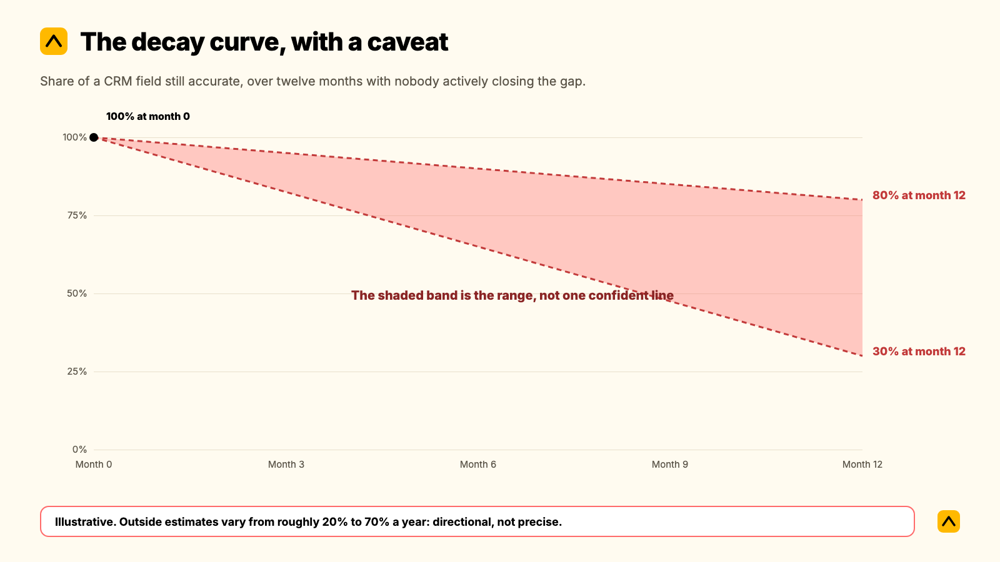

CRM hygiene for account teams means keeping the fields that actually drive decisions accurate and current: stakeholder contacts, deal or account stage, last-touch dates, and risk or health flags. It decays because updating those fields competes with an actual client conversation for the same few minutes, and the conversation wins.

**Key takeaways**

- CRM hygiene decays because it is a behavior problem, not a data problem. Updating a field competes with an actual client conversation, and the conversation wins, every time, for good reason.
- Outside estimates of how fast CRM data goes stale vary enormously, from roughly 20% to 70% a year depending on the field and who is measuring. Treat any single number in that range as directional, not precise.
- In Kaizan's own benchmark data, 69% of struggling client accounts surface a warning sign in conversation at least once, and 38% do so repeatedly, long before anyone logs a risk in a CRM field.
- A reminder email does not fix this. Cutting how much of the update depends on someone remembering to type it in does.
- One agency's own commercial leadership put a number on the gap directly: by his account, about half of the updates and notes his team generates never reach the system of record at all.

Some teams search for this as CRM data hygiene, hoping for a checklist. There is one below. But a checklist alone will not hold, because the reason CRM records decay is rarely the fields themselves. It is what account managers are triaging against every time a field asks for two minutes they do not have.

## When this applies, and when it doesn't

This guide is for account and client service teams running a CRM (Salesforce, HubSpot, or similar) alongside project or delivery tools, where the CRM is meant to reflect account health and not just pipeline. It applies if any of the following sound familiar: nobody can answer "what's going on with this client?" without opening three tools first; the CRM says an account is fine right up until it isn't; an account director leaves and takes the context with them.

It does not apply, or applies much less, if your CRM is purely a new-business pipeline with no ongoing account management layer, or if your team is under 10 accounts and still runs health checks from memory without friction. Below that scale, process overhead can cost more than the problem it solves.

## Why CRM hygiene decays: a behavior problem, not a data problem

**Written for the Head of Ops / COO.** The instinct when a CRM goes stale is to blame the data: duplicate contacts, dead fields, a migration nobody finished. That is rarely the real cause. The real cause is a resourcing decision account managers make dozens of times a day, usually without noticing they're making it.

### The decay curve, with a caveat

Industry estimates of how fast CRM and contact data decays are all over the place. The most commonly repeated benchmark puts B2B contact data decay at around 2% a month, compounding to roughly 22% a year, a figure that traces back to older MarketingSherpa research and has been recycled across dozens of vendor blogs since. Other sources, measuring differently or counting faster-moving fields like job titles and phone numbers, claim decay as high as 60-70% a year. We could not find a single rigorous, independently audited source for either end of that range. Most of the research comes from vendors selling data-cleaning or enrichment tools, which is reason enough to treat any specific percentage as directional. What is not in dispute across any source we reviewed: the gap between what a CRM says and what is actually true about a relationship grows every month nobody actively closes it, and it grows faster the busier an account team gets.

### Why account managers don't update the CRM

Treat this as the real diagnosis, not an excuse. Independent, non-Kaizan research on sales teams found reps spend an average of 5.5 hours a week on manual CRM data entry, and a separate survey of frequent CRM users found 52% cite keeping data current as their single biggest CRM problem, with 48% pointing to data entry itself. Those figures come from sales-rep research, not account management specifically, but the mechanism is identical to what we hear from client service teams: admin and an actual client conversation are competing for the same few minutes, and whichever one has a human waiting on the other end of it wins.

We hear the same pattern directly from agencies we work with. A Head of Operations at one mid-size agency described the project management tool her team was supposed to be keeping current as the single biggest drag on her client service team that year, not because the tool was wrong, but because keeping it updated had become a second job nobody had time for:

> "That's the thing that's really holding back our client services team. They're like, I'm not doing planning, I'm doing project management, and they shouldn't be anymore."
>
> — Head of Operations, Agency Client A

The same operations leader had already tried the obvious fix, asking the team to save client reports to a shared drive so new starters could find them, and watched it fail exactly where every manual hygiene initiative fails:

> "Is there any way that we could save all our reports that we send over email in SharePoint? And I was like, I mean, technically, yes, but no one's going to..."
>
> — Head of Operations, Agency Client A

A Chief Operating Officer at another agency described the same gap from the budget side, where the cost of a tool that still requires manual logging shows up as unused seats rather than bad data:

> "We are paying for a lot of licenses and they are not [being] used."
>
> — Chief Operating Officer, Agency Client B

And a Group Commercial Director at a third agency, mid-sized and UK-based, put a number on the underlying gap: when his team sat down to assess their own CRM discipline, their honest estimate was that about half of the updates and notes an account manager generates in a normal week never make it into the system at all.

> "About half of our updates and notes are never logged."
>
> — Group Commercial Director, Agency Client C

None of these are discipline problems. They are the predictable result of asking a busy person to manually transcribe something a system could capture on its own.

## The CRM hygiene audit: what to actually keep clean

Not every field in a CRM decays at the same rate, and not every field matters the same amount. Before you run an audit, agree on what "clean" means for your team. These are the fields worth the effort, roughly ordered by how fast they go stale:

- **Stakeholder contacts and roles.** Who is the actual decision-maker today, not six months ago. This is usually the fastest-decaying field, because people change roles more often than any other CRM fact changes.
- **Last meaningful contact date.** When did a senior person on your side last genuinely engage this stakeholder, not just cc them. A quiet decision-maker is one of the clearest early warning signs a relationship holds.
- **Deal or account stage and renewal date.** The one field most CRMs get right by default, because finance and new business both depend on it. Still worth auditing for accounts that quietly slipped a stage.
- **Risk or sentiment flags.** Whatever field is supposed to hold "is this account okay." In most CRMs we see, this field is either missing, badly out of date, or filled in only after a client has already raised the problem out loud.
- **Action items and owners.** What was promised, to whom, and whether it happened. The field most likely to be technically present and practically useless, because it depends entirely on someone remembering to close the loop.
- **Custom health or scoring properties.** Any property meant to summarize relationship health for a leadership rollup. Worth checking separately, because a stale health score is more dangerous than no health score: it creates false confidence.

## The six steps

Each step names an owner and a realistic time, because a step nobody owns does not happen, and a step with no time estimate gets deprioritized the first busy week.

### Step 1: Decide what "clean" means before you audit anything

**Owner:** Head of Ops / COO. **Time:** 30 minutes, once.

Pick the five or six fields from the list above that actually matter for your team, not every field the CRM technically has. Write down, in one sentence each, what "accurate" means for each one: a stakeholder record is accurate if the named contact is still in that role and still the right person to reach; a risk flag is accurate if it would match what the account team would say out loud if asked today.

**Script to use in the kickoff:** "We are not trying to make the CRM perfect. We are agreeing on the five fields that actually change how we run this business, so we know what we're protecting."

**Failure mode:** Skipping this step and auditing everything. Teams that try to fix all fields at once lose momentum in the first week and the whole effort quietly dies.

### Step 2: Run the baseline audit

**Owner:** A nominated lead per pod or team, not the Head of Ops personally. **Time:** 15 to 20 minutes per account, once.

For each account, check the five or six fields against step 1's definition of accurate. Mark each one clean, stale, or missing. Do not fix anything yet. The point of this pass is to see the actual size of the problem before anyone starts arguing about causes.

**Failure mode:** Combining the audit with the fix. Teams that try to correct every stale field as they find it never finish the audit, and never get the baseline number that makes the business case for step 4.

### Step 3: Name the behavior problem out loud

**Owner:** Head of Ops / COO, in a team meeting. **Time:** 10 minutes.

Share the audit results from step 2 without blame. The framing that works: "This isn't about anyone not caring. It's that updating this field competes with an actual client conversation, and the conversation should win. We're going to stop asking you to choose."

**Script to use:** "If keeping the CRM honest genuinely required you to skip a client call, you'd be right to skip the CRM. We're changing what the CRM asks of you, not asking you to try harder."

**Failure mode:** Running this as a discipline conversation instead. The moment a hygiene initiative reads as "try harder," account managers tune it out, correctly, because they already know the real constraint is time.

### Step 4: Turn on automatic capture for the fields that decay fastest

**Owner:** Head of Ops / COO, with whoever owns the CRM admin. **Time:** Half a day to connect; ongoing after that with no manual work.

Stakeholder contact, last-touch date, and sentiment or risk signal are the three fields most likely to be stale and most capturable from conversation data without anyone typing anything. If you run Kaizan alongside Salesforce or HubSpot, this step is largely a connection, not a project: both integrations run two-way sync by OAuth. In HubSpot, the sync covers deals, contacts, notes, activity, and custom properties. In Salesforce, the relationship health score, scored against [The Evidence-Based Client Health Standard](https://www.kaizan.ai/us/product/#health-model), writes back directly to the Account object. Every call, email, and chat thread tied to an account is captured and attributed automatically, and the evidence behind a risk flag links back to the specific conversation that triggered it, so nobody has to take a score on faith.

**Failure mode:** Automating the fields that were never the problem (deal stage, renewal date, which the CRM already handles well) and leaving the ones that actually decay, stakeholder and sentiment, as manual fields. Automation only helps if it targets where the hygiene problem actually lives.

### Step 5: Assign one owner per account for what has to stay human

**Owner:** Head of Client Service, assigning by account. **Time:** 15 minutes per account, once, then folded into normal account ownership.

Not everything should be automated. Judgment calls, like whether a risk flag is serious enough to escalate, or whether an expansion signal is real or a client being polite, need a named human to make the call and be accountable for it. Automatic capture should feed that person evidence. It should not make the decision for them.

**Script to use with the team:** "The system tells you when a decision-maker has gone quiet or a risk phrase has shown up twice. You decide what that means and what we do about it. We're not automating the judgment, just the noticing."

**Failure mode:** Treating automatic capture as a replacement for account ownership rather than an input to it. A health score nobody is accountable for acting on is just a new field that will decay exactly like the old one, except leadership will trust it more by mistake.

### Step 6: Set a review cadence and a scorecard

**Owner:** Head of Ops / COO. **Time:** 30 minutes a month.

Pick a cadence, monthly is typical, and a small set of numbers to check: percentage of accounts with a current stakeholder record, percentage with a sentiment or risk flag updated in the last 30 days, and the number of accounts where no senior contact has happened in over six weeks. This is the scorecard that makes hygiene visible to leadership without anyone combing through individual records.

**Failure mode:** Reviewing the scorecard without a next action attached. A number that goes unaddressed for two cycles in a row stops being read at all.

## A worked example, end to end

This is an illustrative example built from patterns we see across agency clients, not one specific account.

A 40-person account management team at a mid-size agency runs its book through HubSpot, with project status tracked separately in Asana. The baseline audit (step 2) finds that 60% of stakeholder records are more than a year old, and the custom "account health" field, added eighteen months earlier with good intentions, has not been touched on 70% of accounts since it was created.

The team does not start by fixing the field. It starts by naming the behavior problem (step 3): the health field was added as one more thing to remember, on top of an already full week, and nobody disputes that it lost to client work every time. The team connects automatic capture (step 4), and within the first week, stakeholder records and a live sentiment signal start updating themselves from the calls and emails already happening, with no new typing required from anyone. The Head of Client Service assigns an owner per account (step 5) specifically for acting on the flags that now arrive automatically: a quiet decision-maker, a risk phrase appearing twice in a month, an unanswered scope question. The COO reviews the scorecard (step 6) at the next monthly leadership meeting and for the first time can say, with evidence rather than a gut feel, which ten accounts actually need attention this month.

Nothing in that sequence required a CRM migration. The CRM stayed exactly where it was. What changed was how much of its accuracy depended on someone remembering to type something in.

## Scripts and wording to copy

Three more, beyond the ones embedded in the steps above, that come up often enough to be worth having ready.

**Introducing the audit to the wider team, without sounding like an inspection:**
"We're checking five fields across the book this month, not grading anyone. The goal is to find out where the system and reality have drifted apart, so we can stop asking people to close that gap by hand."

**Responding to "we already tried a CRM cleanup and it didn't stick":**
"The last cleanup fixed the fields. This one changes what's asking you to fill them in. If the fix doesn't survive a busy week without anyone touching it, it isn't actually fixed."

**Escalating a stale risk flag to a client-facing conversation:**
"I noticed [stakeholder] hasn't been on a call with us in six weeks and the last two mentions of [topic] came up without a clear resolution. Want me to loop in before the renewal conversation, or do you already have this in hand?"

## How to tell whether it worked

Track the same scorecard from step 6 over at least two cycles before judging it. The signal to watch is not whether every field is perfect; it is whether the baseline number keeps moving without anyone having to run a manual push to move it.

For scale, these are Kaizan's own portfolio averages, published on our pricing page, not a guarantee for any single firm: clients see **26%+ average revenue growth per client**, **45% of at-risk revenue protected** through earlier signals, **33% lower cost to serve** each client, and **5.4 hours of admin saved per person, per week**, time that used to go into exactly this kind of manual update. The size of the gain for any one firm depends on how much of the relationship currently lives outside any system at all, which is precisely what the baseline audit in step 2 measures.

## What to automate, and what must stay human

**Automate:** capturing the conversation itself (calls, emails, chat threads), attributing it to the right account, writing stakeholder contact and last-touch data back into the CRM, flagging a risk phrase or a quiet decision-maker, and keeping a relationship health score current without anyone opening a form.

**Keep human:** deciding whether a flagged risk is serious enough to escalate, deciding how to word a difficult client conversation, deciding whether an expansion signal is worth a pitch this quarter, and owning the relationship itself. A system that notices faster than a person could is an advantage. A system that decides instead of a person is a liability nobody signed up for.

## Pitfalls

- **Auditing everything at once.** Symptom: the project stalls in week two with half the book checked. Fix: pick five fields, not fifty, per step 1.
- **Fixing fields without naming the cause.** Symptom: the CRM is clean for a month and drifts back within a quarter. Fix: step 3 has to happen before step 4, not after.
- **Automating the fields that were never the problem.** Symptom: deal stage gets a shiny new sync while stakeholder data keeps decaying. Fix: automate where the audit shows the actual decay, not where it's easiest to connect.
- **A health score with no owner.** Symptom: leadership quotes a number nobody on the account team trusts or acts on. Fix: step 5, every time, before the scorecard goes anywhere near a leadership deck.
- **Treating the scorecard as a one-off report.** Symptom: it's accurate the month it launches and ignored after that. Fix: a fixed monthly cadence with a named owner, per step 6.

## Frequently asked questions

**How long does this take?**
The baseline audit (step 2) runs 15 to 20 minutes per account. Connecting automatic capture (step 4) is typically half a day of setup, after which it runs with no ongoing manual time. The full six-step process, across a team of 30 to 50 accounts, usually lands within two to three weeks from kickoff to a working monthly cadence.

**Who should own it?**
The Head of Ops or COO owns the initiative and the monthly scorecard. The Head of Client Service owns assigning a human decision-maker to every automated flag. No single account manager should own the whole process; it will not survive them going on leave or leaving the business.

**What if the client refuses or ignores it?**
This process runs entirely on your side of the relationship. Nothing here requires a client to do anything differently. The one place clients notice is a faster, better-informed response, not a new ask on their time.

**How do we know it worked?**
Track the scorecard from step 6 for at least two full cycles. Look for the baseline numbers moving on their own, not because someone ran a manual push that month.

**What should we automate?**
Stakeholder contact, last-touch dates, and risk or sentiment signals, in that order, because they decay fastest and are the most capturable directly from conversation data. Judgment calls, escalation decisions, and the relationship itself should stay with a named person.

**Will the team actually use it?**
That is the real adoption risk with any hygiene initiative, and it's worth testing rather than assuming. A fix that still asks someone to manually log something gets treated exactly like the fields it was meant to replace: skipped under pressure. The honest test is whether the record updates itself from conversations that already happen, or whether it just adds one more thing to remember.

**Is CRM hygiene the same as CRM data quality?**
They're used interchangeably in most conversations, and for the purposes of this guide, treat them the same. Where some teams draw a line, data quality refers to the state of the records at a point in time, while hygiene refers to the ongoing practice of keeping them that way. The practice is the harder problem, which is why this guide is built around behavior and ownership rather than a one-time cleanup.

---

Want to see what automatic capture looks like against your own book of accounts? [Book a demo](https://www.kaizan.ai/us/).
