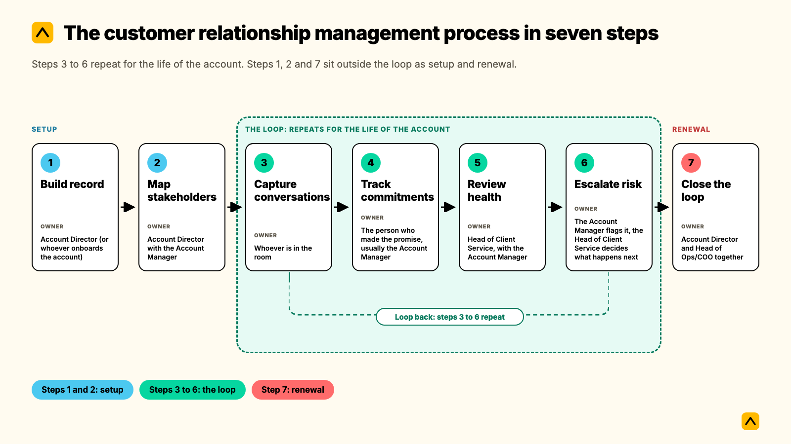
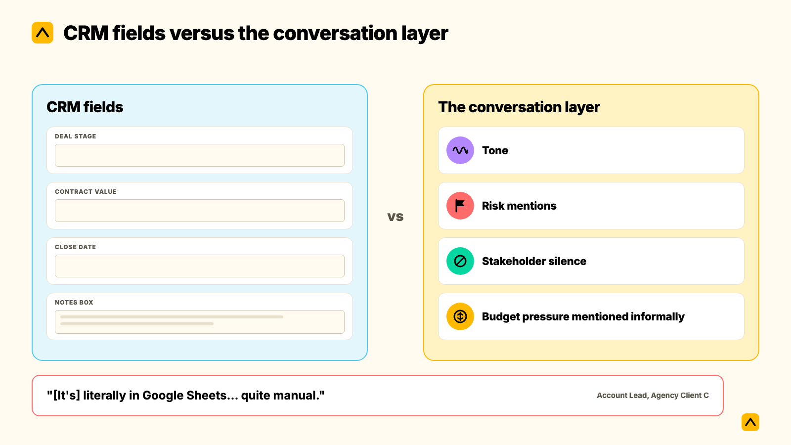

A customer relationship management process is the sequence a client-facing team follows to capture, act on, and review every client interaction, from the first stakeholder meeting through renewal. Most guides to this process describe five steps built for a sales pipeline: generate a lead, convert it, retain it, upsell it, support it. For a service firm running retainer accounts, that process is the wrong shape. It ends at the sale. The seven steps below start there and keep running for the life of the account: build the record, map stakeholders, capture every conversation, close the loop on commitments, review health on a fixed cycle, escalate risk early, and feed the renewal back into the record.

**Key takeaways**

- The five-step customer relationship management process most blogs describe is a sales funnel. It was built to turn a lead into a customer, and it stops there. An agency, consultancy, or professional services firm managing retainer accounts needs a process that keeps running for years, not one that ends at conversion.
- Every step below names an owner and a time estimate, so it can be assigned, not just read.
- Proactivity is the step teams skip most, and it is also the top reason clients leave. 45% of marketers name "lack of proactivity" as the number one reason they review a new agency, ahead of creative or strategy complaints.
- Struggling accounts usually warn you first. In Kaizan's own benchmark data, roughly 69% of accounts later flagged as at risk had already surfaced a warning sign in conversation at least once, and 38% did so repeatedly. The signal is rarely missing. It is rarely noticed.
- None of this requires replacing your CRM. It requires deciding who owns each step, and which parts get logged automatically instead of left to memory.

## When this process applies, and when it does not

This process is for client-facing teams managing ongoing, multi-stakeholder relationships: agencies, consultancies, and other professional services firms running retainer or subscription-style accounts, where the same client relationship has to be actively managed for years, not closed once. If your team runs six, sixteen, or sixty concurrent client relationships and the honest answer to "what's going on with [client]?" takes more than a minute to pull together, this is the process gap.

It is not the right frame for a one-off transactional sale, where the relationship genuinely does end at purchase. That is what the generic five-step customer relationship management process (generate, convert, retain, upsell, support) was written for, and it is a reasonable process for that context. The two get confused constantly because both use the word "CRM," but a sales pipeline and an ongoing client relationship are different jobs, run on different timelines, with different owners.

## The customer relationship management process in seven steps

### Step 1: Build one client record before the first real conversation

**Owner:** Account Director (or whoever onboards the account) · **Time:** 1 to 2 hours, once per account

Every account needs exactly one CRM record, not one per deal, one per project, and one per renewal. Before the first proper working conversation, confirm: contract value, start date, renewal date, account tier, and the names of every stakeholder you already know about. This sounds obvious and is routinely skipped, because the record usually gets built piecemeal by whoever happened to close the deal, with half the fields filled in by guesswork later.

**Script to copy**, sent to the internal handover contact before kickoff:

> "Before we kick off, I want our record for [client] to be complete from day one. Can you send me: every stakeholder you've dealt with and their role, the signed scope and renewal date, and anything raised during the sale that we should already be tracking as a risk or an opportunity?"

**Failure mode:** the client exists in the CRM as three separate records with no single page a Head of Client Service can open to answer "where do we stand with this account?"

### Step 2: Map every stakeholder and set a coverage target

**Owner:** Account Director with the Account Manager · **Time:** 30 to 45 minutes to build, 15 minutes to revisit each quarter

List every stakeholder on the client side by role and influence, and name the actual budget holder or final decision-maker explicitly, not just whoever is most responsive. Against each name, set a minimum contact cadence: a decision-maker going quiet for six weeks is a different problem than a project coordinator going quiet for six weeks, and the record should say so.

**Script to copy**, as an internal note field, not an email:

> Stakeholder: [name] · Role: [title] · Influence: decision-maker / influencer / user · Target cadence: [e.g., every 2 weeks] · Last meaningful contact: [date]

**Failure mode:** single-threading. One person on your side knows the whole account, one person on the client side is the only real relationship, and when either one leaves, the account is exposed. This is one of the most reliable predictors of a lost account, and it is invisible until someone goes looking for it.

### Step 3: Capture every meaningful conversation as it happens

**Owner:** whoever is in the room · **Time:** about 5 minutes per call or meeting, logged the same day

After every call, meeting, or substantive email exchange, log a short note: what was said, who said it, what was committed to, and a single tag of risk, neutral, or opportunity. This is not a transcript. It is a structured recap that someone else on the team, or a new hire six months from now, can read and understand without having been on the call.

> "I can't know the 20 different conversations that are happening on one client before I go and meet with that client. That's the thing that's impossible to stay on top of."
>
> — Senior Leader, Agency Client A

**Script to copy**, a note template to fill in within minutes of hanging up:

> Date / Account / Attendees · What happened (2 to 3 sentences) · Commitments made (who, what, by when) · Tag: Risk / Neutral / Opportunity

**Failure mode:** notes exist wherever the account manager happened to be that day, a notebook, a personal doc, a Slack message to themselves, occasionally the CRM. Nothing is searchable, and nothing is visible to anyone else on the account.

### Step 4: Turn every commitment into a tracked action, the same day

**Owner:** the person who made the promise, usually the Account Manager · **Time:** about 10 minutes per call

Every "I'll get back to you on that" needs an owner and a due date the same day it's said, and the client should hear it back from you before they have to ask. This single habit, agenda before a meeting, actions and a summary after it, is one of the simplest process disciplines an account team can adopt, and one of the most commonly skipped once a team gets busy.

> "How do you have a meeting? Before you have a meeting, you send them an agenda. Afterward you send them actions and summaries. We never did that before, more or less, unless it was a very important meeting. Now I hope that we do it on all our meetings, because it is so simple there's no reason not to do it."
>
> — Head of International Client Team, Agency Client B

**Script to copy**, sent within hours of the call:

> "Quick recap from today: [1 to 2 lines on what we covered]. Actions: [owner] to [action] by [date]; [owner] to [action] by [date]. Let me know if I've missed anything."

**Failure mode:** the client has to chase you. This is the single biggest driver of a client deciding to look elsewhere. 45% of marketers cite a lack of proactivity, ahead of any complaint about the actual work, as their top reason for reviewing a new agency.

### Step 5: Review relationship health on a fixed cadence, not a feeling

**Owner:** Head of Client Service, with the Account Manager · **Time:** 15 minutes per account, monthly for top-tier accounts, quarterly for the rest

Score every account against the same dimensions every time, satisfaction, stakeholder activity, relationship strength, and expansion readiness, and compare the score to last period rather than reading it in isolation. The most common version of this step today is a RAG status spreadsheet, filled in once a month from memory.

> "[It's] literally in Google Sheets... quite manual."
>
> — Account Lead, Agency Client C

A spreadsheet built on memory is backward-looking by design. It tells you what an account manager remembers feeling a few weeks ago, not what is actually happening in the account right now. Kaizan's own health model, [The Evidence-Based Client Health Standard](https://www.kaizan.ai/us/product/#health-model), runs this review continuously across four plain-language dimensions, with the underlying evidence attached to every score, which is the version of this step most teams are trying to reach when they outgrow the spreadsheet.

**Script to copy**, a 15-minute review agenda per account:

> "Score vs last period: up, flat, or down, and why? Any stakeholder gone quiet? Any risk mentioned more than once? Is there an expansion signal we haven't acted on?"

**Failure mode:** the review happens "whenever there's time," which in practice means it happens the week before a renewal, when it is too late to change the outcome.

### Step 6: Escalate risk before the client raises it

**Owner:** the Account Manager flags it, the Head of Client Service decides what happens next · **Time:** same day a signal appears

Define what counts as a risk signal in advance, so nobody has to decide in the moment whether something is worth raising: a concern repeated twice within a month, a decision-maker silent for three or more weeks, a sentiment trend moving down over consecutive calls. The moment one appears, it gets flagged internally the same day, and the client hears from you before they have to raise it themselves.

> "We're trying to be proactive in predicting which clients might be a churn risk."
>
> — Chief Operating Officer, Agency Client D

The uncomfortable finding behind this step: struggling accounts are rarely silent. Across a year of anonymized client service data, Kaizan found that roughly 69% of accounts later flagged as at risk had surfaced a warning sign in conversation at least once, and 38% surfaced the same concern repeatedly, across multiple periods, before anyone escalated it. The gap usually isn't a missing signal. It's a signal nobody was watching for.

**Script to copy**, the client-facing message that gets ahead of a problem rather than reacting to it:

> "I wanted to flag something before it becomes a bigger issue: [the concern, stated plainly]. Here's what we're doing about it: [the action]. I'll update you by [date]."

**Failure mode:** the first time leadership hears about a risk is the renewal call where the client announces they're leaving.

### Step 7: Close the loop at renewal, and write what you learned back into the record

**Owner:** Account Director and Head of Ops/COO together · **Time:** 60 to 90 minutes, starting 90 days before renewal

Renewal prep should pull from the record built in steps 1 through 6, the health history, the stakeholder map, and the action log, rather than being rebuilt from memory under time pressure. Once the renewal conversation happens, the outcome and whatever was learned from it gets written back into the client record, so the next cycle starts from evidence instead of zero.

**Script to copy**, the internal renewal debrief, filled in within a week of the outcome:

> "Outcome: renewed / renewed at reduced scope / lost. What the health score showed in the 90 days before: [summary]. What we'd do differently: [1 to 2 lines]. Updated stakeholder map and risk notes: [attached]."

**Failure mode:** when an account director leaves or goes on leave, the context leaves with them, and whoever inherits the account rebuilds it from scratch, usually in the middle of a renewal cycle.

## A worked example: one account, seven steps, twelve months

This is a composite account, built from patterns that show up across many client relationships, not a single named client.

A 40-person client-side marketing team signs a 12-month retainer with a mid-size agency. In week one, the Account Director builds the single record (Step 1) and maps six stakeholders, flagging the CMO as the actual decision-maker despite most day-to-day contact running through a marketing manager (Step 2). For the first two quarters, every call gets a same-day note (Step 3), and every commitment gets a same-day recap (Step 4), which the client starts to visibly expect and rely on.

In month five, the monthly health review (Step 5) shows the relationship-strength score dipping for two periods running, even though the satisfaction score looks fine on the surface. The call notes show why: the marketing manager has mentioned budget pressure twice in casual conversation, not as a formal complaint, which is exactly the kind of signal a RAG spreadsheet filled in from memory would miss. The team escalates it internally the same week it recurs, and sends a proactive message acknowledging the pressure and proposing a scope adjustment before the client has to ask (Step 6).

At month nine, renewal prep starts (Step 7). Instead of building a recap from memory, the Account Director pulls nine months of health history, the full action log, and the stakeholder map, which together show a relationship that dipped once, was caught early, and recovered. The renewal conversation opens from that evidence rather than from hope. The account renews at the original scope, and the outcome, plus the lesson about surfacing budget signals earlier, gets written back into the record for the team member who inherits the account next cycle.

## How to tell whether the process is working

Measure these four things for a month before changing anything, so you have a real baseline:

- **Time to a logged action.** What share of calls have a tracked action within 24 hours? Anything under 80% means Step 4 is being skipped under pressure.
- **Age of the last health review per account.** If any top-tier account hasn't been reviewed in over 35 days, Step 5 has lapsed.
- **Risk flagged before the client raises it, vs after.** This is the single number that matters most to a Head of Client Service, and the one most worth tracking month over month.
- **Stakeholder coverage.** What share of mapped stakeholders have had meaningful contact in the last 30 days? An account where only the primary contact has been touched is exposed, whatever the overall health score says.

Review these four numbers at the same monthly cadence as Step 5, so the process checks itself rather than relying on anyone remembering to ask.

## What to automate, and what has to stay human

> "About 35 to 40% of an account handler's job now is admin, and there's a problem where that admin is getting in the way of having proper relationship-driven conversations."
>
> — MD and Chief Client Officer, Agency Client E

**Automate:** logging calls and emails, drafting the same-day follow-up, writing the health score and risk flags back into the CRM record, pulling together the renewal recap from existing data. None of this requires judgment. It requires consistency, which is exactly what a busy team under-delivers on by the fourth week of a quarter.

**Keep human:** deciding whether and how to escalate a risk, approving anything before it reaches the client, how to open a difficult renewal conversation, and when to push back on scope. These decisions depend on context a system can surface but shouldn't make unsupervised.

> "We have a target of achieving 20% better efficiency across the business, 20% less time spent on administration. Kaizan has significantly helped us achieve that target."
>
> — Derek Grant, VP Operations & General Manager UK/US, Tradedoubler

This is the practical dividing line most teams land on once they've run the process for a few cycles: the capture and the paperwork get automated, the judgment calls stay with the people who own the relationship.

## Pitfalls, and what fixes each one

- **Symptom:** account health is "whatever the account manager says it is" at the Friday update. **Fix:** Step 5's fixed-cadence scoring against the same dimensions every time, not a verbal gut check.
- **Symptom:** the CRM has three records for one client. **Fix:** consolidate to Step 1's single record before doing anything else. Every later step depends on there being one place to look.
- **Symptom:** a new hire takes months to feel "up to speed" on an account. **Fix:** Step 7's feedback loop. If the record is complete, a new owner reads it in an afternoon instead of rebuilding it from old emails.
- **Symptom:** risk only gets flagged after the client mentions leaving. **Fix:** Step 6's predefined signals and same-day escalation, so the team is watching for the signal rather than waiting for the complaint.
- **Symptom:** notes exist "wherever someone remembers to put them." **Fix:** Step 3's same-day, structured capture, ideally automatic rather than manual, since manual logging is the first habit to slip under pressure.
- **Symptom:** the stakeholder map has one name on it. **Fix:** Step 2's coverage target, reviewed quarterly, with the decision-maker explicitly named rather than assumed.

## Frequently asked questions

**What is the customer relationship management process?**
A customer relationship management process is the sequence a client-facing team follows to capture, act on, and review every client interaction, from the first stakeholder meeting through renewal. For a service firm running retainer accounts, that means seven steps that keep running for the life of the account, not the five-step sales funnel (generate, convert, retain, upsell, support) most CRM guides describe.

**How long does this take to put in place?**
Setting up Steps 1 and 2 for an existing account takes 2 to 3 hours once. Steps 3 through 6 run in minutes per touchpoint once the habit is established, usually within one full billing cycle. Most teams see the biggest early time cost in auditing existing accounts, not in running the process going forward.

**Who should own each step?**
Ownership splits naturally: the Account Director owns setup (Steps 1, 2, 7), whoever is in the room owns capture and follow-up (Steps 3, 4), and the Head of Client Service owns the health review and risk decision (Steps 5, 6). No single person should own all seven, or the process depends entirely on one person's memory and availability.

**What if the client won't share a full stakeholder list or ignores a step?**
Treat a reluctant client as data, not an obstacle. A client unwilling to name a decision-maker, or one who goes quiet on requests, is itself a coverage risk worth logging in Step 2. Build the map from what you can observe, meeting attendees, email participants, who actually approves spend, and revisit it as access improves.

**How do we know the process worked?**
Track the four numbers in the "how to tell whether it's working" section: time to a logged action, age of the last health review, risk flagged before versus after the client raises it, and stakeholder coverage. A process that's working shows risk caught earlier and action items closing faster, not just "the CRM looks tidier."

**What should we automate first?**
Start with Step 3 (capture) and Step 4 (same-day follow-up), since these are the two steps most likely to be skipped under time pressure, and the two with the clearest return: a logged conversation and a fast recap are what a client actually notices week to week.

**Is this different from the standard sales CRM process?**
Yes. The standard five-step process (generate, convert, retain, upsell, support) is built for a sales pipeline and ends once a deal closes. This seven-step process starts where that one ends and is built to run for the life of a retainer or ongoing account, with stakeholder mapping, risk escalation, and a renewal loop that a sales-focused process doesn't need.

---

If you want to see what Steps 3 through 6 look like with automatic capture instead of manual logging, on your own client accounts, [book a demo](https://www.kaizan.ai/us/).
