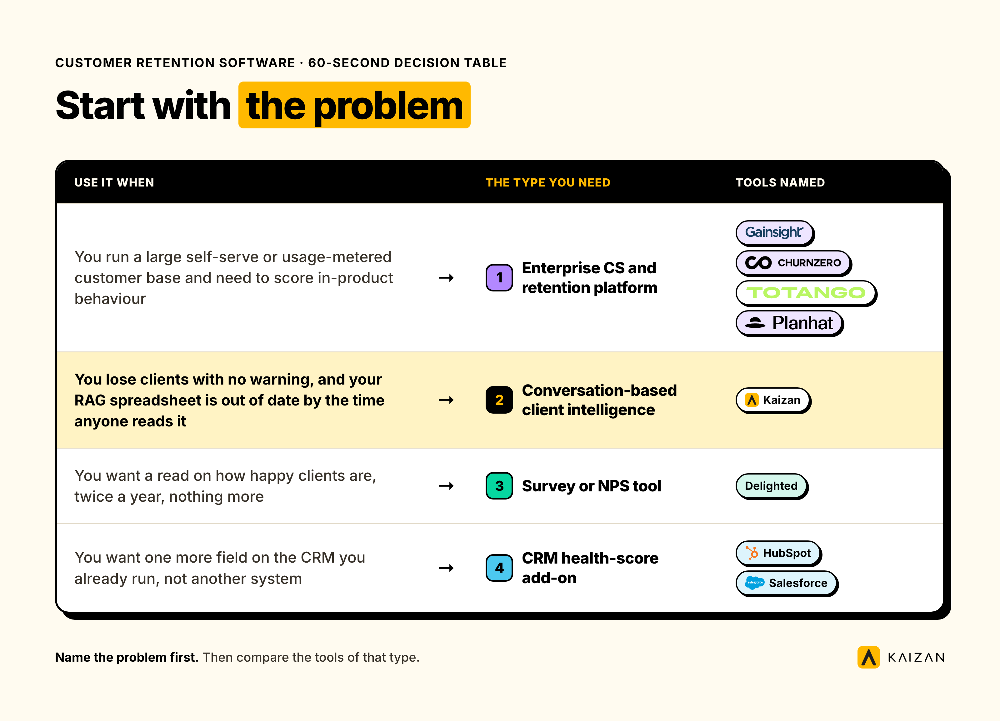
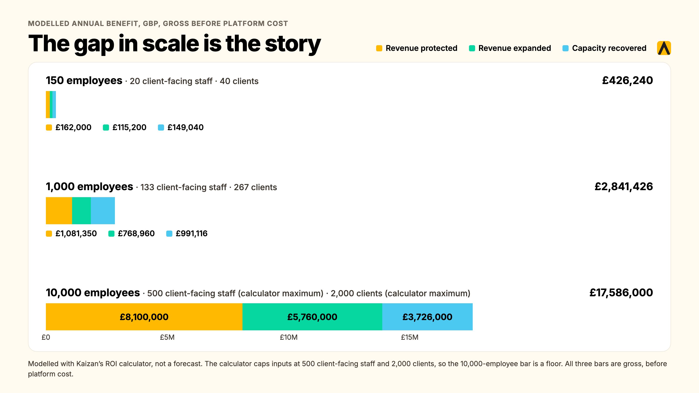

Customer retention software is any platform built to keep the clients a business already has, by tracking relationship health, flagging risk early and prompting action before a renewal is in danger. For agencies and other service firms, the tools that actually work score relationship health from real conversations (emails, calls, meetings), not from product logins or a quarterly survey.

**What you need to know before you buy:**

- Five kinds of tool compete for the phrase "customer retention software," and most were built for B2B SaaS, not for firms that sell people's time.
- Gainsight, ChurnZero, Totango and Planhat price per user seat and read product usage data. If your clients don't log into a product, there's little for them to read.
- Kaizan prices per client rather than per seat, and reads the relationship itself: emails, calls, meetings, Slack, automatically.
- Quiet accounts are not safe accounts. Kaizan's own benchmark data found that accounts which go on to grow actually surface 2.2x more risk signals than accounts that quietly churn.
- Below: the five tools compared, what each one costs, what it would cost you to do nothing, and nine straight answers to the questions buyers actually ask.

## What Customer Retention Software Is, And What It Isn't

Customer retention software is built to answer one question, on repeat: which clients are we at risk of losing, and what should we do about it today. A CRM answers a different question: who do we know, and what have we sold them, because it is primarily built for customer relationship management while retention software focuses on signals that help reduce churn. A CRM is a system of record for contacts and deals. Retention software is a system of signal, usually sitting on top of or beside a CRM rather than replacing it.

The confusion is real because the same product gets sold under three or four names (customer success platform, retention platform, churn-prevention platform, client health platform) by vendors chasing different keywords. Strip the marketing away and there are really two underlying designs, both used to improve customer retention depending on whether they track product usage or conversations:

- **Product-usage platforms.** Built to watch what a user does inside a piece of software: logins, feature adoption, support tickets, in-app events. This is the Gainsight, ChurnZero, Totango and Planhat model.
- **Conversation platforms.** Built to watch what gets said: emails, calls, meetings, chat messages. This is where Kaizan sits.

### Customer Retention Management Software Vs CRM

A CRM logs the facts of a relationship: contacts, deals, open tickets. Customer retention management software uses customer data and customer interactions beyond CRM records to score account health, drawing on signals a CRM was never built to capture, like tone, sentiment, who’s gone quiet, or what a client said last week that nobody logged. The two aren't competitors; paired with the CRM, the retention layer creates a more comprehensive customer view. Most firms run both, and the retention layer is usually the one still missing.

### What Retention Means For An Agency Or Service Firm

For a SaaS company, "usage" is a login. For an agency, a consultancy or any other professional-services firm, there is no product to log into. The usage **is** the relationship: who's on the account, how often they talk, what tone those conversations are taking. Service firms need software that reads the customer journey through those conversations rather than product logins. A platform built to watch logins has almost nothing to read on an agency account. That distinction is the one most "best customer retention software" lists miss, because most of them were written with a SaaS reader in mind.

For a service firm, retention in practice means protecting customer relationships and retaining existing customers before issues turn into churn: fewer unplanned losses at renewal, fewer scope cuts mid-contract, catching a quiet client before a competitor does, and being able to say **why** an account is healthy or at risk with evidence, rather than a gut call on a Friday status update.

## The Types Of Customer Retention Software, And Which One You Need

Four types of tool answer to this keyword. Only one was built around conversations rather than product data, and different customer retention tools support different retention strategies depending on the business model.

### Enterprise Customer Success And Retention Platforms

Gainsight, ChurnZero, Totango and Planhat. Built for B2B SaaS companies with a product people log into, these platforms are designed for customer success teams managing account health through product usage, support tickets and in-app events. Some teams also use predictive analytics and customer health scores to identify accounts at risk. Priced per user seat. Strongest when the business being served genuinely has product usage to read.

### Conversation-Based Client Intelligence Platforms

Kaizan. Built for agencies, consultancies and other firms that sell people's time rather than product seats. It helps customer teams monitor customer health from emails, calls, meetings and chat messages, captured automatically rather than logged by hand. Priced per client rather than per seat. This kind of software helps retain customers by surfacing risk in relationship-led accounts.

### Survey And NPS Tools

Tools such as Delighted or a standalone NPS survey are often treated as among the **best customer retention tools** for measuring stated satisfaction, but they still only capture a limited slice of the picture. They measure **customer satisfaction** a few times a year. Useful as one input, weak as the whole system: a client can score an 8 on a survey and still be a month from leaving, because a survey only catches what a client is willing to write down, not what's actually happening in the account day to day.

### CRM Health-Score Add-Ons

A scoring field bolted onto HubSpot or Salesforce. Cheap, because it's a feature rather than a product, but it depends on what gets typed into the CRM rather than richer customer insights gathered automatically, and most of a relationship never gets typed in.

### Which Type You Need: A 60-Second Decision Table

| If this is your problem | The type you need |
| --- | --- |
| We lose clients with no warning, and our RAG spreadsheet is already out of date by the time anyone reads it | Conversation-based client intelligence (Kaizan) |
| We run a large self-serve or usage-metered customer base and need to score in-product activity by tracking customer behaviour | Enterprise CS/retention platform (Gainsight, ChurnZero, Totango, Planhat) |
| We just want a read on how happy clients are, twice a year, nothing more | A survey or NPS tool |
| We want one more field on the CRM we already run, not another system | A CRM health-score add-on |

## Why Agencies And Service Firms Outgrow Spreadsheets And Their CRM

### The Monthly RAG Spreadsheet Problem

Most support teams still run health as a red-amber-green spreadsheet, filled in once a month by the account lead for day-to-day account monitoring. It's backward-looking by design: it reports how an account felt a few weeks ago, filtered through whoever filled it in that day, and it's usually optimistic, because nobody wants to be the one marking their own account red in front of leadership.

### The Relationship Lives In Inboxes And Calls, Not In Fields

A CRM only knows what someone typed into it. Agency account teams run most of a relationship through email, calls and meetings that never get logged anywhere structured, leaving teams without a reliable record of customer communications across those channels. One agency found that roughly half of its account managers' client updates and notes simply never made it into the system of record at all, which means any health score built on that data is reading half the relationship, at best.

### Context Leaves When An Account Director Leaves

When an account director moves on, whatever they knew about a client, the politics, the history, the thing that nearly ended the relationship two renewals ago, usually leaves with them. A spreadsheet captures a status. It doesn't capture the context behind it.

### The Risk Paradox: Quiet Accounts Aren't Safe Accounts

The most counterintuitive finding in Kaizan's own benchmark research directly undercuts how most teams read a quiet account. Accounts in the top decile for client satisfaction and revenue growth actually surface **2.2x more risk phrases** in their conversations per year than accounts in the bottom decile (15.3 vs 6.9 risk mentions per account, annualised). The healthiest relationships are not the quietest ones; they're the ones where problems get raised and dealt with in the open. A silent risk register on an active account is a warning sign, not a green light, and missed warning signs are often what lead to customer churn.

That pattern holds even inside accounts that are already struggling: roughly 38% of accounts that went on to churn had the **same** risk theme recur across multiple review periods before anyone acted on it. The warning was rarely a single comment. It was the same comment, ignored twice. So teams need to analyse customer feedback in ongoing conversations, and read customer sentiment over time, not just count silent periods.

**Source: Kaizan,** [**The Client Service Benchmark 2026**](https://kaizan.ai/resources/white-paper/)**, Finding 07 (the Risk Paradox) and Finding 06.**

## The Features That Actually Matter In Customer Retention Software

## The Key Features That Actually Matter In Customer Retention Software

**Automatic capture, not manual logging.** If a tool depends on an account manager typing in a health score, it's reporting opinion, not evidence, and it will decay the moment someone's busy. This is where **customer retention software help** should come from: surfacing real evidence from emails, calls, and meetings rather than relying on manual updates.

**Health scoring grounded in real signals.** A single number (a CSAT score, a RAG colour) hides more than it shows. A client can be satisfied with the work and still quietly disengaging from the relationship. Multidimensional scoring, covering satisfaction, stakeholder activity, relationship depth and expansion readiness, catches what a single score misses.

**Early-warning alerting, not a quarterly review.** The value of a risk signal halves every week nobody sees it. A tool should surface a risk the week it appears, not at the next scheduled check-in.

**A portfolio view for leadership.** One account team's view is useful. A leader needs to see the whole book at once: which accounts are at risk, which are ready to grow, and where coverage has thinned, without asking every account director for a status update. That unified view also makes it easier to **boost retention** across the full portfolio.

**Integrations with the tools the team already uses.** Gmail, Outlook, Teams, Zoom, Slack, and the CRM already in place. A tool should fit the **existing tech stack**, because one that requires a second place to log things will get used for a month and then quietly abandoned.

**Permissions and security that would survive a client's own security review.** SOC 2 Type II, data residency options, zero-retention policies on foundation model training, and per-account access controls. For firms handling client data under NDA, this isn't optional.

**AI features worth paying for, and the ones that aren't.** Worth paying for: **AI-powered** help with spotting risk, surfacing signals from real client activity, drafting a follow-up from the actual conversation, and flagging a stakeholder who's gone quiet before a renewal. Not worth paying for: a chatbot bolted onto an existing dashboard with nothing new to say, or a sentiment score with no way to see the evidence behind it.

## Customer Retention Software Compared

Five customer retention software tools, assessed against the two things that decide fit for a service firm: what the tool reads to build its score, and how it's priced. At a glance, many customer retention tools can look similar, but they differ materially in the data they read and the way they charge.

| Tool | Built for | Pricing model | Typical annual cost | One real limitation |
| --- | --- | --- | --- | --- |
| Gainsight | Large B2B SaaS, 1,000+ customers, dedicated CS ops | Per user seat | Enterprise contracts commonly $25,000–$250,000+/yr depending on team size and modules | Built around product usage; little to read on an account with no product login, and a 3–6 month typical rollout |
| ChurnZero | Mid-market to enterprise SaaS | Per user seat | List price from $12,000/yr; real average spend roughly $43,700/yr for 50–1,000-employee buyers, $73,300/yr for 1,000+ | Same product-usage assumption as Gainsight, at a smaller scale |
| Totango | Growing SaaS CS teams | Per user seat, modular | Average spend roughly $37,800/yr for 50–1,000-employee buyers | Entry-level modules are lighter; still reads usage data an agency doesn't generate |
| Planhat | SaaS customer success and revenue teams, CRM-adjacent | Per user seat / modular | Average spend roughly $44,300/yr (50–1,000 employees), $178,800/yr (1,000+) | More flexible than the others, but still reliant on data someone has to log in manually for relationship context |
| Kaizan | Agencies, consultancies and other client-service firms | Per client, unlimited users | Kaizan is priced by number of clients. Price on quote. | No in-product usage telemetry to show, because for most agency clients that data doesn't exist to capture |

**Pricing for Gainsight, ChurnZero, Totango and Planhat is compiled from third-party contract-data and listing sources (SpendHound, Capterra), not the vendors' own published list prices, since none of the four publish self-serve pricing; treat these as directional. Kaizan is priced by number of clients, with the price available on quote.**

## The Five Tools, One By One

### Gainsight

The enterprise standard for customer success, built for software companies managing thousands of accounts through product usage data. Thirty-plus modules cover health scoring, playbooks, journey orchestration, renewal forecasting, and workflow automation, with a recently added AI agent layer. **Best for:** a SaaS business with 1,000+ customers and a dedicated CS operations function. **Standout feature:** depth of configuration, for teams with the headcount to run it. **Limitations:** per-user licensing means cost scales with your team, not your client count, which punishes a lean agency team managing many retainer clients; typical rollout runs three to six months. **Verdict for agencies and service firms:** usually the wrong tool unless the firm also runs its own software product with real usage data behind it.

### ChurnZero

Positioned around real-time engagement and proactive churn-fighting for mid-market SaaS. **Best for:** subscription software companies that want to reduce customer churn through real-time engagement alerts tied to product usage milestones. **Standout feature:** real-time alerts tied to product usage milestones. **Limitations:** the same product-usage assumption as Gainsight at a smaller scale; little for a firm whose product is a relationship rather than a login. **Verdict:** a reasonable fit if you sell software alongside services; a poor fit if you don't.

### Totango

A modular customer success platform aimed at growing SaaS teams that want to start with foundational health-scoring, engagement tracking, and automated workflows for lifecycle programmes as teams grow. **Best for:** earlier-stage SaaS companies building out a CS function for the first time. **Standout feature:** lower cost of entry than Gainsight or ChurnZero for a first CS platform. **Limitations:** still built around usage and lifecycle programmes rather than conversation capture. **Verdict:** worth a look only if the buyer is a software business, not a service firm.

### Planhat

The most CRM-adjacent of the four, pitched as a unified customer platform spanning sales, service, customer success, and marketing automation. **Best for:** SaaS and hybrid product-and-service businesses wanting one system across the customer lifecycle. **Standout feature:** flexibility and a more modern interface than the older platforms in this category. **Limitations:** it can pull data from multiple systems, but relationship context still depends on what gets typed in manually; nothing captures a call or an email automatically. **Verdict:** closer to a fit for a hybrid business than the others, still short of what a pure service firm needs.

### Kaizan

Built specifically for agencies, consultancies and other professional-services firms running client relationships over email, calls and meetings rather than a logged-in product, Kaizan helps **boost customer retention** by turning conversational signals into structured, searchable account memory automatically. The AI Assistant joins calls across Teams, Zoom and Google Meet and turns them into structured, searchable memory automatically; the Client Health Model (branded CARE) scores every relationship against what Kaizan calls The Evidence-Based Client Health Standard, covering client satisfaction, activity with stakeholders, relationship strength and expansion opportunities, with **user behaviour** reflected only through stakeholder activity and engagement patterns visible in conversations rather than a single opaque score. AI Helpers act on what the model finds and help strengthen **customer engagement** by prompting timely follow-up: flagging a stakeholder who's gone quiet, drafting a re-engagement note, surfacing an expansion signal a client raised in passing. **Best for:** agencies, consultancies and client-service teams of roughly 150 to 10,000 employees, and smaller firms in the right situation. **Standout feature:** pricing by client rather than by seat, so a lean team covering many retainer accounts isn't penalised for having a small headcount. **Limitations:** no in-product usage telemetry, deliberately, because for most agency clients that data simply doesn't exist to capture. **Verdict:** the clearest fit on this list for a firm whose clients are relationships, not logins.

**Disclosure: Kaizan publishes this guide and is one of the five tools reviewed. The scoring criteria and every other vendor's pricing and features were checked independently against public sources, set out in the next section.**

## How We Assessed These Tools

Each vendor's published pricing pages, product pages and public review listings (G2, Capterra, SpendHound) were checked in November 2026, and the review focused on fit, integrations, and retention metrics rather than a generic feature checklist. Every tool was scored against five questions chosen for what actually decides fit at an agency or service firm: does it capture conversations automatically, does it price per client or per seat, does it integrate with the tools agencies already run, does it surface risk early rather than through a lagging survey, and can a 10-to-50-person firm realistically afford and operate it.

Kaizan publishes this guide and is one of the five tools scored. Pricing for Gainsight, ChurnZero, Totango and Planhat was compiled from third-party sources, since none of the four publish self-serve pricing; those figures should be read as directional rather than exact, and are worth re-checking at the point of purchase.

## How To Choose Customer Retention Software In Seven Steps

1. **Start from the actual problem, not the feature list.** Write down, in one sentence, what you don't know today. For most Heads of Client Service it's some version of: we only find out a client is unhappy when they tell us.
2. **Map what you already have.** CRM, calendar, note-taking tool, survey tool. Most firms already hold more risk signal than they think; it's just scattered across four systems nobody cross-reference. Also check how **customer retention software integrate** with the systems already in place and whether data can flow across them.
3. **Count clients, not seats.** A per-seat tool can look cheap for a five-person team running 300 self-serve accounts and expensive for a 40-person team running 25 retainer clients. Model the number that actually matters for your pricing structure before comparing sticker prices.
4. **Separate automatic capture from manual logging.** A tool that depends on an account manager typing in a health score is reporting opinion dressed up as data, and automated capture usually gives a clearer view of **customer experience** than manual logging alone. One agency found that roughly half of its account updates never made it into the system of record at all. Ask every vendor, directly, what share of the data behind their score is captured automatically versus typed in by hand.
5. **Pilot on five real accounts for 14 days before buying anything.** Not a demo with sample data, your own accounts, your own clients. This is also the fastest way to find out whether the team will actually use it.
6. **Check what each person on the buying committee needs to see.** A Head of Client Service wants the spreadsheet replaced, with evidence they can defend upward, while different **customer teams** may need different views of account risk and relationship health. As one COO at a professional-services firm in Kaizan's own client base put it:

> "We're trying to be proactive in predicting which clients might be a churn risk, and [the platform] is a huge part of helping to identify that." — COO, Agency Client A

A CEO or CFO wants a different answer. As one agency's senior leadership team framed it when evaluating a client health platform:

> "I just want to know, is my revenue at risk? Client health is a very big indicator for hitting those revenue numbers, and that's what I need to know." — Senior leadership, Agency Client C

7. **Score the shortlist against the same five criteria, then date your own evaluation.** None of this is static. Pricing, features and even category definitions shift every few months; put a date on the comparison you build so it's clear when it was last checked, and remember the goal is to choose the **right customer retention software** for your needs, not just the most feature-rich option.

## What Customer Retention Software Costs, And What Churn Costs You

### What It Costs

The pricing models in this category differ more than the sticker prices do. Four of the five tools here price per user seat, so cost tracks headcount, not client count. Kaizan is the exception, pricing per client with unlimited users. Kaizan is priced by number of clients. Price on quote. For a lean agency team covering a large book of retainer clients, that difference alone can swing which tool is actually affordable; see the comparison table above for the full breakdown by vendor.

### What Churn Actually Costs A Service Firm

Retainer-based agencies run roughly 18% annual client churn on average, against roughly 42% for project-based firms, and the gap widens as agencies grow; top-performing retainer shops hold churn to 8–10%. Professional-services firms overall retain around 84% of clients in a typical year. A firm running 20% annual attrition on a $10 million client portfolio is putting $2 million of revenue at risk every single year, and high churn erodes customer lifetime value while making growth from the existing customer base harder, before any software changes that number; retaining existing customers is usually cheaper than replacing them with new customers.

### A Worked Example, Using Kaizan's Own Published ROI Model

Kaizan publishes a live ROI calculator at [kaizan.ai/us/pricing](https://kaizan.ai/pricing/) that estimates how customer retention software can increase customer lifetime value by protecting revenue, supporting upsell, and recovering capacity. Running the calculator's own default assumptions (a 150-employee firm with a 20-person client-delivery team, 40 clients, £60,000 average annual client value and 15% typical attrition) and scaling the client-facing team and client count proportionally for larger firms gives a sense of how the model moves with firm size:

| Company size | Client-facing team (modelled) | Clients (modelled) | Modelled annual benefit, before platform cost | Revenue protected from churn | Revenue expanded via upsell | Capacity recovered |
| --- | --- | --- | --- | --- | --- | --- |
| 150 employees | 20 | 40 | £426,240/yr | £162,000 | £115,200 | £149,040 (+2.9 FTE) |
| 1,000 employees | 133 | 267 | £2,841,426/yr | £1,081,350 | £768,960 | £991,116 (+19.2 FTE) |
| 10,000 employees | 500 (calculator maximum) | 2,000 (calculator maximum) | £17,586,000/yr | £8,100,000 | £5,760,000 | £3,726,000 (+72.0 FTE) |

**These figures come from actually running Kaizan's own published calculator in its "Expected" scenario, not from an estimate. The 150-employee row uses the calculator's own defaults; the 1,000 and 10,000-employee rows scale the client-delivery-team size and client count proportionally to headcount, holding average client value and attrition constant, and the 10,000-employee row is capped at the calculator's own maximum inputs (500 client-facing staff, 2,000 clients). All three rows are shown before platform cost. This is an illustrative model, not a forecast for any specific firm; run your own numbers at the link above.**

## Which Option Fits Which Firm, At 10, 50 And 200 People

**A 10-person boutique.** Probably too small for any of the enterprise CS platforms here, since the per-seat cost of Gainsight or ChurnZero would outweigh what a team that size bills in a year. A survey tool covers the bare minimum; a conversation-based platform like Kaizan's pilot tier is worth testing once the firm is losing clients it didn't see coming, since Kaizan's pricing works down to smaller books in the right situation even though its primary fit starts around 150 employees.

**A 50-person agency.** This is the size band where the category genuinely earns its keep: enough clients that a spreadsheet can no longer hold the whole picture, not yet big enough to carry a dedicated revenue-operations function to chase the data by hand. The right customer retention setup depends on whether the firm serves more customers through software or manages a smaller number of relationship-led accounts. Compare Kaizan against a scaled-down Totango or ChurnZero only if the firm also ships its own product with real in-app usage to track; otherwise the product-usage platforms have little to read.

**A 200+ person firm or multi-office network.** Portfolio-level reporting across several account directors and offices becomes the deciding requirement. This is also the point where Gainsight-style enterprise platforms genuinely get evaluated alongside Kaizan, and the one question that settles it is simple: does the customer at the other end of the relationship log into a product, or do they talk to a person. One Kite Factory client, running 65 client accounts with 45 active at any one time, described the shift plainly:

> "We have 65 clients, 45 which are active at any point in time. What we can learn about the future of what's happening in the client sector, what's happening with their audiences, what's happening in the media channels, that helps us shortcut some of the stuff we've done manually." — James Smith, CEO, The Kite Factory

## FAQs

**What is the best customer retention management software for agencies?** For agencies and other service firms, it's whichever tool scores relationship health from real conversations rather than product usage, since most agency clients never log into a product. Of the tools compared here, Kaizan is built specifically for that case; the other four were built for B2B SaaS.

**What are the best customer retention solutions for service firms?** The strongest solutions for a service firm combine automatic capture of emails, calls and meetings with a multidimensional health score and early-risk alerting, priced per client rather than per seat. Survey tools, CRM add-ons, and even loyalty programmes may complement this in some models, but they shouldn't replace relationship-health tools or carry it alone.

**What is the best customer retention software?** There's no single best tool across every business; the honest answer depends on whether your customer logs into a product (Gainsight, ChurnZero, Totango or Planhat) or talks to a person (Kaizan). The right customer retention choice depends on the shape of the relationship, not the category label.

**How much does customer retention software cost, and what does churn cost us?** Enterprise CS platforms typically run $25,000 to $250,000+ a year depending on team size. Kaizan is priced by number of clients. Price on quote. Set either against the cost of churn: a firm losing 20% of a $10 million client book annually is putting $2 million at risk every year, and it also cuts future customer lifetime value before software changes that number.

**Is there free customer retention software?** None of the five tools here has a meaningful free tier; all are B2B platforms sold on contract. Kaizan offers a free 14-day pilot on your own data with no card required, which is the closest equivalent to testing before committing.

**Do we need it if we already have a CRM?** Yes, if the CRM only holds what someone typed in by hand. A CRM is a system of record for contacts and deals; retention software is a system of signal for relationship health, built from data a CRM was never designed to capture, and that can increase customer retention by surfacing signals the CRM misses. Most firms run both.

**How long before it predicts anything useful?** A conversation-based platform like Kaizan surfaces its first signals within the first few weeks of connecting your email and calendar, since it's reading conversations that already exist rather than waiting to accumulate new usage data. Product-usage platforms generally need longer, since they're building a baseline from scratch.

**Will this replace our RAG spreadsheet?** Yes, that's the point of it. A RAG spreadsheet is a monthly snapshot filled in by hand; a conversation-based platform updates continuously from the communications already happening, catching the same risks weeks earlier and without relying on someone remembering to fill in a cell.

**What is the return on this?** Measure it in revenue protected and expansion won, not hours saved. One Managing Director at a Kaizan client agency put it this way: "Kaizan is fast becoming the key input to my churn report. Something that used to take me hours now takes me minutes." — MD and Chief Client Officer, Agency Client B. Across the Kaizan portfolio, clients see 26%+ average revenue growth per client.

## Sources

- [Kaizan pricing and ROI calculator](https://kaizan.ai/pricing/), checked November 2026
- [Kaizan product overview](https://kaizan.ai/product/)
- [The Client Service Benchmark 2026](https://kaizan.ai/resources/white-paper/) (Risk Paradox, AM Power Law, CARE benchmarks)
- [How NP Digital uses AI to strengthen client relationships and drive retention](https://kaizan.ai/blog/client-health/np-digital-ai-client-retention/)
- [Agency Benchmarks Report 2026: Margin, Growth, Retention & More](https://forge.so/agency-benchmarks), Forge
- [Average Marketing Agency Churn: 2026 Report](https://focus-digital.co/average-marketing-agency-churn/), Focus Digital
- [Client Retention Statistics for Agencies (2026)](https://agiled.app/statistics/client-retention-statistics), citing Bain & Company average professional-services retention
- [ChurnZero actual pricing 2026](https://www.spendhound.com/marketplace/churnzero-pricing), SpendHound verified-contract data
- [ChurnZero pricing and reviews](https://www.capterra.com/p/176981/ChurnZero/), Capterra
- [Gainsight pricing and cost per user 2026](https://oliv.ai/blog/gainsight-pricing-cost-per-user)
- [10 Best Customer Success Software for SaaS in 2026](https://fungies.io/?p=40846)
