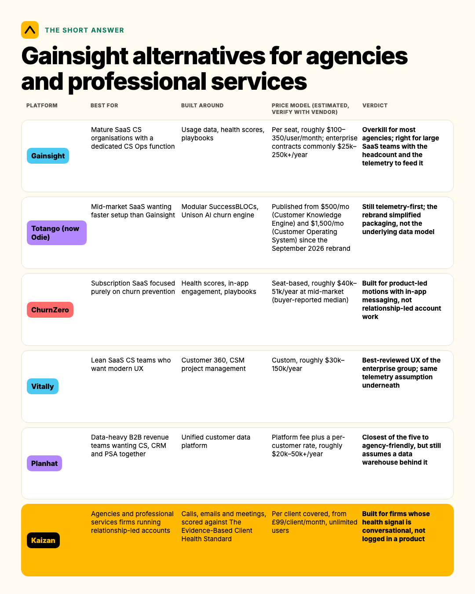
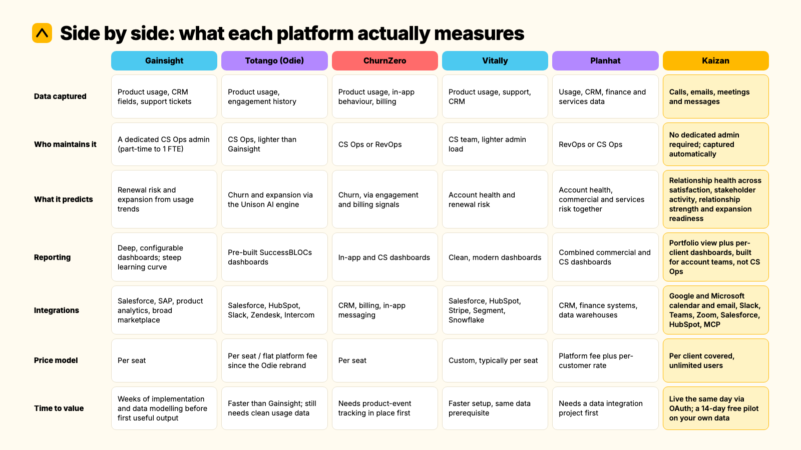
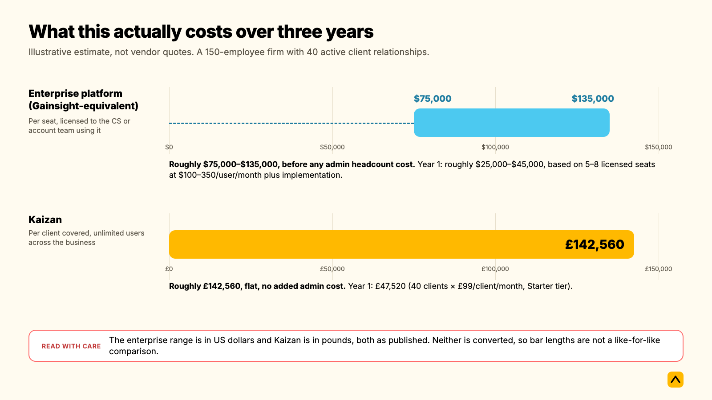

The Gainsight customer success platform is built for SaaS companies with product usage data feeding every health score. Agencies and professional services firms don't have that telemetry: the signal that actually predicts whether a client stays lives in calls, emails and meetings, not in login logs. If that's your starting point, Totango (rebranded to Odie in September 2026), ChurnZero, Vitally, Planhat and Kaizan are the alternatives worth putting side by side, and each one wins in a different setup.

**Key takeaways**

- Gainsight, Totango/Odie, ChurnZero and Vitally are all built around product usage telemetry: logins, feature adoption, in-app events. Agencies and professional services firms rarely have that data — the health signal lives in conversations instead.
- Totango rebranded to Odie in September 2026, replacing a three-product, contact-sales-only lineup with two products and published starting prices.
- None of these five platforms publish full list pricing. Buyer-reported figures below come from third-party cost trackers, not vendor list prices, range widely, and should be re-verified with each vendor before they go into a business case.
- Kaizan prices per client covered rather than per seat, from £99 per client per month with a 10-client minimum, and unlimited users on every tier.
- A 14-day free pilot on your own data answers "will my team actually use this" before anyone signs anything.

## The short answer

| Platform | Best for | Built around | Price model (estimated, verify with vendor) | Verdict |
| --- | --- | --- | --- | --- |
| Gainsight | Mature SaaS CS organisations with a dedicated CS Ops function | Usage data, health scores, playbooks | Per seat, roughly $100–350/user/month; enterprise contracts commonly $25k–250k+/year | Overkill for most agencies; right for large SaaS teams with the headcount and the telemetry to feed it |
| Totango (now Odie) | Mid-market SaaS wanting faster setup than Gainsight | Modular SuccessBLOCs, Unison AI churn engine | Published from $500/mo (Customer Knowledge Engine) and $1,500/mo (Customer Operating System) since the September 2026 rebrand | Still telemetry-first; the rebrand simplified packaging, not the underlying data model |
| ChurnZero | Subscription SaaS focused purely on churn prevention | Health scores, in-app engagement, playbooks | Seat-based, roughly $40k–51k/year at mid-market (buyer-reported median) | Built for product-led motions with in-app messaging, not relationship-led account work |
| Vitally | Lean SaaS CS teams who want modern UX | Customer 360, CSM project management | Custom, roughly $30k–150k/year | Best-reviewed UX of the enterprise group; same telemetry assumption underneath |
| Planhat | Data-heavy B2B revenue teams wanting CS, CRM and PSA together | Unified customer data platform | Platform fee plus a per-customer rate, roughly $20k–50k+/year | Closest of the five to agency-friendly, but still assumes a data warehouse behind it |
| Kaizan | Agencies and professional services firms running relationship-led accounts | Calls, emails and meetings, scored against The Evidence-Based Client Health Standard | Per client covered, from £99/client/month, unlimited users | Built for firms whose health signal is conversational, not logged in a product |

## What each option actually is

### Gainsight

The Gainsight customer success platform is the enterprise standard in this category, and the one most "CS platform" searches end up comparing everything else against. It is a product family, not a single tool: Gainsight CS is the flagship, with Product Experience, Customer Community and Customer Education sold alongside it. Gainsight CS runs on health scores built from product usage data, CRM fields and support signals, then automates the playbooks a CS team runs against them, renewal workflows, risk alerts, QBR prep. It is a per-seat product aimed at CS teams who already have a CS Ops function to run it.

### Totango (now Odie)

Totango rebranded to Odie in September 2026, replacing a three-product, contact-sales-only lineup (Totango CS Platform, Catalyst, Unison) with two products that, for the first time, show starting prices on the public site. The underlying technology hasn't changed: modular "SuccessBLOCs" (pre-built workflow templates for onboarding, renewals and expansion) sit on top of the Unison AI engine, which predicts churn and expansion from historical product and engagement data. It is built to be faster to stand up than Gainsight, but it is still a usage-data platform first.

### ChurnZero

ChurnZero is a real-time customer success platform built specifically for subscription businesses. Its strength is in-app engagement: health scores combine usage data with support and billing signals, and the platform can trigger in-product messages, not just internal alerts, when a client's behaviour changes. That makes it a strong fit for product-led SaaS companies running tech-touch CS at scale, and a poor fit for a firm that has no in-app surface to message through.

### Vitally

Vitally is a modern, mid-market customer success platform that consistently reviews well on UX against Gainsight and Totango. It layers a customer 360 view, health scores, NPS tracking and CSM-facing project management (a lightweight take on "what should I do about this account today") on top of the same usage-and-support-data model as the rest of this group. It fits a SaaS CS team that wants Gainsight-style functionality without Gainsight-style configuration overhead.

### Planhat

Planhat calls itself a "customer platform" rather than a customer success platform, and the distinction is real: it combines CS, a lightweight CRM layer and professional-services-style account data into one system, aimed at data-heavy B2B revenue teams. Of the four enterprise platforms above, it's the closest in spirit to agency work, because it's built to hold commercial and delivery data in the same place. It still assumes a reasonably clean data warehouse feeding it, which is the part most agencies don't have.

### Kaizan

Kaizan is a client success platform built for marketing, advertising and other professional services firms that run many high-touch client relationships across dispersed teams. Instead of ingesting product telemetry, it reads the client's calls, emails and messages directly, builds one permissioned, always-current record for each client, and scores the relationship against [The Evidence-Based Client Health Standard](https://www.kaizan.ai/us/product/#health-model), Kaizan's four-part methodology for client satisfaction, stakeholder activity, relationship strength and expansion readiness. It's the only platform on this page designed around conversations as the primary data source, which is what makes it worth a separate comparison rather than a seventh row on a generic "CS platform" list.

## Why "enterprise customer success platform" doesn't quite fit an agency

Every platform above was designed for the same buyer: a SaaS company with a product, a login screen, and a stream of usage events to score against. Gainsight's health scores, Totango's SuccessBLOCs, ChurnZero's in-app triggers and Vitally's customer 360 all assume that data exists. An agency or professional services firm doesn't have it. There's no feature-adoption curve for a media plan, no login frequency for a PR retainer. The signal that tells you a client relationship is working, or isn't, is sitting in a call transcript, an email thread, or the tone of a Slack message, not in a product database.

That's the real reason "Gainsight for agencies" searches so often end in disappointment. It isn't that Gainsight is a bad product. It's that the whole category was built to answer a different question (is this account using the product enough to renew?) than the one an agency actually needs answered (is this relationship healthy enough to survive the next renewal conversation?).

One COO at a performance marketing agency put it plainly when discussing what their account teams actually run on day to day: "We realised we weren't allowed to access our own data for anything other than [our analytics tool's] dashboarding solution," she told her Kaizan team, describing the workaround her data team had built just to ask basic questions of their own client data — a pattern of general-purpose dashboards that don't speak the language of account management: client, stakeholder, risk phrase, decision-maker, not event, feature, session. This isn't unique to one firm. It's the default state of an agency's data stack, and it's exactly the gap a usage-telemetry platform can't close.

The practical consequence shows up in the research. [RSW/US's 2024 Agency New Business Report](https://www.adweek.com/agencies/rsw-us-new-agency-business-report-2024) found that 45% of marketers now cite an agency's lack of proactivity as their top reason for putting a review in motion, a figure that jumped roughly 50% year on year. Proactivity isn't a product-adoption metric. It's a conversation-quality metric: did the team flag the risk before the client did, did they bring market intelligence the client didn't already have, did the relationship deepen or just continue. None of that lives in a usage log.

## Side-by-side: what each platform actually measures

| Criterion | Gainsight | Totango (Odie) | ChurnZero | Vitally | Planhat | Kaizan |
| --- | --- | --- | --- | --- | --- | --- |
| Data captured | Product usage, CRM fields, support tickets | Product usage, engagement history | Product usage, in-app behaviour, billing | Product usage, support, CRM | Usage, CRM, finance and services data | Calls, emails, meetings and messages |
| Who maintains it | A dedicated CS Ops admin (part-time to 1 FTE) | CS Ops, lighter than Gainsight | CS Ops or RevOps | CS team, lighter admin load | RevOps or CS Ops | No dedicated admin required; captured automatically |
| What it predicts | Renewal risk and expansion from usage trends | Churn and expansion via the Unison AI engine | Churn, via engagement and billing signals | Account health and renewal risk | Account health, commercial and services risk together | Relationship health across satisfaction, stakeholder activity, relationship strength and expansion readiness |
| Reporting | Deep, configurable dashboards; steep learning curve | Pre-built SuccessBLOCs dashboards | In-app and CS dashboards | Clean, modern dashboards | Combined commercial and CS dashboards | Portfolio view plus per-client dashboards, built for account teams, not CS Ops |
| Integrations | Salesforce, SAP, product analytics, broad marketplace | Salesforce, HubSpot, Slack, Zendesk, Intercom | CRM, billing, in-app messaging | Salesforce, HubSpot, Stripe, Segment, Snowflake | CRM, finance systems, data warehouses | Google and Microsoft calendar and email, Slack, Teams, Zoom, Salesforce, HubSpot, [MCP](https://www.kaizan.ai/us/integrations/) |
| Price model | Per seat | Per seat / flat platform fee since the Odie rebrand | Per seat | Custom, typically per seat | Platform fee plus per-customer rate | Per client covered, unlimited users |
| Time to value | Weeks of implementation and data modelling before first useful output | Faster than Gainsight; still needs clean usage data | Needs product-event tracking in place first | Faster setup, same data prerequisite | Needs a data integration project first | Live the same day via OAuth; a 14-day free pilot on your own data |

The pattern across every row: four of the five enterprise options need a working data pipeline before they tell you anything. Kaizan needs a calendar and an inbox.

## Where each one wins, and where each one breaks

### Gainsight: wins with scale, breaks without a CS Ops team

Gainsight wins when a company has hundreds or thousands of accounts, a dedicated Customer Success Operations function, and enough product usage data to build health scores that actually mean something. One review site summed up the trade-off bluntly, calling it "pricey" and "too technical to implement," and warning that it typically needs a full-time admin and clean underlying CRM data to run well. For an agency with twenty or thirty relationship-led accounts and no CS Ops headcount, that's the wrong shape of problem to solve.

#### Gainsight training: what it actually takes to stand one up

"Gainsight training" is a search term in its own right, and that's telling. Buyer-reported implementation timelines for Gainsight CS run four to eight weeks before first useful output, and ongoing administration needs anywhere from part-time attention to a full-time employee, on top of the CS team actually using the tool. Gainsight itself offers live online training, webinars, documentation and a user community (Pulse) to support that ramp. None of this is unusual for enterprise software at this price point. It is, however, a real cost that rarely shows up in the headline per-seat price, and it's worth pricing in before comparing monthly fees across vendors.

### Totango (Odie): wins on speed relative to Gainsight, breaks on the same data assumption

Totango's modular SuccessBLOCs were always meant to get a CS team live faster than Gainsight's configuration-heavy approach, and the September 2026 rebrand to Odie pushed that further by publishing starting prices for the first time ($500/month and $1,500/month across its two products) instead of routing every buyer to a sales call. That's a genuine improvement for transparency. It doesn't change what the platform needs to work: usage and engagement history feeding its Unison AI churn engine.

#### Totango churn prevention: how it actually works

Totango's churn prevention runs on its Customer Health Score system, which blends engagement data, usage patterns and account-specific criteria into a single risk score, then triggers SuccessBLOCs playbooks (renewal sequences, expansion outreach, re-engagement campaigns) when that score moves. The Unison AI engine, built from Totango's 2024 acquisition of Parative AI, layers predictive churn and expansion modelling on top. It's a capable system for a product-led business with usage data to feed it. For an agency whose "churn signal" is a client going quiet on email for three weeks, there's no usage pattern to analyse, so the prevention engine has nothing to run on.

### ChurnZero: wins for product-led SaaS, breaks for anyone without an in-app surface

ChurnZero's distinguishing feature, in-app engagement messaging triggered directly by health-score changes, is only useful to a business with a product surface to message through. An agency delivering a media plan or a brand campaign has no equivalent. ChurnZero is a strong, purpose-built tool; it's simply solving a different company's problem.

### Vitally: wins on UX, breaks on the same prerequisite as the rest

Vitally consistently reviews as the best UX among the enterprise group, and its pricing (reported in the $30,000-150,000 a year range) sits below Gainsight for comparable functionality. The limitation is structural, not cosmetic: it's still built around usage and support-ticket data, so an agency adopting it inherits the same "where does the data come from" problem as the rest of this list.

### Planhat: wins on breadth, breaks on data readiness

Planhat's combined CS, CRM and PSA data model is the closest fit to how a professional services firm actually thinks about an account, commercial, delivery and relationship data in one place. That's a real advantage over the other four. It still needs a data integration project to populate it, which is a heavier lift than most agencies can justify for a tool built primarily for data-heavy B2B revenue teams rather than relationship-led service delivery.

### Kaizan: wins on conversation-first agencies, and here's when to choose something else instead

Kaizan wins specifically where the health signal lives in calls, emails and meetings rather than product usage, where the team has no dedicated CS Ops function to run an enterprise platform, and where firms want every user covered without a per-seat bill. [The Evidence-Based Client Health Standard](https://www.kaizan.ai/us/product/#health-model) scores client satisfaction, stakeholder activity, relationship strength and expansion readiness directly from those conversations, which is why one client put it simply: "I never felt so much in control of our clients as I do now" (Head of International Client Team, Agency Client A).

Honestly, choose one of the platforms above instead when the business in question is a SaaS company with meaningful product telemetry, an existing CS Ops team built to run playbook automation, and hundreds or thousands of seat-based accounts where usage data genuinely predicts renewal risk. Kaizan isn't built to ingest product event streams or run in-app engagement campaigns, and it won't pretend to.

## Do you need both?

For most agencies and professional services firms, no. The two categories are solving different problems, and running both usually means paying twice to answer the same question in two different places. The exception is a firm with a genuine product arm alongside its services business, for example an agency that also sells a SaaS measurement tool to the same client base. In that case, a usage-telemetry platform can sit under the product relationship while Kaizan covers the service relationship, as long as someone owns the handoff between the two so a client doesn't get two conflicting health scores.

One objection comes up consistently from operations leaders evaluating a change like this: will it replace the monthly RAG spreadsheet, or just add another tool next to it. The honest answer is that a platform only replaces the spreadsheet if it's actually faster to check than the spreadsheet was to update, which is the real adoption test, not a feature comparison.

## Switching or adding: the migration checklist

Moving off an enterprise usage-telemetry platform, or adding a conversation-based one alongside it, goes smoother with a short, deliberate sequence rather than a big-bang cutover:

1. **Export what the old platform actually has.** Health score history, renewal dates and any logged risk notes. Usage data generally isn't portable in any useful sense, so don't plan around migrating it.
2. **Decide what counts as historic context versus a clean slate.** A new conversation-based platform starts scoring from the calls and emails it can see going forward; agree with the team whether to backfill recent history (if the vendor supports it) or start the health score fresh from go-live.
3. **Connect calendars and inboxes before anything else.** This is the one step that has to happen first, because everything downstream (meeting capture, email context, stakeholder mapping) depends on it.
4. **Run a pilot on a small, representative slice of the book**, not the easiest five accounts. A 14-day pilot on real, messy accounts is a far better test than a clean demo account.
5. **Set the risk phrases and product and service tags before go-live**, not after, so the first health scores are calibrated to the firm's own language rather than generic defaults.
6. **Retire the spreadsheet on a fixed date.** Running both in parallel indefinitely guarantees neither gets fully trusted.
7. **Review the first month's scores with the team**, flag anything that reads wrong, and correct it early while trust is still being built.

## What this actually costs over three years

None of Gainsight, Totango/Odie, ChurnZero or Vitally publish full list pricing, so every figure here is a buyer-reported estimate from third-party cost trackers, not a vendor quote, and should be re-verified directly with each vendor before it goes into a business case. Kaizan's pricing is the one exception: it's published in full at [kaizan.ai/pricing](https://www.kaizan.ai/us/pricing/).

Take a representative professional services firm: around 150 employees, an account and delivery team of roughly 60 people, and 40 active client relationships.

|  | Enterprise platform (Gainsight-equivalent) | Kaizan |
| --- | --- | --- |
| Price model | Per seat, licensed to the CS/account team using it | Per client covered, unlimited users across the business |
| Year 1 cost (estimated) | Roughly $25,000–$45,000, based on 5–8 licensed seats at $100–350/user/month plus implementation | £47,520 (40 clients × £99/client/month, Starter tier) |
| Admin required | Part-time to 1 FTE to configure and maintain health scores | None dedicated; captured automatically from calendars and inboxes |
| Time to first useful output | 4–8 weeks of implementation and data modelling | Same day for calendar connection; a 14-day free pilot validates value before any contract |
| 3-year estimated total | Roughly $75,000–$135,000, before any admin headcount cost | Roughly £142,560, flat, no added admin cost |

The gap narrows or widens depending on team size and seat count, not client count, which is exactly the structural difference worth noticing: an enterprise platform's bill grows with headcount, Kaizan's grows with the number of clients served. A firm that adds account staff without adding clients sees its enterprise-platform bill rise and its Kaizan bill stay flat. Kaizan's own [ROI calculator](https://www.kaizan.ai/us/pricing/) runs this arithmetic against a firm's actual headcount, client count, attrition rate and average client value, and is modelled on Kaizan clients seeing [26%+ average revenue growth per client](https://www.kaizan.ai/us/pricing/). It's worth running with the firm's own numbers rather than relying on the illustrative figures above, which are directional, not a quote.

## How we checked this

Product descriptions and feature claims for Gainsight, Totango/Odie, ChurnZero, Vitally and Planhat are drawn from each vendor's own site and current third-party review and cost-tracking sites, checked the week of 5 November 2026. Pricing for all five is buyer-reported or vendor-estimated, not list price, because none of them publish full pricing; treat every figure as a starting point to verify with the vendor directly, not a quote. Kaizan's pricing, product description and the 26%+ revenue-growth figure are taken directly from [kaizan.ai/pricing](https://www.kaizan.ai/us/pricing/) and [kaizan.ai/product](https://www.kaizan.ai/us/product/), current as of the same date. We'll revisit this page when any of the five vendors next changes its pricing or packaging.

## Frequently asked questions

**What are the best Gainsight alternatives for agencies and professional services firms?**
The Gainsight customer success platform is built for SaaS companies with product usage data feeding every health score. Agencies and professional services firms don't have that telemetry: the signal that actually predicts whether a client stays lives in calls, emails and meetings, not in login logs. If that's your starting point, Totango (rebranded to Odie in September 2026), ChurnZero, Vitally, Planhat and Kaizan are the alternatives worth putting side by side, and each one wins in a different setup.

**What does Gainsight training involve?**
Gainsight implementations typically take four to eight weeks and need part-time to full-time admin resource to configure and maintain, on top of training the CS team using it. Gainsight provides live training, webinars and documentation to support that, which is standard for software at this level of configuration.

**Which should we choose, Gainsight or Kaizan?**
Choose Gainsight, Totango, ChurnZero, Vitally or Planhat when the business has meaningful product usage data, a CS Ops function to run playbook automation, and hundreds or more seat-based accounts. Choose Kaizan when the health signal lives in calls, emails and meetings rather than product usage, which is the normal case for agencies and professional services firms.

**Can we use both?**
Only where a firm runs a genuine product business alongside its services business and needs separate health scores for each. For most agencies, running both means paying twice to answer the same question twice.

**What does switching from an enterprise platform involve?**
Exporting health score history and renewal dates (usage data generally doesn't migrate), connecting calendars and inboxes, piloting on a representative slice of the book, and setting a fixed date to retire the spreadsheet or old platform rather than running both indefinitely. The full checklist is above.

**Where is Kaizan the wrong choice?**
For a SaaS company with real product telemetry, an existing CS Ops team, and a large seat-based account base where usage data genuinely predicts renewal risk, one of the enterprise platforms above is the better fit.

---

To run your own numbers against a 14-day free pilot, [book a demo](https://www.kaizan.ai/us/).
