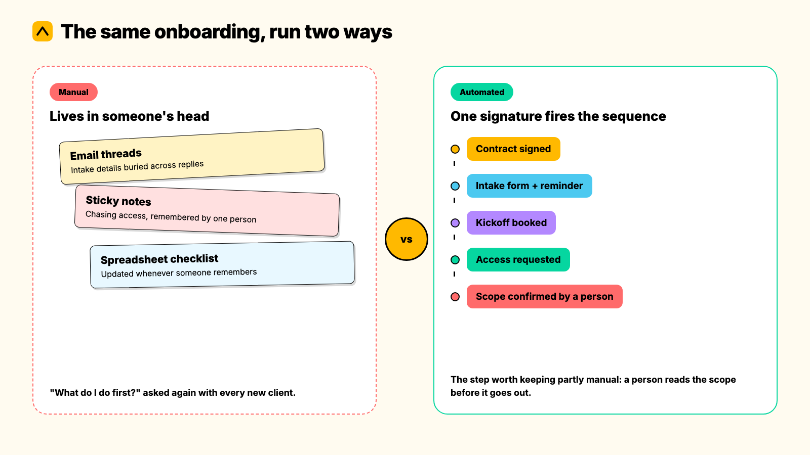
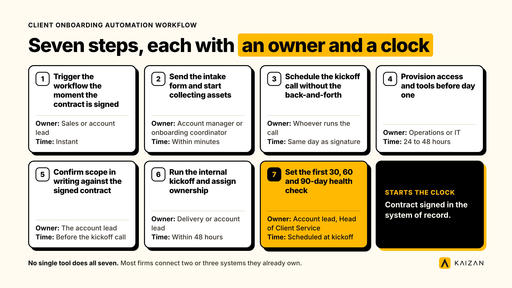
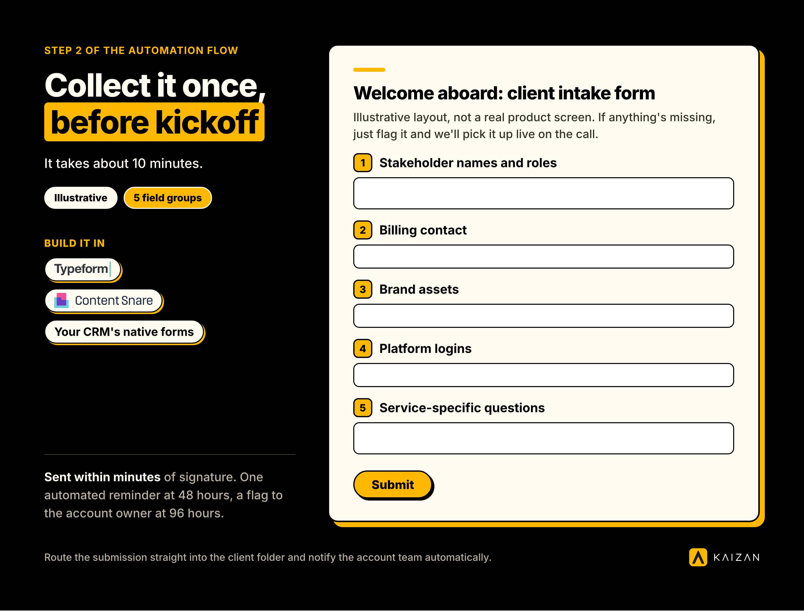

Automating client onboarding means using workflow tools and triggers, not more headcount, to handle the repeatable parts of bringing on a new client: sending the intake form, scheduling the kickoff, provisioning access, and confirming scope. The kickoff call, the scope conversation, and the first escalation stay with a person.

If you run a marketing agency, consultancy, or any professional services firm where a new client triggers the same dozen tasks every time, this guide gives you the actual customer onboarding automation workflow. Seven steps, who owns each one, how long it takes, the wording to copy, and what breaks if you automate the wrong part.

This is written for the person who owns the process (Head of Operations, COO) and the person who owns the relationship (Head of Client Service). Where the two want different things from client onboarding automation, we say so.

## When to automate client onboarding, and when not to

Customer onboarding automation earns its keep once you're bringing on more than one or two clients a month, or once onboarding touches more than three separate tools (CRM, contract, project management, shared drive). Below that volume, a good checklist and a diligent account manager will outperform a workflow nobody maintains.

Automate when:

- The same information gets collected the same way every time (billing details, brand assets, platform access, stakeholder names).
- A step currently depends on someone remembering to chase it.
- New account leads keep asking "what do I do first" because the process lives in one person's head.

Don't automate when:

- You haven't onboarded the same client type twice yet. Automating a process you've only run once locks in guesses, not a working method.
- The engagement is genuinely bespoke at the point of kickoff, a one-off project with a scope that will not repeat.

## The client onboarding automation workflow, step by step

Each step below names an owner and a time estimate, so it can be delegated rather than just read.

### Step 1: Trigger the workflow the moment the contract is signed

**Owner:** Sales or the account lead who closes the deal. **Time:** Instant, once set up.

The signed contract, not the handshake or the Slack message, should be what starts the clock. Connect your e-signature tool (DocuSign, PandaDoc) to your CRM so a completed signature creates the client record and fires the rest of the sequence automatically. Most CRMs (HubSpot, Salesforce) support this natively. Where they don't, Zapier or Make sits in between.

**Failure mode:** Sales closes the deal on a call and tells delivery "verbally." Nothing fires because nothing was signed in the system of record. Fix this by refusing to start delivery work until the trigger has fired, not when someone says it's fine.

### Step 2: Send the intake form and start collecting assets

**Owner:** Account manager or a dedicated onboarding coordinator. **Time:** Sent within minutes. Most clients return it within 48 to 72 hours with one automated reminder.

A branded intake form (Typeform, Content Snare, or your CRM's native forms) collects what you need before the kickoff call: stakeholder names and roles, the billing contact, brand assets, platform logins, and anything specific to the service line. Route the submission straight into the client folder and notify the account team automatically.

**Script to send with the form:**

> Welcome aboard. Before our kickoff call on [date], we need a few things from you so we can hit the ground running: [link to form]. It takes about 10 minutes. If anything's missing, just flag it and we'll pick it up live on the call.

**Failure mode:** The form goes out, nobody checks whether it came back, and the account manager finds out three days before kickoff that half the fields are blank. Automate the chase: a reminder at 48 hours, a flag to the account owner at 96 hours.

### Step 3: Schedule the kickoff call without the back-and-forth

**Owner:** Whoever will run the call. **Time:** Same day as signature.

Put a scheduling link (Calendly, HubSpot Meetings) inside the welcome email so the client books a slot that works for them, instead of trading five emails to find a time.

**Failure mode:** The scheduling link points to one person's calendar, and that person is on leave the week the client signs. Point the link at a team calendar or rotation, not an individual.

### Step 4: Provision access and tools before day one

**Owner:** Operations or IT. **Time:** Within 24 to 48 hours of signature.

Platform access (ad accounts, analytics, Search Console, shared drives) is the single most common reason onboarding stalls, because it depends on someone else granting permission. Automate the request the moment the contract fires: a templated access-request email to the client, a Google Drive or SharePoint folder created from a standard template, and the relevant internal tools (a Slack or Teams channel, a project board) spun up from a saved template rather than built from scratch.

**Failure mode:** Access is requested once, the client doesn't action it, and nobody notices until the kickoff call stalls on "we still can't see your account." Automate a reminder, not just the first ask.

### Step 5: Confirm scope in writing against the signed contract

**Owner:** The account lead. **Time:** Before the kickoff call, not during it.

Generate a one-page scope confirmation straight from the CRM's deal fields (tools like PandaDoc or Ignition can do this), so what the client agreed to in the sales process is what delivery is about to start on. This is the step most worth keeping partly manual: a person needs to read it before it goes out, because this is where scope creep either gets caught early or gets baked in.

**Failure mode:** Sales and delivery worked from two different versions of what was agreed. The scope confirmation is what surfaces the gap before the first invoice, not after.

### Step 6: Run the internal kickoff and assign ownership

**Owner:** Delivery or account lead. **Time:** Within 48 hours of signature, ahead of the client kickoff.

Before the client ever sees a deliverable, the internal team needs a kickoff of its own: who owns what, what the first 30 days look like, and what "done" means for the first milestone. Auto-populate the task board (Asana, ClickUp, Monday) from a saved project template so this doesn't start from a blank page every time.

**Failure mode:** The client kickoff happens before the internal one, so the team is improvising ownership live on the call. Always run the internal kickoff first.

### Step 7: Set the first 30, 60 and 90-day health check

**Owner:** Account lead, with the Head of Client Service tracking the portfolio view. **Time:** Scheduled at kickoff, not after.

Put the 30, 60 and 90-day review dates in the calendar during kickoff week, not when someone remembers in month two. This is also the point to start tracking relationship health from day one, rather than waiting for the first QBR to find out how the client actually feels. We score this against an evidence-based client health standard rather than gut feel, because the first 90 days are when a client decides whether the switch was worth it, and that is exactly when nobody is looking yet.

**Failure mode:** Health gets checked for the first time at the three-month renewal conversation, which is too late to do anything about what it finds.

## The tools behind each step

| Step | Job | Example tools |
| --- | --- | --- |
| 1. Trigger | Contract signed fires the sequence | DocuSign, PandaDoc, HubSpot or Salesforce workflows, Zapier, Make |
| 2. Intake | Collect client information once | Typeform, Content Snare, native CRM forms |
| 3. Scheduling | Book the kickoff without email ping-pong | Calendly, HubSpot Meetings |
| 4. Access | Provision logins, folders and channels | Zapier or Make for folder creation, Slack or Teams channel templates |
| 5. Scope | Confirm scope against the contract | PandaDoc, Ignition |
| 6. Internal kickoff | Populate the project board from a template | Asana, ClickUp, Monday |
| 7. Health check | Track relationship health from day one | [Kaizan](https://www.kaizan.ai/us/product/), calendar automation for the 30/60/90 review cadence |

No single tool does all seven. Most firms connect two or three systems they already own with Zapier or Make, rather than buying a new platform for onboarding alone. If onboarding is the only thing you're automating, start there before you shop for a dedicated onboarding platform.

## A worked example (illustrative)

The firm below is a composite, built to show how the seven steps run together. It is not a named client.

A 40-person performance marketing agency signs a $12,000-a-month retainer. The contract is signed in DocuSign on a Tuesday afternoon. Within two minutes, a webhook creates the client record in HubSpot, which fires the welcome email with the intake form and a Calendly link. By Wednesday morning, the client has booked Friday for kickoff and returned the intake form missing only the ad account access, which an automated reminder catches at the 48-hour mark.

Thursday, operations spins up the Slack channel and the ClickUp project from a template, and the account lead reviews the auto-generated scope confirmation against the original proposal, catching one line item sales had promised verbally that wasn't in the contract. That gets resolved before the client ever sees it. The internal kickoff happens Thursday afternoon. The client kickoff runs Friday with the whole team aligned on ownership. The 30, 60 and 90-day reviews go into the calendar before anyone leaves that call.

Where it broke down in an earlier, pre-automation version of this same agency: access requests went out once and were never followed up, so the account team spent the first two weeks unable to see the ad accounts they were meant to be managing, and the client's first impression was that the agency "didn't seem ready."

## Scripts and templates to copy

**Welcome and intake email:**

> Welcome to [agency]. We're looking forward to getting started. To make sure your kickoff call is useful rather than a fact-finding mission, please complete this short form before then: [link]. We'll also need access to [platforms] so our team can start day one with full visibility. If you can grant access by [date], we'll be ready to go.

**Access request follow-up (sent automatically at 48 hours):**

> Quick follow-up: we haven't seen access to [platform] come through yet. Here's a 2-minute guide to granting it: [link]. Let us know if you've hit a snag and we'll jump on a call.

**30-day check-in:**

> You're one month in with [agency]. Before we move into [next phase], we want to check in: what's working, what isn't, and anything we should adjust before quarter two. Fifteen minutes, whenever suits.

## What to automate, and what must stay human

Automate the admin: intake forms, access requests, folder and channel creation, scheduling, reminders, and populating the project board from a template. None of it needs a person's judgment, and all of it stalls when it depends on someone remembering.

Keep three things human, always:

- **The kickoff call itself.** A client's first real conversation with the team delivering the work should never be with a bot.
- **The scope conversation.** This is where ambiguity either gets resolved or gets buried. Automating the document that triggers the conversation is fine. Automating the conversation itself is not.
- **The first escalation.** The moment something goes wrong in the first 90 days decides how the client reads every future problem. That needs a person who can adapt, not a templated reply.

## How to tell whether it worked

Track these from the first week, not after a quarter:

- **Time from signature to first deliverable.** This is the number that tells you whether onboarding is actually faster, not just busier-looking.
- **Intake form completion rate within 48 hours.** A falling completion rate usually means the form is too long, or asks for things the client doesn't have to hand yet.
- **Number of separate tools the account team has to open to onboard one client.** If this is climbing, the automation is adding steps rather than removing them.
- **30-day health score**, tracked from kickoff rather than guessed at renewal.

For scale, Gainsight's 2025 Customer Success Index found that teams using AI-assisted onboarding automation spent an average of 2.4 hours of manual admin per new account, against 8.7 hours for teams without it. Treat that gap as directional rather than a guarantee: the study covers customer success teams broadly, not professional services firms specifically, and your own baseline is the number that actually matters. One operator's internal log of 63 client automations found the same pattern from the other direction: the steps that saved the most time were the unglamorous ones (chasing documents, creating folders, validating form fields), not the welcome sequence everyone automates first.

## Common pitfalls

**Automating a process you haven't fixed yet.** Automation locks in whatever you had, including the parts that were broken. Run the process manually, twice, write down what actually happens, not what the org chart says happens, then automate that.

**One workflow for every client.** A $2,000-a-month client and a $50,000-a-month enterprise account do not need the same onboarding sequence. Branch the workflow by account tier or complexity, even if it's just a simple fork at step one.

**No single owner.** When a step stalls, someone needs to see it and act, not assume someone else is on it. Every step in this guide has a named owner for exactly this reason.

**Treating "sent" as "done."** An intake form that was sent but never completed, or an access request that went unanswered, looks identical to a finished step in most dashboards unless you build in a check. Automate the follow-up, not just the first ask.

**No way to tell if it's working.** If nobody is tracking time-to-first-deliverable or completion rates, you won't know whether the automation helped until a client complains that onboarding felt slow, and that is one piece of feedback you can no longer act on.

## Frequently asked questions

**How do you automate the client onboarding process?**
Automating client onboarding means using workflow tools and triggers, not more headcount, to handle the repeatable parts of bringing on a new client: sending the intake form, scheduling the kickoff, provisioning access, and confirming scope. The kickoff call, the scope conversation, and the first escalation stay with a person.

**How long does it take to set up client onboarding automation?**
Most firms can connect two or three existing tools (CRM, e-signature, scheduling) with Zapier or Make in a few days. A fuller sequence covering all seven steps above, including templates and branching by account tier, typically takes two to four weeks to build and test properly.

**Who should own client onboarding automation?**
Operations or the Head of Client Service should own the workflow itself, since it touches process design and tooling. Each individual step still needs a named owner (sales, account lead, delivery, IT), so the workflow has one accountable person overall and a clear owner for every step inside it.

**What if the client ignores the intake form or access request?**
Build in an automatic reminder at 48 hours and a flag to the account owner at 96 hours, so a person steps in before the kickoff call is at risk. Automation should surface the problem early, not solve it by itself. From there, it's a conversation, not a bot's job.

**How do we know the automation actually worked?**
Track time from signature to first deliverable, intake completion rate within 48 hours, and a 30-day health score from kickoff. If those move in the right direction, and the account team touches fewer separate tools to get a client live, it's working.

**What should we automate first?**
Start with the step that depends most on someone remembering to do it, usually access provisioning or intake chasing, not the welcome email everyone automates first because it's easiest. The least glamorous steps save the most actual time.

---

Firms that automate the admin side of client onboarding free up the exact hours client teams need for the parts that matter: the kickoff call, the first real conversation about what success looks like, and catching the first sign that something's off before it becomes a renewal problem. [Kaizan](https://www.kaizan.ai/us/) clients see an average 26%+ revenue increase per client and get 5.4 hours back per person every week, time that used to go on the admin this guide just showed you how to remove. [Book a demo](https://www.kaizan.ai/us/pricing/) to see what a day-one health check looks like on your own accounts.
