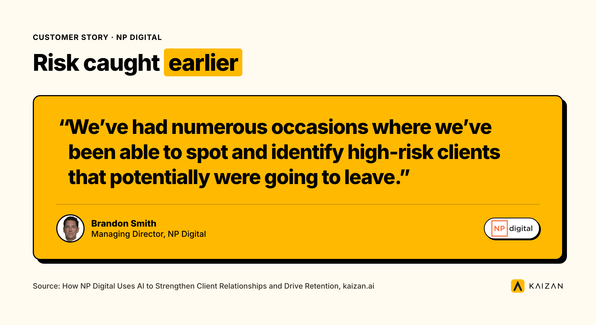
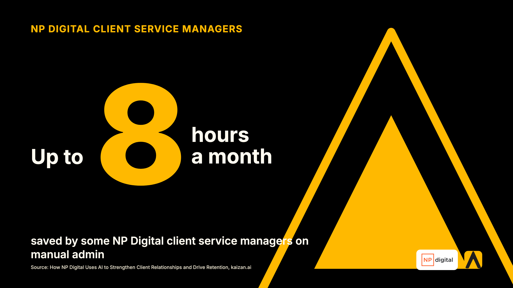
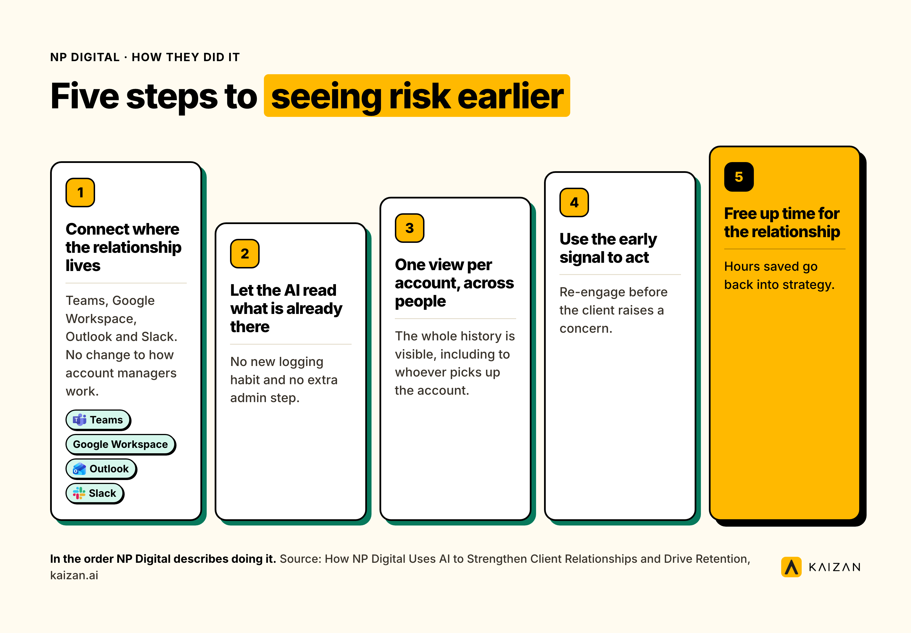

NP Digital's Brandon Smith, Managing Director, on why the clients who leave rarely leave without warning, and what changed once his team could see the warning.

Most agencies find out a client is unhappy in the worst possible meeting. NP Digital, a global performance marketing agency running SEO, paid media and content programmes across multiple markets, used to find out the same way. Brandon Smith, Managing Director, described the problem plainly:

> There are conversations taking place across so many platforms that we don't really have visibility over the health of a client.

This is the story of what NP Digital changed, what it actually took, and what any agency can copy this week, whether or not Kaizan is the tool they pick.

## The Customer Retention Situation, And Why It Happens

NP Digital's client communication was spread across Teams, Google Workspace, Outlook and Slack, with several people often working the same account. Each person held a piece of the relationship. Nobody held the whole picture.

This is not an NP Digital problem. It is what happens to any agency once a client relationship grows past one account lead and one inbox. The risk signals are usually there. They just arrive in scattered customer interactions, with customer data spread across channels nobody is rolling up.

Kaizan's own benchmark research across its client base backs this up, separate from NP Digital's own results: accounts that are quietly struggling almost always say so first. About 69% of struggling accounts surface a warning sign in conversation at least once, and about 38% surface the same warning sign repeatedly across more than one period, before anyone acts on it. Struggling accounts are not silent. They are already telling someone. The problem is whether anyone is listening across every channel at once, not whether the client is being honest. *(Kaizan, The Client Service Benchmark 2026, Vol. 01, Finding 06 — a portfolio-wide benchmark, not an NP Digital-specific figure.)* This fragmented view makes customer retention harder and can increase customer churn before teams see the full picture.

For NP Digital, that meant real risk sitting in individual inboxes and call notes, invisible at the account level until it became a retention conversation nobody wanted to have.

## What Changed In Customer Retention Software

Since putting Kaizan's client intelligence layer across its communication, NP Digital's client teams report three concrete shifts, in Smith's own words and in the language of the people doing the work day to day:

- **Time back.** Some client service managers save up to eight hours a month that used to go into documenting calls, re-reading old threads and manually assessing account health.
- **One view of every relationship.** Emails, meetings and messages across platforms are now read as one account history instead of several disconnected ones.
- **Risk caught earlier.** The team has repeatedly spotted high-risk clients that were heading towards leaving, while there was still time to act.

> We've had numerous occasions where we've been able to spot and identify high-risk clients that potentially were going to leave.
>
> — Brandon Smith, Managing Director, NP Digital

For leadership, the number that matters sits one step upstream of any individual save: every retained retainer is revenue that doesn't have to be replaced through new business, at a far lower cost than winning it back. That's the business case underneath “we caught it earlier,” because retaining existing customers is typically more efficient than replacing them and also protects future repeat business, and it's the reason Smith frames this as a company-wide priority rather than an account-services tool.

To be direct about what this is and is not: NP Digital has not yet published a hard retention percentage, nor a measured lead time between a risk signal appearing and a client raising it formally. What they have published, and what Smith is on record saying, is that the team now catches risk it previously missed, protects time that goes back into strategy, and treats retention as something they manage ahead of the renewal conversation rather than during it. These are the kinds of key metrics or customer retention metrics teams ultimately want software to improve, not just report. We'd rather tell you that plainly than round an anecdote into a number it cannot yet support. We've asked NP Digital for the harder numbers for a future update.

What's more defensible, and separate from NP Digital's own numbers, is the pattern across Kaizan's client base: accounts with more visible account team activity surface more than twice as many risk signals as struggling accounts with less visibility, 15.3 per account per year against 6.9. *(Kaizan, The Client Service Benchmark 2026, Vol. 01, Finding 07 — same caveat: portfolio-wide benchmark, not NP Digital's own number.)* More visibility does not mean more problems. It means the problems that were always there stop hiding, and helps teams identify trends earlier across accounts.

## How They Did It

NP Digital's approach, in the order they describe doing it:

1. **Connected the platforms the client relationship actually lives in.** Teams, Google Workspace, Outlook and Slack, so the setup fit NP Digital's **existing tech stack** and showed how **customer retention software integrate** with the tools teams already use, rather than asking account managers to change how they already work.
2. **Let the AI read what was already there.** No new logging habit, no extra admin step. The signal came from everyday communication the team was having anyway, helping surface **user behaviour** and **customer behaviour** cues that would otherwise stay buried in notes.
3. **Gave every account a single view, across people.** Instead of one account manager's memory of a client, the whole history became visible to whoever needed it, including when someone new picked up the account. In practice, that made it closer to **customer relationship management** and a usable **customer retention platform** for shared visibility.
4. **Used the early signal as a prompt to act, not just to know.** Spotting a high-risk account only matters if someone changes what they do next. NP Digital's teams used the visibility to re-engage and **identify at risk customers** before the client raised a concern themselves.
5. **Freed up time to spend on the relationship, not the admin around it.** The hours saved on manual tracking and light **workflow automation** went back into strategy, which is the work that actually keeps a client.

## What The Team Said

Brandon Smith's framing of why this matters to the business, not just to the account team, and to a stronger **customer success** approach that supports better **customer relationships**:

> We see AI as critical to the future of our business, not just across client servicing, but across every facet of the business.

> Client retention is one of the key areas. The ability to identify where we've got high-risk clients or an opportunity to get things back on track.

> This gives time back to the teams to focus on strategy, and that's the most important thing in a healthy client relationship.

The pattern shows up the same way outside NP Digital. A COO at another Kaizan client agency put it this way:

> We're trying to be proactive in predicting which clients might be a churn risk. And [this] is a huge part of helping to identify that.
>
> — COO, Agency Client A

And a Head of International Client Team at a different agency, on what changed for a team managing accounts across several markets:

> I have a pretty good view now of what is happening on our clients everywhere, and can spot things when things are not working as expected, or when things are going really well, in a much earlier way.
>
> — Head of International Client Team, Agency Client B

That kind of visibility helps **customer success teams** spot risk earlier and **improve customer relationships** before renewal pressure builds.

## What Was Hard About Customer Retention Metrics

The honest part: visibility is not the same as a guaranteed save. Surfacing a risk signal earlier can help businesses reduce customer churn, but only when someone with the right relationship acts on it in time, and not every signal arrives with enough runway to fix the problem. NP Digital's own account, like any agency's, still depends on an account lead choosing to pick up the phone once the signal appears. The tool does not make that call. It makes sure the call gets made with more notice than before.

The other honest part: this took giving up on individual memory as the system of record. For a team used to “I'll remember what that client said,” moving to a shared, always-current view is a change in habit as much as a change in tooling, and it pushed the team towards customer retention management as an operating discipline, not just a client services initiative.

## What To Copy

Whether or not Kaizan is the route you take, choosing the right customer retention software or the right customer retention platform for your team’s needs starts with four things from NP Digital's approach that are worth copying this week:

- **Map where your client conversations actually happen** across the customer journey, including the channels where account conversations and support touchpoints happen, before you decide what to fix.
- **Stop relying on one person's memory as your system of record** for any account with more than one person touching it.
- **Treat a recurring concern raised in conversation or direct customer feedback as a formal risk signal** and use it to shape retention strategies, even if it never makes it into your CRM.
- **Pair any early-warning signal with a named owner and a next step**, because named ownership is what turns visibility into real customer retention efforts.

Many customer retention tools can support these steps, but the best customer retention software depends on where churn appears first.

NP Digital's story shows what changes when an agency can see risk before the client raises it. If you want to see what that looks like on your own book of accounts, [book a demo](mailto:hello@kaizan.ai).

## Customer Feedback: Frequently Asked Questions

**What changed for NP Digital, in numbers?** NP Digital has published qualitative results: client service managers save up to eight hours a month on manual admin, and the team has repeatedly identified high-risk clients before they left. NP Digital has not yet published a specific retention percentage or a measured lead time between a risk signal appearing and a client raising it formally. A future update may also show the harder number many readers expect: **customer retention rate**.

**How long did it take to see this?** NP Digital describes this as an ongoing shift in how the team works day to day, not a one-time project with a fixed end date. The time savings and earlier risk identification were reported as results of normal use, not a pilot period, and with **client retention software** those early signs often appear in operations before full **retention metrics** are published.

**What did the team have to change?** The biggest change was moving away from individual account managers holding the relationship in memory and towards a shared, always-current view that the whole team, and new people joining an account, could use from day one. That shared visibility also helps protect **customer experience** and maintain **customer support** continuity when new people join an account.

**What would they do differently?** Based on Smith's comments, the clearest lesson is treating this as business-critical rather than a client services tool: NP Digital frames AI as central to “every facet” of the business, not a point solution for one team, which helps explain why **customer retention software matters** beyond one team.

*All NP Digital quotes are reused, with attribution, from the published case study* [*How NP Digital Uses AI to Strengthen Client Relationships and Drive Retention*](https://kaizan.ai/blog/client-health/np-digital-ai-client-retention/) *on* [*kaizan.ai*](https://kaizan.ai/)*.*

[← More in Client health](https://kaizan.ai/blog/client-health/) · [All posts](https://kaizan.ai/blog/)
