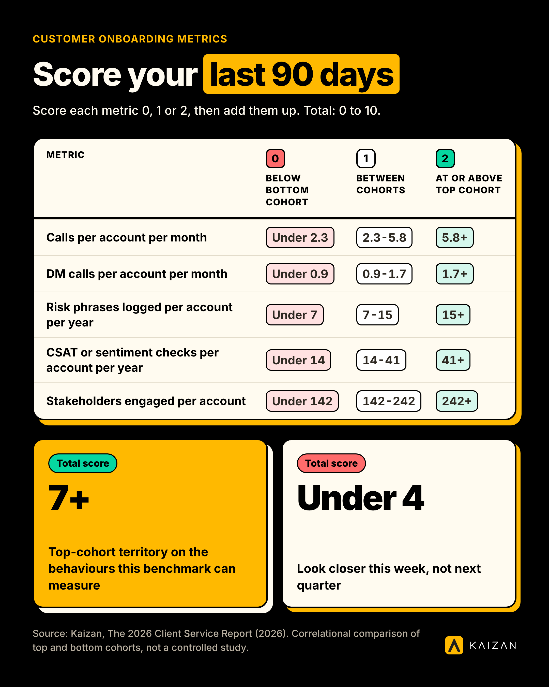

Customer onboarding metrics are the handful of early cadence and coverage numbers, contact frequency with decision-makers, account-level call volume, how often risk gets surfaced, how often sentiment gets measured, that separate accounts heading toward growth from accounts heading toward churn. In Kaizan's own data, the gap between the two groups opens in the first months of a relationship and rarely closes on its own.

**Five findings worth acting on**

- **Coverage isn't the gap, frequency is.** Top and bottom-performing accounts reach almost the same share of the decision-makers they've identified (52.7% vs 50.0%). Top accounts just call them 1.81x more often and email them 2.06x more often.
- **Account-level call cadence runs 2.5x higher on top accounts** (5.8 calls a month vs 2.3), and the pattern holds at the individual account manager level too (1.84x more calls, 1.47x more emails per year, with portfolio size and talk-time share held equal).
- **Top accounts surface 2.21x more risk** in conversation (15.3 risk phrases a year vs 6.9). A quiet risk log isn't a sign of a healthy account. It's usually a sign nobody's listening closely enough yet.
- **The CSAT gap most reports describe is a measurement-frequency gap, not a satisfaction gap.** Where sentiment is actually measured, top and bottom cohorts score identically (7.1 out of 10). Top accounts just get measured 2.93x more often (41 times a year vs 14).
- **Stakeholder count and inbound activity scale together, not separately.** Top accounts engage 1.71x more stakeholders and generate 2.91x more client-initiated email threads, while the ratio of clients to internal team members holds identical across both groups (9.12).


## Method

The figures below come from [Kaizan's 2026 Client Service Report](https://www.kaizan.ai/us/resources/white-paper/), drawn from over 1 million anonymised client-service calls, 10 million emails and thousands of chat messages, analysed across a 12-month period. The accounts in the sample are agency and professional-services clients using Kaizan.

**Cohort definition.** "Top cohort" and "bottom cohort" are the accounts with the highest and lowest CSAT and revenue growth in the sample, not a fixed day-90 cut of new logos. We don't yet have a published breakout that isolates behaviour in the first 90 days specifically from behaviour later in a mature relationship, so what follows should be read as: these are the customer onboarding metrics that separate growing, satisfied relationships from shrinking, dissatisfied ones, and the pattern is visible, and actionable, from the first weeks of a new account onward.

**What this is not.** This is a correlational comparison, not a controlled study. It tells you what top and bottom-performing accounts look like side by side, not that doing X in week one causes Y a year later. We also don't have a segmented cut of this data by firm size, service line or account tier, only the two-cohort comparison above. If you're building a tiering model and need that cut, it's the single most useful addition we could make to this page.

One more honesty note: the underlying report carries an internal inconsistency on one figure (how many struggling accounts show warning signs before they're lost), which we flag plainly in the benchmark table below rather than quietly picking the more flattering number.

## The benchmark in full

| Customer onboarding metric | Bottom cohort | Top cohort | Gap |
| --- | --- | --- | --- |
| Calls per account per month | 2.3 | 5.8 | 2.5x |
| Decision-maker calls per account per month | 0.92 | 1.67 | 1.81x |
| Decision-maker emails per account per month | 22.1 | 45.7 | 2.06x |
| Decision-maker coverage (share of defined DMs reached) | 50.0% | 52.7% | ~1.05x (flat) |
| Risk phrases surfaced per account per year | 6.9 | 15.3 | 2.21x |
| CSAT measurements per account per year | 14 | 41 | 2.93x |
| CSAT score, where measured | 7.1 / 10 | 7.1 / 10 | 1.0x (no gap) |
| Commercial/financial conversation share | 8.3% | 12.9% | +4.6pp |
| Client stakeholders engaged per account | 142 | 242 | 1.71x |
| Client-initiated email threads per account per year | 186 | 541 | 2.91x |
| Client-to-internal-team ratio | 9.12 | 9.12 | 1.0x (no gap) |

Two rows are flat on purpose. Decision-maker coverage and the client-to-team ratio don't move between cohorts, and that's as important as the rows that do: it tells you where more effort won't help (breadth, headcount) and where it will (frequency, cadence).

On warning signs specifically: across the bottom cohort, about 69% of struggling accounts surfaced a risk signal in conversation at least once before the relationship soured, and about 38% surfaced the same signal repeatedly across multiple periods. Both numbers are real; they answer different questions (at-least-once vs recurring), and the source report states them inconsistently in two places. We'd treat the recurring 38% as the more useful one to act on: a risk that comes back is the one worth escalating.

## How to compare yourself

You don't need Kaizan's dataset to run this on your own book. Pull the last 90 days for a handful of accounts and work out:

```
DM contact frequency = (DM calls + DM emails in the period) / (weeks in the period)
Risk-surfacing rate = risk or concern mentions logged / account-months covered
CSAT measurement rate = sentiment or satisfaction checks run / account-months covered
```

**Worked example.** An account with 2 decision-maker calls and 6 decision-maker emails over a 12-week quarter: (2 + 6) / 12 = 0.67 DM touches a week, in the same range as the bottom cohort's 0.92 calls + several emails a month. That account is under-contacted relative to the top-cohort pattern above, not because nobody knows who the decision-maker is, but because nobody's reaching them often enough.

**Self-scoring table.** Score each metric 0, 1 or 2 against your own last 90 days, then add them up.

| Metric | 0: below bottom-cohort level | 1: between cohorts | 2: at or above top-cohort level |
| --- | --- | --- | --- |
| Calls per account per month | Under 2.3 | 2.3-5.8 | 5.8+ |
| DM calls per account per month | Under 0.9 | 0.9-1.7 | 1.7+ |
| Risk phrases logged per account per year | Under 7 | 7-15 | 15+ |
| CSAT or sentiment checks per account per year | Under 14 | 14-41 | 41+ |
| Stakeholders engaged per account | Under 142 | 142-242 | 242+ |



A score of 7 or more across the five rows puts an account in top-cohort territory on the behaviours this benchmark can actually measure. Anything under 4 is worth a closer look this week, not next quarter.

## What separates the top quartile

Not a different strategy. More of the same one, run more often, by more people, on more of the stakeholders already on the map.

- **Frequency over breadth.** Top accounts don't know more decision-makers. They talk to the same decision-makers more often. If your stakeholder map already names the right people, the fix isn't a bigger map, it's a contact-frequency target against the names already on it.
- **Consistency over cleverness.** The account-manager-level finding holds portfolio size, email-to-call ratio and talk-time share equal across cohorts, and the gap is still 1.84x on calls and 1.47x on emails. Top performers aren't finding a smarter angle into the account. They're showing up more.
- **Logged risk, not absent risk.** A rising risk count looks alarming out of context. In this data it's the opposite signal: accounts that talk about risk openly are the accounts getting ahead of it. The one to worry about is the account where nobody's logged a concern in months.
- **Measurement cadence, not measurement optimism.** CSAT itself isn't the lever. How often you check it is. An account you haven't surveyed since kickoff isn't necessarily fine, it's unmeasured, and those are different problems with different fixes.
- **Scale the relationship, not the headcount.** The client-to-team ratio holding flat at 9.12 across cohorts, while stakeholder count and client-initiated threads both climb, says coverage grows with the relationship rather than needing a structural change. A Head of International Client Team at one agency client put the operator version of this plainly when asked how the firm spots at-risk accounts early:

> "You can get a very good feedback from an account manager on what's happening. You get their view. If something is not going so well, they might not want to tell you... You can see a bit more objective what is working, what is not working."
>
> — Head of International Client Team, Agency Client A

## What to do if you're below the benchmark

Prioritised in the order the data suggests they'll move the needle fastest.

1. **Set a contact-frequency target per decision-maker, not a coverage target.** You likely already have the right names. Put a number next to each one (every two weeks for the budget holder, monthly for the rest) and track it against actual contact, not against whether they're in the stakeholder map at all.
2. **Raise call cadence before you raise headcount.** The AM-level finding above holds portfolio size constant and still finds a 1.84x gap. Before adding people to a struggling account, check whether the people already on it are simply under-calling and under-emailing it relative to its size.
3. **Treat a quiet risk log as a red flag, not a green light.** If nobody's logged a concern on an account in the last month, don't read that as health. Ask the account team directly what's gone unsaid.
4. **Measure sentiment on a schedule, not when something feels off.** Moving from roughly once a quarter to something closer to weekly or fortnightly is the single biggest lever in this dataset, 2.93x, and it costs nothing but discipline.
5. **Widen stakeholder engagement in proportion to the relationship, not the org chart.** As an account grows, let the number of people you're in contact with grow with it, rather than staying anchored to the one or two contacts from kickoff.

A COO at one agency client, describing why this kind of signal-watching matters operationally rather than just analytically:

> "We're trying to be proactive in predicting which clients might be a churn risk."
>
> — COO, Agency Client B

**Citation:** Kaizan, *The 2026 Client Service Report* (2026), drawn from 1M+ anonymised client-service calls, 10M+ emails and thousands of chat messages across a 12-month period. Full report and method: [kaizan.ai/resources/white-paper](https://www.kaizan.ai/us/resources/white-paper/).

If you're building your own client health view rather than benchmarking against ours, Kaizan's [CARE model](https://www.kaizan.ai/us/product/) scores exactly these behaviours, decision-maker recency, contact cadence, risk-mention trend, measurement frequency, automatically from call and email data, rather than asking an account team to log them by hand.

## Frequently asked questions

**What's a good number for these customer onboarding metrics?**
Roughly 5-6 calls per account per month, 1.5-2 decision-maker calls a month, 15+ risk phrases logged a year, and sentiment checked 3-4 times a quarter puts an account in top-cohort territory on Kaizan's benchmark. Below half those levels is worth a closer look.

**How was this measured?**
Across 1M+ anonymised client-service calls, 10M+ emails and thousands of chat messages over a 12-month period, comparing the accounts with the highest CSAT and revenue growth against those with the lowest. Full method above.

**How do I compare my firm?**
Pull 90 days of call and email records for a sample of accounts, calculate decision-maker contact frequency, risk-surfacing rate and CSAT-measurement rate using the formulas above, and score each against the self-scoring table.

**What separates the top quartile?**
Frequency, not breadth: the same decision-makers contacted more often, the same account managers calling and emailing more consistently, risk raised openly rather than left unlogged, and sentiment measured on a schedule rather than only when something feels wrong.

**Can I cite this?**
Yes. Cite it as Kaizan, *The 2026 Client Service Report* (2026), with a link to [kaizan.ai/resources/white-paper](https://www.kaizan.ai/us/resources/white-paper/).
