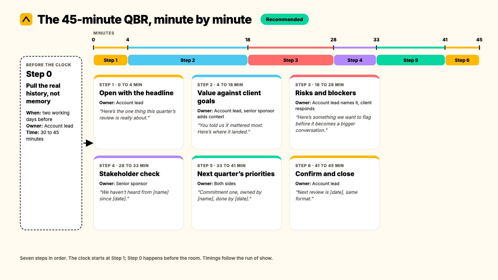

A quarterly business review format only earns its place on the calendar if it survives contact with a real account. This is the version built to survive it: a 45-minute run of show with a named owner, a script and a failure mode for every step, built for a Head of Client Service running a full tier of accounts, not a 90-minute SaaS template borrowed from a customer success playbook.

> **The quarterly business review format that works for most agency accounts runs 45 minutes:** a 4-minute headline, 14 minutes on value delivered against goals, 10 minutes on risks and stakeholder coverage, 8 minutes on next-quarter commitments, and a close that locks owners, dates and the next review date before anyone leaves the room.

This builds on the five components of a QBR and the 30-minute version covered in [what a QBR actually is](https://www.kaizan.ai/us/). If you haven't settled that question yet, start there. Everything below assumes you already know why you're running the meeting and need the format itself: the minute-by-minute agenda, who speaks when, the exact wording to use, and what to do when a step goes wrong.

**Key takeaways**

- A 45-minute quarterly business review format fits most mid-tier agency accounts: long enough to cover risk and stakeholder coverage properly, short enough to run monthly without eating a full afternoon.
- Every step below has an owner, a time box and a script. A QBR agenda with no owner on a step is the single most common reason reviews drift into an unscripted status update.
- The prep (Step 0) happens before the clock starts. A qbr format built from memory or a monthly spreadsheet misses exactly the signal a format built from the real call and email history catches.
- Three numbers tell you whether the format is working: decision-maker attendance, action closure between reviews, and how often the meeting actually holds to 45 minutes.

## When the 45-minute format fits, and when it doesn't

Not every account needs this exact shape. Use the 45-minute quarterly business review format when an account has grown past one deliverables list but hasn't yet earned the executive-level time of a full Executive Business Review. In practice, that's most mid-tier retained accounts: big enough that a status email isn't enough, not yet big enough to justify 60 to 90 minutes of a client's VP's calendar every quarter.

Stretch to 60 minutes for your top-tier accounts, where the stakes and the stakeholder count both justify the extra time. Compress to 20 minutes for your smallest retained accounts, where a 45-minute format would be over-serving the relationship relative to its size. The mistake isn't picking the wrong number of minutes. It's running one format for every account out of habit, rather than matching the format to what the account actually needs this quarter.

## The 45-minute run of show, step by step

Seven steps, in order. The clock starts at Step 1. Step 0 happens before the room.



### Step 0: Pull the real history, not memory

**When:** Two working days before the review, not the 45 minutes itself.

**Owner:** Account lead.

**Time:** 30 to 45 minutes.

What to do: pull every call and email since the last review, not just what made it into last month's status report. Specifically check for two things Kaizan's benchmark research flags as the clearest markers of a strong account team, because both are answerable yes or no at the call level: did the last few calls name the client's own stated goal, and did anyone bring outside context the client didn't already have, a competitor move, a sector shift, something from outside their own four walls. Teams that do this consistently see it roughly 1.4 times and 20 times more often respectively than teams that don't. *(Kaizan, The Client Service Benchmark 2026, Vol. 01, Finding 02, a portfolio-wide benchmark, not a guarantee for any one account.)*

**Script, the pre-read email, sent the same day:**

```text
Subject: [Client] quarterly review, [date], agenda attached

Hi [name],

Agenda for Thursday attached. Three things on it: where we've landed against [specific goal from their own language], one thing we want to flag before it becomes a problem, and what we'd propose for next quarter.

Anything you'd want added before we meet?
```

An account lead at one agency we work with, Agency Client D, described exactly what this step catches, from their own team's shift to pulling supplier and partner conversations into the same review process:

> "When you're having a call with [a media partner] and you want to know what they pitched three months ago, that's what saves us the most time. We couldn't do that before."
>
> — Account Lead, Agency Client D

**Failure mode:** building the deck from memory or last month's RAG spreadsheet. This is the single most common reason a QBR repeats the same surface-level update every quarter: nobody went back through three months of calls and emails to find what actually changed.

### Step 1: Open with the headline, not a recap (0 to 4 minutes)

**Owner:** Account lead.

**Script:** "Before we go through the detail, here's the one thing this quarter's review is really about: [headline]. We'll get to everything else, but that's the thing I want us both walking out having agreed on."

**Failure mode:** opening with "so, last time we talked about..." turns the next four minutes into a recap of the last meeting instead of a frame for this one. The client checks out before the content starts.

### Step 2: Value delivered against the client's goals (4 to 18 minutes)

**Owner:** Account lead presents, senior sponsor adds context where useful.

This is where most of the room's attention should go, and it's the single biggest difference between a quarterly business review format that lands and one that reads as a vendor update. An activity log says what your team did. A goals review says what the client asked for and how close you've got to it, in their language, not yours.

**Script, the framing line that opens this block:** "You told us [X] mattered most this quarter. Here's where it landed, and here's what moved it."

**Failure mode:** a deliverables list dressed up as a goals review. If the client could have written the slide themselves from your invoice, it isn't evidence of value, it's a receipt.

### Step 3: Risks and blockers, named before the client names them (18 to 28 minutes)

**Owner:** Account lead names the risk, client responds.

If your QBR agenda has never once included a risk your own team raised first, that's not a sign of a clean account. Kaizan's benchmark data shows the strongest accounts actually surface roughly 2.2 times more risk signals in conversation than struggling ones, not fewer, because the relationship has enough depth for the client to say the quiet part out loud. *(Kaizan, The Client Service Benchmark 2026, Vol. 01, Finding 07.)* Silence in this section is the warning sign, not the absence of one.

**Script:** "Here's something we want to flag before it becomes a bigger conversation: [specific risk]. We'd rather raise it now, with a plan, than have you raise it with us in three months."

**Failure mode:** treating this as open Q&A instead of a scripted line. If the client has to raise the concern first, the section has failed its one job.

### Step 4: Stakeholder and relationship check (28 to 33 minutes)

**Owner:** Senior sponsor.

Check who's actually been in the conversation this quarter, on both sides, against who should be. A QBR is one of the few moments that guarantees contact with a decision-maker at all, for accounts where day-to-day contact has quietly drifted down to one junior person on each side. Kaizan's benchmark found the gap between the strongest and weakest accounts here is rarely about how many decision-makers get mapped. Both groups map roughly the same share. The gap is frequency: the strongest accounts simply get in front of that person far more often. *(Kaizan, The Client Service Benchmark 2026, Vol. 01, Finding 03.)*

**Script:** "We haven't heard from [name] since [date]. Is that still the right person for this, and is there anyone we should be looping in who isn't on this call?"

**Failure mode:** nobody asks this question until the account is already single-threaded and the one contact who held the whole relationship has left.

### Step 5: Next quarter's priorities and commitments (33 to 41 minutes)

**Owner:** Both sides, named jointly in the room.

Close with two or three commitments, each with a named owner and a date, not a general sense of direction. An expansion conversation belongs here, and only here, and only if the first three sections gave you a genuine, earned opening for it. Pushing growth into a relationship that's still shaky on trust or satisfaction reads to the client as exactly the wrong moment to be asked for more budget.

**Script:** "So for next quarter: [commitment one], owned by [name], done by [date]. [Commitment two], owned by [name], by [date]. Anything we've missed?"

**Failure mode:** "we'll look into it" with no name and no date attached. That's a conversation, not a commitment, and it's the single biggest predictor of a QBR agenda that repeats the same unresolved item next quarter.

### Step 6: Confirm, close, lock the next date (41 to 45 minutes)

**Owner:** Account lead.

**Script:** "To confirm: [read the two or three commitments back, with owner and date on each]. Next review is [date], same format. Anything either of us should flag before then, don't wait, just send it over."

**Failure mode:** ending without reading the actions back out loud. Commitments that only exist in a slide nobody reopens are commitments that quietly stop existing by the time the next review comes around.

## Minute by minute: a worked example

This is a composite account, built from patterns that repeat across agency relationships, not one named client.

A 40-person B2B agency runs this exact quarterly business review format with a mid-market software client. Two quarters run smoothly. In Step 0 of the third quarter, the account lead pulls the full call history instead of working from last month's deck and notices the client's procurement lead has been copied into three recent email threads who was never on a call before. Nobody flagged it, because on its own it looked like routine copying, not a signal.

Step 4 of the review turns out to matter more than anyone expected going in. The account lead asks the stakeholder question directly: "we haven't had procurement on a call yet, should they be here next time." The client's day-to-day contact admits procurement is reviewing the renewal budget next month, a fact that had never surfaced on a status call because nobody had asked the right question in the right structured moment. Step 5's commitments get rebuilt on the spot: a follow-up call with procurement, owned by the account lead, scheduled for the following week, well before the client's own internal review.

The lesson generalizes past this one account. The signal wasn't hidden. It was sitting in an email cc line nobody went back to reread, and a stakeholder check that existed as a named, timed step in the format rather than an afterthought is what gave it somewhere to surface.

## Scripts and wording to copy

Two more, beyond the ones already embedded in the steps above.

**The 48-hour reminder, sent to your own team before any client sees anything:**

```text
Subject: [Client] QBR Thursday, your prep by Wednesday EOD

Pulling the full call/email history now. Need from you by Wednesday:
- One risk we haven't formally raised yet
- One commitment from last quarter's review, status
- Anyone new on the client side we should name in Step 4
```

**The follow-up, sent within 24 hours of the review ending:**

```text
Subject: [Client] QBR recap and next steps

Thanks for today. To confirm what we agreed:
1. [Commitment], [owner], [date]
2. [Commitment], [owner], [date]

Next review: [date]. Flag anything before then, don't wait for the calendar.
```

Sending an agenda before every meeting and a summary with named actions after it sounds obvious once it's written down. It wasn't, for most teams, until it became a habit worth keeping. A Head of International Client Team at one agency we work with, Agency Client A, described exactly this shift:

> "How do you have a meeting? Before you have a meeting, you send them an agenda. Afterwards you send them actions and summaries. We never did that before, more or less, unless it was a very important meeting. Now I hope that we do it on all our meetings, because it is so simple there's no reason not to do it."
>
> — Head of International Client Team, Agency Client A

## How to tell whether the format is working

Three numbers, tracked across the whole book, not just one account.

**Decision-maker attendance rate.** The share of reviews the client's actual budget holder attends, not just their day-to-day contact. If this sits below roughly half, the format isn't reaching the person whose decision actually matters at renewal.

**Action closure rate.** Commitments closed before the next review, divided by commitments made at the last one. A QBR that keeps reopening the same item quarter after quarter is a record of a promise nobody kept, not a review.

**Time-in-room discipline.** The share of reviews that actually held to 45 minutes. *Worked example:* an account team runs 20 QBRs in a quarter on this format. 13 finish at or under 45 minutes. 13 ÷ 20 = 65%. A number below that is worth treating as a signal that Step 2 or Step 5 is running long, usually because the deck has more slides than the format has minutes.

Measuring any of these by hand means going back through calendar invites and call recordings after the fact, which is exactly the kind of admin that quietly stops happening once a quarter gets busy. Kaizan's own [AI Assistant](https://www.kaizan.ai/us/product/#ai-assistant) scores every call continuously against the [Evidence-Based Client Health Standard](https://www.kaizan.ai/us/blog/client-software/client-relationship-is-an-operating-system/), so stakeholder coverage and decision-maker contact are visible between reviews, not just reconstructed from memory the night before one.

## What to automate, and what has to stay human

The prep in Step 0 is the part worth automating first: pulling the full call and email history, checking who's been contacted and how recently, and surfacing what changed since the last review. None of that requires judgment. All of it requires time that a busy account lead will quietly stop spending once the quarter gets tight, which is exactly when the review is most likely to slip back into a memory-based status update.

A Senior Client Partner at one of the agencies we work with, Agency Client B, put the distinction plainly:

> "An AI assistant only really covers the transcription and summarising bit. But it's also a strategic client retention assistant. I think of it in two buckets, an admin assistant for the meeting stuff, and a strategic assistant for the sentiment tracking and opportunity tracking."
>
> — Senior Client Partner, Agency Client B

What has to stay human is everything inside the room: naming the risk in Step 3, reading how the client actually reacts to it, and deciding in the moment whether Step 5's expansion conversation has genuinely been earned this quarter or should wait. A Chief Operating Officer at a third agency we work with, Agency Client C, described why that judgment call matters:

> "You're relying on human error and you're relying on them not looking at things with rose colored glasses. [The system] is impartial and will say, hey, look guys, this guy's not happy."
>
> — Chief Operating Officer, Agency Client C

The impartial read is the input. The decision on what to do with it in the room is still the account lead's call. Teams running on this kind of automated prep report saving meaningfully on the admin side, Kaizan's own client base averages 5.4 hours of admin saved per person every week, with an average 26%+ revenue growth per client across the portfolio once that time goes back into the relationship rather than the paperwork around it.

## Common pitfalls, and what they cost

**Running one format for every account tier.** A top-tier account and your smallest retained client rarely need the same 45 minutes. Forcing both into one template over-serves the small accounts and under-serves the big ones.

**Letting the risk section become improv.** If Step 3 has no script, it drifts into open conversation, and open conversation is where account leads soften a risk they should have named plainly. Write the line down before the meeting, even if it feels unnecessary.

**No timekeeper.** A 45-minute format with nobody watching the clock becomes a 70-minute one by the third quarter. Name one person, usually the account lead, to hold the timeboxes out loud.

**Closing without the read-back.** Skipping the 41-to-45 minute block to save time is the single easiest way to turn today's clear commitments into next quarter's repeated, unresolved agenda item.

**Treating Step 0 as optional when the quarter gets busy.** This is the step that gets cut first under pressure, and it's the one that determines whether the other six minutes are built from the real relationship or from whoever's memory happened to be freshest that week.

## Frequently asked questions

**What is the right quarterly business review format for a 45-minute meeting?**
The quarterly business review format that works for most agency accounts runs 45 minutes: a 4-minute headline, 14 minutes on value delivered against goals, 10 minutes on risks and stakeholder coverage, 8 minutes on next-quarter commitments, and a close that locks owners, dates and the next review date before anyone leaves the room.

**How long does this qbr format take to prepare?**
Budget 30 to 45 minutes for Step 0, pulling the real call and email history rather than working from memory or last month's deck. That's the only prep step; the rest of the format runs inside the 45-minute meeting itself.

**Who should own the QBR agenda and format?**
One person, usually the account lead, owns the prep, the invitation and the follow-through on every commitment. A format with no single owner tends to drift into whichever shape is easiest to build that week, usually a deliverables recap.

**What if the client cancels or skips a step?**
Keep the format but compress it rather than dropping it. A shortened version that still covers Steps 2, 3 and 5 is worth more than a full-length meeting that skips the risk section because time ran short.

**How do we know the format is working?**
Track three numbers across the book: decision-maker attendance rate, action closure rate between reviews, and the share of reviews that actually hold to 45 minutes. All three are easier to see when the underlying call and email history is captured automatically rather than reconstructed by hand.

**What should we automate versus keep human?**
Automate the prep: pulling history, checking stakeholder contact recency, and surfacing what changed since the last review. Keep human everything that happens in the room: naming the risk, reading the client's reaction, and judging whether an expansion conversation has genuinely been earned this quarter.

---

If you want to see what this format looks like built from your own accounts' real call and email history, not a template, [book a demo](https://www.kaizan.ai/us/).
