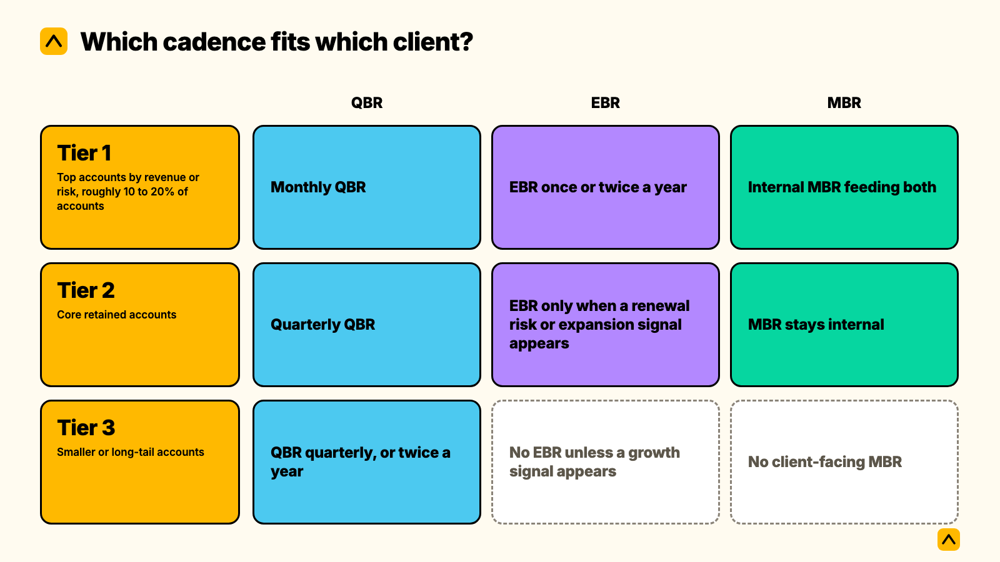
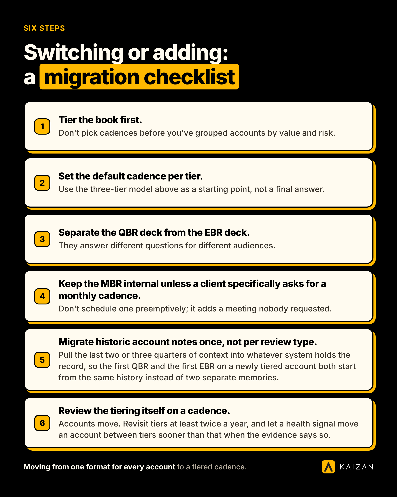

A QBR is the quarterly (or monthly, for your biggest accounts) review of value delivered against a client's own goals. An EBR is that same relationship pushed up a level: a strategic conversation with the executive sponsor, run once or twice a year, built to make the case for renewal or growth rather than to walk through the last ninety days. An MBR is usually internal, a monthly check on delivery metrics, though a few teams run a lighter version of it with the client between QBRs. The table below settles which one you need and when, before the rest of this guide gets into where each one wins, where it breaks, and how to pick a cadence by account tier instead of running one format for every client.

|  | QBR | EBR | MBR |
| --- | --- | --- | --- |
| Run it with | Any retained account | Your highest-tier, highest-risk or highest-growth accounts | Internally, or a light client check-in between QBRs |
| How often | Quarterly, monthly for top-tier accounts | Once or twice a year | Monthly |
| Pitched at | Account lead, the client's day-to-day contact, one senior sponsor each side | The executive sponsor who holds the budget or signs the renewal | The operational team doing the work |
| What it decides | Next quarter's priorities | Whether the relationship grows, and the renewal case | Delivery fixes, not strategy |

If you only read one line of this guide: a QBR, an EBR and an MBR are not three versions of the same meeting at different volumes. They answer three different questions, for three different audiences, and most accounts in your book only ever need one of them.

## What each one actually is

### What's a QBR?

A QBR, quarterly business review, is a structured meeting between an agency and a client, held roughly every quarter, that reviews delivered value against the client's own stated goals, surfaces risk and opportunity, and sets next quarter's priorities. Most agencies run it monthly for their biggest accounts and keep the literal quarterly cadence for everyone else. It is the working-level review, not the executive one.

### What is an EBR?

An EBR, executive business review, takes that same relationship up a level. It is a strategic, executive-only conversation, usually annual or twice yearly, built to make the case for renewal or expansion rather than to review the last quarter's delivery in detail. Plenty of agencies run one QBR a quarter and one EBR a year on the same account, with different people in the room and a different question on the table.

### What is an MBR?

An MBR, monthly business review, is usually internal: a monthly look at delivery metrics and operational health, run among your own team rather than with the client. A handful of agencies run a lighter MBR-style check-in with a client between QBRs, mostly on accounts where a monthly touchpoint is contractual or the relationship is still finding its feet.

## QBR vs EBR vs MBR, side by side

The table above settles who's in the room and how often. This one settles what actually happens in the prep and the meeting itself.

| Criterion | QBR | EBR | MBR |
| --- | --- | --- | --- |
| What gets reviewed | Goals vs. delivery, risks, stakeholder coverage | Strategic fit, growth case, relationship trajectory | Tickets, SLAs, utilization, delivery metrics |
| Who preps it | Account lead | Account lead with the Head of Client Service | Delivery or operations lead |
| Typical length | 30 to 60 minutes | 45 to 60 minutes | 30 to 45 minutes |
| Prep time, built from memory and a spreadsheet | 2 to 4 hours per account | 4 to 8 hours, plus a narrative deck | 1 to 2 hours |
| First useful output | A next-quarter plan with named owners and dates | A renewal or expansion decision | A fixed delivery issue |
| Reports up to | Head of Client Service | The client's executive sponsor, and your own leadership | Delivery lead, internally |

The prep-time row is the one worth sitting with. None of this time is the actual meeting. It's the hour or two beforehand spent reconstructing three months of calls and emails from memory, a RAG spreadsheet and whatever made it into someone's notes, which is also the exact point where a quiet risk goes missing. The [Evidence-Based Client Health Standard](https://www.kaizan.ai/us/product/), Kaizan's name for the CARE-based relationship health model, exists to cut that reconstruction time by scoring Client Satisfaction, Activity, Relationship Strength and Expansion Opportunities continuously from the real conversation history, so the review starts from a current picture instead of a memory exercise.

## Where each one wins, and where it breaks

### QBR: wins on frequency, breaks on seniority

A QBR wins on most retained accounts because it is light enough to run every quarter, or every month for your top tier, without burning a full day of prep each time, and specific enough that a real next-quarter plan gets built instead of a vague sense of direction. It breaks when you ask it to carry a conversation it was never built for. A QBR with the client's CFO in the room, trying to settle a renewal, is really an EBR wearing a QBR's agenda, and it reads as under-prepared for the size of the decision on the table. Choose an EBR instead when the question is whether to renew or expand, not what to prioritize next quarter.

### EBR: wins on protecting the relationship, breaks on overuse

An EBR wins when an account has outgrown its QBR: big enough, or important enough, that a clean strategic conversation with the actual budget holder deserves its own slot on the calendar, separate from quarterly detail. It breaks the moment agencies run it on every account out of habit. A 45-minute executive conversation on a small retained account reads as overkill to a client who only ever deals with the account lead day to day, and it burns goodwill with the one senior stakeholder you actually need in the room for the accounts that matter. Choose a QBR instead when the account doesn't yet have, or doesn't need, a standing executive relationship on both sides.

### MBR: wins as internal discipline, breaks as a client meeting nobody asked for

An MBR wins as the habit that keeps a QBR honest: a monthly internal look at whether delivery is actually on track, so the quarterly conversation isn't the first time anyone checks. It breaks the moment it gets dressed up as a client-facing meeting on accounts that never asked for one. Most clients have no appetite for a monthly agenda of SLA metrics; they want the quarterly or executive conversation, not a standing meeting every thirty days. Choose a QBR, or nothing client-facing at all, when the client has shown no interest in a monthly touchpoint, and keep the MBR internal.

## Which cadence fits which client?

This is the decision most QBR guides skip, because most of them write for one account at a time. A Head of Client Service is running a whole book, and the honest answer to "how often should we run these" depends on the tier, not a fixed rule.

**Tier 1, your top accounts by revenue or risk.** Monthly QBR, an EBR once or twice a year, and an internal MBR feeding both. This is the only tier where all three genuinely coexist, and it's usually a small slice of the book, maybe 10 to 20% of retained accounts.

**Tier 2, your core retained accounts.** Quarterly QBR as standard. Pull forward an EBR only when a genuine renewal risk or expansion signal opens up, rather than scheduling one by default. The MBR stays internal.

**Tier 3, smaller or long-tail accounts.** A QBR quarterly, or twice a year if the account genuinely doesn't need more. No EBR unless a growth signal changes the account's trajectory. No client-facing MBR at all.

The trigger for moving an account between these defaults is usually a health signal, not the calendar. If a Tier 2 account's Expansion Opportunities score moves, or a risk starts recurring across several calls rather than surfacing once, that's the moment to pull an EBR forward rather than wait for the next scheduled slot. One Chief Operating Officer we work with, Agency Client A, put the underlying goal plainly:

> "We're trying to be proactive in predicting which clients might be a churn risk, and Kaizan is a huge part of helping to identify that."
>
> — Chief Operating Officer, Agency Client A

That's the same logic in reverse for expansion: don't wait for the scheduled EBR if the account is already telling you it's ready sooner.

## Do you need all three?

Most accounts don't, and that's the point. The stack above isn't three meetings bolted onto every client. It's one review cadence, tiered by account, where the MBR stays internal for most of the book and the EBR only appears where the relationship has genuinely earned it. If you're running a monthly RAG spreadsheet today, this doesn't ask you to add a QBR, an EBR and an MBR on top of it. It replaces the spreadsheet's job, guessing at account health from memory, with a continuous picture, and then lets you decide which of the three reviews each account actually needs from that picture, rather than from habit.

The reason this works across a whole book rather than one account at a time is visibility that doesn't depend on being on every call. A Head of International Client Team we work with, Agency Client B, described what that changes:

> "I have a pretty good view now of what is happening on our clients everywhere, and can spot things when things are not working as expected or when things are going really well, in a much earlier way."
>
> — Head of International Client Team, Agency Client B

That's the view a tiered cadence needs to actually hold: not just a rule for which review runs when, but a current enough picture of every account to know when the rule should bend.

## Switching or adding: a migration checklist

If you're currently running one review format for every account regardless of size, here's the order that avoids redoing the work twice.

- **Tier the book first.** Don't pick cadences before you've grouped accounts by value and risk. If you haven't formally segmented your client list, do that first; it decides everything downstream.
- **Set the default cadence per tier.** Use the three-tier model above as a starting point, not a final answer. Adjust it to how many accounts actually sit in your Tier 1.
- **Separate the QBR deck from the EBR deck.** They answer different questions for different audiences. A deck that tries to do both ends up too detailed for the executive and too strategic for the quarterly working session.
- **Keep the MBR internal unless a client specifically asks for a monthly cadence.** Don't schedule one preemptively; it adds a meeting nobody requested.
- **Migrate historic account notes once, not per review type.** Pull the last two or three quarters of context into whatever system holds the record, so the first QBR and the first EBR on a newly tiered account both start from the same history instead of two separate memories.
- **Review the tiering itself on a cadence.** Accounts move. Revisit tiers at least twice a year, and let a health signal move an account between tiers sooner than that when the evidence says so.

## How we researched this

The comparison above draws on two sources: the practical difference between QBR, EBR and MBR formats as they're actually run across agency and professional-services accounts, cross-checked against how the terms are used in SaaS customer success writing, and Kaizan's own benchmark data from more than a million client service calls and ten million emails across agency accounts, used here for the cadence and risk-signal findings. Client examples are anonymized under the name Agency Client, each a distinct account, with job titles kept as given.

## Frequently asked questions

**What's a QBR?**
A QBR, quarterly business review, is a structured meeting between an agency and a client, held roughly every quarter, that reviews delivered value against the client's own stated goals, surfaces risk and opportunity, and sets next quarter's priorities. Most agencies run it monthly for their biggest accounts and keep the literal quarterly cadence for the rest of the book.

**Which should we choose, QBR, EBR or MBR?**
Start with the QBR; it's the right default for almost every retained account. Add an EBR only for accounts big or strategic enough to need a standing executive conversation separate from quarterly detail. Keep the MBR internal unless a specific client has asked for a monthly touchpoint.

**Can we use both a QBR and an EBR on the same account?**
Yes, and on your top-tier accounts you usually should. Run the QBR quarterly or monthly for the working-level detail, and the EBR once or twice a year for the strategic, executive-level conversation. They cover different ground, so running both isn't duplication.

**What does switching involve?**
Mostly re-tiering the book and splitting your deck templates so the QBR and EBR stop trying to do the same job. The bigger shift is moving account history out of memory and spreadsheets and into a record both review types can draw from, so neither one starts from scratch.

**Where is each one the wrong choice?**
A QBR is the wrong choice when the real question on the table is a renewal or expansion decision that needs the budget holder in the room; that's an EBR. An EBR is the wrong choice on small or early-stage accounts, where it reads as disproportionate to the relationship. An MBR is the wrong choice as a client-facing meeting on any account that hasn't asked for one; keep it internal.

---

If you want to see what a QBR, an EBR or an MBR looks like when it's built from the actual call and email history instead of a memory-based spreadsheet, on your own client accounts, [book a demo](https://www.kaizan.ai/us/).
