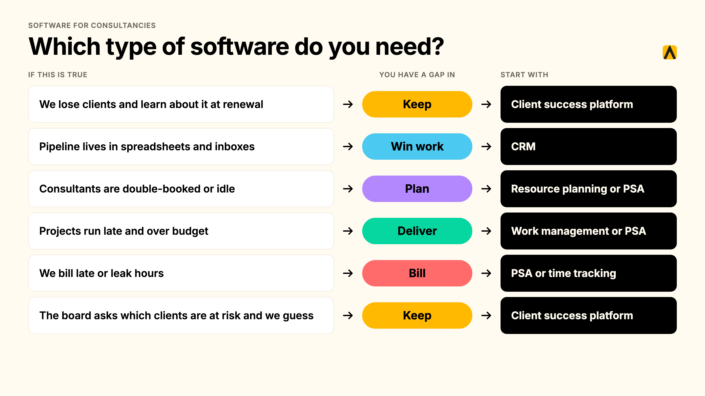
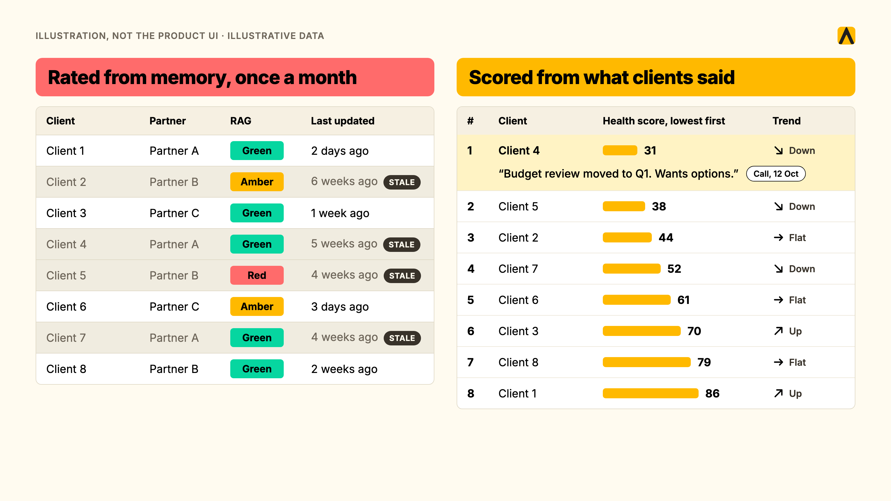
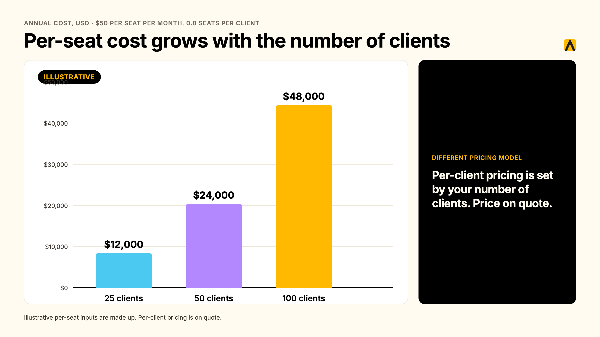
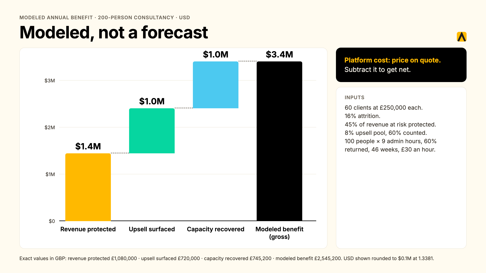
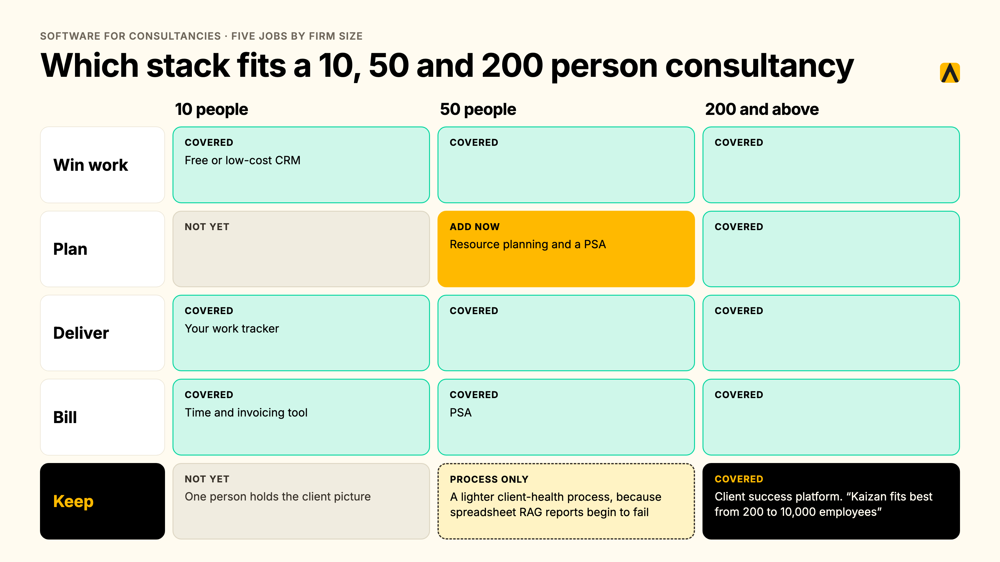

Software for consultancy firms covers five jobs: winning work, planning and staffing, delivering projects, billing time, and keeping clients. Most consultancies cover the first four well and run the fifth on a spreadsheet and memory. A complete stack has one tool per job, and the fifth tool protects the revenue the other four create.

**Key takeaways**

- A consultancy stack does five jobs: win, plan, deliver, bill, keep. No single product does all five well.
- Firms usually own tools for the first four. The fifth, keeping clients, is where revenue leaks.
- A CRM records deals. A PSA records time and margin. Neither captures the emails and calls where clients signal trouble.
- Per-seat pricing scales with your team. Per-client pricing scales with your portfolio. Compare both against the revenue you protect.
- Start with the problem you can put a number on, then buy the type of tool that fixes it.

## What software for consultancy firms is, and what it is not

Software for consultancy firms is the set of tools that run the cycle from first meeting to renewal. It is not one product. The phrase gets applied to CRMs, project tools, billing suites and AI assistants as if they were interchangeable. They are not. Each does one job, and buying the wrong type for your problem is the most expensive mistake in the category.

This guide sorts the market by the job each tool does, so you can match your problem to a type before you compare vendors. I wrote it for CEOs and CFOs who sign off the spend, and for COOs who carry the rollout.

### What professional services management software does

Professional services management software, often called PSA, runs the delivery and money side of a services business. It handles resource planning, time capture, project budgets, invoicing and profitability by engagement. A PSA answers "are we staffed, are we billing, are we making margin." It does not answer "is this client happy, and will they renew."

That second question sits outside most PSA data models. The signals live in client emails, calls and messages. That gap is the reason this guide treats keeping clients as its own job.

## The five jobs, and the type of tool that does each

Here is the stack map. Every consultancy runs some version of it, whether the tools are bought or improvised.

| Job | Tool type | Examples in this guide |
|---|---|---|
| Win work | CRM and proposals | HubSpot, Salesforce |
| Plan | Resource and capacity planning | Float |
| Deliver | Work and project management | monday.com |
| Bill | PSA, time tracking and invoicing | Productive, Scoro, Kantata, Deltek Vantagepoint, Accelo, Harvest |
| Keep | Client success platform | Planhat, Kaizan |

### Win work: CRMs and proposal tools

A CRM holds contacts, companies and deals. It tells you what is in the pipeline and who owns it. HubSpot and Salesforce dominate here. Both do the job well for sales. Neither was built to read a client's inbox, so relationship data depends on people typing it in.

### Plan: resource and capacity tools

Resource planning tools show who is free, who is overbooked and what next month looks like. Float is a dedicated option. Many PSA suites include planning, so check what you already own before you buy a separate tool.

### Deliver: work management

Work management tools run tasks, timelines and approvals. monday.com is a common choice. These tools organize delivery. They do not tell you whether the client on the other end is satisfied with it.

### Bill: PSA, time tracking and invoicing

This is the largest group and the one most associated with software for consultants. It splits into full suites (Kantata, Deltek Vantagepoint, Scoro, Productive, Accelo) and lighter time and invoicing tools (Harvest). Suites tie time to budgets and margin. Lighter tools capture hours and send invoices.

### Keep: client success platforms

A client success platform captures client conversations, scores relationship health and tells your team what to do next. Planhat and Kaizan sit here. The category is newer in professional services, and it is the job most consultancies cover least.

### Which type do you need? A 60-second decision table

| If this is true... | You have a gap in... | Start with |
|---|---|---|
| We lose clients and learn about it at renewal | Keep | Client success platform |
| Pipeline lives in spreadsheets and inboxes | Win work | CRM |
| Consultants are double-booked or idle | Plan | Resource planning or PSA |
| Projects run late and over budget | Deliver | Work management or PSA |
| We bill late or leak hours | Bill | PSA or time tracking |
| The board asks which clients are at risk and we guess | Keep | Client success platform |

## Why consultancies outgrow spreadsheets and their CRM

I see the same four failures in firms between 200 and 10,000 people. Each one has a data answer.

### The monthly RAG spreadsheet

Account teams rate every client red, amber or green once a month. The rating reflects the last conversation the person remembers.

> "monthly rag reports... They rely often on people's memory."
>
> Head of Client Services, Agency Client A

A rating built on memory arrives late and skews optimistic. People do not volunteer bad news about their own accounts.

### The relationship lives in inboxes and calls, not CRM fields

Our Client Service Benchmark 2026 analyzed more than 1 million calls and 10 million emails, anonymized, over 12 months. About 69% of struggling accounts surfaced their own warning signs in conversation at least once. The clients were already telling their teams. The signal never reached a field in the CRM. ([Kaizan, The Client Service Benchmark 2026](https://www.kaizan.ai/us/white-paper/))

### When a partner leaves, the context leaves

The same dataset shows how uneven coverage is. The top quartile of account managers makes 66.2% of all client calls, and averages 64 calls a year against 3 for the bottom quartile, a gap of roughly 21 times. When one of the heavy hitters leaves, a large share of the relationship history walks out with them.

> "About 35 to 40% of an account handler's job now is admin, and there's a problem where that admin is getting in the way of having proper relationship driven conversations."
>
> MD and Chief Client Officer, Agency Client B

### Nobody can evidence which clients are at risk

Revenue in a consultancy concentrates. Leaders know it, and they cannot see it moving.

> "We rely on about 20 global accounts really to drive most of our revenue."
>
> Executive, Agency Client C

> "600 clients, but there's only 50. Really, who I'm kind of really concerned about."
>
> Managing Director, Agency Client D

For a CFO, that is concentration risk with no early-warning system. For a CEO, it is the question that arrives from the board: which clients are at risk, and what is your evidence? Another leader we work with framed it as a revenue question:

> "Client health is a very big indicator for hitting those revenue numbers. And that's what I need to know."
>
> Executive, Agency Client E

Industry data adds context. Secondary sources put average annual client retention in professional services near 84%, with business consulting around 85%. Treat those figures with a grain of salt: they are repeated across aggregator sites, and I could not trace one audited primary source ([Agiled's compilation](https://agiled.app/statistics/client-retention-statistics)). The direction is useful even if the decimals are soft. Roughly one client in six leaves each year.

## The features that matter, tied to the job they do

Features are only useful when they fix a named problem. These are the ones I would test, in the order I would test them.

### Capture: client data without manual entry

If your people have to type it, it will be wrong or missing. Look for automatic capture of emails, meetings, calls and chat. Ask what share of account activity reaches the system without a human step. Our advice to any buyer: test this first.

### Scoring: an evidence-based health score

A score should come from conversation evidence, not opinion. We call our approach The Evidence-Based Client Health Standard. Its method, CARE, scores every relationship across four dimensions: Client Satisfaction, Activity with Stakeholders, Relationship Strength and Expansion Opportunities. It acts as a leading indicator, so it shows where a relationship is heading before the renewal conversation. Whatever tool you pick, ask how the score is built and what evidence sits behind each number.

### Alerting: early warnings with a next step

An alert without an action is noise. Good alerts name the account, the signal (a stakeholder gone silent, sentiment falling, a single-threaded relationship) and the recommended next step.

### Reporting and portfolio view

Leadership needs one page: revenue at risk, expansion in flight, which accounts need attention this week. A PSA gives you a financial portfolio view. A client success platform gives you a relationship portfolio view. You need both.

### Integrations

A new tool earns a place by connecting to the ones you run. Check HubSpot, Salesforce, Microsoft Teams, Slack, Zoom, Google Meet, Gmail and Outlook, plus your project tools. Kaizan connects to all of these and to monday, Asana, Jira, ClickUp and Wrike, so it adds a layer without replacing your stack ([integrations](https://www.kaizan.ai/us/integrations/)).

### Permissions and security: engagement-level access

Consultancies handle commercially sensitive material. Proposals, negotiation positions and engagement details must stay with the engagement team. Ask for role-based access scoped by account, team or client, and decide before any pilot which calls and clients the tool may touch. One global consultancy we work with keeps consulting engagements behind project codes and restricted teams, so it set permissions first and scoped the rollout to client-relationship work. Look for SOC 2 Type II, a zero-retention policy on model training, EU and US data residency, and SSO with SCIM. Kaizan provides all of these ([security](https://www.kaizan.ai/us/security/)).

### AI features worth paying for, and the gimmicks

Worth paying for: cited answers about any client across calls, emails and chat; drafted follow-ups that sound like your people; next actions grounded in your account data. Gimmicks: summaries that restate the transcript, generic upsell suggestions and chatbots with no source links. The test is simple. Can you click through from an answer to the evidence?

## The 12 tools compared

Pricing models are listed rather than dollar figures for most tools, because third-party trackers disagree on current rates. Confirm the rest with each vendor before you decide.

| Tool | Job | Best for | Pricing model | Main limitation |
|---|---|---|---|---|
| HubSpot | Win work | Pipeline and marketing | Per seat, free CRM tier | Relationship data depends on manual entry |
| Salesforce | Win work | Complex sales and large teams | Per user by edition | Heavy admin and add-on costs |
| Float | Plan | Resource scheduling | Confirm with vendor | Planning only |
| monday.com | Deliver | Flexible project tracking | Per seat | No client health layer |
| Productive | Bill | Agency-style PSA | Per user, no free plan | Delivery and margin focus |
| Scoro | Bill | Quote-to-cash in one system | Per user, reported 5-user minimum | Client health out of scope |
| Kantata | Bill | Larger professional services firms | Quote-based | Heavier implementation |
| Deltek Vantagepoint | Bill | Project-based firms needing ERP | Quote-based | Heavier implementation |
| Accelo | Bill | Client work and billing in one | Per user, confirm with vendor | Not built for risk detection |
| Harvest | Bill | Time and invoices | Per seat | Light on planning and profitability |
| Planhat | Keep | Subscription customer success | Quote-based | Data model built for subscriptions |
| Kaizan | Keep | Client health, risk and growth | Per client, unlimited users. Price on quote | Does not run delivery, time or billing |

### HubSpot

**What it is:** a CRM with marketing, sales and service hubs. **Best for:** firms that want one pipeline and a free starting point. **Pricing:** per seat, with a free CRM tier. **Limitation:** contact and deal data stays only as good as what people enter. **Verdict:** the right default for winning work. It sits beside a client success platform, and Kaizan syncs with it.

### Salesforce

**What it is:** the enterprise CRM, configurable to almost any sales process. **Best for:** large firms with admin resources. **Pricing:** per user by edition, with add-ons. **Limitation:** configuration and data hygiene take sustained effort. **Verdict:** strong for deals, and the system of record for many global firms. Kaizan connects to it so insights land where sellers already work.

### Float

**What it is:** a resource scheduling tool. **Best for:** firms that need a clear view of who is on what. **Pricing:** confirm with the vendor. **Limitation:** it plans people and does nothing else. **Verdict:** buy it if your PSA does not already plan capacity.

### monday.com

**What it is:** a flexible work management platform. **Best for:** teams that want custom boards across delivery. **Pricing:** per seat. **Limitation:** it tracks work, and has no view of client sentiment or stakeholder coverage. **Verdict:** a good delivery layer. Kaizan integrates with it.

### Productive

**What it is:** agency-oriented PSA with time, budgets and resourcing. **Best for:** agencies and creative-led consultancies. **Pricing:** per user, with no free plan reported by [CostBench](https://costbench.com/software/agency-project-management/productive-io/free-plan/); published rates differ across trackers, so confirm directly. **Limitation:** it manages delivery and margin, not relationship health. **Verdict:** solid for the Bill job.

### Scoro

**What it is:** a work and sales platform covering quotes, projects, time and invoices. **Best for:** firms that want quote-to-cash in one system. **Pricing:** per user, with a five-user minimum reported by [Agiled](https://agiled.app/blog/scoro-pricing). **Limitation:** client health is outside its scope. **Verdict:** a credible suite for smaller to mid-size firms.

### Kantata

**What it is:** a PSA built for professional services. **Best for:** larger services firms that need resourcing, projects and financials. **Pricing:** quote-based. **Limitation:** implementation takes planning. **Verdict:** pick it when delivery and utilization are your biggest problems.

### Deltek Vantagepoint

**What it is:** project-based ERP and PSA. **Best for:** firms that want accounting, projects and CRM under one roof. **Pricing:** quote-based. **Limitation:** scope and implementation effort. **Verdict:** a heavyweight for the Bill job. Deltek's own work with SPI reports average billable utilization fell to 68.9% in 2024, below the 75% optimal mark, which is why COOs invest here ([Deltek](https://www.deltek.com/en-gb/blog/professional-services-benchmarks)).

### Accelo

**What it is:** client work management combining CRM, projects, time and billing. **Best for:** small to mid-size firms that want one tool for client work. **Pricing:** per user, confirm with the vendor. **Limitation:** it was not designed to detect relationship risk from conversations. **Verdict:** a good all-rounder for lean firms.

### Harvest

**What it is:** time tracking and invoicing. **Best for:** firms that need hours captured and billed without a suite. **Pricing:** per seat. **Limitation:** light on planning and profitability analysis. **Verdict:** simple and effective at its job.

### Planhat

**What it is:** a customer platform used heavily by subscription software companies. **Best for:** firms whose clients behave like subscribers, with usage and renewal data. **Pricing:** quote-based. **Limitation:** its data model assumes subscription metrics that consultancies do not have, so setup demands configuration. **Verdict:** worth a look if your revenue is recurring and product-led.

### Kaizan

**What it is:** a client success platform for professional services firms. It captures every call, email and chat into one permissioned client memory, scores each relationship with The Evidence-Based Client Health Standard, and gives account teams the next action to approve. **Best for:** consultancies, agencies and professional services firms of 200 to 10,000 people that run many high-touch client relationships. **Standout features:** early warnings for stakeholders who go silent and for falling sentiment, a revenue-at-risk view across the portfolio, AI Helpers that draft follow-ups and QBR briefs, and an MCP server so your own AI tools can query client context. **Pricing:** per client, unlimited users, price on quote (see the cost section). **Limitation:** it does not run delivery, time tracking or billing, so it sits alongside your PSA. **Verdict:** the tool I would add fifth, because it is the only one in this list built to answer "which clients are at risk and why."

Kaizan clients see an average 26%+ revenue increase per client, 5.4 hours of admin saved per person each week, 23% lower cost to serve each client, and 45% of revenue at risk protected through early signals ([see the product page](https://www.kaizan.ai/us/product/)).

> "We have a target of achieving 20% better efficiency across the business. 20% less time spent on administration. Kaizan has significantly helped us achieve that target."
>
> Derek Grant, VP Operations & General Manager UK / US, Tradedoubler

## How we assessed these tools

I scored each tool against five criteria: which job it does, whether it captures client data automatically, how likely the team is to adopt it, how well it integrates with the stack around it, and how transparent its pricing is. I reviewed each vendor's public materials and independent trackers. I have not run a hands-on trial of every product, so treat the limitation lines as informed positioning, not lab results. Pricing models come from vendor positioning and third-party trackers, which disagree on current rates. Verify any dollar figure with the vendor.

Kaizan appears in this list, and I work here. The scoring method above applies to every tool, ours included.

## How to choose in seven steps

- **Name the problem first.** Write one sentence: "We lose clients without warning" or "We bill late." Use the decision table above to find the job.
- **Map your current stack.** List every tool, owner, seat count and cost. Aim to do it in 60 minutes.
- **Count clients, not only seats.** Per-seat tools scale with headcount. Per-client tools scale with portfolio. Model both at your size.
- **Test manual entry against automatic capture.** If your team must type the data, adoption will decide the outcome. Choose capture that needs no extra admin.
- **Pilot on five accounts for 14 days.** Pick a mix: two healthy accounts, two uncertain, one you worry about. Check whether the tool tells you something you did not know.
- **Ask what each buyer needs to see.** The CEO wants revenue at risk. The CFO wants cost and payback. The COO wants adoption and admin time per account director.
- **Score the shortlist.** Weight the criteria, score each tool, and rank them.

## What software for consultancy firms costs

Costs fall into three models. Per-seat tools charge per user per month, so cost grows with headcount. Quote-based suites price by modules and users, so implementation is part of the bill. Per-client platforms charge by portfolio size.

Kaizan is priced by number of clients, with unlimited users. Price on quote. Every engagement starts with a free 14-day pilot on your own data.

### Cost at 25, 50 and 100 clients

This table shows how a per-seat tool scales. It uses made-up inputs, so it illustrates a pattern and is not a quote from any vendor: $50 per seat per month and 0.8 seats per client.

| Clients | Illustrative per-seat tool, annual (USD) |
|---|---|
| 25 | $12,000 |
| 50 | $24,000 |
| 100 | $48,000 |

_Illustrative per-seat inputs are made up. Per-client pricing is on quote._

Read the table this way. The two models measure different things. A per-seat tool costs less because it does a narrower job. The right test for a client success platform is what it protects.

### A worked example: a 200-person consultancy

I rebuilt the ROI method from the calculator on our pricing page, using Expected mode. The inputs are assumptions, not client data: 200 employees, 100 client-facing staff, 60 clients, £250,000 average annual revenue per client, and 16% attrition. That attrition rate comes from the 84% retention average above, a soft benchmark. USD figures are converted at 1.3381 USD per GBP, a mid-market rate dated 22 July 2026; update it to today's rate before you budget.

| Line | Method | Annual value (GBP) | Annual value (USD) |
|---|---|---|---|
| Portfolio value | 60 clients x £250,000 | £15,000,000 | about $20.1M |
| Revenue at risk | 16% attrition | £2,400,000 | about $3.2M |
| Revenue protected | 45% of revenue at risk | £1,080,000 | about $1.4M |
| Upsell surfaced | 8% pool, 60% counted | £720,000 | about $1.0M |
| Capacity recovered | 100 people x 9 admin hours, 60% returned, 46 weeks, £30 an hour | £745,200 | about $1.0M |
| **Modeled benefit** | | **£2,545,200** | **about $3.4M** |

Platform cost: price on quote. Subtract it to get net.

This is a model, not a forecast, and no one has published hard data on outcomes at your firm. Run the [live calculator](https://www.kaizan.ai/us/pricing/) with your own numbers.

## Which stack fits a 10, 50 and 200 person consultancy

**At 10 people**, buy the first three jobs cheaply. A free or low-cost CRM, a time and invoicing tool, and your work tracker cover the basics. One person can hold the client picture in their head. Kaizan is not a first purchase at this size.

**At 50 people**, add resource planning and a PSA, because utilization and margin start to leak. Relationships now span several partners. Spreadsheet RAG reports begin to fail, and a lighter client-health process is worth building.

**At 200 people and above**, you need all five jobs, and the fifth stops being optional. Concentration risk is visible in the board pack, and no single person knows every account. This is where the Keep layer earns its place, and where Kaizan fits best, from 200 to 10,000 employees.

## What changed when firms added a client success layer

Three firms describe the shift in their own words.

> "We've had numerous occasions where we've been able to spot and identify high-risk clients that potentially were going to leave."
>
> Brandon Smith, Managing Director, NP Digital ([read the story](https://www.kaizan.ai/us/blog/how-np-digital-uses-ai-to-strengthen-client-relationships-and-drive/))

> "Kaizan really helps us focus in on those opportunities where we know there'll be an uplift in gross profit."
>
> Derek Grant, VP Operations, Tradedoubler

> "It is the one tool that whenever we have efficiency discussions or cost cutting discussions or budget discussions, it is never even on the table to discuss Kaizan."
>
> COO, Agency Client F

One boundary example matters for consultancies. A global consultancy we work with keeps engagement calls restricted to named project teams. It started with client-relationship and CRM intelligence, set permissions first, and treats engagement-level pilots as a separate decision. That sequencing is the one I would copy.

## FAQs

### What software does a consultancy need?

Software for consultancy firms covers five jobs: winning work, planning and staffing, delivering projects, billing time, and keeping clients. Most consultancies cover the first four well and run the fifth on a spreadsheet and memory. A complete stack has one tool per job, and the fifth tool protects the revenue the other four create.

### How much does software for a consultancy cost?

Cost depends on the pricing model. Per-seat tools charge per user per month, and rates vary by plan, so request a quote for your headcount. Per-client platforms charge by portfolio size. Kaizan is priced by number of clients, with unlimited users. Price on quote.

### Is there free software for consultancies?

Yes, for parts of the stack. HubSpot offers a free CRM for contacts and deals. Free tiers stop where consultancies need help most: multi-team permissions, utilization reporting and client health. Kaizan offers a free 14-day pilot on your own client data, with no card and no commitment.

### Do we need it if we already have a CRM or a PSA?

Yes, if you cannot say which clients are at risk and why. A CRM records contacts and deals. A PSA records time, cost and margin. Neither captures the emails and calls where clients signal trouble. Keep both, and add a client success layer when the evidence sits outside your systems.

### How long does it take to roll out?

It depends on the type. CRMs and time trackers typically go live in days but need weeks of entry before reports mean anything. PSA suites typically take weeks to months to configure. Kaizan goes live the same day through OAuth, and its free 14-day pilot delivers client health scores and findings by day 14.

### What is the return on this?

Measure return in revenue protected and expansion won, not hours saved. In a modeled 200-person consultancy with 60 clients, the calculator method returns about $3.4 million in annual benefit before platform cost, which is priced on quote. Treat it as a model, not a forecast. Run the live calculator with your own numbers.

### Will the team actually use it?

Adoption follows effort. Tools that need manual entry get skipped. Pick tools that capture client emails and calls automatically, set permissions before launch, and pilot on five accounts for 14 days. Measure weekly active users against seats. Under 50% utilization after 60 days means the wrong fit or a rollout that needs work.

**Run the numbers, and [book a demo](https://www.kaizan.ai/us/) when you want to see your own clients scored.**
