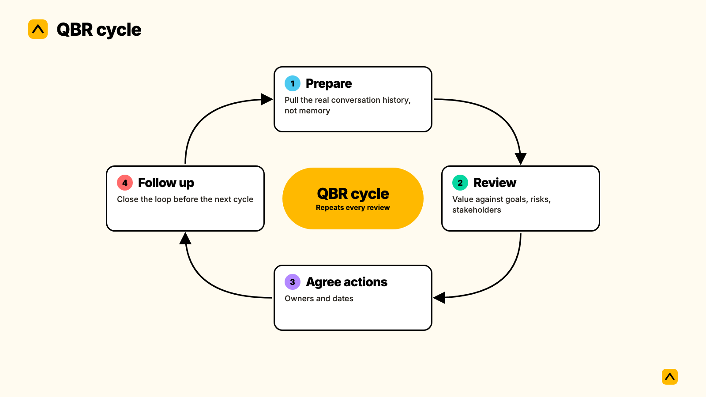
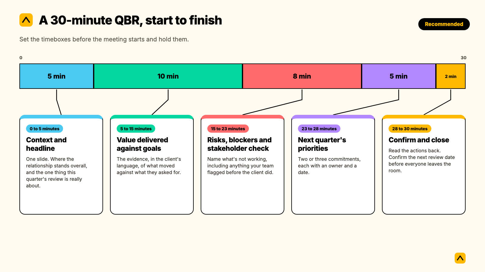
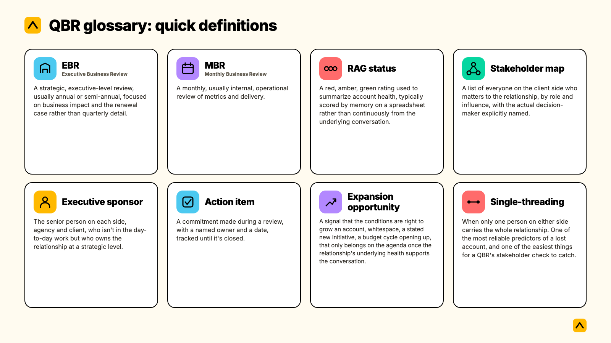

A quarterly business review (QBR) is a structured meeting between an agency and a client, held roughly every quarter, that reviews the value delivered against agreed goals, surfaces risks and opportunities, and sets the priorities for the next period. In agencies, QBRs often run monthly rather than quarterly.

That covers the dictionary answer. The rest of this guide covers what actually makes a QBR worth running: what belongs on the agenda, how it differs from an EBR or an MBR, what one looks like when it works on a real account, how to measure whether yours are working, and a 30-minute run of show you can use this quarter.

This is written for Heads of Client Service running a book of retained accounts, not for SaaS teams running product-adoption reviews. The shape of a QBR, the stakes behind it, and the questions worth asking change when the relationship is a service, not a license.

The same three letters also get used for two other meetings worth ruling out first. A sales QBR reviews pipeline, quota and win rates with a sales team, not a client relationship. An internal QBR is how a leadership team reviews its own department's numbers, shared between colleagues rather than with a client. This guide covers neither. It covers the external, client-facing QBR: the one an account team runs with the client itself.

**Key takeaways**

- A QBR is a review of value against goals, not a status update. If the agenda is a list of what you did, it is not a QBR yet.
- The word "quarterly" is doing less work than people think. Most agencies run these monthly for top-tier accounts and quarterly for the rest.
- A QBR is confused with an EBR, an MBR and a renewal call more often than any of them get properly told apart. The table below settles it.
- Most QBRs fail for one of three reasons: no decision-maker in the room, prep built from memory instead of the actual conversation history, or no agenda item that wasn't already obvious to the client.
- You can measure whether a QBR process is working with three numbers: decision-maker attendance rate, action closure rate between reviews, and how long a risk sits in conversation before it reaches an agenda.

Most people searching "what is a QBR" already run something they call a business review. The gap usually isn't the meeting existing. It's whether the meeting is doing the five jobs below, or doing just one of them and calling it done.

## Why QBRs matter, in revenue terms

A QBR is not an admin task you owe a client. It is one of the few guaranteed moments each quarter where someone senior on the client side sits across from someone senior on yours, with time set aside to talk about the relationship rather than the task list. That makes it one of the most consequential meetings an account team runs, and one of the easiest to let slide into a status read-out.

The stakes are real. Agency client retention is commonly cited in the 80 to 90% range annually, which means even a well-run book is losing one client in ten most years. Executive engagement is widely linked to that number: McKinsey research, cited widely across customer success literature, found B2B customers with strong executive engagement are around 2.5 times more likely to renew. Treat that figure as directional rather than exact, since it comes from outside Kaizan's own dataset, but the direction matches what shows up in agency client conversations too: the accounts that survive a rocky patch are usually the ones where a senior person on the client side already trusts a senior person on yours, because a QBR gave them the room to build that trust before the rocky patch arrived.

Kaizan's own benchmark data, drawn from over a million client service calls and ten million emails across agency accounts, backs this up from a different angle. Across the accounts in that dataset, the engagement gap between the best-performing and weakest-performing client relationships was rarely about which decision-makers an account team had identified. Both groups had mapped roughly the same share of stakeholders. The gap was frequency: the strongest accounts got nearly twice as many calls and twice as many emails with the actual decision-maker as the weakest ones. A QBR is one of the only forcing functions that guarantees that contact happens at all, for the accounts where the day-to-day relationship has drifted down to a single junior contact over time.

The same dataset found something else worth sitting with: accounts that later became genuinely at risk were rarely silent about it beforehand. Roughly 69% had raised a concern in conversation at least once before anyone treated it as a risk, and about 38% raised the same concern more than once. A QBR that only ever hears good news is not evidence the account is healthy. It is usually evidence that nobody built a mechanism to get the quieter signal onto the agenda before the client decided to raise it themselves.

## The components of a QBR

A QBR built from a slide template rarely survives contact with a real agenda. Build it from what the meeting actually has to accomplish instead, and the slides take care of themselves. Five things belong in every QBR, whatever you call the sections on the deck.

### Progress against the client's stated goals, not your activity log

The single biggest difference between a QBR that lands and one that doesn't is whose language it's written in. An activity log says what your team did. A goals review says what the client asked for and how close you've got to it. Kaizan's own benchmark found this is one of only two behaviors where the top and bottom cohort of account teams differ in kind, not just degree: the strongest teams named the client's own stated objective in roughly 1 in 9 conversations, against roughly 1 in 13 for the weakest. The gap is small in absolute terms and large in effect, because it is coachable at the level of a single call: did the last call name a specific client goal, yes or no.

### Evidence of value delivered, in terms the client already uses

"Evidence" here means outcomes, not outputs. A QBR that lists 40 deliverables shipped is an activity report. A QBR that opens with "here's where we said we'd move your lead volume, and here's where it landed" is a value report. Fiona Skilton, Client Services Director at Collective Content, described the gap this closes for her team directly:

> "The Client 360 gives us an at-a-glance view of what's going on in our clients' worlds. We can then come up with ideas off the back of that. Previously, we were having to do lots of desk research, and that took an awfully long time."
>
> — Fiona Skilton, Client Services Director, Collective Content

Pulling that context together manually, call by call and email by email, is exactly the prep work that turns a QBR into a scramble the night before.

This is the second behavior Kaizan's benchmark flags as a genuine marker of the strongest account teams, not just a nice-to-have: bringing outside context into the conversation, a competitor move, a sector shift, something the client couldn't have read from inside their own four walls, shows up roughly 20 times more often in the strongest accounts than the weakest. It's a small habit with an outsized effect, because it's the clearest signal to a client that you're thinking about their business, not just your scope of work.

### Risks and blockers, named before the client names them

If your QBR agenda has never once included a risk your team raised first, that is not a sign of a clean account. It is a sign the risk section has become theater. Name the thing that's actually making you nervous about the account, even the one you'd rather not bring up, because the alternative is the client bringing it up for you at the worst possible moment.

### Stakeholder and relationship coverage across the account

A QBR is the natural moment to check who's actually in the room, on both sides, against who should be. Alex Beddoe, Head of Biddable Media at Transmission, described what changes when that view stops living in one person's head:

> "Being across so many clients, I really struggled to make sure I had a good understanding across all of our different client interactions and touch points. Now I have much greater visibility into what's going on day-to-day, without the subjectivity of what my teams or even our clients are telling me."
>
> — Alex Beddoe, Head of Biddable Media, Transmission

Kaizan's benchmark data shows the client-to-team contact ratio holds remarkably steady across strong and weak accounts, at roughly nine client stakeholders per internal team member either way. What differs is scale: the strongest accounts simply run more of everything, roughly 1.7 times more client stakeholders engaged and nearly three times more client-initiated contact. The fix for a thin relationship usually isn't a different shape. It's more of the right kind of contact, and a QBR is one of the few moments that guarantees it.

### Priorities and commitments for the next period

Close every QBR with named owners and dates, not a general sense of direction. An expansion conversation belongs here too, but only when the first four components are solid. Pushing growth into a relationship that's still shaky on satisfaction or trust rarely lands well, and usually reads to the client as exactly the wrong moment to be asked for more budget.

## QBR vs the terms it gets confused with

"QBR" gets used loosely enough that it's worth settling what it is not. The table below compares it against the terms most often mixed up with it.

|  | QBR | EBR | MBR | Renewal call | Weekly/monthly status update |
| --- | --- | --- | --- | --- | --- |
| Who's in the room | Account team, client day-to-day contact, one senior sponsor each side | C-suite or VP-level sponsors only | Operational team, day-to-day only | Commercial decision-makers | Working team |
| How often | Quarterly, or monthly for top-tier agency accounts | Annually or semi-annually | Monthly | Once, timed to the contract | Weekly or biweekly |
| What it covers | Value vs. goals, risk, next-quarter plan | Strategic partnership, business impact, the renewal case | Operational metrics, delivery tracking | Commercial terms, scope, price | Task progress |
| Typical length | 30 to 60 minutes | 45 to 60 minutes | 30 to 45 minutes | Varies | 15 to 30 minutes |
| What gets decided | Next quarter's priorities | Strategic direction, expansion green light | Operational fixes | Contract terms | Little beyond the task list |

A few distinctions worth stating plainly. An EBR is not just a QBR with more senior people invited. It runs less often, covers strategic direction rather than quarterly detail, and exists specifically to build the case for renewal at the executive level, which is why some teams run one QBR a quarter and one EBR a year with the same account. An MBR is internal-facing far more often than external: it's how a leadership team reviews its own department's numbers, not how an agency reviews a client relationship, though some agencies run a lightweight MBR-style check-in with a client between QBRs. A renewal call is a commercial negotiation, not a relationship review, and walking into one without the evidence from your last few QBRs is how teams end up negotiating from a position of hope rather than a position of proof. And a weekly status update is not a QBR run more often. It's a different job: tracking tasks, not reviewing a relationship.

If you only remember one distinction from this table: the word people reach for most often when they actually mean QBR, in a business context, is simply "business review," with the cadence attached as a modifier. A QBR defined in one sentence is a quarterly version of that review. An agency running them monthly for its biggest accounts hasn't invented a new thing. It's just named the cadence honestly.

## How a QBR works in practice: one worked example

This is a composite account, built from patterns that show up across agency relationships, not one named client.

A 60-person marketing agency runs a QBR with a mid-market retail client every quarter. For two quarters, the reviews go fine: the deck covers deliverables, the client nods, nobody pushes back. In the third quarter's prep, the account lead pulls the last three months of call notes and email threads before building the deck, rather than working from memory, and notices something the monthly RAG spreadsheet never would have caught: the client's day-to-day marketing manager has mentioned budget pressure twice in passing, not as a formal complaint, once in a call and once in an email thread about an unrelated deliverable. Neither mention made it onto a status report, because neither one looked, on its own, like a problem.

The account lead puts it on the QBR agenda directly, as its own line rather than folding it into a general "how's it going" question, and brings a proposed scope adjustment rather than waiting for the client to raise it. The client's actual budget holder, who had skipped the previous two reviews, attends this one because the invitation explicitly flagged a budget conversation. The adjustment gets agreed in the room. The account renews at the original annual value six months later, and the account lead credits the save specifically to catching the signal before it reached the client's own internal budget review, not to anything in that quarter's delivery.

The lesson generalizes past this one account: a QBR built from the actual conversation history catches what a QBR built from memory or a monthly spreadsheet misses, and it does so precisely because the signal usually isn't hidden. It's scattered across calls and emails nobody went back to reread.

That pattern shows up outside the composite example too. A VP Client Growth at another agency we work with, Agency Client C, described the same habit from their own renewal and QBR prep:

> "When you're having a call with NBC and you want to know what they pitched three months ago, that's what saves us the most time. We couldn't do that before."
>
> — VP Client Growth, Agency Client C

## How to measure whether your QBRs are actually working

Three numbers tell you more than a satisfaction score after the fact. The example below uses illustrative figures to show the calculation, not one real client's data.

**Decision-maker attendance rate.** The share of QBRs attended by the client's actual budget holder or final decision-maker, not just their day-to-day contact.

*Formula:* QBRs attended by the real decision-maker ÷ total QBRs run, over a quarter.

*Worked example:* An account team running 40 retained clients holds 11 QBRs in a quarter (not every account warrants one every quarter). The actual budget holder attends 7 of them. 7 ÷ 11 = 64%. Given how strongly executive engagement tracks with renewal, a number below roughly half is worth treating as a target to move, not a fact of life.

**Action closure rate.** The share of commitments made at one QBR that are actually closed by the next one.

*Formula:* actions closed before the next review ÷ actions committed at the last one.

*Worked example:* 18 actions were committed across last quarter's QBRs. 14 were closed by the time this quarter's reviews started. 14 ÷ 18 = 78%. A QBR that keeps reopening the same unresolved action item quarter after quarter is not a review. It's a record of a promise nobody kept.

**Signal-to-agenda lag.** How long a risk or opportunity sits in ordinary conversation before it reaches a QBR agenda item.

This one is harder to calculate by hand, because it requires going back through calls and emails to find when a concern first surfaced, not just when it was finally written down. It's the single most useful number for a Head of Client Service to track, because it's the clearest proxy for whether the team is working from the real relationship or from whatever happened to make it into someone's notes. Teams that automate the first step, capturing every call and email and flagging recurring risk themes automatically, tend to see this lag shrink from months to days, simply because nothing has to wait for someone to remember it before the next review. Kaizan's own [AI Assistant](https://www.kaizan.ai/us/product/#ai-assistant) builds the QBR prep this way by default: every call and email captured and scored continuously, so the agenda reflects what the relationship has actually been saying, not just what made it into last month's status report.

These same three numbers double as what you take upstairs. A decision-maker attendance rate, an action closure rate and a shrinking signal-to-agenda lag are evidence a leadership team can act on, not just a sense that the account team has things under control.

## A 30-minute QBR, start to finish

Most QBR advice assumes you have 60 to 90 minutes. Agencies running these monthly, for a full tier of accounts, rarely have that much time to spare per client. Here's a run of show that fits in half an hour and still covers all five components above.

- **0 to 5 minutes: Context and headline.** One slide. Where the relationship stands overall, and the one thing this quarter's review is really about. Not a recap of the last meeting.
- **5 to 15 minutes: Value delivered against goals.** The evidence, in the client's language, of what moved against what they asked for. This is where most of the room's attention should go.
- **15 to 23 minutes: Risks, blockers and stakeholder check.** Name what's not working, including anything your team flagged before the client did. Confirm who's actually been in the conversation this quarter, on both sides.
- **23 to 28 minutes: Next quarter's priorities.** Two or three commitments, each with an owner and a date. An expansion conversation belongs here, if and only if the first three sections gave you a genuine opening for it.
- **28 to 30 minutes: Confirm and close.** Read the actions back. Confirm the next review date before everyone leaves the room.

Set the timeboxes before the meeting starts and hold them. A 30-minute QBR with no clock becomes a 60-minute one soon enough, and the discipline of the format is most of what makes it work.

## How to run a QBR clients actually attend

A strong agenda doesn't guarantee attendance, and a QBR nobody senior shows up to isn't really a QBR. A few things consistently move the needle.

**Ask for their agenda items a week out.** One question routinely surfaces the topic that would otherwise show up in the final five minutes, unprepared for: "what would make this meeting worth your time?" Agencies that treat the QBR as something the client co-builds, rather than something delivered to them, get noticeably better attendance from the people who matter.

**Keep the room small.** A QBR with ten people on the call becomes a status meeting by default, because nobody feels comfortable saying anything candid in front of that many colleagues. The account lead, the client's day-to-day contact, and one senior sponsor on each side is usually enough.

**Make the invitation specific to what's in it for them.** An invite that says "quarterly check-in" gets delegated. An invite that names the actual decision on the agenda, a budget conversation, a scope question, a strategic pivot, gets the right person to show up.

**Build the habit between reviews, not just inside them.** A Senior Client Partner at one agency we work with, Agency Client A, described exactly this kind of ongoing rhythm:

> "I use the sentiment tracking a lot in our weekly agency growth meetings to track sentiment. It's really, really invaluable."
>
> — Senior Client Partner, Agency Client A

A QBR that's the only moment anyone looks at the relationship all quarter is starting from a cold read every time. One that sits on top of a lighter weekly or monthly habit starts from context instead.

**Don't pitch the Honda as a Rolls-Royce.** If the client only needs a focused 20-minute conversation about three things, don't pad it into an hour-long deck review to make it feel more substantial. The agenda should match what the relationship actually needs this quarter, not a fixed template run on autopilot.

## Common mistakes, and what they cost

**Treating it as a status read-out.** The moment a QBR becomes a recap of deliverables, it stops being a review and starts reading, to the client, like a vendor update rather than a partnership conversation. The cost shows up at renewal, when the client has no evidence the relationship grew beyond the task list.

**Preparing from memory instead of the record.** One Head of Client Service we spoke with described their agency's monthly health reporting as built in a spreadsheet, blended from weighted scores and whatever the account manager remembered feeling that week, always a few weeks behind the actual conversation. Reviews built this way miss exactly the kind of quiet signal covered in the worked example above, because nobody goes back through three months of calls to find it by hand.

**No decision-maker in the room.** A QBR attended only by the day-to-day contact can still feel productive and still fail to move the number that matters most: whether the person who signs the renewal has any reason to trust your team beyond a status email. A Chief Operating Officer at another agency we work with, Agency Client B, put the underlying goal plainly:

> "We're trying to be proactive in predicting which clients might be a churn risk."
>
> — Chief Operating Officer, Agency Client B

A QBR without the actual decision-maker in the room is trying to do that work blind.

**No follow-through between reviews.** An agenda that repeats the same unresolved action item quarter after quarter tells a client, implicitly, that commitments made in the room don't carry outside it. That's a more expensive signal to send than most teams realize.

**Running one QBR format for every account.** A top-tier account and a small retained account rarely need the same cadence, the same length, or the same level of executive involvement. Forcing both into one template usually means over-serving the small accounts and under-serving the big ones.

## How to get started in 30 days

- **Week 1: Audit and segment.** List every retained account and set a cadence per tier, monthly for your top accounts, quarterly for the rest. Most agencies find they've been running one cadence for every account out of habit, not design.
- **Week 2: Build one lean template.** Use the five components above as your section headings, not a generic slide deck borrowed from a SaaS playbook. Keep it to one page of prep notes per account, not a ten-slide deck nobody will read twice.
- **Week 3: Run it on two or three accounts.** Pick accounts where you already suspect something's off, not your easiest relationships. A QBR earns its place fastest on the account where it actually changes what happens next.
- **Week 4: Review what worked and standardize.** Check the three measures above, decision-maker attendance, action closure, and how fast a risk made it onto the agenda. Fix whichever one is weakest before rolling the format out to the rest of the book.

## QBR glossary: quick definitions

- **EBR (Executive Business Review).** A strategic, executive-level review, usually annual or semi-annual, focused on business impact and the renewal case rather than quarterly detail.
- **MBR (Monthly Business Review).** A monthly, usually internal, operational review of metrics and delivery.
- **RAG status.** A red, amber, green rating used to summarize account health, typically scored by memory on a spreadsheet rather than continuously from the underlying conversation.
- **Stakeholder map.** A list of everyone on the client side who matters to the relationship, by role and influence, with the actual decision-maker explicitly named.
- **Executive sponsor.** The senior person on each side, agency and client, who isn't in the day-to-day work but who owns the relationship at a strategic level.
- **Action item.** A commitment made during a review, with a named owner and a date, tracked until it's closed.
- **Expansion opportunity.** A signal that the conditions are right to grow an account, whitespace, a stated new initiative, a budget cycle opening up, that only belongs on the agenda once the relationship's underlying health supports the conversation.
- **Single-threading.** When only one person on either side carries the whole relationship. One of the most reliable predictors of a lost account, and one of the easiest things for a QBR's stakeholder check to catch.

## Frequently asked questions

**What is a QBR?**
A quarterly business review (QBR) is a structured meeting between an agency and a client, held roughly every quarter, that reviews the value delivered against agreed goals, surfaces risks and opportunities, and sets the priorities for the next period. In agencies, QBRs often run monthly rather than quarterly.

**What does QBR mean in business?**
Searched as "QBR meaning in business" or "QBR meaning business," the answer is the same. In a business context, QBR means a periodic review of a client or account relationship against its goals, rather than a sales pipeline review or an internal department review, which use the same acronym in other contexts. The business meaning centers on one relationship, not a whole territory or team.

**What is QBR in business, exactly, if my team has never run one?**
It's the meeting where you stop reporting what you did and start reviewing what it achieved. If your current version of this is a monthly status email or a RAG spreadsheet update, a QBR replaces the memory-based scoring with an evidence-based conversation, built from the actual record of the relationship.

**What's the difference between a QBR and an EBR?**
A QBR runs more often, usually quarterly or monthly, and covers the detail of value delivered and next-quarter priorities. An EBR runs less often, usually annually, sits at a more senior level, and exists mainly to build the strategic case for renewal or expansion. Many agencies run both with the same account, at different cadences.

**How long should a QBR be?**
Most run 30 to 60 minutes. Agencies running QBRs monthly, across a full tier of accounts, often compress to a 30-minute format to make the cadence sustainable, which is why this guide includes a 30-minute run of show above.

**How often should agencies run QBRs?**
The literal word suggests quarterly, but many agencies run these monthly for top-tier accounts and quarterly, or even just twice a year, for smaller ones. Match the cadence to the account's size and risk, not to the name of the meeting.

**Who should attend a QBR?**
The account lead, the client's day-to-day contact, and one senior sponsor on each side. A QBR with too many attendees tends to default to a status meeting, because candid conversation gets harder the larger the room.

**What happens if a QBR has no clear owner?**
It drifts into whichever format is easiest to build that week, usually a deliverables recap, and the agenda stops reflecting what the relationship actually needs. Someone, usually the account lead or Head of Client Service, needs to own the prep, the invitation, and the follow-through on every action item.

---

If you want to see what a QBR looks like when it's built from the actual call and email history instead of a memory-based spreadsheet, on your own client accounts, [book a demo](https://www.kaizan.ai/us/).
